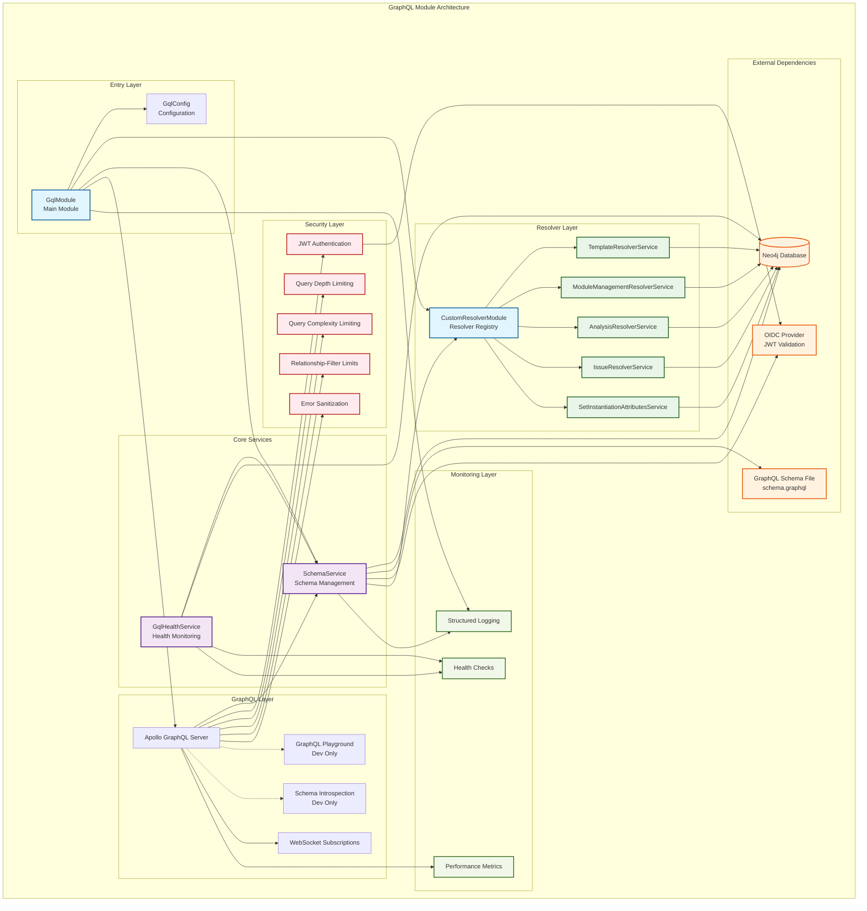

# GraphQL Module Architecture Overview

## System Architecture

The GraphQL module follows a layered architecture pattern with clear separation of concerns, providing a scalable and maintainable GraphQL API implementation.

## Architecture Diagram



## Architectural Layers

### 1. Entry Layer
The entry point and configuration layer that initializes the entire GraphQL system.

**Components:**
- **`GqlModule`**: Main NestJS module orchestrating all components
- **`GqlConfig`**: Centralized configuration with environment-based settings

**Responsibilities:**
- Module initialization and dependency injection
- Environment-specific configuration management
- Integration with NestJS application lifecycle

### 2. Core Services Layer
Business logic and schema management services.

**Components:**
- **`SchemaService`**: GraphQL schema creation and management
- **`GqlHealthService`**: System health monitoring and diagnostics

**Responsibilities:**
- Schema compilation and validation
- Custom resolver integration
- Health checks and system monitoring
- Error handling and logging

### 3. Resolver Layer
Custom business logic implementations for GraphQL field resolution.

**Components:**
- **`CustomResolverModule`**: Resolver service registry and provider
- **Resolver Services**: Individual business logic implementations
  - `TemplateResolverService`
  - `ModuleManagementResolverService`
  - `AnalysisResolverService`
  - `IssueResolverService`
  - `SetInstantiationAttributesService`

**Responsibilities:**
- Custom field resolution logic
- Database query execution
- Business rule implementation
- Data transformation and computation

### 4. GraphQL Layer
Apollo GraphQL server integration and API exposure.

**Components:**
- **Apollo GraphQL Server**: Core GraphQL execution engine
- **GraphQL Playground**: Development interface (dev only)
- **Schema Introspection**: Schema exploration (dev only)
- **WebSocket Subscriptions**: Real-time data updates

**Responsibilities:**
- GraphQL query parsing and execution
- HTTP and WebSocket protocol handling
- Development tooling integration
- Real-time subscription management

### 5. Security Layer
Security measures for deployment.

**Components:**
- **JWT Authentication**: Token-based user authentication
- **Query Depth Limiting**: Protection against deeply nested queries
- **Query Complexity Limiting**: Prevention of expensive operations
- **Relationship-Filter Limits**: Refusal of a `single` filter on an interface or union relationship, which exhausts Neo4j's heap while it is planned, a budget on a request's filters, and caps on its input objects, relationship operands and scalar size, which bound the Cypher dt-ws translates on its event loop
- **Error Sanitization**: Secure error message handling

**Responsibilities:**
- User authentication and authorization
- Query validation and limiting
- Security policy enforcement
- Sensitive information protection

### 6. Monitoring Layer
Observability and system health tracking.

**Components:**
- **Structured Logging**: Operation logging
- **Health Checks**: System component status monitoring
- **Performance Metrics**: Query performance tracking

**Responsibilities:**
- Operation logging and audit trails
- System health monitoring
- Performance metrics collection
- Error tracking and alerting

## Data Flow Architecture

### 1. Request Processing Flow

```
HTTP Request -> Apollo Server -> Authentication -> Query Validation -> Schema Resolution -> Custom Resolvers -> Database -> Response
```

**Detailed Steps:**
1. **HTTP Request**: Client sends GraphQL query/mutation
2. **Apollo Server**: Parses and validates GraphQL syntax
3. **Authentication**: JWT token validation (if required)
4. **Query Validation**: Depth limiting, relationship-filter limits and complexity limiting checks
5. **Schema Resolution**: Neo4j GraphQL auto-resolution
6. **Custom Resolvers**: Business logic execution
7. **Database**: Neo4j query execution
8. **Response**: Formatted JSON response

### 2. Schema Creation Flow

```
Schema File -> SchemaService -> Resolver Merging -> Neo4j GraphQL -> Executable Schema
```

**Detailed Steps:**
1. **Schema File**: Load GraphQL type definitions
2. **SchemaService**: Validate schema syntax and structure
3. **Resolver Merging**: Combine all custom resolvers
4. **Neo4j GraphQL**: Generate CRUD operations and integrate resolvers
5. **Executable Schema**: Final schema ready for execution

### 3. Health Check Flow

```
Health Request -> GqlHealthService -> Component Checks -> Status Aggregation -> Health Response
```

**Component Checks:**
- Neo4j database connectivity
- GraphQL schema validation
- Service availability verification

## Component Interactions

### 1. Module Dependencies

```typescript
GqlModule
├── ConfigModule (Configuration management)
├── DatabaseModule (Neo4j connection)
├── CustomResolverModule (Custom resolvers)
└── GraphQLModule (Apollo integration)
```

### 2. Service Dependencies

```typescript
SchemaService
├── ConfigService (Configuration access)
├── Neo4j Driver (Database connection)
└── ResolverServices[] (Custom business logic)

GqlHealthService
├── SchemaService (Schema validation)
└── Neo4j Driver (Connection testing)
```

### 3. Resolver Dependencies

```typescript
ResolverService
├── Neo4j Driver (Database queries)
├── ModuleRegistryService (Module management)
└── Business Services (Domain logic)
```

## Security Architecture

### 1. Authentication Flow

```
Client Request -> JWT Token -> OIDC Validation -> User Context -> Resolver Access
```

**Security Layers:**
- **Transport Security**: HTTPS/WSS encryption
- **Token Validation**: JWT signature verification
- **Context Propagation**: User information in resolvers
- **Authorization**: Role-based access control

### 2. Query Protection

```
GraphQL Query -> Depth Analysis -> Relationship-Filter Limits -> Complexity Analysis -> Execution
```

**Protection Mechanisms:**
- **Depth Limiting**: Prevents deeply nested queries
- **Complexity Scoring**: Assigns cost to each field
- **Relationship-Filter Limits** (`assertRelationshipFiltersWithinLimits`): Refuses a `single` filter, or a deprecated `*_SINGLE` field, on a relationship to an interface or union, in the query or its variables; `@neo4j/graphql` renders it as a XOR across the member types, which Neo4j's planner cannot plan on a large interface such as `Element`. Use `some`. `some`, `all` and `none` stay allowed within a budget of 300 (each quantifier costs the number of types it can match, `all` twice; an aggregate filter like a `some`; a filter on a `@cypher` field 2, or 10 when it walks a variable-length path), with at most 2,500 input objects in all of a request's arguments and 1,000 in its `where` arguments, at most 640 relationship operands in mutation inputs (each counted once per type its target can be), at most 4,000,000 characters of scalar values (a value counts once for every place it is used), input nested at most 64 levels and at most 10,000 selections after fragment expansion. On `/graphql` a refusal, like a complexity-limit refusal, is `BAD_USER_INPUT`, HTTP 400. See [Query Protection](./GRAPHQL_MODULE.md#query-protection)
- **Every Transport**: `/graphql`, `/graphql/stream` (SSE) and, with `SUBSCRIPTION_TRANSPORT=ws`, the graphql-ws WebSocket transport run the same depth, relationship-filter and complexity guards; graphql-ws runs them for queries and mutations as well as subscriptions
- **Query Timeout**: Prevents long-running operations
- **Rate Limiting**: Controls request frequency (external)

## Scalability Architecture

### 1. Horizontal Scaling

**Stateless Design:**
- No server-side session storage
- Database connection pooling
- Schema caching in memory

**Load Balancing:**
- Multiple application instances
- Shared Neo4j database cluster
- Session affinity for subscriptions

### 2. Performance Optimization

**Caching Strategy:**
- Schema compiled once at startup
- Database connection pooling
- Query result caching (external)

**Resource Management:**
- Automatic database session cleanup
- Memory-efficient resolver execution
- Lazy schema building

## Deployment Architecture

### 1. Development Environment

```
Developer -> GraphQL Playground -> GqlModule -> Local Neo4j
```

**Features Enabled:**
- GraphQL Playground interface
- Schema introspection
- Detailed error messages
- Relaxed security limits

### 2. Production Environment

```
Load Balancer -> Multiple App Instances -> GqlModule -> Neo4j Cluster
```

**Features Enabled:**
- Security hardening
- Error sanitization
- Query limiting
- Health check endpoints

### 3. Monitoring Integration

```
Application -> Structured Logs -> Log Aggregation -> Monitoring Dashboard
Application -> Health Checks -> Health Monitoring -> Alerting System
```

## Error Handling Architecture

### 1. Error Classification

**System Errors:**
- Database connection failures
- Schema compilation errors
- Service unavailability

**User Errors:**
- Invalid GraphQL syntax
- Authentication failures
- Authorization violations

**Business Errors:**
- Validation failures
- Business rule violations
- Data not found

### 2. Error Flow

```
Error Occurrence -> Error Classification -> Logging -> Sanitization -> Client Response
```

**Error Handling Strategy:**
- **Catch Early**: Validate inputs before processing
- **Log Everything**: Error logging
- **Sanitize Output**: Hide internal details in production
- **Fallback Behavior**: Continue operation when possible

## Configuration Architecture

### 1. Environment-Based Configuration

```
Environment Variables -> Configuration Validation -> Type-Safe Config -> Service Injection
```

**Configuration Layers:**
- **Environment Variables**: External configuration
- **Default Values**: Sensible fallbacks
- **Validation**: Runtime configuration checking
- **Type Safety**: TypeScript configuration classes

### 2. Configuration Categories

**Security Configuration:**
- Authentication settings
- Query limits
- Error handling modes

**Database Configuration:**
- Connection parameters
- Pool settings
- Timeout values

**Feature Configuration:**
- Playground enablement
- Subscription settings
- Logging levels

## Testing Architecture

### 1. Testing Layers

**Unit Tests:**
- Individual service testing
- Resolver function testing
- Configuration validation testing

**Integration Tests:**
- Module integration testing
- Database connectivity testing
- Schema compilation testing

**End-to-End Tests:**
- Complete GraphQL query testing
- Authentication flow testing
- Error handling testing

### 2. Test Isolation

```
Test Suite -> Mock Dependencies -> Service Under Test -> Assertions
```

**Mocking Strategy:**
- Mock Neo4j driver for unit tests
- Mock authentication for resolver tests
- Mock configuration for service tests

### 3. Running the suites on Neo4j

The dt-ws integration suites (`test/integration/*.e2e-spec.ts`, run with `pnpm --filter dt-ws test:e2e`) start a database per suite in testcontainers. `DT_TEST_ENGINE` picks the engine: `memgraph` (the default) or `neo4j`. Any other value is refused, so a typo never runs Memgraph by mistake.

```bash
DT_TEST_ENGINE=neo4j pnpm --filter dt-ws test:e2e
```

**One entry point.** Suites call `startMemgraph()` from `test/integration/memgraph-container.ts` on either engine. On `neo4j` it starts `neo4j:5.26-community` through `neo4j-container.ts` and returns the same handle. The name is historical.

**The default database is named `memgraph`.** The test Neo4j names its default database as the platform does, so a suite that opens `{ database: 'memgraph' }` runs unchanged. Heap and page cache are capped, since suites run in parallel.

**APOC Core is loaded as the deployment loads it.** The harness sets `NEO4J_server_directories_plugins=/var/lib/neo4j/labs` and `NEO4J_dbms_security_procedures_allowlist=apoc.date.convertFormat,apoc.util.validatePredicate`, as `deploy/compose/compose.neo4j.yaml` does, so Neo4j loads those two functions, and no other APOC procedure or function, from the APOC Core jar the image ships in `labs/`. The GraphQL layer reads every DateTime field through `apoc.date.convertFormat` and writes `apoc.util.validatePredicate` into the checks of some mutations; without them those GraphQL queries fail, while suites that read and write through Cypher alone still succeed. `graphql-temporal.e2e-spec.ts` reads a DateTime field through the production schema on either engine and, on Neo4j, lists both functions and calls each once.

**Memgraph-only tests are marked.** A suite or test that exercises Memgraph alone (`vector_search`, `SHOW INDEX INFO`, its own image or flags) uses `describeMemgraphOnly` or `itMemgraphOnly` from `test/integration/test-engine.ts`. These are skipped on Neo4j. Today that is `bootstrap-ddl-memgraph`, `legacy-vector-index`, `mitre-vector-index` (through `describeMemgraphContainerOnly`, see [§4](#4-running-the-suites-against-an-external-test-database)), `upsert-query-plan`, the vector-index tests in `match-mitre-techniques`, and the Memgraph case of `vector-search`.

**What `neo4j` refuses.** The harness throws before any container starts when a suite asks for its own Memgraph image or flags, or when `MEMGRAPH_TEST_IMAGE` is set. A Memgraph-only suite that lacks its marker therefore fails instead of running against the wrong engine. An external test database for the Neo4j leg is named by `NEO4J_TEST_URI` (see [§4](#4-running-the-suites-against-an-external-test-database)).

**Server failures reach the log.** On Neo4j the harness driver writes every `FAILURE` the server answers to stderr, code included, marked `[test-db server failure]`. This happens even when the code under test catches and swallows the error. `DatabaseService`'s failed-query logs also carry the error `code`.

**The Neo4j leg.** The `neo4j-leg.yml` workflow runs only by hand (`workflow_dispatch`); it is too slow for every pull request. It runs the dt-ws and threat-report end-to-end suites in a matrix of `memgraph` and `neo4j`, so the Memgraph run is the baseline. Each suite's output goes to a `<suite>.log`, and `.github/scripts/neo4j-log-gate.sh` then fails the leg when a log:

- is missing or empty (the suite did not run);
- reports no passed test (a skipped suite does not count as a run);
- holds a `Neo.ClientError.Statement.*`, `Neo.ClientError.Procedure.*` or `Neo.ClientError.Schema.*` code that no
  allowlist line matches (a Memgraph-only statement or procedure on Neo4j shows as a Statement or Procedure error; a
  writer that lost its lock and met a uniqueness constraint shows as a Schema error, which the driver does not retry).

A green test run is not enough on its own, because code under test often catches a query error and goes on. The allowlist is `.github/neo4j-log-gate-allow.txt`: one `<suite|*> <extended regex>` line per error the code under test answers on purpose. The gate's own fixture test (`neo4j-log-gate.test.sh`) runs in `ci.yml` on every pull request.

### 4. Running the suites against an external test database

On a machine where containers cannot run, the integration suites can share one external test database instead of starting a container per suite. `MEMGRAPH_TEST_URI` names a test Memgraph; `NEO4J_TEST_URI` names a test Neo4j, used by the Neo4j leg (`DT_TEST_ENGINE=neo4j`) and, on either leg, by the suites that start Neo4j directly. With neither set, each suite starts its own container. A run that names a database for one engine only refuses to start a container for the other.

```bash
pnpm --filter @dethernety/dt-module build
MEMGRAPH_TEST_URI=bolt://test-db.example:7697 \
NEO4J_TEST_URI=bolt://test-db.example:7698 \
DT_TEST_EXTERNAL_WIPE=bolt://test-db.example:7697,bolt://test-db.example:7698 \
  pnpm --filter dt-ws exec jest --config ./test/jest-e2e.json --runInBand
```

**The guard runs before anything is wiped.** The check and the reset live in `@dethernety/dt-module/test-database`, so the suites need `@dethernety/dt-module` built first (they import its `dist`). A target is refused unless:

- the URI is a plain `bolt://host:port`, and the port is not 7687 (always refused);
- the URI is listed exactly in `DT_TEST_EXTERNAL_WIPE` (comma-separated);
- the server identifies itself as a test database. This is checked before anything is listed. A test Memgraph is started with `--bolt-server-name-for-init=dt-test-memgraph` and must report that server name. The Neo4j check is the weaker of the two: a test Neo4j is started with `NEO4J_AUTH=none` and `NEO4J_initial_dbms_default__database=memgraph`, so a login with an empty user name must succeed (no auth) and `SHOW DEFAULT DATABASE` must answer `memgraph`.

Anything the guard cannot confirm is refused. A refused login (either engine), or a Neo4j without a `memgraph` database, is refused at once instead of being retried as a database still starting. Every error names the variable (`MEMGRAPH_TEST_URI` or `NEO4J_TEST_URI`), and any credentials in a refused URI are masked.

A test Neo4j is also started with `NEO4J_server_directories_plugins=/var/lib/neo4j/labs` and `NEO4J_dbms_security_procedures_allowlist=apoc.date.convertFormat,apoc.util.validatePredicate`, as the container harness starts it (see [§3](#3-running-the-suites-on-neo4j)): the GraphQL suites need those two APOC Core functions, and these settings load them, and no other APOC procedure or function, from the jar the image ships in `labs/`. The guard does not check them; on a test Neo4j without them, `graphql-temporal` fails.

**Each suite resets the database when it connects.** Every node, index and constraint goes, leaving the state of a fresh container. Every index and constraint is listed and its kind checked before the first drop, so a database holding a kind the suites never create is refused untouched:

- on Memgraph, label, label+property, edge-type, edge-type+property and vector indexes, and uniqueness and existence constraints, are dropped; a target with triggers is refused;
- on Neo4j, `UNIQUENESS` / `NODE_PROPERTY_UNIQUENESS` constraints and `RANGE` indexes are dropped. The token `LOOKUP` indexes a fresh database holds stay, and an index a constraint owns goes with its constraint;
- a name a drop would use (index, constraint, label or property) outside `[A-Za-z0-9_.:-]` is refused.

**One worker at a time.** Every suite resets the shared database, so suites must run one at a time (jest `--runInBand`, vitest `--no-file-parallelism`). A second test worker of the same run is refused. Two runs at once, such as two packages against the same database, are not detected, so run one package at a time.

**Some suites are skipped, with a printed reason.** A suite that needs container operations (its own image or flags, a restart) is declared with `describeContainerOnly` from `test/integration/test-engine.ts` and is skipped in an external run; `describeMemgraphContainerOnly` combines it with the Memgraph-only marker, and today that is `mitre-vector-index`. A suite that starts Neo4j itself is declared with `describeWithNeo4j` and is skipped in an external run that names no Neo4j (no `NEO4J_TEST_URI`); today that is `bootstrap-ddl-neo4j`, and the Neo4j case of `vector-search` is dropped the same way.

The threat-report module's end-to-end harness (`test/memgraph-container.ts`) uses the same guard: `MEMGRAPH_TEST_URI`, or `NEO4J_TEST_URI` with `DT_TEST_ENGINE=neo4j`.
