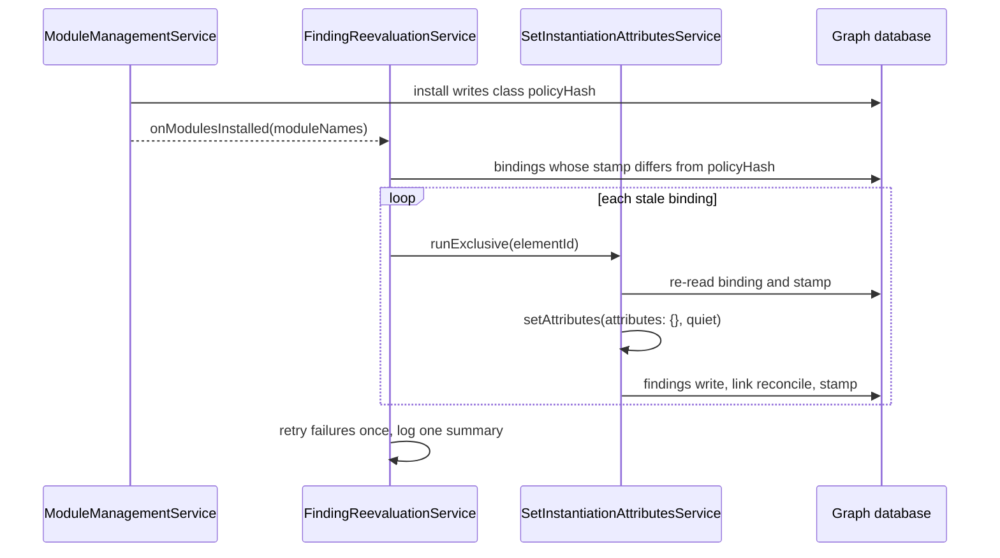

# SetInstantiationAttributesService

## Overview

The `SetInstantiationAttributesService` handles component configuration and links class-derived findings to MITRE ATT&CK, ATLAS and D3FEND nodes while supporting batch processing for frontend auto-save functionality.

## Key Features

### Neo4j v5 Transaction Management
- **Native Neo4j Implementation**: Uses `executeRead()`/`executeWrite()` methods as per [Neo4j JavaScript Driver documentation](https://neo4j.com/docs/javascript-manual/current/transactions/)
- **Proper Session Management**: Guaranteed session cleanup using try/finally patterns
- **Transaction Safety**: Complete transaction management without local rollback mechanisms
- **Connection Efficiency**: Optimized session lifecycle with proper database configuration

### Batch Processing for Auto-Save
- **Debounced Operations**: 1-second debounce for frequent frontend updates
- **Auto-Save Optimization**: Handles rapid successive updates from frontend auto-save
- **Latest Wins Strategy**: Processes the most recent attributes when batching
- **Configurable Batching**: Batch size and debounce timing can be adjusted

### Architecture
- **Structured Logging**: Complete replacement of `console.*` with NestJS Logger
- **Error Handling**: Fallback behavior and detailed error context
- **Input Validation**: Thorough parameter validation with detailed error messages
- **Type Safety**: Complete TypeScript interfaces replacing all `any` types
- **Resource Management**: Proper database session lifecycle and cleanup

## Design Decisions

### Neo4j v5 Transaction Patterns
```typescript
// Using executeWrite as per Neo4j documentation
await session.executeWrite(async (tx: DatabaseTransaction) => {
  const result = await tx.run(query, parameters);
  // Process result within transaction
});
```

### Batch Processing for Frontend Auto-Save
```typescript
// Debounced handling for frequent frontend updates
private async setAttributesWithBatching(
  request: SetAttributesRequest,
  context?: AuthorizationContext,
): Promise<SetAttributesResult> {
  // Add to batch queue with debounce timeout
  // Process latest request when debounce period expires
}

// Configuration for auto-save optimization
batchEnabled: true,
batchDebounceTime: 1000, // 1 second debounce
maxBatchSize: 10,
```

### Concurrency Control
```typescript
// Following established pattern from other resolvers
private async executeWithConcurrencyControl(
  componentId: string,
  operation: () => Promise<SetAttributesResult>,
): Promise<SetAttributesResult> {
  // Same mutex pattern as other services
  // Timeout handling and cleanup
}
```

### Authorization
```typescript
// Authorization handled by GraphQL schema directives (@authentication)
private async checkAuthorization(
  context: AuthorizationContext | undefined,
  operation: string,
  resource: Record<string, any>,
): Promise<void> {
  return; // Schema-level authorization
}
```

## Monitoring and Observability

### Metrics
- **Operation Statistics**: Success rates, response times, operation counts by type
- **Batch Processing Metrics**: Batch sizes, wait times, debouncing activity
- **Concurrency Tracking**: Active operations, mutex usage, resource contention
- **Database Performance**: Transaction times, session usage, connection efficiency

### Health Monitoring
```typescript
interface SetInstantiationStatistics {
  totalOperations: number;
  successfulOperations: number;
  failedOperations: number;
  averageResponseTime: number;
  longestOperation: number;
  shortestOperation: number;
  operationsByType: {
    setAttributes: number;
    upsertExposures: number;
    upsertCountermeasures: number;
    linkExternalObjects: number;
  };
  batchProcessing: BatchProcessingStatistics;
}
```

## Core Service Methods

### Main Operations
- `setAttributes()` - Set component instantiation attributes. A third argument, `{ quiet: true }`, moves the per-save log lines (no-op, success, failure) to debug, for a caller that saves many elements and reports them in one summary of its own (see [Re-evaluation after a class policy change](#re-evaluation-after-a-class-policy-change)). The GraphQL mutation never passes it.
- `processControlCountermeasures()` - Handle countermeasures for control components
- `processComponentExposures()` - Handle exposures for non-control components

### Database Operations (Neo4j v5)
- `upsertExposures()` - Upsert exposures using `executeWrite` pattern (owns its own session + transaction)
- `upsertCountermeasures()` - Upsert countermeasures using `executeWrite` pattern (owns its own session + transaction)
- `upsertExposuresInTx(tx, request)` - **Public tx-bound helper.** Runs the scoped Cypher upsert inside a caller-supplied `DatabaseTransaction`. Performs no session management of its own; used by `ElementBindingService` to fold the constructive-upsert step into its single `executeWrite` block. Returns `{ instantiated, unresolved, staleFlipped }` (`UpsertFindingsResult`): the finding names that landed, the distinct references it could not link, and the number of dispositioned findings it flagged stale because their links changed. See [Tx-bound helpers shared with `changeElementBinding`](#tx-bound-helpers-shared-with-changeelementbinding).
- `upsertCountermeasuresInTx(tx, request)` - **Public tx-bound helper.** Same pattern as `upsertExposuresInTx`, for Countermeasures.
- `deleteObsoleteFindingsInTx(tx, request)` - **Public tx-bound helper.** Runs `deleteObsoleteExternalObjects` for one class inside the caller's transaction and returns the number of findings deleted. Throws on failure, so the caller's transaction rolls back.
- `stampPolicyInTx(tx, elementId, classId, policyHash)` - **Public tx-bound helper.** Writes the element's [policy stamp](#the-policy-stamp) for one class inside the caller's transaction.
- `policyHashToStamp(moduleInstance, classId, storedHash)` - The hash to stamp after `moduleInstance` evaluated `classId`: `storedHash` when the module agrees, otherwise `null`. See [Which hash](#the-policy-stamp).
- `planReferences()` - Reference pre-pass: classifies and resolves every reference of a batch of findings in one statement before any edge is written. See [Reference resolution](#reference-resolution).
- `linkToExternalObject()` - Writes one edge from a finding to a reference target that the pre-pass resolved
- `deleteObsoleteExternalObjects()` - Clean up obsolete security objects

### Tx-bound helpers shared with `changeElementBinding`

`upsertExposuresInTx` and `upsertCountermeasuresInTx` are the public, transaction-bound forms of the standard upsert helpers. They take an already-open `DatabaseTransaction` as their first argument and perform no session management of their own, so a caller can fold the constructive-upsert step into its own `executeWrite` block.

For the findings it writes, each upsert helper upserts the finding nodes, writes their links, and then reconciles each SYSTEM finding's links to that finding's resolved references (see [Links follow the policy](#countermeasure-verb-edges)). It also flags a dispositioned finding whose links changed. It runs no obsolete-finding cleanup: that belongs to the caller. `setInstantiationAttributes` runs `deleteObsoleteExternalObjects` after the upsert, and `changeElementBinding` runs `deleteObsoleteFindingsInTx` per class (step 6 below).

The atomic class-change resolver in [`ElementBindingService`](../../../../apps/dt-ws/src/gql/resolver-services/element-binding.service.ts) is the second caller. Its single `executeWrite` runs in sequence:

1. In-tx authoritative read of the current binding.
2. Identity short-circuit (if target matches current, exit with zero deltas).
3. Destructive sweep of stale SYSTEM-derived findings (predicate: `createdBy = 'SYSTEM' OR createdBy IS NULL`).
4. Rewire of the `IS_INSTANCE_OF` / `REPRESENTS_MODEL` edges.
5. **`upsertExposuresInTx` / `upsertCountermeasuresInTx`** for every class the element is bound to after the rewire, one class at a time.
6. **`deleteObsoleteFindingsInTx`** for each of those classes, right after its upsert: it deletes the element's SYSTEM findings of that class whose names the module no longer emits, with the same predicate as `deleteObsoleteExternalObjects`. A Control that keeps a class while its class set changes escapes the step 3 sweep, so this step removes the countermeasures that class no longer emits. The counts go into `deletedDerivedCountermeasures` / `deletedDerivedExposures`.
7. **`stampPolicyInTx`** for each of those classes that has a `policyHash`, after its cleanup: the [policy stamp](#the-policy-stamp), with the hash the preflight read together with the class, before the module evaluated, and only when `policyHashToStamp` returned it for the module that evaluated.

The `staleFlipped` counts of step 5 are summed into `linkStaleFlipped`: the dispositioned findings of the kept classes flagged stale because their links changed. It is not a GraphQL delta; the `Element binding changed` log line carries it.

All seven steps share one Bolt transaction. On any error, Bolt rolls back the rewire and the upsert together — no partial graph state can land. A reference the upsert cannot link is not an error: the binding change commits, and the reference is logged and recorded on its finding exactly as on the `setInstantiationAttributes` path (see [Reference resolution](#reference-resolution)). `changeElementBinding` does not return the unresolved references; it reads only the instantiated names. The shared module-attribute sanitiser lives in [`src/gql/resolver-services/shared/finding-attrs.ts`](../../../../apps/dt-ws/src/gql/resolver-services/shared/finding-attrs.ts); both write paths (the `setInstantiationAttributes` mutation and `changeElementBinding`) apply the same positive allowlist (`EXPOSURE_ATTR_KEYS`, `COUNTERMEASURE_ATTR_KEYS`) to keys returned by module SDKs. This excludes server-owned fields (`id`, `createdBy`) and any module-supplied keys not in the schema.

### Batch Processing
- `setAttributesWithBatching()` - Debounced batch processing for auto-save
- `processBatch()` - Process batched operations with latest-wins strategy

### Management Operations
- `getStatistics()` - Operation statistics
- `resetStatistics()` - Reset metrics for monitoring systems
- `getHealthStatus()` - Complete health check with issue detection

## Security and Authorization

### Authorization Framework
```typescript
// Authorization handled by GraphQL schema directives (@authentication)
private async checkAuthorization(
  context: AuthorizationContext | undefined,
  operation: string,
  resource: Record<string, any>,
): Promise<void> {
  return; // Schema-level authorization
}
```

### Input Validation
- **Parameter validation**: All inputs validated before processing
- **Type Safety**: Strong typing throughout the service
- **Error Context**: Detailed validation error messages
- **Reference validation**: every finding reference is checked against the closed set of label/key pairs for its field before anything is written (see [Reference resolution](#reference-resolution))

## Database and Transaction Management

### Neo4j v5 Patterns
```typescript
// Session management with guaranteed cleanup
const session = this.neo4jDriver.session({
  database: this.configService.get('database.name') || 'neo4j',
}) as DatabaseSession;

try {
  // Use executeWrite pattern
  const result = await session.executeWrite(async (tx: DatabaseTransaction) => {
    return await tx.run(query, parameters);
  });
  // Process result
} finally {
  await session.close();
}
```

### Transaction Safety
- **Native Neo4j Transactions**: No local rollback mechanisms as per requirements
- **Proper Error Handling**: Database errors propagated correctly
- **Connection Management**: Efficient session lifecycle management
- **Query Optimization**: Optimized Cypher queries for performance

## Error Handling and Resilience

### Structured Error Types
```typescript
type SetInstantiationErrorType =
  | 'VALIDATION_ERROR'
  | 'DATABASE_ERROR'
  | 'MODULE_ERROR'
  | 'TRANSACTION_ERROR'
  | 'EXTERNAL_LINK_ERROR'
  | 'TIMEOUT_ERROR'
  | 'UNKNOWN_ERROR';
```

### Fallback Behavior
- **Structured Error Responses**: Return detailed error context instead of throwing
- **Operation Context**: Maintain operation context through error chains
- **Resource Cleanup**: Automatic cleanup of failed operations
- **Retry Logic**: Configurable retry attempts for transient failures

## Performance Optimizations

### Batch Processing
- **Reduced Database Load**: Batch multiple rapid updates into single operation
- **Frontend Optimization**: Handle auto-save scenarios efficiently
- **Latest Wins**: Process most recent attributes, avoiding stale updates
- **Configurable Debouncing**: Adjustable timing for different use cases

### Database Efficiency
- **Transaction Patterns**: Optimized Neo4j v5 transaction usage
- **Session Pooling**: Proper session lifecycle management
- **Query Optimization**: Efficient Cypher queries for exposures/countermeasures
- **Connection Management**: Minimized connection overhead

### Monitoring Integration
- **Operation Timing**: Track response times for all operations
- **Success Rate Monitoring**: Monitor failure rates and trends
- **Resource Usage Tracking**: Database sessions, concurrent operations, batch queues
- **Alert Thresholds**: Configurable thresholds for health monitoring

## Configuration

```typescript
interface SetInstantiationConfig {
  // Batch processing settings
  batchEnabled: boolean;
  batchDebounceTime: number; // milliseconds
  maxBatchSize: number;

  // Operation settings
  operationTimeout: number;
  maxConcurrentOperations: number;

  // Database settings
  transactionTimeout: number;
  retryAttempts: number;

  // Monitoring settings
  enableDetailedMetrics: boolean;
  metricsRetentionPeriod: number;
}
```

## Shared Services Integration

### Shared Service Architecture
- **AuthorizationService**: Centralized authorization context extraction
- **MonitoringService**: Unified operation metrics and health monitoring
- **Consistent Patterns**: Same concurrency control and error handling patterns

### MITRE ATT&CK Integration
- **External Object Linking**: Links exposures to ATT&CK or ATLAS techniques (`EXPLOITED_BY`)
- **Countermeasure Mapping**: Maps countermeasures to ATT&CK or ATLAS mitigations, D3FEND techniques and regulatory requirements (`RESPONDS_WITH`, the identity block)
- **Data Consistency**: Writes an edge only to a target that the reference pre-pass found in the graph; a reference that cannot be linked is recorded on its finding
- **Validation**: Each reference is mapped onto the closed set of label/key pairs for its field ([Reference resolution](#reference-resolution)); `validateExternalObjectTarget` (label/property/value presence, Cypher-identifier regex) remains as a backstop in `linkToExternalObject`

#### Reference resolution

The module's policies supply each class-derived finding's references: `exploitedBy` on an exposure, and `respondsWith` plus the eight verb fields on a countermeasure. The writer resolves all references of a save **in one statement, before any edge is written** (`planReferences`, with the table and query in [`shared/reference-resolution.ts`](../../../../apps/dt-ws/src/gql/resolver-services/shared/reference-resolution.ts)). The pre-pass runs inside `upsertExposuresInTx` / `upsertCountermeasuresInTx`, so `setInstantiationAttributes` and `changeElementBinding` behave the same.

**Allowed targets.** A reference is allowed only if it maps onto the closed set of label/key pairs for its field:

| Field | Allowed targets (`Label.key`) |
|---|---|
| `exploitedBy`, and the verb fields `mitigates`, `protectsAgainst`, `detects`, `isolates`, `deceives`, `evicts`, `restores`, `respondsTo` | `MitreAttackTechnique.attack_id`, `MitreAtlasTechnique.atlas_id` |
| `respondsWith` | `MitreAttackMitigation.attack_id`, `MitreAtlasMitigation.atlas_id`, `MitreDefendTechnique.d3fendId`, `RegulatoryRequirement.id` |

A `MitreRef` object (`{label, property, value}`) must name one of its field's pairs exactly and carry a non-empty `value`. A bare-string id dispatches by shape, and any other string is not allowed:

| Bare id shape | Field kind | Target |
|---|---|---|
| `T####`, `T####.###` | technique | `MitreAttackTechnique.attack_id` |
| `AML.T####`, `AML.T####.###` | technique | `MitreAtlasTechnique.atlas_id` |
| `M####` | `respondsWith` | `MitreAttackMitigation.attack_id` |
| `AML.M####` | `respondsWith` | `MitreAtlasMitigation.atlas_id` |
| `D3-…` (alphanumeric) | `respondsWith` | `MitreDefendTechnique.d3fendId` |

A `RegulatoryRequirement` can only be referenced in object form.

**Outcomes.** The resolve query has one `UNWIND` + `OPTIONAL MATCH` branch per pair, joined with `UNION ALL`, and takes the values as parameters. Each reference then has one of three outcomes:

| Reference | Edge | Logged | Recorded on the finding | Returned |
|---|---|---|---|---|
| Allowed and found | Written as before; the ref's `attributes` (e.g. `justification`) go onto the edge | — | — | — |
| Allowed MITRE pair, not found; or not allowed for its field | Not written | Error level, with element, class, finding and field | Yes | Yes |
| `RegulatoryRequirement`, not found | Not written | Warning only | No | No |

The unlinked `RegulatoryRequirement` case is tolerated because a compliance pack can load its requirement nodes after the classes that cite them.

**The marker.** Each upsert sets `unresolvedReferences` on the finding node to that finding's distinct unlinked references. A MITRE miss is recorded as its id (`T1562.010`), and a disallowed reference as `Label.key=value`. When every reference links, the upsert sets the property to `null`, which removes it, so a re-save after the MITRE data catches up clears the marker. `Exposure.unresolvedReferences` and `Countermeasure.unresolvedReferences` are read-only in the GraphQL API (`@settable(onCreate: false, onUpdate: false)`).

**The result.** `SetInstantiationAttributesResult.unresolvedReferences` lists the distinct unlinked references across the element's class-derived findings. It is `null` when every reference linked.

**The save does not fail on a reference.** The attributes are saved and every other link is written. `setAttributes` runs as two transactions: the attribute write and the staleness flip commit first, then the findings and their links are written in a second one. A save that changes the links of a dispositioned SYSTEM finding flags it `dispositionStale` in that second transaction, as an attribute change does, and the result's `staleFlippedCount` counts both. Failing the second over a reference would leave new attributes next to stale findings, and the user who edited the attributes cannot fix the class content anyway. The CI reference check over shipped modules keeps such defects out of a release (see the [`mitre-frameworks` README](../../../../modules/mitre-frameworks/README.md#module-reference-check)).

**Identifier safety.** The labels and keys interpolated into the resolve and link statements come only from the writer's own table (`REFERENCE_PAIRS`). An allowed target carries the table's label and key strings, never the module's, so a label or key from module data never reaches a query.

#### Countermeasure verb edges
- **Closed verb set**: beyond the identity `RESPONDS_WITH`, a countermeasure carries per-verb relations to the ATT&CK or ATLAS **Techniques** it counters — `COUNTERMEASURE_MITIGATES`, `_PROTECTS_AGAINST`, `_DETECTS`, `_ISOLATES`, `_DECEIVES`, `_EVICTS`, `_RESTORES`, `_RESPONDS_TO`. The verb→edge-type map (`COUNTERMEASURE_VERB_EDGES`) is the single source of truth **for the edge-type string**; the `satisfies Partial<Record<keyof Countermeasure, string>>` constraint ties each map key to a real dt-module interface field, so a verb rename is a compile error. The GraphQL field set is a *separate* hand-maintained layer (see write-ahead below) verified by the verb-parity e2e, not by the type system.
- **Write-ahead of schema (the write path carries all verbs; the schema surfaces the realized subset)**: the write path carries **all eight** verbs, but only verbs with realized policy data are exposed as GraphQL fields on `type Countermeasure` (today: `mitigates`, `protectsAgainst`, `detects`, `isolates`). This is deliberate — the write layer persists every verb edge at the graph level so the edges already exist when a currently-dormant verb (`deceives`/`evicts`/`restores`/`respondsTo`) later gains data and its schema field is added. Until then such an edge is *written-but-not-yet-queryable*, not a bug. Adding a verb to the GraphQL surface later is therefore a schema-only change (the interface field and map entry already exist).
- **Relationship-type safety**: an edge's `relationName` is **only ever** a compile-time constant (a map value or the `RESPONDS_WITH`/`EXPLOITED_BY` literals) — never data-derived. The target label and key are likewise constants from `REFERENCE_PAIRS` (see [Reference resolution](#reference-resolution)). The `linkToExternalObject` identifier regex is a backstop.
- **Edge provenance (`justification`)**: each ref may carry edge `attributes`. Edge attributes are **key-allowlisted** (`EDGE_ATTR_KEYS = ['justification']`) and primitive-guarded (`describeNonPrimitiveValue`), mirroring the node-property allowlist in `shared/finding-attrs.ts`. A non-allowlisted key is dropped; a non-primitive value is dropped **with a warning, never thrown** — a bad provenance string must not abort the upsert. `linkToExternalObject` sets each allowlisted key explicitly (`SET rel.justification = $edge.justification`). When the ref does not carry the key, the value is null, which removes the property, so a justification the policy no longer gives is cleared on the next save. A target named twice under one edge type is written once, and the mention that carries a justification wins, whatever the order.
- **Links follow the policy**: after the link writes, each upsert helper deletes every link of its own types that is not among the finding's resolved references in this save. The types are `EXPLOITED_BY` for exposures, and `RESPONDS_WITH` plus the eight `COUNTERMEASURE_<VERB>` types for countermeasures. Only links to a node carrying one of the reference labels (`ALL_REFERENCE_PAIRS`) are considered. The scope matches the link write: the element, the class, and findings with `createdBy = 'SYSTEM'` or a legacy null `createdBy`. USER findings, including copies made by supersede, are never touched. A link added by hand to a SYSTEM finding is removed by the next save, and so is a link whose target no longer resolves. The prune groups the links by finding and link key: a link the policy keeps stays once, and its parallel copies (the same type to the same target) are deleted. An edge to a reference-labelled target that has no key property has no link key, so the writer never links it by key and the prune leaves it alone, whatever the keep list holds. A dispositioned finding whose link set changed is flagged `dispositionStale`. A transient conflict in a reconcile statement is retried by the managed transaction; any other error fails the findings write. Readers therefore see each element's links as its class policy stood at the element's last save; after a class policy change, the [re-evaluation](#re-evaluation-after-a-class-policy-change) saves the element again. An element of a class without a `policyHash` (a remote module's classes carry none) is not re-evaluated: it keeps its links until it is saved again, and a save with no changes (`setInstantiationAttributes` with `{}`) is enough.

## Policy stamps and re-evaluation

A save derives an element's findings from its class's policy as it stands at that moment. When a module update changes the policy, the element's findings stay as the old policy derived them until it is evaluated again. The policy stamp records which policy each binding was last evaluated under, and `FindingReevaluationService` evaluates again every binding whose stamp is out of date.

### The policy stamp

Each class node carries `policyHash`, written by the module install (see [Module Management Service → Class policy hash](./MODULE_MANAGEMENT_SERVICE.md#class-policy-hash)). Each element carries `classPolicyStamps`: one `<classId><U+001F><policyHash>` string per class it is bound to, the hash of the policy its findings for that class were last evaluated under. The helpers live in [`shared/policy-stamp.ts`](../../../../apps/dt-ws/src/gql/resolver-services/shared/policy-stamp.ts).

- **Who writes it.** `setAttributes` (and so import, which saves through it) writes the stamp after the findings write, in a transaction of its own; it skips Issues, classes without a `policyHash`, and evaluations `policyHashToStamp` does not vouch for (below). A failure to write it is logged as `Could not record the policy the findings were evaluated under` and does not fail the save: the findings are right, and the binding is only re-evaluated once more. `changeElementBinding` writes it inside its own transaction (step 7 [above](#tx-bound-helpers-shared-with-changeelementbinding)).
- **Which hash.** The stamp is the class's stored `policyHash`, which both paths read before the module evaluates. It is written only when `policyHashToStamp(moduleInstance, classId, storedHash)` returns it:
  - the module's `getPolicyHash(classId)` (see [DTModule interface → getPolicyHash](../../modules/DT_MODULE_INTERFACE.md#getpolicyhashclassid)) reports the same hash: the stored hash;
  - the module has no `getPolicyHash`: the stored hash, as the module cannot say otherwise;
  - it reports another hash, none, or throws: `null`, and no stamp is written;
  - no stored hash: `null`.

  So for a module that reports its hash, a stamp is never newer than the policy evaluated, on any instance: the agreement check ties it to the policy the evaluating instance holds. An install that lands between the read and the evaluation leaves either no stamp (the module now reports the new hash) or the old hash (the module evaluated with the old policy); either way the binding is re-evaluated rather than missed. An instance still holding an older policy than the one stored, on a rolling or multi-instance deployment, reports that older hash, so it leaves the binding unstamped and a later sweep re-evaluates it. For a module without `getPolicyHash` the claim holds within one instance only.
- **The write.** `STAMP_POLICY_CYPHER` replaces the stamp for that one class, keeps the stamps of the element's other classes, and writes nothing when the element is no longer bound to the class.
- **Internal.** `classPolicyStamps` is not in the GraphQL schema, so no query, dt-core selection or export reads it.

### Re-evaluation after a class policy change

[`FindingReevaluationService`](../../../../apps/dt-ws/src/gql/resolver-services/finding-reevaluation.service.ts) runs a **sweep**:

- **When.** Once in the background at application bootstrap, after the start-up install, and after every later install that wrote at least one module (a [catch-up](./MODULE_MANAGEMENT_SERVICE.md#catch-up-when-the-embedder-becomes-ready) or a module reset), through `ModuleManagementService.onModulesInstalled`. The sweep never runs inside an install and never fails one.
- **What it finds.** Bindings (`IS_INSTANCE_OF`) to a `ComponentClass`, `DataFlowClass`, `SecurityBoundaryClass`, `ControlClass` or `DataClass` of an installed module whose stamp for that class is missing or differs from the class's `policyHash` (`STALE_BINDINGS_CYPHER`), read in pages of 200 in element-id, class-id order.
- **What it does per binding.** Under the element's lock (`runExclusive(elementId, 'setAttributes', …)`), it re-reads the binding and the stamp. A binding removed meanwhile is counted `unbound`; one saved meanwhile is `current` and left alone. Otherwise it calls `setAttributes({ componentId, classId, attributes: {} }, undefined, { quiet: true })`: the save's own path, with no attribute change. The save creates the findings the policy now emits, deletes the ones it no longer emits (with their dispositions), reconciles links, flags `dispositionStale` on a link change, and writes the stamp when [`policyHashToStamp`](#the-policy-stamp) vouches for it. Only the class's SYSTEM findings are touched; USER findings, supersede copies and findings from other sources are not. With no attribute change, the attribute-change stale flip does not fire.
- **What it skips.** Bindings of a class without a `policyHash` (`UNHASHED_BINDINGS_CYPHER`), counted as `skipped`. The classes of a remote module (`DtRemoteModule`) carry no `policyHash`, so its bindings, which evaluate only with a caller's token and a sweep has none, are skipped as such; there is no separate remote-module check.
- **Failures.** A binding whose save fails keeps its findings and its old stamp. It is retried once at the end of the sweep; if it fails again it is counted `failed`, and the next sweep tries it again. A sweep that throws is logged as `Re-evaluation sweep failed; the next install or start tries again`.
- **One at a time.** Only one sweep runs. Any number of requests during a sweep are coalesced into one more sweep after it, which picks up whatever the newer installs changed. The sweep yields to the event loop between elements, and stops between elements on shutdown; a request after shutdown starts no sweep.
- **Per instance.** The sweep and the element lock (`runExclusive`) are per platform instance: run one platform instance (the bundle does). Several instances each sweep, which is safe for the stamps (see [Which hash](#the-policy-stamp)) but repeats the work.
- **Logging.** One line per sweep: `Re-evaluated findings after a class policy change`, with `reevaluated`, `current`, `unbound`, `failed`, `skipped`, `durationMs`, and up to three element ids in `failedSample` and `skippedSample`. It is a warning when any element failed. A sweep that found nothing to do logs nothing.



**First start after the upgrade.** No element has a stamp yet, so the start's sweep re-evaluates every binding to a class with a `policyHash` once. Findings the current policies no longer emit are deleted with their dispositions. A module whose content did not change is still reinstalled once when its class nodes do not hold the hashes it reports (see [Module Management Service → Content-hash skip gate](./MODULE_MANAGEMENT_SERVICE.md#content-hash-skip-gate)), so the sweep covers its elements too.

## Business Logic

### Component Type Handling
- **Component Type Handling**: Preserves existing Issue/Control/Component logic
- **Module Integration**: Maintains existing module interface patterns
- **Exposure/Countermeasure Processing**: Same business logic with improved reliability
- **MITRE Framework Integration**: Consistent external object linking

### Frontend Auto-Save Optimization
- **Debounced Updates**: Handles rapid successive updates efficiently
- **Latest Wins Strategy**: Most recent data wins
- **Reduced Server Load**: Batches frequent updates to reduce database operations
- **User Experience**: Maintains responsive frontend while optimizing backend
