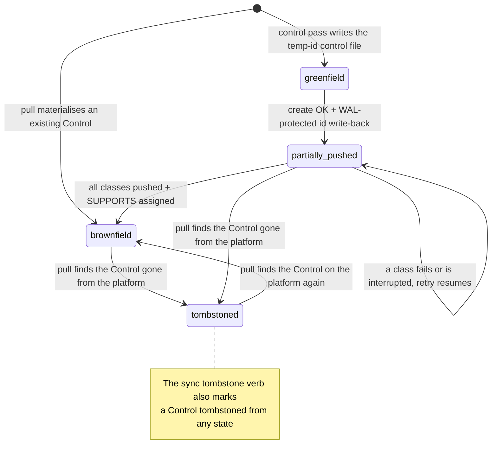

# Control Library — Local File Layout and Sync Semantics

> Design for managing per-instance Control configuration outside the model sync path.
>
> **Status: implemented.** Companion to [CONTROL_INTEGRATION.md](CONTROL_INTEGRATION.md), which covers control assignment semantics and two-tier reporting. **Supersedes** [CONTROL_INTEGRATION.md §6.1](CONTROL_INTEGRATION.md#61-two-path-control-integration) on the timing of greenfield Control creation: this doc defers the `manage_controls` create call to sync push (with a temp local id) instead of invoking it eagerly during the control pass. The reference shape in [§6.4](CONTROL_INTEGRATION.md#64-local-json-format) (`{id, name, source}`) is unchanged.

## Table of Contents

- [1. Problem Statement](#1-problem-statement)
- [2. Why Not in `structure.json`](#2-why-not-in-structurejson)
- [3. Proposed Layout — `controls/` Folder](#3-proposed-layout--controls-folder)
- [4. Per-Control File Schema](#4-per-control-file-schema)
- [5. Lifecycle: Greenfield → Brownfield](#5-lifecycle-greenfield--brownfield)
- [6. Shared-Ownership Safety](#6-shared-ownership-safety)
- [7. Sync Flows](#7-sync-flows)
- [8. Agent Workflow Changes](#8-agent-workflow-changes)
- [9. What Was Built](#9-what-was-built)
- [10. Open Questions](#10-open-questions)
- [11. Decisions](#11-decisions)
- [12. Out of Scope](#12-out-of-scope)
- [13. Known Limits and Designs Not Built](#13-known-limits-and-designs-not-built)
- [Appendix A. Implementation Notes](#appendix-a-implementation-notes) (A.1 – A.12, including hardening design-choice rationale at A.12)

---

## 1. Problem Statement

The platform's `setInstantiationAttributes(componentId, classId, attributes)` mutation writes per-instance configuration values onto the `IS_INSTANCE_OF` edge between a Control and its ControlClass. Today the threat-model sync pipeline never invokes it for Controls — it only handles attributes on Boundaries, Components, DataFlows, and DataItems.

The first attempt to close this gap added `classId` and `attributes` fields to each `controls[]` entry inside `structure.json` / `dataflows.json` and a sync helper in `DtUpdate` / `DtImport` that wrote them via `setInstantiationAttributes`. That approach was reverted (see Section 2) and this document specifies the replacement.

**Authority placement.** Per [SYNC_AND_SOURCE_OF_TRUTH.md §1](SYNC_AND_SOURCE_OF_TRUTH.md#1-source-of-truth-dual-authority-model) the dual-authority table is amended: greenfield Controls (and their per-instance attributes) are local-authoritative until first push promotes them to brownfield, after which the platform is authoritative. Push under this design is a **publish operation**, not a bidirectional sync — same semantics as the rest of `sync push`.

---

## 2. Why Not in `structure.json`

Three concrete problems with embedding control attributes inside the model's structural files:

1. **Controls are reusable, model-independent entities.** A single Control on the platform (e.g. "Azure Firewall (Hub)") is typically assigned via SUPPORTS edges to elements across multiple models. Its instantiation attributes (on the IS_INSTANCE_OF edge to its ControlClass) are global properties of that Control, not per-model. Storing them inside any one model's `structure.json` makes that model the apparent owner of state that is in fact shared.

2. **File-size explosion.** A single ControlClass template can carry 30+ attribute fields. A typical infrastructure boundary may reference 4–8 controls, each potentially bound to multiple ControlClasses. Inlining attributes across the boundary/component/dataflow tree pushes `structure.json` well past the size threshold that motivated the split-file schema in the first place ([SYNC_AND_SOURCE_OF_TRUTH.md](SYNC_AND_SOURCE_OF_TRUTH.md)).

3. **Export/import asymmetry.** [`dt-export-split.ts`](../../../packages/dt-core/src/dt-export/dt-export-split.ts) intentionally flattens each control reference to `{id, name}` only — `classId` and `attributes` are never written on export. An import path that reads them from `structure.json` therefore drifts from export, and round-trips silently lose data.

The design below moves Control configuration into a dedicated peer of `attributes/` so each Control owns its own file, sized independently of the models that reference it.

---

## 3. Proposed Layout — `controls/` Folder

```
threat-models/<model>/
├── manifest.json
├── structure.json             ← controls[] = [{ id, name, source }] only
├── dataflows.json             ← same minimal shape
├── data-items.json
├── attributes/                ← per-element attributes (existing)
│   ├── boundaries/<id>.json
│   ├── components/<id>.json
│   └── dataFlows/<id>.json
└── controls/                  ← NEW — per-control configuration
    └── <control-id>.json
```

`controls/<id>.json` is created when:
- A brownfield platform Control is **assigned** to any element in this model (file is auto-pulled from platform state), OR
- A new greenfield Control is **created** in the control pass — the `enrich-controls` skill writes the file once the operator confirms the agent's proposal (file is the source of truth until first push).

There is no `_index.json` lookup file. The folder is small enough to scan, and an index would risk drift versus the per-control files. Agents that need a name→id mapping should keep it in conversation memory or scan the folder.

`structure.json` and `dataflows.json` continue to carry only the minimal control reference shape:

```json
{ "id": "ctrl-uuid", "name": "Azure Firewall (Hub)", "source": "declared" }
```

Export writes the `{ id, name }` part of this shape. `source`, and entries without an id, are local-only: export leaves them out, so a pull does not bring them back.

---

## 4. Per-Control File Schema

```json
{
  "id": "bcdd0034-a355-4ffc-aac3-98083c5416f8",
  "name": "Azure Firewall (Hub)",
  "source": "declared",
  "lifecycle": "brownfield",
  "classes": [
    {
      "classId": "d3e851bb-caaa-4db4-a134-3afc13595c58",
      "className": "Firewall Policy",
      "moduleId": "<module-uuid>",
      "attributes": {
        "inbound_firewall_enabled": true,
        "default_inbound_policy": "log_only",
        "egress_filtering_enabled": true
      },
      "platformAttributes": {
        "inbound_firewall_enabled": true,
        "default_inbound_policy": "deny",
        "egress_filtering_enabled": true
      },
      "localEditedAt": "2026-04-17T19:05:42Z",
      "pushedAt": "2026-04-17T18:42:11Z",
      "pendingEdit": {
        "editedBy": "agent",
        "editedAt": "2026-04-17T19:05:42Z",
        "previousAttributes": {
          "default_inbound_policy": "deny"
        }
      }
    }
  ],
  "platformState": {
    "lastSyncedAt": "2026-04-17T18:42:11Z",
    "lastPushedAt": "2026-04-17T18:55:42Z",
    "assignedModelCount": 3,
    "assignedModelIds": [
      "this-model-id",
      "model-b-id",
      "model-c-id"
    ]
  }
}
```

### Field-by-field

| Field | Required | Notes |
|---|---|---|
| `id` | yes | Platform Control ID once promoted to brownfield. While `lifecycle: "greenfield"`, a temp local id (`greenfield-<short-uuid>`) — replaced via the WAL-protected id-rewrite mechanism (see [§7 ID write-back](#id-write-back-wal-protected)) immediately after the platform create succeeds, before any per-class attribute mutation runs. |
| `name` | yes | Mirrors the `name` in `controls[]` references; useful for human review of the file. |
| `source` | yes | Same `discovered` / `declared` / `both` semantics already documented in [controls-enrichment.md](../../../apps/dethereal/workflow/shared/controls-enrichment.md#source-field). Mirrors the `source` field on the corresponding `controls[]` reference in `structure.json`. |
| `lifecycle` | yes | One of `greenfield`, `partially-pushed`, `brownfield`, or `tombstoned`. Sync writes this back. See [§5](#5-lifecycle-greenfield--brownfield) for transitions. |
| `classes[]` | yes | One entry per ControlClass the Control is `IS_INSTANCE_OF`. A single Control can be an instance of multiple classes (e.g. an Azure Firewall is both "Firewall Policy" and "Network Access Control"); each class has its own template and its own attribute payload. |
| `classes[].classId` | yes | ControlClass UUID. Drives the `setInstantiationAttributes` mutation. |
| `classes[].className`, `moduleId` | no | Cached from platform for human readability and for the agent to skip a `get_classes` round-trip when populating attributes. |
| `classes[].attributes` | yes | Per-instance values whose keys must match the ControlClass template's `properties`. Empty object `{}` is valid (agent has not yet observed values). The **editable** copy. |
| `classes[].platformAttributes` | brownfield / partially-pushed only | Raw payload as returned by the platform on last successful push or pull. Diff is computed against this, not against the agent-edited `attributes` field. Insulates against false positives from server-side normalization (string trimming, default-value coercion). Re-read fresh from the platform during every brownfield push — by the push's batched fresh fetch, and again per Control in [§7 brownfield Step B](#push--brownfield-controls) — so a concurrent push from another operator doesn't make our snapshot stale. |
| `classes[].localEditedAt` | yes (when `attributes` differs from `platformAttributes`, or on greenfield) | ISO-8601 of the last agent or operator write to this `attributes` payload. Bumped explicitly by the writer — **not** filesystem mtime, which is unreliable across `git checkout`, editor rewrites, and CI clones. Drives Step B's resume-skip logic (skip class entries whose `pushedAt` is `>= localEditedAt`). |
| `classes[].pushedAt` | brownfield / partially-pushed only | ISO-8601 of the last successful `setInstantiationAttributes` for this class entry. Enables resume from `partially-pushed`. |
| `classes[].pendingEdit` | present only between an edit and the next push | Marker block written by the `manage_controls` `set-local-edited` action when a brownfield class entry's `attributes` are edited (`editedBy` `agent` or `operator`), or by `promote-external-edit` when an outside edit is promoted (`editedBy: external`); never hand-written. **Records exactly which keys were intended to change and what their pre-edit values were** (`previousAttributes` is keyed by changed-attribute name, not the full attribute payload). The push phase uses this key set to determine which keys to send to the platform — see [§7 brownfield Step D](#push--brownfield-controls) and [DEC-CL-11](#11-decisions). This narrow-payload contract is what protects against the mid-session-staleness corruption case where another operator pushed an edit to a different key in between our pull and our push.<br><br>**Two-write semantic.** When an existing `pendingEdit` block is being updated by a subsequent edit (operator/agent edits the same class entry twice in one session, or a session resumes from a partially-pushed state), the writer **does not overwrite** `previousAttributes` for keys already recorded — the original pre-edit value is what represents the operator's intent baseline. Rule: for each changed key `k` in the new edit that is in neither `previousAttributes` nor `firstWriteKeys` yet: if `k` has a value in `entry.attributes`, set `previousAttributes[k]` to it; if it has none, add `k` to `firstWriteKeys` (JSON would drop an `undefined` value). Then update `entry.attributes[k]` to the new value. Result: `previousAttributes[k]` always holds the pre-edit value as of the FIRST agent/operator write within the current pendingEdit lifecycle, never an intermediate value. The `set-local-edited` action ([§9 dt-core local file machinery](#dt-core--local-file-machinery)) enforces this rule.<br><br>Cleared when the push mutates the class entry; when the operator reverted every intended value to its pre-edit value (that path also writes a `reverted` audit-log entry — see [§6 Audit log](#audit-log)); when every intended key was resolved with `accept-theirs`; and when the platform already holds every intended value. A `cancel` leaves it in place, so the question comes back on the next push. **Lives in-file**, not in a side-file: keeps git-diff visibility on every PR review. See [DEC-CL-6](#11-decisions). |
| `classes[].pendingEdit.firstWriteKeys` | only when non-empty | The intended keys that had no prior value. Mutually exclusive with the keys of `previousAttributes`. The push sends `keys(previousAttributes) ∪ firstWriteKeys`; a first-write key has no baseline, so it is never checked for a conflict. `promote-external-edit` never writes it. |
| `platformState` | brownfield / partially-pushed only | Cached snapshot of platform-wide state at last interaction (model assignments only — attribute snapshots live per-class above). Used by `/dethereal:status` for drift display only — **not** by the shared-ownership check, which always queries fresh (see §6). Greenfield files have no `platformState` until first successful push. |
| `platformState.lastSyncedAt` | brownfield / partially-pushed only | ISO-8601 of the most recent successful **pull** — every `pull-controls` call: the control pass's pull, `/dethereal:sync pull`, and the batched fresh fetch at the start of a control-library push. Drives the "stale" line of `/dethereal:status` (last synced more than 15 minutes ago). Never bumped by the attribute mutations of a push; `setInstantiationAttributes` doesn't return enough information about other operators' pre-existing values to warrant a freshness claim. |
| `platformState.lastPushedAt` | brownfield / partially-pushed only | ISO-8601 of the most recent successful **push** (any class entry on this Control had `setInstantiationAttributes` mutated successfully). Drives the activity side of `/dethereal:status` drift display ("you pushed 2 minutes ago"). Distinct from `lastSyncedAt` because pushing bytes does not refresh the local snapshot of other operators' values. |

### Why `classes[]` is a list

A Control may be `IS_INSTANCE_OF` multiple ControlClasses. The platform mutation is per-(Control, ControlClass) pair, so the local file mirrors that shape: one entry per class, one mutation per entry on push. Existing platform behaviour ([`dt-control.ts`](../../../packages/dt-core/src/dt-control/dt-control.ts) `assignControlToElements`) confirms multi-class Controls are first-class.

### Why both `attributes` and `platformAttributes`

`attributes` is the agent-editable copy. `platformAttributes` is the immutable last-known-server payload. The brownfield push diff (§7) computes against `platformAttributes`, never against `attributes` itself; this is the only correct way to detect "user actually changed something" vs "server returned a normalised version of what we sent". A single field is ambiguous: if the platform trims `"deny "` to `"deny"` on save, a one-field design would either flag every push as a diff (false positive prompt fatigue) or silently miss real edits.

---

## 5. Lifecycle: Greenfield → Brownfield

### States

| State | Source of truth | Sync direction |
|---|---|---|
| `greenfield` | local file | local → platform (create + setInstantiationAttributes per class + assign SUPPORTS) |
| `partially-pushed` | local file (resume) | local → platform; only class entries with `pushedAt < localEditedAt` are re-attempted |
| `brownfield` | platform | platform → local (cache); local edits gated by [shared-ownership safety](#6-shared-ownership-safety) |
| `tombstoned` | local file (orphan record) | none — Control no longer exists on the platform; file kept for recovery / inspection |

### Transitions



`partially_pushed` in the diagram is the `partially-pushed` lifecycle value. Both `brownfield` and `partially-pushed` files are tombstoned when a pull no longer finds their Control on the platform.

- **greenfield → partially-pushed.** As soon as the platform create returns, write the server id back via the WAL-protected id-rewrite mechanism (see [§7 ID write-back](#id-write-back-wal-protected)) — into the per-control file and into every `controls[]` reference in `structure.json` / `dataflows.json` / `data-items.json` — before attempting any per-class attribute mutation. Flip lifecycle to `partially-pushed`. This is the idempotency anchor — a retry after this point will not duplicate the Control on the platform.
- **partially-pushed → brownfield.** When all `classes[]` entries have `pushedAt >= localEditedAt` and SUPPORTS edges are confirmed, flip to `brownfield` and populate `platformState`.
- **partially-pushed → partially-pushed (retry).** Resumable. Skip class entries whose `pushedAt >= localEditedAt` (already-pushed work is not re-applied).
- **partially-pushed, a class no longer bound.** If the resumed push finds one of the control's classes no longer bound to it on the platform (unbound after the push stopped), it pushes the other classes and stops with the file still `partially-pushed` and that class's local attributes kept. The operator either binds the class again — `manage_controls` `update` with `class_ids` naming every class the control should carry, since the list replaces the control's classes — and pushes again, or removes that class's entry from the file's `classes` by hand, leaving `lifecycle` and `platformState` as they are, and pushes again. A class deleted from the platform is refused earlier, and only removing its entry finishes the push.
- **A pull during a part-way push.** A pull keeps a `partially-pushed` file (and a `greenfield` file that already holds its server id) at its lifecycle, keeps the local attributes of classes not yet pushed, and refreshes only the platform snapshot, so pull, then resume, is safe.
- **brownfield / partially-pushed → tombstoned.** When a pull's `getControlsByIds({ ids })` returns no row for a requested id whose local file is `brownfield` or `partially-pushed`, the file flips to `tombstoned`. The `pendingEdit` block (if any) is preserved for reference; there is no automatic recovery of the edit.
- **any state → tombstoned (operator).** `/dethereal:sync tombstone <control id>` marks a local control `tombstoned` after the `tombstone-confirm` question. It is local only: the platform Control is not deleted, and the file is left out of pushes.
- **tombstoned → brownfield.** A pull rewrites every Control the platform returns as `brownfield`, so a tombstoned Control that still exists on the platform and is still referenced comes back on the next pull. To retire it for good, remove the reference.

### Drift / cleanup transitions

| Local-file reaction to platform event | Behaviour |
|---|---|
| **Control deleted on platform** (the next pull gets no row for it) | Flag the local file with `lifecycle: "tombstoned"` and warn at next `/dethereal:enrich --focus controls` or `/dethereal:status`. Do not auto-delete the local file — operator may want to recover it as a greenfield re-create. The corresponding `controls[]` references in `structure.json` are left in place; the next push refuses with `control_id_not_found` and pushes nothing until the operator answers each such entry — another Control, `create`, or `remove` (see [SYNC_AND_SOURCE_OF_TRUTH.md §12](SYNC_AND_SOURCE_OF_TRUTH.md#push-flow)). |
| **Local-side Control rename** | Not supported. The `name` field is platform-authoritative for brownfield Controls and is overwritten on every pull (we pull by id, so resolution is unaffected). To use another name in this model, create a new Control in the control pass and point the reference at it; clone-and-swap is not implemented ([A.2](#a2--clone-and-swap-not-built)). |
| **ControlClass removed from a Control on platform** | Pull rebuilds `classes[]` from the platform's classes, so an entry without a pending edit disappears. An entry with an unpushed `pendingEdit` is carried over, without `platformAttributes` or `pushedAt` (there is no live binding to compare against); no question is asked. `/dethereal:status` lists the pending edit, and the operator re-binds or discards it. |
| **Orphan local file** (`controls/<id>.json` exists with no matching `controls[]` reference in `structure.json`, `dataflows.json` or `data-items.json`) | Validator emits a warning (not error), and `/dethereal:status` lists it under "Orphan files". The operator removes or re-links it; nothing deletes it automatically — that could mask real bugs. |

### No demotion

Brownfield Controls do not become greenfield again. A tombstoned Control becomes brownfield again only through a pull that still finds it on the platform (see the transitions above). For a Control deleted on the platform there is no recovery path from the tombstoned file: the next push refuses the reference with `control_id_not_found`, and the operator links another Control, creates a new one (`create`) or removes the entry. Deleting a Control on the platform is out of scope here — it goes through `manage_controls(action: 'delete')`. The local file's reaction to that deletion is the `tombstoned` row above.

### Never hand-edit `lifecycle` or `platformState`

These fields are owned by the sync state machine, not the operator or agent. Hand-editing `lifecycle` to "fix" a control after a platform-side change does not work and only produces friction: the value enum is exactly `greenfield | partially-pushed | brownfield | tombstoned`, so a guessed value like `pushed` fails validation outright, and an out-of-band `brownfield` without a populated `platformState` block fails a second validation pass. After **any** platform-side change, run `manage_controls(action: 'pull-controls')` to regenerate canonical files — it is the only sanctioned path that reconciles `lifecycle` and `platformState` with the platform. See also [Sync-Owned Fields](../../../apps/dethereal/workflow/shared/controls-enrichment.md#sync-owned-fields-never-touch-directly) in the control-enrichment instructions.

---

## 6. Shared-Ownership Safety

> **Section boundary.** §6 specifies the **operator-facing UX** of the safety check (prompts, verbs, batched review, audit-log shape). [§7](#7-sync-flows) specifies **where in the push pipeline** the check fires (Step ordering, idempotency, WAL, partial-payload semantics). Both sections describe push-time behaviour; the cross-references resolve overlap rather than duplicate intent.

Brownfield attribute edits must be gated because Controls are shared across models. Editing one model's local Control file and pushing would silently mutate every other model that references the same Control.

### Check

Before any brownfield attribute push, sync reads the **live** set of model IDs (`liveAssignedModelIds`) that reference each touched Control. It comes from the push's batched fresh fetch — one `pull-controls` call for all touched Controls, which runs the control, instantiation-attribute and assigned-models queries in parallel and rewrites each control file — not from the `platformState.assignedModelIds` cached at an earlier pull. The skill then copies the refreshed `platformState.assignedModelIds` as it is.

The platform schema has Models reaching elements via `(:Model)-[:CONTAINS]->(:SecurityBoundary)<-[:BELONGS_TO*]-(:Component|:SecurityBoundary)` for boundary/component supports, via `(:Component)-[:FLOWS]-(:DataFlow)` for data-flow supports, and via `(:Model)-[:CONTAINS]->(:Data)` for data supports; a Control can also `SUPPORTS` a Model directly. A naive single-pattern query that uses `HAS_CHILD*` (which doesn't exist as an edge label) would always return zero models for DataFlow-attached Controls, silently passing the safety check — verified against the live Memgraph schema. The shipped batched query (`getControlsAssignedModels` in `schema.graphql`, comments abridged):

```cypher
UNWIND $controlIds AS cid
MATCH (c:Control {id: cid})
// Branch 1: Component / SecurityBoundary supports
OPTIONAL MATCH (c)-[:SUPPORTS]->(e) WHERE e:Component OR e:SecurityBoundary
OPTIONAL MATCH (m1:Model)-[:CONTAINS]->(:SecurityBoundary)<-[:BELONGS_TO*0..50]-(e)
WITH cid, c, collect(DISTINCT m1.id) AS ids1
// Branch 2: DataFlow supports, via FLOWS-attached Components
OPTIONAL MATCH (c)-[:SUPPORTS]->(df:DataFlow)
OPTIONAL MATCH (df)-[:FLOWS]-(:Component)-[:BELONGS_TO*0..50]->(:SecurityBoundary)<-[:CONTAINS]-(m2:Model)
WITH cid, c, ids1, collect(DISTINCT m2.id) AS ids2
// Branch 3: Data supports, via the Model that CONTAINS the Data element
OPTIONAL MATCH (c)-[:SUPPORTS]->(:Data)<-[:CONTAINS]-(m3:Model)
WITH cid, c, ids1, ids2, collect(DISTINCT m3.id) AS ids3
// Branch 4: a Control that SUPPORTS the Model itself
OPTIONAL MATCH (c)-[:SUPPORTS]->(m4:Model)
WITH cid, ids1, ids2, ids3, collect(DISTINCT m4.id) AS ids4
WITH cid, ids1 + ids2 + ids3 + ids4 AS combined
WITH cid, [m IN combined WHERE m IS NOT NULL] AS filtered
WITH cid, [i IN range(0, size(filtered)-1) WHERE NOT filtered[i] IN filtered[0..i] | filtered[i]] AS modelIds
RETURN { controlId: cid, modelIds: modelIds } AS result
```

Notes:
- Variable-length paths are capped at `*0..50`. An earlier `*0..10` cap silently failed open on deeply nested boundary trees (12+ levels): it under-counted assigned models and biased the check toward "alone".
- Separate `OPTIONAL MATCH` clauses, not comma-joined multi-patterns — known Memgraph planner weakness.
- Components and DataFlows are handled in separate branches because DataFlow reaches a Model only via its `FLOWS`-attached Components. Each branch is aggregated before the next runs, which avoids a Cartesian product when a Control supports elements of more than one kind.
- A Data element counts for the Model that `CONTAINS` it. The elements that `HANDLE` it are not followed.
- The final list comprehension deduplicates **across branches**: a Control supporting both a Component and a DataFlow that route to the same Model returns one model id, not two. Unlike an `UNWIND` over the combined list, it keeps the row of a Control with no models.
- Empty result for a Control with no SUPPORTS edges = `modelIds == []`, treated as safe to edit (Control was just created and not yet referenced).
- **The DataFlow branch needs its own check.** A model with no Control on a DataFlow never exercises it; verifying this query needs a Control that supports a DataFlow.
- **Required indexes.** Memgraph has no auto-index on `id` properties. Without per-label indexes on `id` the query does a full label scan per `UNWIND` row — at production scale (~10k controls × 50 in batch) that's ~500k row touches per push. dt-ws ensures the required indexes at startup ([§9 Platform / database](#platform--database)) — confirmed via live `EXPLAIN`: `Filter (c :Control), {c.id} / ScanAll (c)` becomes `ScanAllByLabelProperties (c :Control {id})` after the index lands.
- **Caller contract for missing IDs.** If `$controlIds` contains an id with no matching `:Control` node, the row is silently dropped (the leading `MATCH` fails). `pullControls` reconciles `requested vs returned` (by the control-metadata query), **filtered by local lifecycle**:
  - For ids whose local lifecycle is `brownfield` or `partially-pushed` → "Control deleted upstream". The local file flips to `tombstoned` per [§5 drift transitions](#drift--cleanup-transitions); the push surfaces it and skips that Control.
  - For ids whose local lifecycle is `greenfield` → expected absence (the Control hasn't been pushed yet). Callers should not send them; when one does, `pullControls` leaves the file as it is and logs a warning.
  - **Never tombstone based on a single missing-id observation alone** without checking lifecycle — a brand-new Control pushed by another operator on a separate branch may not yet be visible from this branch's perspective.
- **Bolt partial-result handling.** Treat any non-`SUCCESS` Bolt terminal (timeout, mid-stream `FAILURE`) as **refuse-all** rather than reconciling against the partial set of rows already streamed. Partial results from an aborted transaction are not safe to interpret as "definitive list of controls present on platform".
- **Result ordering.** Memgraph returns rows in index-scan order, not `$controlIds` order. The wrapper must build `Map<controlId, modelIds[]>` keyed by the returned `controlId` field — never positional alignment with the input array.
- **Client-side dedupe.** `Array.from(new Set(controlIds))` before the call. Duplicate ids in `$controlIds` would produce redundant UNWIND rows; the result Map handles this gracefully but the redundant work is avoidable.
- **Do not `PROFILE` this query on Memgraph 3.x.** Confirmed crash-on-PROFILE (segfault, full server restart) on a live `bolt://localhost:7687` instance. Use `EXPLAIN` for plan inspection; rely on application-level timing for cardinality/perf measurement until upstream Memgraph fixes the planner crash.
- **TypeScript parameter typing.** `controlIds` must be a JS `string[]`, never `null` or `Set`. A `null` UNWIND silently produces zero rows. Wrap with `if (!controlIds?.length) return new Map()` before the Bolt call.

This query lives behind a new `dtControl.getControlsAssignedModels(controlIds: string[])` method as the cleanest seam.

### Behaviour

| `liveAssignedModelIds` for this Control | Sync behaviour |
|---|---|
| `[thisModel]` (alone) | Push attributes — safe. |
| `[thisModel, ...others]` (shared) | **Refuse by default.** Defer to operator-decision queue (see "Handoff" below). On operator confirmation: see the two options below. |
| `[]` (no SUPPORTS edges yet — race against assignment) | Treated as safe; push attributes. The SUPPORTS edges this push is about to create are this model's. If a concurrent push from another model added a SUPPORTS edge in the same window, that's a TOCTOU acknowledged in [§10 Q3](#10-open-questions) — a known limit. |
| **Ownership unknown** (the refreshed file has no ownership data) | **Refuse by default.** Do NOT fall back to an older cached value, do NOT silently skip, do NOT assume "alone": only `push-unverified` or `cancel` can proceed. If the batched fresh fetch fails as a whole, the whole control-library push stops instead; see "Error-path UX" below. |

Two options when shared (operator picks at the prompt):

1. **Cancel** — make no change to the Control on the platform; leave existing platform attributes intact. The local edits remain in `classes[].attributes` (and the `pendingEdit` block stays populated) and the prompt fires again on the next push attempt.
2. **Push anyway** — explicit approval; the sync proceeds and writes a `force-shared` audit-log entry recording: timestamp, operator, control id, the live `liveAssignedModelIds` at decision time, the attribute diff (as per-machine value tags, never the values — see [Audit log](#audit-log)), and the resulting `setInstantiationAttributes` mutation timestamps. The audit entry enables post-hoc reconstruction of who-changed-what when two operators legitimately race (a known limit; see [§10 Q3](#10-open-questions)).

**Clone-and-swap is not offered.** The design had a third option — fork the Control into a new one and repoint only this model — but it is not implemented ([A.2](#a2--clone-and-swap-not-built), which keeps the design). To fork a shared Control today, cancel the row and create a separate Control with `/dethereal:enrich --focus controls`.

The default (option 1) is non-destructive. There is no automatic "push without asking" path — explicit approval is required every time the safety check fires.

### Prompt content (single-control)

The prompt must give the operator enough to make an informed choice. "N other models" alone hides blast radius. It is used when exactly one Control needs a decision, it is shared, it has no conflicting key, and its ownership is known; anything else goes to the [batched review screen](#batched-review-screen-multiple-controls). Required content:

```
Shared Control: Azure Firewall (Hub) (Production Stack)
This Control is also assigned to 2 other models (3 total):
  - Staging Environment
  - Disaster Recovery

You are about to change these attributes on the IS_INSTANCE_OF edge to ControlClass "Firewall Policy":

  default_inbound_policy:    "deny"     →  "log_only"   (you proposed)
  egress_filtering_enabled:  true       →  false        (you proposed)

  No other attributes will be touched (push uses partial payload).

Affected ControlClass: Firewall Policy (1 of 1 classes on this Control)
```

The skill then asks `This control is used by other models too: your change applies to all of them. (cancel / push-anyway)`:

- `cancel` leaves platform attributes unchanged — local edits stay and the question comes back next push.
- `push-anyway` applies YOUR changes to all 3 models, writes an audit-log entry, and leaves the server keys you did not propose to change untouched.

In the review screen, the per-key view of a row with a **conflict** (server value changed since our snapshot — see [§7 brownfield Step D](#push--brownfield-controls)) replaces the relevant key rows with a typed 3-way display and per-key choices:

```
  default_inbound_policy (string):
    "deny"           →  "log_only"      (you proposed)
    "alert_only"                        (server changed since your pull)
    Per-key choice:  keep 1.default_inbound_policy
                   | accept-theirs 1.default_inbound_policy
                   | merge 1.default_inbound_policy = <value>

  egress_filtering_enabled (boolean):  true → false   (you proposed; no conflict)
```

- The display includes the attribute's JSON Schema type (`string`, `boolean`, `integer`, `number`, `array`, `object`) drawn from the ControlClass template. Operators need this to type the `merge` value correctly — `merge ... = true` is a boolean, `merge ... = "true"` is a string.
- **Per-key choice syntax** (used in the verb interface — see [Batched review screen](#batched-review-screen-multiple-controls)):
  - `keep <row>.<key>` — push your intended new value (overwrites the server)
  - `accept-theirs <row>.<key>` — drop the key from the outbound payload; copy the server value into local `attributes`
  - `merge <row>.<key> = <json-literal>` — push the typed value. The right-hand side **must** be a JSON literal: `true`, `42`, `"text"`, `["a","b"]`, `{"k":1}`. Input that does not parse as JSON is rejected with the parse error and example forms, and the question is asked again. The literal is not checked against the attribute's declared type: the displayed type is what tells the operator that `merge 1.egress_filtering_enabled = "false"` would write a string to a boolean attribute.
  - `drop <row>.<key>` — remove the key from the outbound payload and from `pendingEdit.previousAttributes`.
- The other models are listed in full — a consent names every model it reaches, never cut short. They come from the Control's refreshed `platformState.assignedModelIds`, each by name where it is known, otherwise by id.
- The diff shows only the intended keys — those in `pendingEdit.previousAttributes` and `pendingEdit.firstWriteKeys`. The push will send only those keys (partial payload; the platform's `r += $attributes` merge leaves untouched keys on the edge alone).
- Affected class made explicit because only changed `classes[]` entries trigger writes.
- Total count includes `thisModel` for clarity ("2 other / 3 total"), removing the "does N include us" ambiguity.

### Batched review screen (multiple controls)

When more than one Control needs a decision at push time (typical for a re-enrichment pass touching 5–10 controls), or any row has a conflicting key, or a row's ownership is unknown, enumerating each full prompt produces a wall of scroll that operators page through and rubber-stamp. The push surface is a **collapsed master list** that the operator drives with explicit verbs (a chat surface has no interactive collapse widgets, so the spec uses a typed verb interface). The verbs are those of the control-library push reference ([`control-library-push.md`](../../../apps/dethereal/workflow/shared/control-library-push.md)):

```
Shared-Control review (3 of 5 controls require approval):

  Prompted (require your decision):
    #1  Azure Firewall (Hub)               [shared: 3 models]   [conflict: default_inbound_policy]
                                                                [intent:   egress_filtering_enabled]
    #2  NSG Least-Privilege Ingress        [shared: 2 models]   [intent:   4+ keys — show 2 to expand]
    #3  Entra ID RBAC (Nexus Groups)       [ownership unknown]

  Safe-to-push (alone on platform OR only assigned to this model — no other models affected):
    #4  TLS 1.3 (API Gateway)
    #5  CloudWatch Alarms (Production)

Verbs (grouped by scope):

  Per-row decisions:
    cancel <n>           leave Control #n unchanged on the platform
    push-anyway <n>      apply YOUR intended changes to Control #n (writes force-shared)
    push-unverified <n>  apply YOUR intended changes although ownership is unknown (force-unverified)

  Per-key decisions (use when row has [conflict: ...]):
    keep <n>.<key>             push your intended new value (overwrites server)
    accept-theirs <n>.<key>    drop the key from outbound payload; copy server value local
    merge <n>.<key> = <json>   push the typed value (JSON literal; "string"|true|42|{"k":"v"})
    drop <n>.<key>             remove the key from outbound payload AND from pendingEdit.previousAttributes

  Bulk shortcuts:
    keep-all <n>          apply 'keep' to every conflicting key on Control #n
    accept-theirs-all <n> apply 'accept-theirs' to every conflicting key on Control #n
    cancel-all            cancel ALL prompted rows (safe-to-push group will still push)
    cancel-everything     cancel ALL rows including safe-to-push (full abort — nothing pushes)

  Inspection (read-only — does not commit anything):
    show <n>              expand row <n> to the full single-control prompt
    show all              expand every prompted row (warns if >4 prompted)
    show models <n>       list every model that references Control #n

  When ready:
    done                  proceed to push with the decisions made so far
```

- `push-unverified` is accepted only for a row whose ownership is unknown; for a shared row it is refused and the row is asked again.
- A key whose name contains a dot is quoted: `keep 3."tls.min_version"`.
- `show models <n>` lists the model ids cached at the Control's last pull, with the note `(model freshness/ownership not shown)` and a `git log --follow controls/<id>.json` hint for the history of local edits.
- The operator gives decisions until `done`. Before any push the skill shows the decision table — row, control, decision, per-key choices, and every model a `push-anyway` row reaches — with the `done`, and shows it again after a context compaction. A conflicting key left without a per-key decision makes the engine cancel that whole row, so every conflict is resolved in the review loop rather than left to that default.

**`cancel-all` vs `cancel-everything`** — the asymmetric default exists so an operator can deal with the prompts without inadvertently blocking the safe-to-push group; the explicit `cancel-everything` is the kill switch.

- `cancel-all` cancels only the *prompted* rows. The safe-to-push group still pushes when the operator types `done`.
- `cancel-everything` aborts the whole control-library push — no pushes at all, including safe-to-push.

`safe-to-push` rows are the `alone` ones: the refreshed `assignedModelIds` is empty or holds only this model, and no key conflicts. The skill renders these as a separate group so the operator can scan them once and let `done` apply them en bloc.

**Compact mode.** With 5 or more prompted Controls, or 10 or more conflicting keys across them, the screen switches to compact rendering: rows keep only a `[!<N> conflicts]` badge (and `[ownership unknown]`), and the verb block becomes a one-line hint. `show <n>` and `show all` still render in full. The operator switches with `verbose` and `compact`.

There is no bulk `push-anyway` or `push-unverified`: each such row is approved on its own ([DEC-CL-6](#11-decisions)), because a single command could write to dozens of foreign models.

`push-anyway` and `push-unverified` are **distinct verbs** because they produce different audit-log entries (`force-shared` vs `force-unverified`) and represent different operator intents (overriding ownership consensus vs proceeding without an ownership check). The verb names match the audit type names so an auditor reading the log can trace each entry back to the operator's exact action. See [DEC-CL-7](#11-decisions).

### Error-path UX

Ownership data comes from the push's batched fresh fetch (`pull-controls`). If that fetch fails as a whole, the control-library push stops: nothing is pushed on stale ownership data, and the operator is offered to run it again later. There is no per-row retry.

A row whose refreshed control file has no ownership data is shown as `[ownership unknown]`; its only choices are `push-unverified` and `cancel`. The skill passes `null` as the live assigned model ids for it, and the engine refuses anything else for that Control.

`push-unverified` writes a `force-unverified` audit-log entry — same fields as `force-shared`, plus `queryFailureReason` and `queryAttempts`, with `liveAssignedModelIds: null` to make the unknown-blast-radius explicit in the audit record. **Never** falls back to an older cached `platformState.assignedModelIds` — silently using stale data would defeat the entire purpose of the live check.

There is no non-interactive form: `/dethereal:sync push` takes no flag that approves unverified rows. The design's `--force-unverified` CLI flag was not built.

### Handoff: agent → operator

Inside `/dethereal:enrich --focus controls`, the security-enricher agent runs as a specialist with its own turn limit — 40 turns on Claude Code (`maxTurns: 40`) and 40 steps on OpenCode (`steps: 40`); the plugin sets none on Codex — and on every harness it can't pause mid-turn for a synchronous human decision. So in the control pass the agent writes nothing: it returns its proposal tables, and the `enrich-controls` skill, running in the main conversation, asks the operator and writes what they confirm. The decision about a shared Control's edit is not taken there either; the handoff mechanism is **deferred-queue**:

- After the three-step control pass, the skill runs the control library step: it pulls the referenced Controls, shows each Control's proposed values for its sparse classes, and applies every change the operator confirms with `manage_controls` `set-local-edited` (`edited_by: 'agent'`) — never by editing the file. That action updates the class entry's `attributes`, bumps `localEditedAt` and writes a `pendingEdit` block in the same `controls/<id>.json` file (see [§4 schema](#4-per-control-file-schema)). The block records who edited (`agent` or `operator`; `external` when `/dethereal:sync promote-external-edit` promotes an outside edit), when, and **the pre-edit values for exactly the keys the operator/agent intended to change** (a key with no prior value goes in `firstWriteKeys`) — this key set is what the push later sends as a partial payload (see [§7 brownfield Step C](#push--brownfield-controls) and [DEC-CL-11](#11-decisions)). In-file placement is deliberate: it makes pending state visible in `git diff` and in PR review, which is the governance story.
- After those edits, the skill emits a passive annotation for the edited Controls that other models share (`platformState.assignedModelCount > 1`), e.g.: `[!] Pending shared-edits: 2 controls will trigger a shared-ownership prompt at /dethereal:sync push: Azure Firewall (Hub) [Firewall Policy], NSG Least-Privilege Ingress [Network Access Control].` — not a blocking question. `/dethereal:status` lists every pending edit too (`Pending edits: N controls with edits to push`), so a future session that picks up after a branch switch sees the queue.
- When the operator runs `/dethereal:sync push`, the push phase refreshes ownership for every Control with a `pendingEdit` block (the batched fresh fetch), asks the single-control prompt or shows the batched review screen above, and acts on each decision: `cancel` leaves `attributes` and `pendingEdit` as they are, so the queue stays visible; `push-anyway` / `push-unverified` clear the block after a successful mutation.

#### Commit hygiene for `pendingEdit`

`pendingEdit` blocks **should be committed** alongside the model edit they document. They are the PR-review artefact for shared-edit intent — without them, a reviewer sees `attributes` change with no context. The push phase clears the block on successful mutation; the next commit naturally removes it.

To keep un-pushed `pendingEdit` blocks from landing on `main` (which would make the queue a permanent part of the trunk), we recommend a **base-vs-head diff** check in the repository's own CI, on PRs targeting `main` only — feature branches are exempt so operators can commit in-flight `pendingEdit` blocks during PR review without the check failing on every push. **No such check ships with Dethereal**; what follows is a recommended design.

The check passes if any of the following holds for each `controls/*.json` modified by the PR:
- The file has no `pendingEdit` blocks on the head SHA (clean), OR
- The file has the same `pendingEdit` blocks on the base SHA (operator inherited them), OR
- The merge commit clears all blocks the PR introduced.

On failure, the check would emit a structured message such as:

```
Un-pushed pendingEdit blocks detected on this PR (base→head):

  threat-models/payment-api/controls/azure-firewall-...json
    classes[0] (Firewall Policy)
      pending keys: default_inbound_policy, egress_filtering_enabled

  threat-models/payment-api/controls/nsg-...json
    classes[0] (Network Access Control)
      pending keys: default_deny_posture

These blocks must be cleared before merge. Two options:

  1. Push the pending edits to the platform:
       /dethereal:sync push
     This clears each block on successful platform mutation.

  2. Discard the pending edits and revert to the base values:
       git checkout origin/main -- threat-models/payment-api/controls/azure-firewall-*.json
       git checkout origin/main -- threat-models/payment-api/controls/nsg-*.json
     Then commit and push the revert.

Reference: CONTROL_LIBRARY.md §6 "Commit hygiene for pendingEdit"
```

A first-pass sketch is in the [§9 CI check row](#dethereal-skills); the workflow file itself is host-CI-specific (GitHub Actions, GitLab CI, etc.) and is the repository owner's to write.

#### Audit log

The `force-shared`, `force-unverified`, `reverted`, and `first-write` audit-log entries record cross-model writes, considered-but-discarded edits, and newly populated class bindings as seen from the operator's machine. They are written to `.dethereal/control-audit.log` (append-only, line-oriented JSON-per-line). The log **stays on the machine that wrote it** and is not meant to be committed. The server lists it in the model's own `.dethereal/.gitignore`, with `sync.json`, the enrichment relay folder `relay/` and the settlement's two files, and discovery also recommends a `.gitignore` entry for `.dethereal/control-audit.log` (and for the recovery journal), so the log is not committed. The authoritative record of a cross-model write is the platform's; this log is a local record of what this machine pushed and decided. See [DEC-CL-13](#11-decisions). Attribution comes from the `authnOperator` field on each entry: the platform login that authorised the push (see [§13.1](#131--authnoperator-jwt-anchor-on-auditlogentry)).

**Entries hold no attribute values.** Every value field — `attributesPushed`, `previousAttributes`, and a conflict resolution's `ours` / `theirs` / `merged` — holds the value's **tag** instead:

- **Construction.** HMAC-SHA256 under a subkey derived from this machine's own key (the key is kept outside every repository; the subkey's purpose label is `dethereal/audit-value/v1`), over the attribute key and the canonical JSON of the value, truncated to 32 hex characters. An absent value has a tag of its own, distinct from every present value.
- **What a tag tells.** On this machine, two tags for the same attribute key are equal when the values are equal, so a tag answers "did this key change?" and "is this the same value as in that entry?". Anywhere else a tag tells nothing.
- **Why not a plain hash.** A short secret's plain hash can be guessed offline by hashing candidates; a keyed tag cannot be checked without this machine's key.
- **No usable key.** When the machine key cannot be used, the values are left out: `values: "omitted"`, every value field is `null`, conflict resolutions keep only `key` and `chosen`, and `valuesOmittedCode` says why. The push is not blocked.

The same tagged entries are what a push returns as `auditEntries`. The scope is the audit log and the returned entries: the control file itself (`controls/<id>.json`) still holds the attribute values, because they are the model's own data.

**Older entries.** Entries without `schemaVersion` were written by earlier versions and may hold values verbatim. They are never rewritten; see [Appendix A.7](#a7--audit-log-no-longer-records-attribute-values-secret-handling-resolved) for what to do with an older log.

Schema (one JSON object per line):

```json
{
  "schemaVersion": 2,
  "values": "hmac" | "omitted",
  "valuesOmittedCode": "<code>",
  "timestamp": "<iso>",
  "authnOperator": "<email-or-sub>" | "unauthenticated",
  "kind": "force-shared" | "force-unverified" | "reverted" | "first-write",
  "editedBy": "agent" | "operator" | "external",
  "controlId": "<uuid>",
  "controlName": "<string>",
  "classId": "<uuid>",
  "className": "<string>",
  "modelId": "<this-model-id>",
  "liveAssignedModelIds": ["<id>", ...] | null,
  "intendedKeys": ["<key>", ...],
  "attributesPushed": { "<key>": "<tag>" | null, ... },
  "previousAttributes": { "<key>": "<tag>" | null, ... },
  "firstWriteKeys": ["<key>", ...],
  "effective": "ours" | "theirs" | "novel" | null,
  "conflictResolutions": [
    { "key": "<string>", "chosen": "ours" | "theirs" | "merge", "ours": "<tag>", "theirs": "<tag>", "merged": "<tag>" }
  ],
  "blockedKeys": ["<key>", ...],
  "readdedKeys": ["<key>", ...],
  "droppedKeys": ["<key>", ...],
  "queryFailureReason": "<string>",
  "queryAttempts": 1
}
```

Field semantics:

- **`schemaVersion`** is `2` on every entry this version writes: values are tags or omitted, never verbatim. An entry without it is older and may hold values.
- **`values`** says how the entry records values: `"hmac"` (tags under this machine's key) or `"omitted"` (no usable key; every value field is `null`).
- **`valuesOmittedCode`** is present only with `values: "omitted"`: the reason the machine key could not be used, or `no_tagger` when the writer was given no tagger at all.
- **`authnOperator`** is the entry's only attribution: the `email` (else `sub`) claim of the platform login's identity token, or `"unauthenticated"` when the session had no usable token. It is absent from entries older than the field. Older entries may also carry `operator`, a self-asserted identity (a git `user.email`, or `<user>@unknown`); it is no longer written, and older entries are never rewritten.
- **`editedBy`** is the author of the originating `pendingEdit`: `agent`, `operator`, or `external` when the edit came through `promote-external-edit`. A hand-edited file that claims `external` without that action's shape (its `previousAttributes` must equal the platform values, and it never has `firstWriteKeys`) is recorded as `operator`. Absent from entries older than the field.
- **`intendedKeys`** is the canonical "what did the operator try to do" — equal to `keys(pendingEdit.previousAttributes) ∪ pendingEdit.firstWriteKeys` at push time. This is the single authoritative intent record; `attributesPushed` and `previousAttributes` are derived from it.
- **`previousAttributes`** is the pre-edit snapshot (`pendingEdit.previousAttributes`) — the tags of the values the operator started from.
- **`attributesPushed`** is `intendedKeys` projected through `attributes` AFTER [§7 Step D](#push--brownfield-controls) conflict resolution. A key may be absent from `attributesPushed` (despite being in `intendedKeys`) if the operator chose `accept theirs` on conflict, or the platform already held its value.
- **`effective`** is a derived field for cheap auditor readability. `"theirs"` if every conflicting key resolved to `accept theirs`; `"ours"` if every conflicting key resolved to `keep ours` AND no merge produced a value matching `theirs`; `"novel"` if any merge produced a value not equal to either `ours` or `theirs`, and always for `first-write`. `null` for `force-unverified` (no conflict detection ran) and for `reverted`.
- **`firstWriteKeys`** lists the pushed keys that had no prior value (`pendingEdit.firstWriteKeys`). Present on every `first-write` entry, and on a `force-shared` / `force-unverified` entry whose push included such keys; absent otherwise.
- **`blockedKeys`**, **`readdedKeys`**, **`droppedKeys`** are defined in the schema but not written today. `blockedKeys` was meant for the `absent-and-unknown` keys that abort a push (Step D Case 1), but an aborted push writes no audit entry; `readdedKeys` and `droppedKeys` belong to Step D Case 2, which is not implemented ([A.3](#a3--step-c-absent-but-known-collapsed-to-absent-and-unknown)).
- **`queryFailureReason`** is one short line: printable ASCII only (other characters become spaces), trimmed, at most 120 characters (ending in `...` when cut).
- Fields `queryFailureReason` and `queryAttempts` populated only on `force-unverified`; `liveAssignedModelIds` is `null` only on `force-unverified`. `conflictResolutions` populated only when [§7 Step D](#push--brownfield-controls) Case 3 detected per-key conflicts.

**`force-unverified` partial-payload note.** When the ownership query failed, the pre-existing server values for keys not present in `attributesPushed` are unknowable from this entry alone — that's the inherent meaning of "unverified". Auditors reconstructing post-hoc state should treat absent keys in `attributesPushed` as "untouched on the platform during this push; pre-existing server value unrecoverable from this entry".

**`reverted` semantics.** Written when [§7 Step C](#push--brownfield-controls) clears a `pendingEdit` because the operator reverted all proposed values back to their pre-edit values before push. `intendedKeys` records what the agent or operator originally proposed; `attributesPushed` is empty `{}`; `effective: null`. Captures the "we considered this and decided not to" governance signal that would otherwise vanish silently when `pendingEdit` is cleared.

**`first-write` semantics.** Written when a class push includes at least one key that had no prior value on either the local file or the platform's `IS_INSTANCE_OF` edge: the Control–ControlClass binding was newly populated. `previousAttributes` is `{}` when every pushed key is new. A shared-ownership push takes `force-shared` or `force-unverified` instead, keeping the first-write keys in `firstWriteKeys`.

#### Reading the audit log

The log is line-oriented JSON (one entry per line), so it grep/jq cleanly without a dedicated tool. Common operator queries:

```bash
# What did I (force-)push this week? (the email of your platform login)
jq -c --arg me "<your-login-email>" 'select(.authnOperator == $me and .timestamp > "2026-04-10")' \
  .dethereal/control-audit.log

# Every cross-model write to "Azure Firewall" in the last quarter:
jq -c 'select(.controlName == "Azure Firewall (Hub)" and .kind == "force-shared")' \
  .dethereal/control-audit.log

# All considered-but-discarded edits (governance signal of "we thought about this"):
jq -c 'select(.kind == "reverted")' .dethereal/control-audit.log

# Controls that needed force-unverified (ownership query failures):
jq -c 'select(.kind == "force-unverified") | {timestamp, controlName, queryFailureReason}' \
  .dethereal/control-audit.log
```

There is **no `/dethereal:audit` skill**: the jq recipes above are the way to read the log. A wrapping skill would need its own design (filter UX, time-range semantics, multi-model aggregation); see [§10 Q7](#10-open-questions). The log is not committed, so it is read on the machine that wrote it; being JSON lines, it can be fed from there to any tooling that reads JSON lines. For an audit response, the platform's record of the write is the authoritative one.

The log is append-only — never rewritten or compacted. Append happens after the platform mutation has acknowledged success; a crash mid-append leaves the log without the entry but the platform state still reflects the change (acceptable: re-running `/dethereal:sync` after a crash will re-detect the now-applied edit as already-pushed and not re-prompt). Audit-log retention/rotation policy is out of scope — operators can archive at organisational policy intervals (move-and-truncate is safe).

See [DEC-CL-13](#11-decisions), which supersedes DEC-CL-12. **Secret handling: see [Appendix A.7](#a7--audit-log-no-longer-records-attribute-values-secret-handling-resolved).** Entries written by this version hold tags, not values, so the log does not carry a secret written as a Control attribute; entries written by earlier versions may.

### When the check fires

The single authoritative trigger: a Control has a `pendingEdit` block on at least one of its `classes[]` entries. The `set-local-edited` action writes this block on every brownfield attribute edit (the `enrich-controls` skill calls it for each change the operator confirms); the push phase reads it as the truth source. The validator catches asymmetric state where `attributes != platformAttributes` but no `pendingEdit` is present (signals an external tool bypassed `set-local-edited`), the control-library push's Gather pre-flight stops the whole push before any fetch while such a Control exists, and the brownfield push's [Step A external-edit guard](#push--brownfield-controls) refuses such states at runtime — defense in depth. **Not at enrich time.** The skill's enrich-time annotation is informational only.

---

## 7. Sync Flows

### Pull (auto, after the three-step control pass)

Decision DEC-CL-2: pull is **eager** — one batched pull of every referenced Control, run after the three-step control pass and before any attribute edit — not lazy on first edit. The agent gathers full local context once, avoiding mid-task GraphQL round-trips and giving the user a coherent view of what already exists before making decisions.

**Batched, not sequential.** For a model with N boundaries × M controls each, a naive `getControl(id)` + `getControlsAssignedModels(id)` per-Control design produces 2N×M sequential round-trips — at ~50–150ms each, a 15-boundary × 6-control model wastes 9–27s of blocking wait at the start of every control pass. That's not "negligible" (as the first draft claimed) — it's operator-visible latency that hurts adoption. The queries are batched over all ids.

**No staleness gate.** The design had a `STALE_TTL` of 15 minutes, configurable in `.dethereal/config.json`, that would let a second invocation within the window skip the platform. It was not built: every `pull-controls` call fetches every id it is given, and there is no `config.json`. The 15 minutes survive only as the "stale" hint of `/dethereal:status` (a control last synced more than 15 minutes ago). An in-flight agent still works against the files as they were when it started; nothing re-pulls mid-pass (see [DEC-CL-9](#11-decisions) and its note).

```
1. Read structure.json + dataflows.json + data-items.json — collect the referenced
   control ids that are usable (a string of [A-Za-z0-9_-]); each id once
     - a reference without a usable id (null, absent, another shape) is never sent:
       one bad id would fail the whole batched call. It is counted and named
       (the control and the element or data item that references it)
     - no usable id left: skip the pull
2. manage_controls(action: 'pull-controls', control_ids: [...]) — one call; the
   engine runs three batched queries in parallel:
     - dtControl.getControlsByIds({ ids })
         returns { id, name, controlClasses: [{ id, name, module: { id } }] }
         # Class metadata only — IS_INSTANCE_OF edge properties not exposed here.
     - dtControl.getControlInstantiationAttributes({ controlIds })
         returns [{ controlId, classId, attributes }]
         # Per-(control, class) instantiation attribute payloads.
     - dtControl.getControlsAssignedModels({ ids })
         returns Map<controlId, modelIds[]>
3. For each returned id:
     - Compose classes[] entries by joining the class-metadata result with the
       instantiation-attributes result on (controlId, classId).
     - Write controls/<id>.json with lifecycle: "brownfield",
       classes[].platformAttributes = the joined attributes payload,
       classes[].attributes = the same payload — except for a class entry with an
       in-flight pendingEdit, whose local attributes and pendingEdit are kept,
       platformState populated (lastSyncedAt = now(), assignedModelIds, assignedModelCount)
4. For each requested id with no row: tombstone a brownfield / partially-pushed
   file (§5); leave a greenfield file as it is
5. Null-id (greenfield name-only) refs: defer; the control pass decides
   whether to upgrade them to a class-bound greenfield Control or leave name-only
```

### Push — greenfield Controls (idempotent)

Every step is individually idempotent and resumable from `partially-pushed` state (see §5). Failure at any step leaves the local file in a recoverable state; the next push skips already-done work.

```
For each controls/<id>.json with lifecycle in {"greenfield", "partially-pushed"}:

  Step A — Create Control on platform (if not already done):
    If lifecycle == "greenfield":
      serverControl = DtControl.createControl({
        name, classIds: [c.classId for c in classes]
      })
      Apply the WAL-protected id rewrite (see "ID write-back" below) to:
        - replace temp id with serverControl.id in controls/<tempId>.json
        - replace temp id with serverControl.id in every controls[] reference in
          structure.json, dataflows.json and data-items.json that held the temp id
        - flip lifecycle to "partially-pushed"
        - rename the file: controls/<tempId>.json → controls/<serverControl.id>.json
    # From this point forward, a retry will NOT duplicate the Control.

  Step B — Set per-class instantiation attributes (skip entries already-pushed):
    For each entry in classes[]:
      If entry.pushedAt and entry.pushedAt >= entry.localEditedAt:
        skip  # already pushed, idempotent
      setInstantiationAttributes(serverControl.id, entry.classId, entry.attributes)
      entry.platformAttributes = entry.attributes  # snapshot what went to server
      entry.pushedAt = now()
      clear entry.pendingEdit (if present)
      persist controls/<id>.json

  Step C — Assign SUPPORTS edges:
    For each element or data item that references this control id in structure.json,
    dataflows.json or data-items.json:
      assignControlToElements(serverControl.id, supportingElementIds)
        # GraphQL connect compiles to a bare relationship CREATE, not a MERGE.
        # assignControlToElements reads the attached elements first and connects
        # only the missing ones, so a sequential re-run creates no duplicate edge;
        # two concurrent callers can still both connect (CONTROL_INTEGRATION.md §12.4).

  Step D — Finalize:
    If all classes[] entries have pushedAt >= localEditedAt AND all SUPPORTS edges confirmed:
      flip lifecycle to "brownfield"
      populate platformState { lastPushedAt, assignedModelCount, assignedModelIds }
      (lastSyncedAt is left absent — set on the next pull, not on this push;
       assignedModelIds is what the caller passed: the skill passes [] for a
       greenfield Control, so it stays [] — and assignedModelCount 0 — until
       the next pull)
```

**Model-push gate.** The control-library push runs only when `/dethereal:sync push` hands over to it after the model push, with the model id and the push's counts; started any other way, or for a model with no platform id, it stops and points to `/dethereal:sync push`. Otherwise Step C could try to assign SUPPORTS edges to elements that are not on the platform, and the operator would not notice. A greenfield Control with no supporting elements is created only after the operator answers `continue` to the `greenfield-no-elements` question.

**Rollback explicit non-goal.** Half-applied greenfield pushes (Step A succeeded, Step B partially succeeded, operator abandons) are handled by resume-on-next-push, not rollback. An abandoned greenfield Control does exist on the platform after Step A; it can be deleted via `manage_controls(action: 'delete')` if the operator decides never to use it. See [§12](#12-out-of-scope).

**Step B failure recovery (sanctioned path).** When `setInstantiationAttributes` fails for a class entry, the control stays at `partially-pushed` with its local `attributes` intact — this is the resume anchor, not a dead end. The mutation's failure now carries a diagnosis (surfaced as `Cause: …` on the thrown error and in the result envelope's `errorMessage`): a wrong-kind class binding reads "class … is a ComponentClass — a Control can only bind ControlClass". Recover by (1) fixing the cause and re-running `push-greenfield` with the **same** control id — the loop skips already-pushed entries and re-attempts the rest — or (2) for a control already live on the platform, `set-local-edited` + brownfield push. After re-binding a class entry to a different (valid CONTROL) class, re-populate that entry's instantiation attributes from the new class's template before resuming. Do **not** recover by deleting the control and recreating it with bare `create` + `assign`: that path skips `setInstantiationAttributes` entirely, so every binding lands with empty `attributes`/`platformAttributes` and the module emits no countermeasures (the validator flags this empty-binding state at `validate_model_json` / `/dethereal:status` time).

### Push — brownfield Controls

```
For each controls/<id>.json with lifecycle: "brownfield":

  Step 0 — Short-circuit (no network):
    If no class entry has a pendingEdit block AND no class entry's attributes
    differs from platformAttributes:
      → no-op. Skip all remaining steps for this Control. No round-trips.

  Step A — External-edit guard:
    For each entry in classes[]:
      If entry.attributes differs from entry.platformAttributes AND
         entry.pendingEdit is absent:
        → ABORT push for this Control (EXTERNAL_EDIT_DETECTED). The skill renders:
          "Control "<name>" [class "<classId>"]: its local values were changed
           outside the plugin (no edit record for them).
           Recovery: /dethereal:sync promote-external-edit <controlId> <classId>"
    # Why: an external tool (editor, CI job, naive script) modified attributes
    # without bumping localEditedAt or writing pendingEdit. Pushing such a
    # state would lose the operator's intent record and silently overwrite
    # whatever the platform now holds.
    # The skill's Gather pre-flight catches the same state before any fetch and
    # stops the whole control-library push while any drift remains (§6 "When the
    # check fires"); this engine guard is the defence in depth. Recovery is
    # promote-external-edit (record the local values as the operator's edit, after
    # a confirmation), or discarding the hand edit (restore the file, or pull again).

  Step B — Refresh platformAttributes BEFORE diff:
    Re-fetch the live IS_INSTANCE_OF attribute payload for this Control inline:
        dtControl.getControlInstantiationAttributes({ controlIds: [controlId] })
    For every class entry that has a pendingEdit block, overwrite its
    platformAttributes with the fresh payload.
    Only on a transient network error (connection refused or reset, timeout,
    session expired) does it fall back to the caller's freshPlatformAttrs map
    from the batched fresh fetch; any other error aborts the push. See A.8.
    # Why: between the batched fresh fetch and this push, the operator reviews
    # the screen (seconds to minutes), and another operator may have updated
    # this Control's attributes. Without this refresh, our diff uses a stale
    # snapshot and the prompt shows a misleading "old → new" where "old" is
    # OUR cached old, not server-current.

  Step C — Compute the intended-change key set per class entry:
    For each entry with pendingEdit:
      changedKeys = keys(entry.pendingEdit.previousAttributes)
                    + entry.pendingEdit.firstWriteKeys
      # These are the keys the operator/agent INTENDED to change. They are NOT
      # derived from a current diff against platformAttributes — see DEC-CL-11.

      For each k in changedKeys:
        entry.outboundPayload[k] = entry.attributes[k]

        If k is a first-write key: push as-is (no prior value, nothing to
          conflict with); skip the classification below.

        # Classify each key against the just-refreshed platformAttributes:
        if k in entry.platformAttributes:
          k.serverState = "present"
          If the server already holds our intended value: drop k from
          outboundPayload (already applied — e.g. a retry after a crash)
        elif k in entry.classTemplate.properties:   # known to ControlClass schema
          k.serverState = "absent-but-known"        # NOT IMPLEMENTED (A.3): the engine
                                                    # has no template properties and
                                                    # treats this as absent-and-unknown
        else:
          k.serverState = "absent-and-unknown"      # typo or template drift

      If every intended key's value equals its pre-edit value in
      pendingEdit.previousAttributes (the operator reverted all intended edits):
        Append `reverted` audit-log entry (see §6 Audit log).
        Clear pendingEdit and localEditedAt. Continue (no platform mutation).

      If outboundPayload is empty and no key conflicts (every intended value is
      already on the platform): record pushedAt, clear pendingEdit, no mutation
      and no audit entry.

  Step D — Conflict detection per intended key:
    For each entry with non-empty outboundPayload:
      For each intended key k:

        Case 1 — k.serverState == "absent-and-unknown":
          → BLOCK with explicit error in batched review screen:
            "Key '<k>' is not in the ControlClass template's properties.
             Likely causes: typo, or the template has changed since the
             local file was created. Fix the local file or update the
             ControlClass on the platform; this push will not proceed
             for Control <name> until resolved."
          # Why: r += $attributes would happily persist a junk key,
          # producing schema drift the validator never catches.

        Case 2 — k.serverState == "absent-but-known":   NOT IMPLEMENTED (A.3)
          The design below is deferred; the engine handles such a key as Case 1.
          → WARN with explicit confirmation in batched review screen:
            "Key '<k>' is not currently set on the platform (likely
             dropped by another operator or never set).
             Push will RE-ADD this key."
            Operator chooses per key: keep / drop.
              keep → push k as planned.
              drop → remove k from outboundPayload; remove from
                     pendingEdit.previousAttributes; no audit entry beyond
                     the eventual force-shared/force-unverified record.

        Case 3 — k.serverState == "present" AND
                 entry.platformAttributes[k] != entry.pendingEdit.previousAttributes[k]:
          → CONFLICT: server value of k changed since our snapshot.
            Surface in the batched review screen as a per-key 3-way display:
              k (<type>):
                <our pre-edit>   →  <our intended new>     (we proposed)
                <server-current>                            (someone else changed)
            Operator chooses, per conflicting key:
              keep ours        → push our intended new value (overwrites the server)
              accept theirs    → drop k from outboundPayload, copy server value into
                                 attributes; pendingEdit.previousAttributes[k] also
                                 updated to the server value
              merge            → operator types a final value (a JSON literal);
                                 treated as "keep ours" with that value
            A conflicting key with no decision cancels the whole row.

        Case 4 — k.serverState == "present" AND no conflict:
          → push as intended. No prompt.

      Case 3 decisions are recorded in the eventual audit-log entry under
      conflictResolutions (see §6 Audit log). Case 1 aborts the push with an
      error and writes no audit entry.

  Step E — Run shared-ownership check (§6) for this Control if outboundPayload
           remains non-empty after Step D.
    - ownership comes from the batched fresh fetch (the refreshed file's
      assignedModelIds), passed in by the skill
    - alone              → push setInstantiationAttributes(controlId, classId,
                           outboundPayload)  # PARTIAL update — only changed keys
                           Update entry.platformAttributes[k] = entry.attributes[k]
                                  for each k in outboundPayload
                           Set entry.pushedAt = now()
                           Clear pendingEdit.
                           first-write audit entry when the payload holds a
                           first-write key; otherwise no audit entry
    - shared, allowed    → same, plus force-shared audit-log entry
                           (recording the conflict-resolution choices from Step D)
    - shared, refused    → skip; leave attributes + pendingEdit as-is
    - ownership unknown  → only push-unverified (same, plus a force-unverified
                           entry) or cancel; any other decision is refused
                           (see §6 Error-path UX)

  Step F — When at least one class entry was pushed: bump
           platformState.lastPushedAt = now(). A round that only reverted,
           found the values already applied, or was cancelled leaves it alone.
           Do NOT bump platformState.lastSyncedAt — pushing bytes is not the
           same as having fresh server state for other operators' keys.
```

**Why partial-payload push.** The `setInstantiationAttributes` mutation uses `r += $attributes` (Cypher property merge), which is partial-update-friendly: keys not present in the input are left unchanged on the edge. Sending only the operator's intended-change keys (computed in Step C from `pendingEdit.previousAttributes` and `firstWriteKeys`, and adjusted by Step D's per-key conflict resolutions) means the brownfield push never touches keys the operator didn't reason about — fully closes the [DEC-CL-11](#11-decisions) staleness corruption case.

### Sync pipeline boundary

`dt-update.ts` and `dt-import.ts` are **not modified** for this work. They continue to handle SUPPORTS edges only on model elements (boundaries, components and data flows; data items have no `controls` relationship). The control-library push runs as a separate phase that `/dethereal:sync push` hands over to the `sync-controls` skill, sequenced as:

```
1. model push (dt-update / dt-import)
   └─ hand over to sync-controls with the directory, the model id and the counts
2. control-library push (this doc)
   ├─ gather: any external-edit drift → STOP before any fetch, until each
   │  drifted Control is promoted or its edit discarded
   ├─ batched fresh fetch: ONE pull-controls call over the touched Controls
   │     (the engine runs getControlsByIds, getControlInstantiationAttributes and
   │      getControlsAssignedModels in parallel and rewrites each controls/<id>.json,
   │      keeping pendingEdit blocks); the skill reads the refreshed files
   │     fails as a whole → STOP: nothing is pushed on stale ownership data
   ├─ classify + decide (single-control prompt or review screen)
   ├─ brownfield push (Section 7 — Steps 0, A–F; Step B re-fetches inline)
   └─ greenfield push (Section 7 — Steps A–D, WAL-protected)
3. audit-log note + combined footer
```

Brownfield decisions and pushes come first, greenfield after. Pull results from earlier in the session are not reused: the ownership check depends on the fetch made by this push.

#### ID write-back (WAL-protected)

Greenfield Step A's id rewrite touches multiple files: `controls/<tempId>.json` (rename + content edit), `structure.json` (every `controls[]` entry holding the temp id), `dataflows.json` (same), and `data-items.json` (same; skipped when the model has none). POSIX gives no multi-file atomic transaction; a naive sequential implementation that crashes mid-rewrite leaves the server id present on the platform but absent from the local files, and the next push will create a duplicate Control on the platform — exactly the bug DEC-CL-8 is meant to prevent.

The mechanism is a **write-ahead log**.

##### Journal schema

`.dethereal/pending-id-rewrite.json` is a single JSON object containing one or more pending operations (at most four), signed with a `mac` when this machine has a journal key. Only one operation shape is written and replayed, `greenfield-id-rewrite`:

```json
{
  "version": 1,
  "operations": [
    {
      "kind": "greenfield-id-rewrite",
      "tempId": "greenfield-abc",
      "serverId": "<uuid>",
      "filePaths": ["structure.json", "dataflows.json", "data-items.json", "controls/greenfield-abc.json"],
      "controlFileRename": {
        "from": "controls/greenfield-abc.json",
        "to":   "controls/<uuid>.json"
      },
      "createdAt": "<iso>"
    }
  ],
  "mac": "<mac>"
}
```

`filePaths` must be exactly these four paths, in this order (a journal written before data items carried controls names the three without `data-items.json`, and still replays), and the rename exactly `controls/<tempId>.json` → `controls/<serverId>.json`; any other operation is rejected (`unsupported_kind`, `bad_paths`, `bad_rename`, …) and the journal is not replayed. A `clone-and-swap` operation type is defined (`oldId`, `newId`, `filePaths`, `controlFileWrite`, `controlFileContent`, `controlFileDelete`, `createdAt`), but nothing writes one, since clone-and-swap is not implemented yet (see [A.2](#a2--clone-and-swap-not-built)), and a journal holding one is rejected. The clone-and-swap steps below describe that operation as designed.

The journal is written via fsync + rename (POSIX-atomic on all common filesystems) before any platform mutation that the journal records is considered "real" locally.

##### Apply order

For each operation, in declared order:

1. **Rewrite content**: for every path in `filePaths`, apply the temp-file-then-rename pattern (write `path.tmp`, fsync, atomic rename). Replace `tempId` → `serverId` (greenfield) or `oldId` → `newId` (clone).
2. **Apply file-level changes**:
   - greenfield: rename `controlFileRename.from` → `controlFileRename.to` (atomic on POSIX).
   - clone-and-swap: the operation type is still defined for compatibility; nothing writes it, and a journal holding one is refused.
3. After all operations apply cleanly, delete the journal (atomic unlink).

##### Crash recovery (per-operation, idempotent)

Replay logic for each operation in the journal — applied in order, each step idempotent:

| Crash point | Recovery rule |
|---|---|
| Crash before any file rewritten | Each path's content still contains `tempId`/`oldId` → apply the rewrite. |
| Crash mid-rewrite (some files rewritten, some not) | Per file: if it contains `tempId`/`oldId` → rewrite; if it contains `serverId`/`newId` → skip. |
| Crash after all paths rewritten, before file rename/write | greenfield: if `controls/<serverId>.json` does not exist and `controls/<tempId>.json` does → rename; else skip. clone-and-swap: if `controlFileWrite` does not exist → write it; if `controlFileDelete` exists → unlink it; either step skipped if already done. |
| Crash after file rename/write done, before journal delete | All checks are no-ops; proceed to journal delete. |
| Crash on a non-POSIX filesystem (network mount, some Windows configs) | Not handled. The replay can detect inconsistent state — e.g. both `<tempId>.json` and `<serverId>.json` present with conflicting content — and abort with explicit error: "WAL replay detected ambiguous state (both `<tempId>.json` and `<serverId>.json` present); manual reconciliation required". |

##### Replay scope (every MCP entry)

The journal is replayed at the **MCP boundary** — the top of `manage_controls.execute()`'s switch, after lock acquisition and before action dispatch — for every action that takes `directory_path`: `pull-controls`, `push-greenfield`, `push-brownfield`, `tombstone`, `set-local-edited`, `promote-external-edit`. Replay before lock release means two concurrent sessions can't replay the same journal twice; replay-failure aborts the action with `WAL_REPLAY_FAILED` rather than silently proceeding against a partially-rewritten directory.

The design originally intended replay at every skill entry (a longer enumerated list of skills); an earlier implementation only invoked replay inside `pushGreenfieldControl`. Relocating the replay seam to the MCP boundary closes the gap, since that boundary is single-pointed and reachable from every skill regardless of which action it invokes. The trade-off: skills that *only* read the model directory without invoking a directory-touching MCP action (`/dethereal:view`, `/dethereal:status`, including its local-only `show models`) don't trigger replay; their reads are best-effort and may observe pre-replay state during the brief window between platform mutation and journal cleanup. This is acceptable: those skills are read-only and the worst-case is rendering slightly-stale ids — the next directory-touching action replays before its critical section.

Replay is a single fstat + (if present) JSON parse + apply — under 5ms when the journal is absent, which is the common case. The journal is per-operator transient state and is not meant to be committed; the server does not ignore it itself, and discovery recommends a `.gitignore` entry for `.dethereal/pending-id-rewrite.json`.

**Non-skill / non-MCP readers.** Tools that read `controls/*.json` outside the MCP boundary — `pnpm test`, ad-hoc CI scripts, manual `cat`/`jq` inspection — bypass the WAL replay and may observe pre-replay state. The risk is read-only: such tools see slightly-stale ids in `structure.json` while `controls/` contains the new server-id file, or vice versa. Treat the model directory as authoritative only after a directory-touching MCP action has run. CI that mutates the model directory directly without going through the MCP boundary is unsupported.

##### Per-operation callback (`afterOperation`)

`applyPendingRewrites(modelDir, { afterOperation })` takes an optional callback, and `pushGreenfieldControl` passes the same option through to its own replay. The callback is awaited after each operation's id rewrite and before the journal is deleted, and receives only `{ tempId, serverId }`. A throw propagates and **keeps the journal**, so the next replay runs every operation again, callback included: the callback must be idempotent.

`manage_controls` uses it to carry the operator's registrations of a local control from its temporary id to its platform id (the **settlement carry**). The carry does anything only with the settlement on, which is off by default (see [MCP_ARCHITECTURE.md → Settlement Switch](MCP_ARCHITECTURE.md#settlement-switch)); with it off, nothing is registered and there is nothing to carry. It runs for every replayed operation, both the replay before any directory action and the greenfield push's own. Only operations the replay accepts reach the carry: a journal this process wrote, or one that passes the journal's MAC. The carry never fails the action. A carry that fails or throws leaves the registration on the temporary id as a flagged row, and adds a warning to the action's result that names the temporary id and says to confirm the new control id with `model_state_settle`. `push-greenfield` reports its own control's carry as `settlement_registration`, when that carry registered or failed.

---

## 8. Agent Workflow Changes

In the control pass the work is split. The security-enricher agent **proposes** — evidence, ranking, ControlClass bindings, attribute values — and writes nothing. The `enrich-controls` skill, in the main conversation, shows each proposal, asks the operator, and **writes only what the operator confirms**.

### Greenfield path

When the agent identifies a control that does not exist in the platform library:

1. The agent proposes a temporary local id (`greenfield-<short-uuid>`; the file name must equal the id), the ControlClass(es) to bind (discovered with `match_classes`, `classLabel: 'CONTROL'`, templates fetched with `get_classes`), and attribute values from observed code/IaC evidence, with the candidate classes it did not bind and why.
2. Once the operator confirms, the skill writes `controls/<temp-id>.json`:
   - `lifecycle: "greenfield"`
   - one `classes[]` entry per bound ControlClass
   - `attributes` populated from the confirmed evidence; empty `{}` if nothing observed yet
3. The skill writes `{ id: "<temp-id>", name, source: "declared" }` to `structure.json` / `dataflows.json`.
4. On `/dethereal:sync push`: the control-library push creates the Control, sets attributes, assigns SUPPORTS, writes the server id back, flips lifecycle.

### Brownfield path

When an existing platform Control is assigned to elements:

1. The agent proposes it from the `rank` candidates; once the operator confirms, the skill writes `{ id: "<existing-id>", name, source: "declared" }` to `structure.json` / `dataflows.json`. The SUPPORTS edge lands on the next push.
2. The control library step pulls the referenced Controls (Section 7) into `controls/<id>.json`.
3. `classes[].attributes` of a pulled Control are read-only by default. For classes with sparse attributes, the skill shows a table of proposed values with their evidence and the Control's `assignedModelCount`, and asks.
4. Each change the operator confirms goes through `manage_controls` `set-local-edited` (`edited_by: 'agent'`), which updates `attributes`, bumps `localEditedAt` and writes `pendingEdit` — never a hand edit of the file. When the Control is shared, the skill emits the passive pending-shared-edits annotation (§6 Handoff); the shared-ownership decision waits for `/dethereal:sync push`.

### Documentation updates

The agent and skill instructions for this flow live in the workflow source: [`controls-enrichment.md`](../../../apps/dethereal/workflow/shared/controls-enrichment.md) and [`control-library.md`](../../../apps/dethereal/workflow/shared/control-library.md) for the control pass, and [`control-library-push.md`](../../../apps/dethereal/workflow/shared/control-library-push.md) for the push. The build inventory below covers code changes only.

---

## 9. What Was Built

Listed in dependency order. Items at the top had to land before items below them. **Everything listed here has shipped** except the CI check, which is a recommendation (see its row); each row records where the piece lives and, where it differs, how it shipped. The workflow-instruction changes (§8) are not part of this build inventory (they are a content task, not a code task).

### Platform / database

| Item | Where | Notes |
|---|---|---|
| Index on `:Control(id)` | dt-ws, created at startup | Required before the §6 query is run on any non-trivial control inventory. Without it the query does a full Control label scan per `UNWIND` row. Confirmed live: `Filter (c :Control), {c.id} / ScanAll (c)` becomes `ScanAllByLabelProperties (c :Control {id})` after the index lands. |
| Indexes on `:Model(id)`, `:SecurityBoundary(id)` | dt-ws, created at startup | Same §6 query benefits from these on the m1/m2 hops. Both were once found absent on a running Memgraph instance, which is why they are created, not just declared required. |
| Index on `:ControlClass(id)` | dt-ws, created at startup | Required for the `getControlInstantiationAttributes` `@cypher` query (below). Without it, the IS_INSTANCE_OF lookup in the Step B refresh degrades to a full ControlClass label scan per touched class. |
| Index on `:Component(id)` | dt-ws, created at startup | Required for SUPPORTS-edge lookups in greenfield Step C (`assignControlToElements`) and for any Component-scoped traversal added by future enhancements. |

dt-ws has no migration mechanism; its bootstrap ensures these indexes (and others) every time it starts, with the DDL of the engine it runs on. On Neo4j, a label/property pair that a uniqueness constraint already covers gets no separate index: the constraint's index serves the same lookups. A failure to create one is logged and does not stop the server; the queries then fall back to label scans.

### dt-core — new GraphQL primitives

| Item | Where | Notes |
|---|---|---|
| **Batched `getControlsByIds({ ids: string[] })`** GraphQL query + `dt-control.ts` method | `packages/dt-core/src/dt-control/dt-control-gql.ts` + `dt-control.ts` | **Added.** Besides it there are `getControl({controlId})` (singular) and `getControls({folderId})` (folder-scoped); neither matches the id-list shape §7 needs for the auto-pull. Returns `{ id, name, controlClasses: [{ id, name, module: { id } }] }` for each id — **class metadata only**. The auto-generated `controlClasses` field on `:Control` does NOT expose `IS_INSTANCE_OF` edge properties (verified live); per-instance attributes are fetched via the dedicated query below. |
| **Batched `getControlInstantiationAttributes({ controlIds: string[] }): { controlId, classId, attributes }[]`** | `dt-control.ts` + new `@cypher` query in `schema.graphql` | **New.** The `@neo4j/graphql` auto-generated relationship resolver does not expose edge properties; the existing per-(control, class) `getAttributesFromClassRel(componentId, classId)` query is singular. This `@cypher` query runs `MATCH (c:Control) WHERE c.id IN $controlIds OPTIONAL MATCH (c)-[r:IS_INSTANCE_OF]->(cc:ControlClass)` and returns `controlId`, `classId` and `attributes` (`null`, not `{}`, when the Control has no class edge — Memgraph's `properties(null)` returns `{}`) in a single round-trip. Backs §7 brownfield Step B refresh and the auto-pull's `platformAttributes` initialisation. Without this, Step B degrades to N×M sequential round-trips and DEC-CL-9's batching argument collapses. **Caller-side guard** — the wrapper short-circuits with `if (!controlIds?.length) return []` before the call and deduplicates the ids (the same rule as `getControlsAssignedModels`, [§6 Notes](#check)). |
| **Batched `getControlsAssignedModels({ ids: string[] }): Map<string, string[]>`** | `dt-control.ts` + new `@cypher` query in `schema.graphql` | **Added.** Backed by the Cypher in §6. The wrapper returns every requested id, with `[]` for one with no rows. The lifecycle-filtered missing-id reconciliation (only `brownfield`/`partially-pushed` ids absent from the platform are treated as "Control deleted upstream" → flip local file to `tombstoned`; `greenfield` ids' absence is expected) is done by `pullControls`, from the control-metadata query. |
| **`setInstantiationAttributes(controlId, classId, attributes)`** exposed on `dt-control.ts` | `dt-control.ts` | **Shipped as a thin pass-through wrapper** on `dt-control.ts` that delegates to `dt-class.ts`'s generic implementation and returns `{ success, errorMessage }` — single source of truth, no duplicate code paths to drift apart. The `attributes` parameter is treated as a **partial payload** (the platform mutation uses `r += $attributes`, leaving keys not present in the input untouched on the edge). This is the mutation the entire design exists to drive — see [§7 brownfield Step E](#push--brownfield-controls) and [DEC-CL-11](#11-decisions). |

### dt-core — control-library module

| Item | Where | Notes |
|---|---|---|
| `DtControlLibrary` class | `packages/dt-core/src/dt-control-library/` (new) | Composes the three primitives above. Methods: `pullControls(controlIds: string[]): ControlFile[]` (writes/refreshes `controls/<id>.json` for each), `pushGreenfieldControl(file): ControlFile` (Steps A–D from §7), `pushBrownfieldControl(file, decision)` (Steps 0, A–F with the operator-supplied decision per row; returns the file, the audit entries and `mutated`), `markTombstoned(file)`, `setLocalEdited` and `promoteExternalEdit`. |
| `ControlFile` interface | `packages/dt-core/src/schemas/control-file.schema.ts` (new) | Matches the §4 schema. **Independent** from `ControlReference`, which stays `{ id, name?, source? }`. `source` is local-only: `dt-export-split.ts` writes `{ id, name }` and import resolves by id or name, so a pull drops it. The design planned a `source` passthrough in export; it was not built, because a real round-trip needs a property on the platform edge. See [CONTROL_INTEGRATION.md §3.1](CONTROL_INTEGRATION.md#31-local-json-supports-controls-but-the-engine-ignores-them). |

### dt-core — local file machinery

| Item | Where | Notes |
|---|---|---|
| WAL-protected id-rewrite | `packages/dt-core/src/dt-control-library/wal-helper.ts` | Implements the `.dethereal/pending-id-rewrite.json` mechanism specified in [§7 ID write-back](#id-write-back-wal-protected). Used by greenfield push Step A (the clone-and-swap operation is defined but never written or replayed, see [A.2](#a2--clone-and-swap-not-built)). Crash-recovery replay runs at the MCP boundary: at the entry of every `manage_controls` action that takes `directory_path`, except `inspect-wal` and `clear-wal` ([§7 Replay scope](#replay-scope-every-mcp-entry)). |
| `localEditedAt` bumping helper | `dt-control-library` (`setLocalEdited`, behind the `set-local-edited` action) | Single path that every `attributes` edit of an existing file goes through. Bumps `classes[].localEditedAt` and writes `pendingEdit` under the two-write rule (§4), with `firstWriteKeys` for keys that had no value. Filesystem mtime is **not** used — see §4 schema notes. |
| Audit-log writer | `dt-control-library` (`audit-log-writer.ts`) | Four entry kinds: `force-shared` and `force-unverified`, per [Behaviour](#behaviour) and [Error-path UX](#error-path-ux) in the shared-ownership section, plus `reverted` and `first-write`. Append-only log under `.dethereal/control-audit.log` — a local record that stays on the machine and is not meant to be committed (discovery recommends a `.gitignore` entry for it); entries hold per-machine value tags, never values. Schema and rationale in [Audit log](#audit-log) and [DEC-CL-13](#11-decisions). Entries are buffered during a push and appended after the control file is written (a crash in between loses the entry rather than duplicating it; see the shared-ownership section). |

### dethereal MCP tool

| Item | Where | Notes |
|---|---|---|
| `manage_controls` extended actions | `apps/dethereal/src/tools/manage-controls.tool.ts` | Shipped as actions on `manage_controls`, not a separate tool: `pull-controls`, `push-greenfield`, `push-brownfield`, `tombstone`, `set-local-edited`, `promote-external-edit`, and the journal-repair pair `inspect-wal` and `clear-wal`. The skill, not the tool, renders the review screen and collects the decisions; `push-brownfield` takes them as its `decision`. |

### dethereal skills

| Item | Where | Notes |
|---|---|---|
| `/dethereal:sync push` skill | `apps/dethereal/workflow/skills/sync/SKILL.md` (model push), handing over to `apps/dethereal/workflow/skills/sync-controls/SKILL.md` (control library) | Sequence: model push → control library push (gather and drift stop, batched fresh fetch, decisions, brownfield pushes, then greenfield) → combined footer; the journal replay runs inside each `manage_controls` call. Surface the single-control prompt or the [batched review screen](#batched-review-screen-multiple-controls) when the safety check fires. There is no `--force-unverified` flag. |
| `/dethereal:sync promote-external-edit <controlId> <classId>` skill action | `apps/dethereal/workflow/skills/sync-controls/SKILL.md` | **Sub-action.** Recovery path for the external-edit guard (see [§7 brownfield Step A](#push--brownfield-controls)). Shows every diverging key (platform value → local value) and asks `promote-confirm`; on `promote`, writes a `pendingEdit` block with `editedBy: "external"` whose `previousAttributes` holds the **current** `platformAttributes` value of only the diverging keys (a full snapshot would push every key). Local `attributes` stay as they are; it refuses a class entry that already has a `pendingEdit`, and answers `NO_DIVERGENCE` when nothing diverges. After this runs, the next `/dethereal:sync push` treats the external edit as legitimate operator intent and runs the shared-ownership check against it. No platform mutation; purely local. |
| `/dethereal:enrich --focus controls` skill | `apps/dethereal/workflow/skills/enrich-controls/SKILL.md` + `apps/dethereal/workflow/shared/controls-enrichment.md` + `apps/dethereal/workflow/shared/control-library.md` | Pull of the referenced Controls (Section 7; every id, no staleness gate). Greenfield: the skill writes new `controls/<temp-id>.json` after confirmation. Brownfield edits go through `set-local-edited`, which bumps `localEditedAt` + `pendingEdit`. The skill emits the passive annotation listing pending shared-edit prompts. |
| `/dethereal:status` | existing + `apps/dethereal/workflow/skills/status/SKILL.md` | (1) Display cached `platformState.assignedModelIds` for drift visibility (read-only, never used as source of truth). (2) A control-library block per model: `Pending edits: N controls with edits to push` with the edited classes, `Not yet pushed` (greenfield or partially pushed), `Drift` (external edits), `Stale` (last synced more than 15 minutes ago), `Orphan files`, `Tombstoned`, and a present recovery journal. The counts come from `workspace_status`. Avoids the "branch-switch ambush" case where an operator forgets a queued review screen across days. |
| **CI check** for `pendingEdit` blocks on `main` — **recommended, not shipped** | the repository owner's own CI (e.g. a GitHub Actions workflow) | No such workflow ships with Dethereal. Recommended per-PR check: any `controls/*.json` with a `pendingEdit` block on the PR's head SHA must NOT also have one on the base SHA, OR if present on both, must be cleared by the merge. Prevents un-pushed shared-edit intent from landing on trunk. Sketch in [§6 Commit hygiene for `pendingEdit`](#commit-hygiene-for-pendingedit). |

### Validator

| Item | Where | Notes |
|---|---|---|
| Cross-reference checks | `apps/dethereal/src/tools/validate-model.tool.ts` (`validate` action) | (1) Every `controls[]` reference with a non-null id has a matching `controls/<id>.json` (warning, not error — may be created by next pull). (2) Every `controls/<id>.json` is referenced by at least one `controls[]` entry (warning — orphan). (3) For every brownfield class entry: if `pendingEdit` is populated then `localEditedAt > pushedAt` (or `pushedAt` absent). The inverse — `attributes != platformAttributes` without `pendingEdit` — is an **external-edit drift** flagged separately (see [§7 brownfield Step A external-edit guard](#push--brownfield-controls)). Asymmetric state with `pendingEdit` populated AND `attributes == platformAttributes` is **valid** (operator rolled an edit back to the server value; the `pendingEdit` block is cleared on the next push). |

### Out of scope

- `dt-update.ts` / `dt-import.ts` — **no changes**. Model sync stays focused on element + SUPPORTS-edge sync.

---

## 10. Open Questions

1. **~~What counts as a "diff" in Section 7's brownfield push step?~~** **Resolved.** Store the raw server payload in `classes[].platformAttributes` per-class (not at top-level `platformState`). Diff is `!deepEqual(attributes, platformAttributes)` per class entry. See §4 "Why both `attributes` and `platformAttributes`" and §7 Brownfield Step A.

2. **~~Naming for the clone-and-swap option~~** **Resolved in design; not implemented** ([A.2](#a2--clone-and-swap-not-built)). Default: `<Control name> (<thisModel.name>)`, never `(local copy)`. Operator is prompted with the default pre-filled and can override. Old local file is atomically deleted when the new one is written. The full naming design is kept in A.2.

3. **Shared-Control TOCTOU race (known limit).** The shared-ownership query runs fresh at push time, but the window between the query and the `setInstantiationAttributes` mutation is non-zero. Two operators who both pick "push anyway" on overlapping edits land in last-write-wins with no serialisation. This is accepted: concurrent shared-edit pushes are expected to be rare (multi-model control edits are a governance operation, not a hot path), and the `force-shared` audit-log entry (§6 option 2) captures enough to reconstruct who-changed-what for post-hoc review. Closing the window would need a platform-side `revision` or `updatedAt` on the `IS_INSTANCE_OF` edge for compare-and-swap — a platform schema change, not built. Mirrors the same accepted limit as [SYNC_AND_SOURCE_OF_TRUTH.md Scenario 7](SYNC_AND_SOURCE_OF_TRUTH.md#scenario-7-multi-user-concurrent-edits).

4. **Concurrent edits on different branches** — same limitation as Q3, but across git branches rather than concurrent operators. Last push wins on the platform; `git diff` is the operator's tool for pre-push review. There is no further mechanism.

5. **Migration for existing models** that already have `controls[]` populated under the old `{id, name}` shape — they work as-is. The first run of the new pull populates `controls/<id>.json` for each referenced Control. No data loss; nothing is removed from `structure.json`.

6. **`show models <n>` requires platform-side `Model.lastModifiedAt` and `Model.owner`.** The `getControlsAssignedModels` query returns model IDs; the verb interface enriches each with `lastModifiedAt` and `owner` so the operator can judge blast radius beyond just names. Neither field exists on the Model schema: `Model.lastModifiedAt` would be the `updatedAt` described in [SYNC_AND_SOURCE_OF_TRUTH.md §11 Q1](SYNC_AND_SOURCE_OF_TRUTH.md#11-resolved-questions), which is not built, and `Model.owner` would need to be added (typically the email of the last pusher). Until both fields are available, `show models <n>` lists the cached model ids with the note `(model freshness/ownership not shown)` and a `git log --follow controls/<id>.json` hint for the history of local edits.

7. **`/dethereal:audit` skill: not built.** The jq surface is the way to read the log: the per-machine line-oriented JSON log under `.dethereal/control-audit.log` is grep/jq-readable on the machine that wrote it (canonical recipes in [§6 Reading the audit log](#reading-the-audit-log)). A wrapping skill would need design work for filter UX, time-range semantics, and multi-model aggregation, and the underlying file is already auditor-friendly. Operators who want a richer surface can pipe the log through their existing log-ingest tooling.

---

## 11. Decisions

| ID | Decision | Rationale |
|---|---|---|
| **DEC-CL-1** | Shared-Control attribute pushes require explicit operator approval every time | Editing a Control assigned to multiple models silently mutates state in models that may not even be open. Explicit approval — refuse-by-default — is the only safe default. The clone-and-swap option lets an operator make per-model edits without touching shared state. |
| **DEC-CL-2** | Auto-pull all referenced Controls at the start of the control pass (eager) | Lazy pull complicates the agent's flow (mid-task round-trips, partial knowledge). Eager pull buys a coherent up-front picture for negligible network cost. |
| **DEC-CL-3** | No `_index.json` lookup file in `controls/` | Adds drift risk for marginal gain — folder is small, agent can scan or hold the mapping in memory. Mirrors why `attributes/` has no index either. |
| **DEC-CL-4** | `classes[]` is a list (one entry per ControlClass) | Platform supports multi-class Controls. Per-(Control, ControlClass) attribute payload matches `setInstantiationAttributes` shape and avoids shoehorning multiple class templates into one `attributes` blob. |
| **DEC-CL-5** | `dt-update.ts` / `dt-import.ts` unchanged | Model sync stays focused on element + SUPPORTS-edge sync. Control-library writes are a separate phase, owned by the new `dt-control-library` module. |
| **DEC-CL-6** | Agent → operator handoff is **deferred-queue** with in-file `pendingEdit` markers; bulk decisions in the batched review screen are restricted to `cancel-all` and `clone-all` (never `push-anyway-all`) | Inside a specialist agent run (40 turns on Claude Code, 40 steps on OpenCode; the plugin sets no turn limit on Codex) there is no synchronous way to pause for a human decision. Recording edits in an in-file `pendingEdit` block (not a side-file) keeps governance state visible in `git diff` and PR review, and batching the prompts into a single sync-time review screen avoids flow breakage. Enrich-time warnings are passive annotations; the blocking prompt fires only at `/dethereal:sync push`. Bulk `push-anyway` is intentionally excluded — a single click would write to potentially dozens of foreign models, re-introducing the silent-blast-radius risk DEC-CL-7 was written to prevent. |
| **DEC-CL-7** | Shared-ownership query failure → refuse-by-default with explicit error | Silent skip, fallback to cached `platformState.assignedModelIds`, or assumed-alone would all cause silent cross-model attribute corruption. `--force-unverified` provides an explicit per-control opt-out (audit-logged with `query_failure_reason` and `liveAssignedModelIds: null`). Available as a per-row choice in the batched review screen and as a CLI flag for non-interactive (CI) use; the CLI flag still produces per-control audit entries. Mirrors the refuse-by-default shape of DEC-CL-1. |
| **DEC-CL-8** | Greenfield push is idempotent via WAL-protected id write-back + per-class `pushedAt`/`localEditedAt` | The platform-create → per-class-attribute sequence is non-transactional across N+1 GraphQL calls and the id write-back touches multiple local files (POSIX has no multi-file atomic write). The WAL mechanism in [§7 ID write-back](#id-write-back-wal-protected) (`.dethereal/pending-id-rewrite.json`, fsync+rename = POSIX-atomic) anchors idempotency: a crash between platform-create and finishing the local-file rewrite is recoverable by replaying the journal on next sync entry. Per-class `pushedAt >= localEditedAt` enables resume without re-applying already-done work. Filesystem mtime is **not** used for `localEditedAt` — bumped explicitly by every writer so `git checkout` / editor rewrites / CI clones don't lose the marker. |
| **DEC-CL-9** | Pull is batched; `STALE_TTL = 15 minutes` gates **next** invocation only — never mid-session refresh | Sequential per-Control round-trips at 50–150ms each would burn 9–27s at the start of every control pass for a realistic model — "negligible" was wrong framing. Single batched query for metadata, single batched query for assigned-models. The TTL determines whether the **next** `/dethereal:enrich --focus controls` invocation re-pulls; an in-flight agent always works against the snapshot it pulled at session start, regardless of how long the session runs. This trades freshness for determinism and avoids surprising the agent mid-task with a re-fetched payload that contradicts what it already reasoned about. Operators on slow connections can override the TTL via `.dethereal/config.json`. |
| **DEC-CL-10** | Control phase gated on full model-push success | Control SUPPORTS assignment targets elements created by the model-push phase. Running the control phase after a partially-failed model push would produce silent "target element not found" failures. Fail loud: skip control phase, surface model errors, require operator to resolve element errors before re-running sync. |
| **DEC-CL-11** | Brownfield push uses **partial payload** keyed by `pendingEdit.previousAttributes`, not the whole `attributes` blob; per-key conflict detection prompts the operator for resolution | The platform mutation `setInstantiationAttributes` writes via `r += $attributes` (Cypher property merge), which is partial-friendly. Sending only the keys the operator/agent intended to change protects against the mid-session-staleness corruption case: if operator A's local snapshot is stale because operator B pushed an unrelated key in between, A's "push anyway" no longer silently overwrites B's edit. Per-key conflict detection (§7 brownfield Step D) catches the case where A and B touched the *same* key, surfacing a 3-way diff for explicit resolution. The alternative — full-payload push — required A's `attributes` to be a faithful representation of A's intent across every key, which is impossible to guarantee against mid-session staleness without re-reading the entire payload before every prompt and asking A to re-confirm every untouched key. The `pendingEdit.previousAttributes` key set is exactly the operator's intent record; the push respects it literally. |
| **DEC-CL-12** | *(Superseded by [DEC-CL-13](#11-decisions) on 2026-09-28.)* Audit log (`force-shared` and `force-unverified` entries) is **committed** to the repository, not gitignored | The `force-*` entries are the governance trail for cross-model writes — exactly what SOC 2 / ISO 27001 auditors look for ("who approved this cross-model attribute change and when"). Per-operator gitignore would lose entries on laptop reimage, hide them from PR review, and make them un-diffable against the model PR that triggered the edits. Committing them is the only honest answer; per-operator attribution comes from the `operator` field on each entry (typically `git config user.email`). Append-only line-oriented JSON keeps `git diff` readable and merge conflicts trivial. The alternative — server-side audit sink — would require platform infrastructure not yet in scope for the dethereal plugin. |
| **DEC-CL-13** | *(2026-09-28; supersedes DEC-CL-12.)* The audit log stays on the machine that wrote it — ignored like the other per-machine files in `.dethereal/`, never committed — and its entries record no attribute values: every value field holds a per-machine tag (HMAC-SHA256 under a key derived from this machine's own key), or the values are omitted when there is no usable key. Entries carry `schemaVersion: 2`; older entries are never rewritten. | The log recorded attribute values verbatim, and a Control attribute can hold a secret; committing the log made those values permanent in the repository's history. The log offered no tamper evidence of its own, so committing it added little as a governance record. The authoritative record of a cross-model write is the platform's. A tag keeps the log useful on the machine that wrote it ("changed?", "same value as that entry?") while telling nothing anywhere else; a plain hash is not used because a short secret's plain hash can be guessed offline. *(2026-09-28.)* Entries no longer record the self-asserted `operator` (the git `user.email`, or the local user name): in a log kept on the operator's own machine it adds nothing over the platform login, so `authnOperator` is the only attribution; older entries are not rewritten. See [§6 Audit log](#audit-log) and [Appendix A.7](#a7--audit-log-no-longer-records-attribute-values-secret-handling-resolved). |

> **Note:** DEC-CL-12 is superseded by DEC-CL-13 (2026-09-28). The audit log is no longer committed and no longer records attribute values or the self-asserted `operator`.

> **Note (2026-10-12):** DEC-CL-6's rationale assumes the Control attribute edits are made inside a specialist agent run. They no longer are: the security-enricher writes nothing in the control pass, and the `enrich-controls` skill, in the main conversation, shows each Control's proposed keys with its `assignedModelCount`, asks the operator, and records the confirmed changes through `set-local-edited` (still `editedBy: agent`). The decision stands: the shared-ownership decision still waits for `/dethereal:sync push`, where the live assigned-models check runs, and the control pass emits only the passive pending-shared-edits annotation.

> **Note (2026-10-12):** what shipped differs from five decisions above, which are kept as written:
> - **DEC-CL-2** — the pull is still eager, but it runs after the three-step control pass, before the attribute edits, not at the pass's start.
> - **DEC-CL-1** — the clone-and-swap option it relies on is not offered ([A.2](#a2--clone-and-swap-not-built)); a per-model edit means cancelling the row and creating a separate Control.
> - **DEC-CL-6** — the bulk shortcuts are `cancel-all` and `cancel-everything` (plus the per-row `keep-all` / `accept-theirs-all`); there is no `clone-all`, and still no bulk `push-anyway` or `push-unverified`.
> - **DEC-CL-7** — refuse-by-default ships, with `push-unverified` as the per-row choice for a Control whose ownership is unknown. The `--force-unverified` CLI flag was not built, so there is no non-interactive path.
> - **DEC-CL-9** — pulls are batched, but there is no `STALE_TTL` gate and no `.dethereal/config.json`: every pull refreshes every id it is given. The 15 minutes are only the "stale" hint of `/dethereal:status`.
>
> **DEC-CL-13** holds as written: the server's `.dethereal/.gitignore` lists `control-audit.log` with the other per-machine files (`sync.json`, `relay/` and the settlement's two files). Discovery also recommends a `.gitignore` entry for it.

---

## 12. Out of Scope

- **Control deletion semantics.** Platform-side deletion goes through `manage_controls(action: 'delete')`. Local-file reaction (tombstoning) is specified in §5 but no automatic GC.
- **Rollback of a half-applied greenfield push.** Step A of the greenfield push (`createControl`) creates the Control on the platform. If the operator abandons the model after that but before Step B completes, the orphan Control stays on the platform and the local file is in `partially-pushed`. Resume (next push) is the recovery path; explicit rollback-on-abandon would require a separate undo command and platform-side delete + SUPPORTS cleanup, and is not built.
- **Control library export to a portable file** (e.g. `controls-library.json` for sharing across orgs). The platform is authoritative; no offline export pipeline yet.
- **Tenant-level shared control libraries** (vs per-org). Single-tenant scope only.
- **Attribute conflict resolution UI** when the same Control's attributes diverge across two model branches or two operators before either has synced. Documented as a known limitation in Open Question 3.
- **Cross-platform-instance Control identity.** A Control named "Azure Firewall (Hub)" on a staging platform and the same-named Control on a production platform have different UUIDs; pulling the same model into each environment will produce different `controls/<id>.json` files. Nothing reconciles them by name across platforms.
- **SUPPORTS edges to foreign-model elements.** A Control may end up supporting an element that belongs to a model the operator has no local copy of (e.g. shared infrastructure controls). The shared-ownership query still correctly counts the foreign model in `liveAssignedModelIds`, but the operator has no way to see that model's structure from inside this model's workflow. The prompt surfaces the model IDs; deeper cross-model visibility is not built.
- **Automatic re-pull mid-session.** Nothing re-pulls while a pass is running (see [DEC-CL-9](#11-decisions) and its note). A "pull invalidated" signal, for a `/dethereal:sync pull` run from a second terminal, is not built.

---

## 13. Known Limits and Designs Not Built

Items designed during the hardening work, with their status. 13.1 shipped; the others are not built and are kept as the design record. Each **design sketch** is a record of the reasoning, not a commitment.

Two constraints apply to them:

1. **Migration story.** A change to the on-disk schema of `control-audit.log` — a local, append-only record on each machine — must leave older entries readable. Entries now carry `schemaVersion` (`2` today) and older entries are never rewritten, so a reader must accept every earlier shape (verifier accept-with-warning).
2. **Latent issues.** 13.3 and 13.4 are known limits with no observed incident.

### 13.1 — `authnOperator` JWT anchor on `AuditLogEntry`

**Status: shipped.** The `authnOperator` field carries the JWT-anchored identity from the OIDC token that authorised the platform mutation, and it is the entry's only attribution. Entries once also recorded `operator`, a locally-claimed (spoofable) git `user.email`; that field is no longer written (see [DEC-CL-13](#11-decisions)). The sketch below is kept as the design record; the shipped code decodes the identity token's claim in the `manage_controls` MCP tool rather than in the Apollo client, and only `pushBrownfieldControl` takes the parameter.

**Design sketch.**
- Apollo client extracts `email` / `sub` from the bearer token's payload (it already validates the token; this is a free read).
- The `apolloClient` wrapper exposes `getAuthClaims(): { email?: string; sub?: string }` for downstream use.
- `pushBrownfieldControl` and `pushGreenfieldControl` accept an `authnOperator` parameter (string sentinel for the unauthenticated case) and thread it into the `AuditLogEntry`. The `manage_controls` MCP tool is the only call site — adapt there.
- Three observable states the verifier must distinguish:
  - **absent** (`undefined`) → an entry written before the field existed. Verifier reports `attribution: unknown-back-compat`.
  - **present** as an email or sub → JWT decode succeeded.
  - **present** as `'unauthenticated'` → no token / unparseable token at MCP layer.

**Migration story.**
- No data conversion needed (field is optional).
- A verifier accepts absence with a structured INFO entry, not a warning. No verifier is built: there is no `/dethereal:audit` skill (§10 Q7).
- Operators who rotate keys partway through may see a mix of three states in one log; the verifier's per-entry classification handles that.

The JSDoc on `AuditLogEntry.authnOperator` documents the three states ([audit-log-writer.ts](../../../packages/dt-core/src/dt-control-library/audit-log-writer.ts)) so the contract surface is settled.

### 13.2 — Audit-log hash chain (`prevEntryHash`)

**Status: not built.** The hash chain was designed for a log committed to the repository, where history already pushed to a shared remote would anchor it and expose an edited entry. Since [DEC-CL-13](#11-decisions) the log stays on the operator's own machine and is never committed, so there is no external copy to anchor a chain: whoever can edit the local log can also rebuild a chain over it.

The log therefore offers **no tamper evidence** of its own. Read it as a local record on the operator's machine, not as a tamper-resistant store; the authoritative record of a cross-model write is the platform's.

### 13.3 — `push-unverified` operator-asserted vs. engine-detected

Today the operator **declares** that the verification step ran (e.g. they confirmed the shared-ownership prompt). The engine trusts the declaration. A malicious or careless operator could fabricate the assertion.

**Design sketch (not built).** No incident has shown that this matters.
- One option: a per-push signed assertion the platform issues at prompt time and the engine includes verbatim in the audit entry.
- Another: prompt-state token persisted across `/dethereal:sync` invocations so the engine knows "the operator was shown the §6 prompt at T-N seconds ago."
- The cleanest path probably requires a small platform change (issue + verify the token); it is not designed further.

**Cost estimate.** Unknown; depends on architectural decision.

### 13.4 — Multi-class controls last-write-wins

A single Control referenced by two ControlClasses with overlapping attribute keys can race: two enrich passes touch the same key on different `classes[idx]` and the last writer wins. Nothing prevents this.

**Design sketch (not built).**
- Two viable paths:
  - **Engine-level**: `setLocalEdited` rejects an edit when another `classes[idx]` already has a `pendingEdit` on the same key set.
  - **Platform-level**: `setInstantiationAttributes` rejects per-class writes that diverge on shared keys (requires a class-attribute-overlap registry).
- The platform path is the right long-term answer; the engine path is a stop-gap.

**Cost estimate.** Engine stop-gap: ~20 lines + tests. Platform fix: substantial, requires class-attribute-overlap modelling.

### 13.5 — Improvement ideas (not built)

Three ideas, none built:

| Item | Trigger |
|---|---|
| Validator adversarial-input corpus test (~50 lines) | Defence-in-depth for the validator's input surface; add when validator surface area grows |
| `O(n²)` dedup in shared-ownership query → `reduce(...)` form | Currently no-op at expected cardinality (≤10 modelIds); add when Memgraph ships `set()` or a real-world Control accumulates >1000 reachable Models |
| Memgraph index-bootstrap structured metric (`memgraph_index_bootstrap_failed_total`) | Production-debugging gap; add when ops dashboards exist that can consume the metric |

**And one more:**

| Item | Why not built |
|---|---|
| Memgraph bootstrap depth probe (`EXPLAIN MATCH ... :BELONGS_TO*0..50` at startup) | Today the `*0..50` raise is sufficient for the design's max boundary depth (~10 levels in practice). The probe is instrumentation that detects unindexed deep traversals on the actual model graph; no performance incident has called for it. |

---

## Appendix A. Implementation Notes

Recorded after implementation: the small deviations from the design above, and the deferred items.

### A.1 — `set-local-edited` MCP action added beyond original four

The original design listed four new `manage_controls` actions: `pull-controls`, `push-greenfield`, `push-brownfield`, `tombstone`. Implementation added a fifth — `set-local-edited` — that delegates to `DtControlLibrary.setLocalEdited`. Reason: routing the enrich agent through the engine method is the only way to guarantee the §4 two-write rule is not bypassed by direct JSON edits. The agent has filesystem write access; without an authoritative MCP path, the invariant is unenforceable.

### A.2 — `clone-and-swap` not built

Clone-and-swap is not offered: no prompt or verb of the control-library push names it, and the tool refuses `decision.sharedOwnership: 'clone-and-swap'` at its input (it accepts `cancel`, `push-anyway` and `push-unverified`). The engine's type still names it and throws `CloneAndSwapNotImplemented` if it is ever reached. To fork a shared Control, the operator cancels the row and creates a separate Control with `/dethereal:enrich --focus controls`. The WAL defines a `clone-and-swap` operation shape, but nothing writes one and a journal holding one is rejected.

The design, kept as the record:

- **The option.** Create a new Control on the platform from the local file, copy attributes, repoint this model's `controls[]` reference to the new Control. Other models keep the original Control unchanged.
- **Default name.** `<original name> (<thisModel.name>)`. Never `(local copy)` — that produces unreadable libraries (`(local copy) (local copy)`) over time. The operator is prompted with the default pre-filled and can override.
- **Name sanitisation.** The platform's Control-name rules are applied to the default and to an operator-typed name before `manage_controls(action: 'create')`: no `/`, `\`, `"`, control characters (U+0000–U+001F), or leading/trailing whitespace (e.g. a model named `Customer A / Prod` gives `<original> (Customer A - Prod)`), and a length cap with `…` truncation.
- **Collision handling.** Before submitting, `query_controls(action: 'list', name: <chosen>)`; on a collision, offer a numeric suffix (`(2)`), a different name, or abort.
- **Atomic swap.** The old `controls/<old-id>.json` is removed in the same WAL-protected rewrite that creates the new file — a half-applied swap that left the old file behind would re-fire the prompt next push.

### A.3 — Step C `absent-but-known` collapsed to `absent-and-unknown`

`pushBrownfieldControl` Step C classifies intended-edit keys as `present`, `absent-but-known`, or `absent-and-unknown` per §7. The `absent-but-known` branch requires the ControlClass template's `properties` keys to distinguish "schema-known but not yet set on this instance" from "platform doesn't know this key at all". The dt-class metadata cache does not carry template properties, so the engine collapses both into `absent-and-unknown` and aborts the push with a clear error message. The `absent-but-known` branch (push the key as a re-add) would need the template properties plumbed through the `pull-controls` flow; it is not built.

### A.4 — Bundle-safety lazy imports in dt-control-library

The dt-core barrel re-exports `dt-control-library/*` modules, which are also consumed by browser-bundled apps. Static `import * as fs from 'node:fs/promises'` at the top of `wal-helper.ts`, `audit-log-writer.ts`, and `file-io.ts` caused Vite to tag the entire `@dethernety/dt-core` barrel as `__vite-browser-external` at runtime, breaking such a bundle. Fix: each Node-only import is now lazy-loaded behind a cached promise (`loadFs()`, `loadChildProcess()`) and `node:path` is replaced with inline POSIX `join()` / `dirname()` helpers. Compatible with the dt-export.ts pattern (existing precedent at the same barrel position).

### A.5a — Greenfield ID-rebinding closes the orphan-file corner case

The greenfield Control flow appears, on a casual read, to leave a stranded file: operator creates `controls/greenfield-abc.json` and writes `{id: null, name: "..."}` (or `{id: "greenfield-abc", ...}`) into `structure.json`; the next push asks the platform for a UUID; the structure entry is repointed to the new UUID — but the file is still named `greenfield-abc.json`.

The WAL pre-write rename ([§7 ID write-back](#id-write-back-wal-protected)) closes this seam by treating the rebinding as a single atomic operation:

1. Invoke `createControl(name, classes)` against the platform; receive `serverId`.
2. Write `<modelDir>/.dethereal/pending-id-rewrite.json` with `{tempId, serverId, intendedFiles, intendedRename}`.
3. Rewrite every reference (`structure.json`, `dataflows.json`, `data-items.json`, `controls/greenfield-abc.json` body) `tempId → serverId`.
4. Rename `controls/greenfield-abc.json → controls/<serverId>.json`. Atomic on POSIX.
5. Delete the journal file. Push completes.

A crash after step 2 leaves the journal on disk. The next directory-touching `manage_controls` action (or the explicit `/dethereal:sync repair-wal [directory]` recovery verb) replays steps 3–5 idempotently. One gap remains: a crash between steps 1 and 2 leaves no journal and the temporary id, so the next push creates the Control again — check the library for a duplicate of that name after such a crash.

This subsection is the design rationale; the engine implementation lives at [`wal-helper.ts:applyPendingRewrites`](../../../packages/dt-core/src/dt-control-library/wal-helper.ts) and the operator workflow at [`apps/dethereal/workflow/skills/sync-controls/SKILL.md` § Repair the recovery journal](../../../apps/dethereal/workflow/skills/sync-controls/SKILL.md), with its reference in [`workflow/shared/control-library-push.md`](../../../apps/dethereal/workflow/shared/control-library-push.md).

### A.5 — `pullControls` preserves in-flight `pendingEdit`

When the operator has an open `pendingEdit` block on a class entry and `pull-controls` is called for that control (e.g. as part of the control-library push's batched fresh fetch), `DtControlLibrary.pullControls` preserves the local `attributes` and `pendingEdit` while overwriting `platformAttributes` and `platformState.assignedModelIds`. This was needed so the sync skill could re-issue a single-call fresh-fetch without authoring a separate `batch-fetch-fresh` MCP action. The behaviour is documented in [dt-control-library.ts:266-279](../../../packages/dt-core/src/dt-control-library/dt-control-library.ts#L266).

### A.6 — Live-platform integration test

An integration test exercises the full pull → set-local-edited → push-brownfield → re-pull loop against a live platform. It runs only when pointed at one, and skips otherwise. It checks the DEC-CL-11 partial-payload contract: editing only key A leaves platform-side keys B and C unchanged — the canonical contract for the entire design.

### A.7 — Audit log no longer records attribute values (secret-handling, resolved)

Earlier versions of the [shared-ownership audit log](#audit-log) recorded every control attribute value that flowed through a `force-shared` / `force-unverified` / `reverted` push **verbatim** in `attributesPushed`, `previousAttributes` and conflict resolutions, and the log was committed to the repository under DEC-CL-12. A secret-like value written as a Control attribute (`api_key`, `password`, connection strings, signing keys) therefore ended up in the repository's history.

**Resolved by [DEC-CL-13](#11-decisions) (2026-09-28).** Entries carry `schemaVersion: 2` and hold per-machine tags in place of values, or omit the values when there is no usable machine key ([§6 Audit log](#audit-log)); the log stays on the machine and is not committed: the server lists `control-audit.log` in the model's own `.dethereal/.gitignore`. Tagging needs no list of sensitive keys, so it covers every attribute whatever the class schema.

What remains:

- **Older entries** (no `schemaVersion`) may hold values verbatim; they are never rewritten. Delete or rotate an older log. If it was ever committed, untrack it with `git rm --cached .dethereal/control-audit.log` — an ignore rule does not untrack a file that is already committed — and note that the old values remain in the repository's history.
- **The control file** `controls/<id>.json` still holds the attribute values: they are the model's own data and are committed with the model. Store secrets out-of-band (vault refs, environment-variable indirection on the platform side) rather than as literal Control attributes.
- **The terminal.** The §6 single-control prompt and per-key conflict diff still print values. Operators in shoulder-surf-able environments should be aware.

### A.8 — Step A external-edit guard is snapshot-relative; Step B re-fetches inline

The Step A guard at [dt-control-library.ts:748-756](../../../packages/dt-core/src/dt-control-library/dt-control-library.ts#L748) checks `entry.attributes !== entry.platformAttributes && !entry.pendingEdit`, where `entry.platformAttributes` is the snapshot from the last `pull-controls` call. It does NOT re-query the platform at guard-fire time — by the time Step A runs, the snapshot is what's on disk.

**Inline re-fetching closes the silent-overwrite case for Step D conflict detection.** An earlier Step B trusted the caller's `freshPlatformAttrs` map, built once by the push's batched fresh fetch. If a third party mutated the platform during the operator review window (seconds to minutes between the fresh fetch and the push of the decided rows), the snapshot would still show the operator's pre-edit value as the baseline — Step D would see no conflict, the third party's edit would be silently overwritten, no `force-shared` audit entry would record it. Step B now re-fetches `getControlInstantiationAttributes` inline per touched Control just before classification; it falls back to the caller's map only on a transient network error, and any other error aborts the push. Scope: ALL Controls (alone + shared) — the safety property is honest only if it covers every push regardless of shared/alone. Cost: one extra round-trip per touched Control.

**What this still doesn't cover:** the Step A guard itself doesn't re-fetch — it's a tripwire on the at-rest snapshot, not a live check. A third party who mutates after the fresh fetch but in a way that the operator's snapshot already accounts for (e.g., they wrote the same value the operator was about to push) is invisible to Step A. The Step D inline re-fetch catches the divergent case that matters; the at-rest tripwire is for the much commoner "operator hand-edited the file" case (now ALSO caught at the skill layer by the push's Gather pre-flight, which stops on any drift).

An alternative, not built: optimistic locking via `If-Match` on the GraphQL mutation would eliminate the round-trips on the happy path; the engine would return the conflict to the skill, which would re-fetch only the conflicting rows. A.12 records why the inline re-fetch was chosen.

The operator-facing mitigation is the review loop: run the push again to re-fetch ownership and `platformAttributes`.

### A.9 — Brownfield Step F crash-recovery is idempotent re-plan, not WAL replay

Greenfield gets WAL protection because its critical section (`controls/<tempId>.json` rename + every `controls[]` reference rewrite from temp id to server id) is multi-file. Brownfield Step F is per-class: each class entry's mutation is `setInstantiationAttributes(controlId, classId, partialAttrs)` followed by an in-memory `working.classes[i] = ...` update; the on-disk `writeControlFile` happens once at the end. A crash between class 1 and class 2 leaves: class 1's platform state mutated (per partial-payload contract), the on-disk file unchanged. Re-run sees `entry.attributes != entry.platformAttributes` for class 1 — but the partial-payload Cypher (`SET r += $attributes`) is idempotent, so re-applying class 1's partial payload is a no-op (platform already matches). No audit entry was written for class 1: entries are buffered and appended only after the control file is written, so the crash lost it. The retry re-plans, finds class 1's value already on the platform and drops that key, and class 2 then runs normally; the push that applied class 1 is not audited again.

The maintainer-facing implication: the brownfield engine has no WAL because it doesn't need one. The crash-resilience contract is "re-plan from scratch and re-attempt; idempotent under partial-payload" — distinct from greenfield's "WAL replay reconverges from observed corruption". Don't mistakenly add WAL operations to brownfield in a future refactor.

**Crash-recovery contract layers** (now also inlined as a JSDoc block at `dt-control-library.ts` Step F):
1. *No on-disk mutation until success* — every `working.classes[i] = ...` is an in-memory edit; `writeControlFile` runs once after the loop. A crash between mutations leaves the file untouched.
2. *Re-plan from scratch on retry* — the next `push-brownfield` re-runs Steps A→F. Step A re-checks the external-edit guard, Step B re-fetches live platform attributes (the inline re-fetch catches concurrent mutations during the crash window), Step D re-runs conflict detection.
3. *Idempotent under partial-payload* (DEC-CL-11) — the Cypher mutation is `SET r += $attributes`. A class entry that was successfully pushed before the crash has its server state already at the desired value; the retry's outbound payload merges identical values (no-op).

The `pendingEdit` block on disk **is** the journal for brownfield. Caller responsibility: re-run `push-brownfield` after a transient failure. Step B re-fetch + Step D conflict detection + Step F partial-payload idempotency together ensure no data loss even on mid-batch abort.

### A.10 — §6 verb-table revision history

An early close-flow UX iteration introduced two verbs in the `/dethereal:sync` SKILL that didn't exist in the original §6 verb table:

- `cancel-everything` — full kill switch (cancels ALL rows including the safe-to-push group). Distinct from `cancel-all` which only cancels the prompted rows. The asymmetric default exists so an operator can deal with prompts without inadvertently blocking the safe-to-push push; the explicit `cancel-everything` verb is the explicit kill path.
- `drop <n>.<key>` was originally documented under "Per-key for re-add prompts (Step D Case 2)" only. Operator UX testing revealed that `drop` is also useful in the main per-key view (the operator wants to remove a key from the outbound payload AND from `pendingEdit.previousAttributes` so the next push doesn't surface the same conflict). The reconciliation moves `drop` into the main per-key list (Step D Case 2 itself is not implemented, see A.3).

Later revisions removed the verbs that the shipped push does not support — `clone`, `clone-all`, `retry-query` and `show failed` — and added the display toggles `verbose` and `compact`. The §6 verb table now matches the control-library push reference ([`control-library-push.md`](../../../apps/dethereal/workflow/shared/control-library-push.md)), which the `sync-controls` skill reads. A future revision should update §6 first and then propagate to the workflow source, not the other way around — the design doc is the auditor-facing contract.

### A.11 — Hardening additions

The hardening work added four security primitives orthogonal to the original design:

- **`authnOperator` field on `AuditLogEntry`**. JWT-anchored operator identity threaded through every `pushBrownfieldControl` audit-write call site. Optional for back-compat with older entries; on every new entry it holds the identity token's `email` (else `sub`) claim, or the sentinel `'unauthenticated'` when the MCP entry has no usable token. It is the only attribution: the locally-claimed `operator` field is no longer written (see [DEC-CL-13](#11-decisions)).
- **`IllegalEditedByError`**. The `set-local-edited` MCP action's Zod enum drops `'external'`; the engine's `setLocalEdited` raises this error if a programmatic caller bypasses Zod. The `'external'` discriminator is reserved for the dedicated `promote-external-edit` recovery action.
- **`acquireLock` / `releaseLock`**. File-based advisory lock at `.dethereal/.control-library.lock` with PID + signal-zero stale detection. Wraps every `manage_controls` action that takes `directory_path`. Closes the WAL/audit-log corruption window from concurrent invocations.
- **WAL replay at every MCP entry**. `applyPendingRewrites` is called at the top of `manage_controls.execute()`'s switch, after lock acquisition and before action dispatch. An earlier implementation invoked replay only inside `pushGreenfieldControl`, so a stranded greenfield journal would silently persist across `pull-controls` / `push-brownfield` / `set-local-edited` operations.

Each addition has a unit-test suite under `packages/dt-core/src/dt-control-library/__tests__/`.

### A.12 — Hardening design-choice rationale

The hardening work made several architectural decisions where multiple defensible options existed. Recording the rejected alternatives here so a future revisitor doesn't re-derive the comparison from scratch.

**WAL replay seam — chose MCP-tool layer over engine layer.**
- Option (a, chosen) — `applyPendingRewrites(modelDir)` invoked at the top of `manage_controls.execute()`, after lock acquisition and before action dispatch. Six action handlers; replay runs once per entry regardless of which action fires.
- Option (b, rejected) — replay invoked inside each `DtControlLibrary` public method (six methods).
- Why (a) won: the engine layer stays free of cross-cutting concerns (replay, locking, JWT extraction) — those are responsibilities of the MCP boundary that owns the `directory_path` parameter and the operator session. Keeping the engine pure makes it independently usable from non-MCP callers (e.g. integration tests, browser-bundled clients) without inheriting MCP-specific lifecycle hooks. Option (b)'s "harder to bypass" trade was real but mitigated by the fact that engine methods are not part of the public MCP surface.
- When to revisit: if a future non-MCP caller appears that needs the same replay-on-entry semantics, lift the call into the engine OR introduce a thin façade that does both — don't duplicate the replay logic at every entry.

**TOCTOU window — chose per-control fresh-fetch over `If-Match` semantics.**
- Option (a, chosen) — `pushBrownfieldControl` Step B re-fetches `getControlInstantiationAttributes` inline per touched Control just before classification. One extra round-trip per touched Control; ~all client-side; no schema changes.
- Option (b, not built) — `updatedAt` field on the `IS_INSTANCE_OF` edge with `If-Match` on the GraphQL mutation. Schema work in dt-ws; per-mutation conflict reported by the server; eliminates the client-side round-trip on the happy path.
- Why (a) won: the safety property (catch concurrent mutations during the operator review window) comes first; the round-trip cost is acceptable at expected control counts (~10 per push). Option (b) is the better long-term answer but requires a server-side schema change and a conflict-handling protocol.
- When to revisit: if the per-push round-trip cost becomes user-visible (operator complaints about slow pushes on shared brownfield Controls), or if the server schema gains optimistic-locking primitives for unrelated reasons, swap to option (b). The implementation is contained to `pushBrownfieldControl` — the swap is local.
- Option (b) is also described in Appendix A.8.

**Fallbacks (kept for swap traceability).** Each hardening item whose preferred technical bet had a documented fallback path:
- **JWT plumbing** — preferred path threads the token through the MCP `ToolContext` shape. Fallback (not used): `audit-log-writer.ts` reads the token directly from `~/.dethernety/tokens.json`. Less elegant (writer touches storage rather than receives an injected value); it was the path had the `ToolContext` change turned out to be invasive elsewhere.
- **Advisory lock** — preferred path uses `proper-lockfile`. Fallback (chosen): `fs.open(path, 'wx')` sentinel — zero-dep, slightly more code, verified to not break browser bundles of dt-core. Recorded here because if a future maintainer considers swapping back to `proper-lockfile`, they need to re-verify browser-bundle compatibility.

**Later hardening design choices** are captured at each call site — JSDoc at the engine layer and inline comments at the touch points encode the why. Commit-level history is in `git log`.
