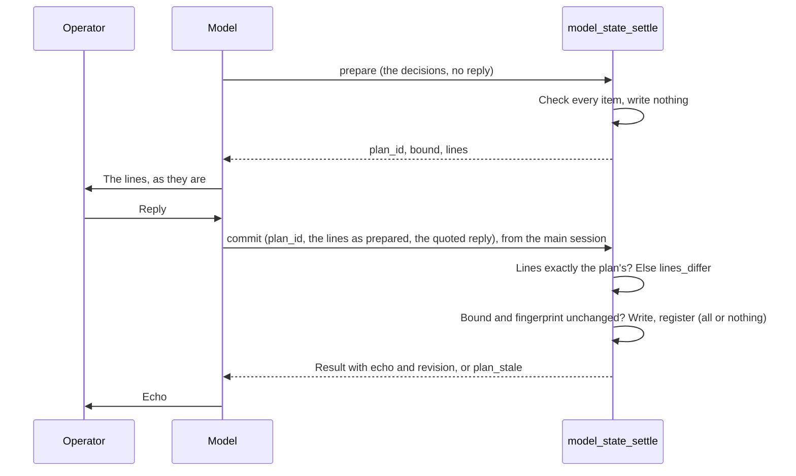
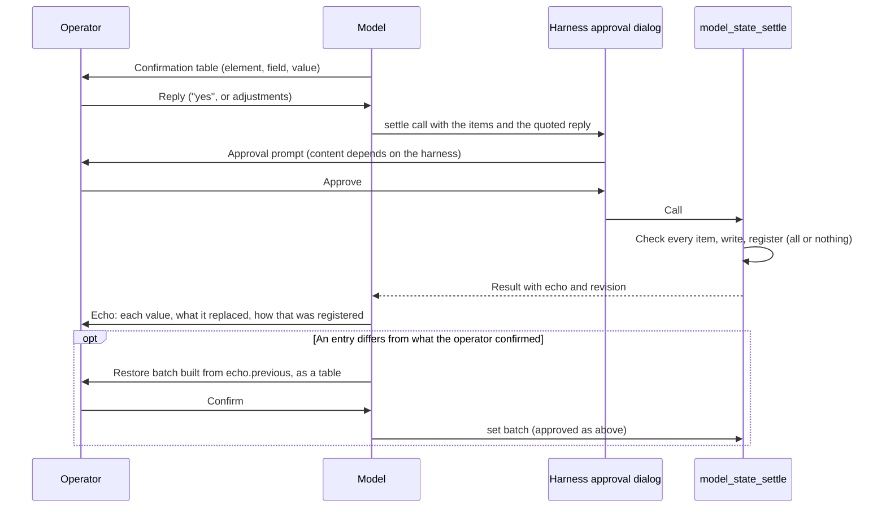

# Dethereal MCP Server Architecture

> Architecture of the Dethereal MCP server. Supersedes [ARCHITECTURE.md](ARCHITECTURE.md), which is retained as a pre-upgrade snapshot; §11 says briefly how the one became the other.

## Table of Contents

- [1. Overview](#1-overview)
- [2. Architecture Diagram](#2-architecture-diagram)
- [3. Core Components](#3-core-components)
- [4. Authentication Flow](#4-authentication-flow)
- [5. Tool System](#5-tool-system)
- [6. Tool Reference](#6-tool-reference)
- [7. Data Flow](#7-data-flow)
- [8. dt-core Integration](#8-dt-core-integration)
- [9. Security Model](#9-security-model)
- [10. Configuration](#10-configuration)
- [11. History](#11-history)

---

## 1. Overview

**Dethereal** is an MCP (Model Context Protocol) server that enables AI assistants to create, validate, import, export, analyze, and manage Dethernety threat models. It is the platform communication layer of the Dethereal workflow, which is rendered for three harnesses: Claude Code, Codex and OpenCode. Each harness names the same tool differently:

| Harness | Tool name |
|---------|-----------|
| Claude Code | `mcp__plugin_dethereal_dethereal__<tool>` |
| Codex | `mcp__dethereal__<tool>` |
| OpenCode | `dethereal_<tool>` |

Which tools run without asking is decided once, in the tool manifest (see [Tool Manifest and Listing](#tool-manifest-and-listing)), and written into each harness's own approval configuration; see [PLUGIN_ARCHITECTURE.md → Tools by Approval](PLUGIN_ARCHITECTURE.md#tools-by-approval).

### Design Principles

| Principle | Implementation |
|-----------|----------------|
| **Protocol Compliance** | MCP server over stdio via `@modelcontextprotocol/sdk`, offering the tools capability |
| **dt-core Integration** | All backend communication through `@dethernety/dt-core` classes — no raw GraphQL queries |
| **Split-File Format** | Directory-based model storage with per-element attribute files |
| **Stateless Tools** | Each tool execution is independent with cached authentication |
| **Type Safety** | Full TypeScript with Zod schema validation on all inputs |
| **Output Size Awareness** | MCP tool output limited to ~10,000 tokens; large payloads paginate, summarize, or write to disk |

### Key Characteristics

```
┌─────────────────────────────────────────────────────────────────────────────┐
│                           DETHEREAL CHARACTERISTICS                         │
├─────────────────────────────────────────────────────────────────────────────┤
│                                                                             │
│  1. MCP PROTOCOL COMPLIANCE                                                 │
│     ─────────────────────────                                               │
│     Implements Model Context Protocol for AI assistant integration.         │
│     Uses stdio transport for communication with host applications.          │
│     Tools exposed via ListTools/CallTool handlers.                          │
│                                                                             │
│  2. SPLIT-FILE DIRECTORY FORMAT                                             │
│     ─────────────────────────                                               │
│     Models stored as directory structures with separate JSON files:         │
│     manifest.json, structure.json, dataflows.json, data-items.json,         │
│     and per-element attribute files. Enables version control and            │
│     incremental updates.                                                    │
│                                                                             │
│  3. dt-core DATA ACCESS LAYER                                               │
│     ─────────────────────────                                               │
│     All GraphQL operations routed through dt-core classes:                  │
│     DtImportSplit, DtExportSplit, DtUpdateSplit, DtModule, DtModel,         │
│     DtClass, DtExposure, DtControl, DtControlLibrary, DtCountermeasure,     │
│     DtAnalysis, DtMitreAttack, DtMitreDefend.                               │
│     No raw GraphQL queries in tool implementations.                         │
│                                                                             │
│  4. BROWSER-BASED OAUTH                                                     │
│     ─────────────────────────                                               │
│     Authentication via OIDC OAuth with PKCE. Opens browser for              │
│     login, receives callback on localhost, caches tokens locally.           │
│     Transparent token refresh via refresh token when access token expires.  │
│     Supports auth-disabled mode for no-auth deployments (no login needed).  │
│                                                                             │
│  5. HARNESS INTEGRATION                                                     │
│     ─────────────────────────                                               │
│     Skills and agents call tools by each harness's own tool name.           │
│     Which tools ask first comes from the tool manifest, written into        │
│     each harness's approval configuration. Tools are designed for agent     │
│     consumption (structured JSON output, compact summaries).                │
│                                                                             │
└─────────────────────────────────────────────────────────────────────────────┘
```

---

## 2. Architecture Diagram

```
┌──────────────────────────────────────────────────────────────────────────────┐
│                              AI ASSISTANT HOST                               │
│                       (Claude Code / Codex / OpenCode)                       │
│  ┌────────────────────────────────────────────────────────────────────────┐  │
│  │  Skills  │  Agents (threat-modeler, etc.)                              │  │
│  │  call tools by the harness's tool name (see §1)                        │  │
│  └────────────────────────────────────────────────────────────────────────┘  │
└───────────────────────────────────┬──────────────────────────────────────────┘
                                    │ stdio (JSON-RPC)
                                    ▼
┌──────────────────────────────────────────────────────────────────────────────┐
│                            DETHEREAL MCP SERVER                              │
│  ┌────────────────────────────────────────────────────────────────────────┐  │
│  │                         MCP Protocol Layer                             │  │
│  │  ┌──────────────┐  ┌──────────────┐  ┌──────────────────────────────┐  │  │
│  │  │ ListTools    │  │ CallTool     │  │ Error Handling               │  │  │
│  │  │ Handler      │  │ Handler      │  │ (McpError)                   │  │  │
│  │  └──────────────┘  └──────────────┘  └──────────────────────────────┘  │  │
│  └────────────────────────────────────────────────────────────────────────┘  │
│                                    │                                         │
│  ┌────────────────────────────────────────────────────────────────────────┐  │
│  │                            Tool Registry (30 tools)                    │  │
│  │  ┌─────────────────────────┐  ┌─────────────────────────────────────┐  │  │
│  │  │ Client-Free Tools (12)  │  │ Client-Dependent Tools (18)         │  │  │
│  │  │ • Authentication (3)    │  │ • Model CRUD (5)                    │  │  │
│  │  │ • Reference (2)         │  │ • Element Management (4)            │  │  │
│  │  │ • Validation (1)        │  │ • MITRE Frameworks (2)              │  │  │
│  │  │ • Local Workspace (2)   │  │ • Security Elements (6)             │  │  │
│  │  │ • Workflow State (4)    │  │ • Analysis (1)                      │  │  │
│  │  └─────────────────────────┘  └─────────────────────────────────────┘  │  │
│  │  Per-tool list: Tool Categories below                                  │  │
│  └────────────────────────────────────────────────────────────────────────┘  │
│                                    │                                         │
│  ┌─────────────────────────┐  ┌────────────────────────────────────────────┐ │
│  │    Authentication       │  │           dt-core Integration              │ │
│  │  ┌───────────────────┐  │  │  ┌──────────────┐  ┌──────────────────┐    │ │
│  │  │ OAuth Flow (PKCE) │  │  │  │ DtImportSplit│  │ DtExportSplit    │    │ │
│  │  │ Token Store       │  │  │  │ DtUpdateSplit│  │ DtModule         │    │ │
│  │  │ Platform Config   │  │  │  │ DtModel      │  │ DtExposure       │    │ │
│  │  └───────────────────┘  │  │  │ DtControl    │  │ DtCountermeasure │    │ │
│  └─────────────────────────┘  │  │ DtMitreAttack│  │ DtMitreDefend    │    │ │
│                               │  │ DtAnalysis   │  │ DtClass          │    │ │
│                               │  └──────────────┘  └──────────────────┘    │ │
│                               └────────────────────────────────────────────┘ │
│                                    │                                         │
│  ┌────────────────────────────────────────────────────────────────────────┐  │
│  │                        File System Layer                               │  │
│  │  ┌──────────────────────────────────────────────────────────────────┐  │  │
│  │  │ Directory Utils: read/write model directories, apply ID mappings │  │  │
│  │  │ File Utils: path operations, JSON read/write, backups            │  │  │
│  │  │ Sync Utils: sync.json management, content hashing               │  │  │
│  │  └──────────────────────────────────────────────────────────────────┘  │  │
│  └────────────────────────────────────────────────────────────────────────┘  │
└──────────────────────────────────────────────────────────────────────────────┘
                                    │
                    ┌───────────────┴───────────────┐
                    │                               │
                    ▼                               ▼
┌───────────────────────────────┐   ┌───────────────────────────────────────┐
│   Identity Provider (OIDC)    │   │         Dethernety Platform           │
│  ┌─────────────────────────┐  │   │  ┌─────────────────────────────────┐  │
│  │ • Cognito / Keycloak /  │  │   │  │ GraphQL API (dt-ws)             │  │
│  │   Auth0 / Zitadel       │  │   │  │ • Models, Components, Boundaries│  │
│  │ • OAuth 2.0 + OIDC      │  │   │  │ • Data Flows, Data Items        │  │
│  │ • Managed Login UI      │  │   │  │ • Modules, Classes, Exposures   │  │
│  │ • JWT Token Issuance    │  │   │  │ • Controls, Countermeasures     │  │
│  └─────────────────────────┘  │   │  │ • MITRE ATT&CK / D3FEND        │  │
└───────────────────────────────┘   │  │ • Analyses                      │  │
                                    │  └─────────────────────────────────┘  │
                                    └───────────────────────────────────────┘
```

---

## 3. Core Components

### Entry Point (`src/index.ts`)

`src/index.ts` is the package's executable (`dist/index.js`). It only dispatches: with no arguments it loads the MCP server (`src/server.ts`); with arguments it runs the command-line interface (`src/cli/`) that harness hooks and the installer use. A Node.js older than the supported floor is refused before either loads.

### MCP Server (`src/server.ts`)

The version the server reports comes from `serverVersion()`: the shipped build stamps the `package.json` version in as `__DETHEREAL_VERSION__`, and a build without it (tsc's output) reads the version from the `package.json` beside `dist/`.

The server registers two request handlers and connects over stdio:

```typescript
const server = new Server(
  { name: 'dethereal', version: serverVersion() },
  { capabilities: { tools: {} } }
)

// Tool listing: name, description, flattened input schema, and the
// interaction hint for tools the manifest marks requiresUser (tool-listing.ts)
server.setRequestHandler(ListToolsRequestSchema, async () => {
  return { tools: allTools.map(listedTool) }
})

// Tool execution: find the tool, run it (§5), redact the result
server.setRequestHandler(CallToolRequestSchema, async (request) => {
  const { name, arguments: args = {} } = request.params
  const tool = allTools.find((t) => t.name === name)
  if (!tool) throw new McpError(ErrorCode.MethodNotFound, `Unknown tool: ${name}`)
  const response = await callTool(tool, name, args)   // config gate, context, tool.run(args, context)
  return { ...response, content: response.content.map((item) => ({ ...item, text: redactSecrets(item.text) })) }
})

// Stdio transport
const transport = new StdioServerTransport()
await server.connect(transport)
```

`listedTool` converts each Zod schema to JSON Schema (draft-07) and forwards only `{ type, properties, required }`: top-level keywords such as `$ref`, or the `allOf` a cross-field refinement produces, are dropped before the client sees them, so tool inputs must be expressible as a flat property bag. `buildToolContext()` takes no arguments; it builds the session context described in §5.

Only local work happens before the transport connects (the project root is resolved and the configuration is checked), so a slow or unreachable platform never delays the handshake. The platform's `/config` is then loaded in the background, and again by the first tool call that needs it. When the harness closes stdin, a pending sign-in is cancelled and the process exits.

### Base Tool Classes (`src/tools/base-tool.ts`)

Abstract base classes define the tool interface. All 30 tools extend one of two concrete base classes:

```typescript
export interface ToolContext {
  apolloClient?: ApolloClient
  /** Why `apolloClient` is absent, when it is — see §5 Tool Execution Flow, step 5 */
  clientUnavailableReason?: string
  /** The bearer sent to the platform — the OAuth access token */
  token?: string
  /** The same session's OIDC identity token, read for profile claims only */
  identityToken?: string
  /** JWT-anchored operator identity, decoded from the identity token's `email`/`sub` claim */
  authnOperator?: string
  debug: boolean
  /** The settlement mode of this call, when an in-process caller names it; otherwise DETHEREAL_SETTLEMENT — see §5 Settlement Switch */
  settlement?: 'on' | 'off'
}

export interface ToolResult<T = any> {
  success: boolean
  data?: T
  error?: string
  warnings?: string[]
}

export abstract class BaseTool<TInput = any, TOutput = any> {
  abstract readonly name: string
  abstract readonly description: string
  abstract readonly inputSchema: ZodType<TInput>
  abstract readonly requiresClient: boolean
  /** A successful result is sent as compact JSON; `false` indents it. Errors are always compact */
  readonly compactResult: boolean = true

  abstract execute(input: TInput, context: ToolContext): Promise<ToolResult<TOutput>>

  // Validates input via Zod, checks client requirement, then delegates to execute()
  async run(rawInput: unknown, context: ToolContext): Promise<ToolResult<TOutput>> { ... }
}

// Concrete base classes
export abstract class ClientFreeTool extends BaseTool { requiresClient = false }
export abstract class ClientDependentTool extends BaseTool { requiresClient = true }
```

### Tool Categories

| Category | Tools | Base Class | Count |
|----------|-------|------------|-------|
| **Authentication** | `login`, `logout`, `auth_status` | `ClientFreeTool` | 3 |
| **Reference** | `get_model_schema`, `get_example_models` | `ClientFreeTool` | 2 |
| **Validation** | `validate_model_json` | `ClientFreeTool` | 1 |
| **Local Workspace** | `workspace_status`, `detect_drift` | `ClientFreeTool` | 2 |
| **Workflow State** | `model_state`, `model_state_waive`, `model_state_settle`, `model_state_prune` | `ClientFreeTool` | 4 |
| **Model CRUD** | `create_threat_model`, `import_model`, `export_model`, `update_model`, `list_models` | `ClientDependentTool` | 5 |
| **Element Management** | `get_classes`, `match_classes`, `update_attributes`, `generate_attribute_stubs` | `ClientDependentTool` | 4 |
| **MITRE Frameworks** | `search_mitre_attack`, `get_mitre_defend` | `ClientDependentTool` | 2 |
| **Security Elements** | `manage_controls`, `manage_countermeasures`, `get_control_gaps`, `query_controls`, `query_exposures`, `query_countermeasures` | `ClientDependentTool` | 6 |
| **Analysis** | `manage_analyses` | `ClientDependentTool` | 1 |
| **Total** | | | **30** |

`model_state_settle` is listed only with the settlement on, so a server with the default lists 29 tools; see [Settlement Switch](#settlement-switch).

`model_state_prune` is a write action and always asks for the operator's approval: it deletes the attribute files of elements the model no longer has. The server deletes only the files it finds orphaned itself (a structured attribute file named for an element id that is in no element group), all or nothing and at most 50 a call; a call that leaves more returns the next call's files as `next_files`. The call must name exactly those files, and each must still hold the bytes the server read. A flat file, a file named for another id, or one whose name differs from a live element id only in letter case is listed as not deleted. With the settlement on, it does not drop the removed elements' registered values; `model_state_settle` drops those once the operator acknowledges them. With it off, the prune runs the same checks, reads and writes no settlement file and needs no key, and its description does not name the settle tool.

### Source Directory Layout

Directories, and the key files in them. Tests sit beside the code, in `__tests__/` folders.

```
apps/dethereal/src/
├── index.ts                        # Executable: no arguments runs the server, arguments run the CLI
├── server.ts                       # MCP server: handlers, session context, config gate, redaction
├── tool-listing.ts                 # tools/list entries: flattened schema + interaction hint
├── config.ts                       # Platform URL resolution and URL policy (configProblem)
├── client/
│   ├── apollo-client.ts            # Apollo Client factory, cached per bearer
│   └── platform-capabilities.ts    # Probe for the platform fields the plugin's documents need
├── auth/
│   ├── login-manager.ts            # One non-blocking browser sign-in at a time (wait, pending, busy)
│   ├── oauth-flow.ts               # Code exchange, refresh, stored-session login
│   ├── oauth-server.ts             # Loopback sign-in server (/start, /callback; port 9876)
│   ├── browser.ts                  # Opens the local /start URL with a fixed system launcher
│   ├── pkce.ts                     # PKCE verifier/challenge and state generation
│   ├── token-store.ts              # Session store (~/.dethernety/tokens.json), locking, expiry
│   ├── revoke.ts                   # Refresh-token revocation at logout (RFC 7009)
│   ├── token-endpoint.ts           # Token/revocation endpoint failures, described without bodies
│   ├── platform-config.ts          # Platform /config fetching and caching
│   ├── scope.ts                    # Granted-scope and ID-token claim helpers
│   └── redact.ts                   # Session-token redaction for tool results and stderr
├── tools/
│   ├── manifest.ts                 # Tool manifest: names, approval classes, actions, inputs
│   ├── index.ts                    # Registry: allTools, clientFreeTools, clientDependentTools, localTools
│   ├── base-tool.ts                # BaseTool, ClientFreeTool, ClientDependentTool
│   ├── stub-tool.ts                # Placeholder for an unimplemented manifest entry (tests only)
│   ├── auth/                       # login, logout, auth_status
│   ├── query-security.tool.ts      # query_controls, query_exposures, query_countermeasures
│   ├── manage-exposures.tool.ts    # Exposure reader behind query_exposures (not a registered tool)
│   └── *.tool.ts                   # One file per remaining tool (see Tool Categories)
├── utils/
│   ├── directory-utils.ts          # Read/write split-file model directories, apply ID mappings
│   ├── file-utils.ts               # Path operations, JSON I/O, backups
│   ├── sync-utils.ts               # .dethereal/sync.json
│   ├── platform-baseline.ts        # Platform-change check before a push
│   ├── state-store.ts              # .dethereal/state.json and the other committed state files
│   ├── gates.ts                    # Quality Gates 1–3
│   ├── loop-back.ts                # Loop-back guard
│   ├── settlement*.ts              # Settlement baseline, state and machine registrations
│   ├── registrable.ts              # What may be registered as the operator's value
│   ├── manifest-modules.ts         # Derived manifest.json module list
│   ├── project-root.ts             # Project root resolution
│   ├── path-confinement.ts         # Path confinement for directory_path
│   ├── runtime-trust.ts            # Refuses a Node runtime that cannot be trusted with the bearer
│   └── ...                         # Lints, tiers, hashing, locking, git, secret paths, source globs
├── cli/                            # CLI: hook commands (session-start, post-write, approve, config and secret guards), workspace-status, installer commands
├── installer/                      # dethereal install / uninstall / doctor for Claude Code, Codex, OpenCode
├── generator/                      # Renders the harness-neutral workflow/ into bundles/<harness>
├── packaging/                      # Shipped-build options and self-contained bundle checks
├── data/                           # Example models and credential-class hints
├── acceptance/                     # Development only: scoring of harness runs (not shipped)
├── test-setup/                     # Isolated home directory for tests
└── __tests__/                      # Package-level tests (packaging, startup, tool listing, harness smoke tests)
```

---

## 4. Authentication Flow

### OAuth 2.0 with PKCE

```
┌─────────────┐     ┌─────────────┐     ┌─────────────┐     ┌─────────────┐
│ AI Assistant│     │  Dethereal  │     │   Browser   │     │OIDC Provider│
└──────┬──────┘     └──────┬──────┘     └──────┬──────┘     └──────┬──────┘
       │                   │                   │                   │
       │ login tool call   │                   │                   │
       │──────────────────>│                   │                   │
       │                   │                   │                   │
       │                   │ Generate PKCE     │                   │
       │                   │ code_verifier +   │                   │
       │                   │ code_challenge    │                   │
       │                   │                   │                   │
       │                   │ Start callback    │                   │
       │                   │ server on :9876   │                   │
       │                   │                   │                   │
       │                   │ Open local /start │                   │
       │                   │ (redirects to IdP)│                   │
       │                   │──────────────────>│                   │
       │                   │                   │                   │
       │                   │                   │ GET /authorize    │
       │                   │                   │──────────────────>│
       │                   │                   │                   │
       │                   │                   │<──────────────────│
       │                   │                   │ Login page        │
       │                   │                   │                   │
       │                   │                   │ User authenticates│
       │                   │                   │──────────────────>│
       │                   │                   │                   │
       │                   │                   │<──────────────────│
       │                   │                   │ Redirect with code│
       │                   │                   │                   │
       │                   │<──────────────────│                   │
       │                   │ GET /callback     │                   │
       │                   │ ?code=xxx         │                   │
       │                   │                   │                   │
       │                   │ Exchange code     │                   │
       │                   │ + code_verifier   │                   │
       │                   │─────────────────────────────────────>│
       │                   │                   │                   │
       │                   │<─────────────────────────────────────│
       │                   │ Tokens (access,   │                   │
       │                   │ id, refresh)      │                   │
       │                   │                   │                   │
       │                   │ Store tokens at   │                   │
       │                   │ ~/.dethernety/    │                   │
       │                   │ tokens.json       │                   │
       │                   │                   │                   │
       │<──────────────────│                   │                   │
       │ Platform URL,     │                   │                   │
       │ email, expiry     │                   │                   │
       │ (never tokens)    │                   │                   │
       │                   │                   │                   │
```

`login` does not block until the browser returns. It waits at most `wait` seconds (default 30, at most 45); a sign-in that has not finished by then is reported as `status: 'pending'` with `openUrl`, the local `http://127.0.0.1:9876/start` address, for the user to open. The listener lives 5 minutes from its start and exchanges the code as soon as the provider redirects, whether or not a call is waiting; the next `login` reuses the pending sign-in, and `force_new` cancels it first. The provider's sign-in URL, with its `state` and PKCE challenge, is never returned or logged: `/start` redirects to it.

### Auth-Disabled Mode

When the platform's `/config` endpoint returns `authDisabled: true` (no-auth mode), the MCP server bypasses all OAuth flows:

```
┌─────────────┐     ┌─────────────┐                    ┌─────────────┐
│ AI Assistant│     │  Dethereal  │                    │  Platform   │
└──────┬──────┘     └──────┬──────┘                    └──────┬──────┘
       │                   │                                  │
       │                   │ GET /config                      │
       │                   │─────────────────────────────────>│
       │                   │<─────────────────────────────────│
       │                   │ { authDisabled: true, ... }      │
       │                   │                                  │
       │ any tool call     │                                  │
       │──────────────────>│                                  │
       │                   │                                  │
       │                   │ GraphQL (no Authorization header)│
       │                   │─────────────────────────────────>│
       │                   │   Backend creates mock dev-user  │
       │                   │<─────────────────────────────────│
       │                   │                                  │
       │<──────────────────│                                  │
       │ Tool result       │                                  │
```

In this mode:

| Component | Behavior |
|-----------|----------|
| **Platform config** | Skips `oidcClientId` / `oidcDomain` validation |
| **Apollo client** | Created without `Authorization` header |
| **buildToolContext()** | Skips token resolution, creates unauthenticated client |
| **Client-dependent tools** | Work without authentication (backend creates mock user) |
| **Auth tools** | `login` returns immediately with a "No login needed" message; `auth_status` reports `authDisabled: true, authenticated: true`; `logout` behaves as in any mode (it removes whatever session is stored) |

### Token Management

```typescript
// Token storage structure (~/.dethernety/tokens.json)
// Keyed by platform URL to prevent cross-instance token confusion (D61)
interface TokenFile {
  version: number
  tokens: Record<string, StoredTokens>   // keyed by platform URL
  logoutEpoch?: string      // Rewritten by every logout; a sign-in saves only if it is
                            // unchanged since the sign-in began
  // Unknown top-level keys are kept on every write
}

interface StoredTokens {
  accessToken: string       // Bearer presented to the platform (carries `scope`)
  idToken: string           // Profile claims only — never sent as a bearer
  grantedScope?: string     // Scope the provider actually granted; absent on older
                            // records, where the access token's own claim is read instead
  refreshToken: string
  expiresAt: number         // Unix timestamp (milliseconds) when the access token expires
  baseUrl: string           // Platform these tokens belong to
  storedAt: number          // When the tokens were last written (reset on every save)
  oidcDomain?: string       // The identity provider that issued the session; logout
  oidcClientId?: string     // revokes the refresh token only there, for this client
  refreshRejected?: boolean // The provider rejected the refresh token: never refreshed
                            // again; a new sign-in replaces the entry
  issuedAt?: number         // Written by older versions; ignored
}

// Token resolution for authenticated requests:
// 1. Load stored tokens from ~/.dethernety/tokens.json for the current baseUrl
// 2. Use them while expiresAt is more than 60 seconds away
// 3. Otherwise try a transparent refresh, unless the provider already rejected the refresh token
// 4. No token needed when authDisabled is true
```

The `getSessionTokens()` function in `server.ts` implements this chain, returning the session's two tokens as `{ bearer, identity }`:
1. Load stored tokens from `~/.dethernety/tokens.json` keyed by the current `baseUrl`. They are valid until 60 seconds before the stored `expiresAt`; the JWT is not decoded for this.
2. If they have expired, refresh transparently: load the platform config, then call the OIDC token endpoint with `grant_type=refresh_token`, and store and use the new tokens (or another process's, if it refreshed first). Any refresh token the provider has not rejected is tried, since only the provider knows whether it is still valid; a rejection sets `refreshRejected`. The refresh is bounded to 10 seconds.
3. Return `undefined` if no valid token is available (no session, a rejected refresh token, or a refresh that failed).

The two are not interchangeable. `bearer` is the OAuth **access token** — only it carries the `scope` claim, and a resource server behind the platform is entitled to require one. `identity` is the **ID token** — only it carries the profile claims (`email`), which is what audit attribution reads; it is never sent as an `Authorization` header.

**Scope.** Login requests the scope the platform advertises as `oidcScope`, falling back to `openid profile email` when it advertises none, and records what the provider actually granted as `grantedScope`. A stored session whose grant no longer satisfies the requirement is skipped in favour of a fresh browser login: the refresh grant takes no scope parameter, so refreshing would re-issue the original grant indefinitely. When the provider grants less than was asked for, login still succeeds and reports the shortfall — the tokens remain valid for the platform itself, but anything behind it may refuse them.

> **Security (D61):** The `_token` argument is **not supported**. Tokens must only come from the secure token store, never from the conversation layer. Accepting tokens from tool arguments would allow prompt injection attacks to supply attacker-controlled JWTs.

> **Security (D69):** Credentials do not flow the other way either. No tool takes a credential as input or returns token material or the token-store path; skills check the session with `auth_status` and are told never to read `~/.dethernety/`. Everything the server relays that it does not control — platform error text, a proxy's error page, the GraphQL layer's own logging — can echo the bearer, so every session token the process loads or saves is registered with `auth/redact.ts`, and both tool results and stderr pass through exact-value redaction. Token-endpoint errors carry only the HTTP status and the OAuth `error` code; token-store errors carry only the filesystem error code; the sign-in URL (which holds the pending login's `state` and PKCE challenge) is never logged or put into an error.

### Auth Component Files

| File | Purpose |
|------|---------|
| `auth/login-manager.ts` | One browser sign-in at a time, never blocking a call for long: `wait`, pending, reuse, `force_new`, cancellation |
| `auth/oauth-flow.ts` | Authorization-code exchange, refresh, and the stored-session step of `login` |
| `auth/oauth-server.ts` | Loopback sign-in server on port 9876: `/start` redirects to the provider, `/callback` receives the code |
| `auth/pkce.ts` | PKCE code_verifier/code_challenge and `state` generation |
| `auth/token-store.ts` | Session store (`~/.dethernety/tokens.json`): locking, atomic writes, expiry, refresh bookkeeping |
| `auth/revoke.ts` | Revokes removed sessions' refresh tokens at logout, each at its own platform's provider (RFC 7009) |
| `auth/token-endpoint.ts` | Token and revocation endpoint failures, reported by HTTP status and OAuth `error` code only |
| `auth/platform-config.ts` | Fetches and caches OIDC provider config from platform `/config` endpoint |
| `auth/browser.ts` | Opens only the local `/start` URL with a fixed system launcher (macOS `/usr/bin/open`, Windows `rundll32`, elsewhere `xdg-open`); errors never include the URL |
| `auth/scope.ts` | Granted-scope parsing and the `email` claim of the ID token |
| `auth/redact.ts` | Registers session tokens and redacts them from tool results and stderr |

---

## 5. Tool System

### Tool Manifest and Listing

`src/tools/manifest.ts` is the frozen contract of every tool: its name, its approval class (`auto` runs without a prompt in harnesses that ask per tool, `prompt` always asks), its actions and top-level inputs, and `requiresUser` for tools that must never run unattended. A test holds the registered tools to it. The per-harness bundles read their approvals from it: the Claude Code approve hook, Codex's `approval_mode` entries and OpenCode's `permission` rules. Today 16 tools are `auto` and 14 are `prompt`; on Claude Code the approve hook also approves one action of a `prompt` tool, `model_state_settle` `prepare`, which records nothing in the model.

`tools/list` (`src/tool-listing.ts`) lists each tool with its name, description and flattened input schema. A tool whose manifest entry has `requiresUser` also carries `_meta["anthropic/requiresUserInteraction"]: true`: Claude Code then asks even under allow rules, and refuses the call where no one can answer. Other harnesses ignore the key and apply their own approval rules.

A placeholder (`stub-tool.ts`) for a manifest entry without an implementation is registered only when `DETHEREAL_REGISTER_STUBS=1`, which tests set; a model never sees one.

### Settlement Switch

The **settlement** holds each value in the model files to the operator's registrations (see [`model_state_settle`](#model_state_settle)). It is off by default. It is on only when `DETHEREAL_SETTLEMENT` is exactly `on`. Unset is off. Any other value, an empty one included, is off too, and the server says so in one fixed stderr line at start that never shows the value (`settlementEnvProblem` in `src/utils/settlement-switch.ts`).

| | Settlement off (default) | Settlement on |
|---|---|---|
| Tool list (read once, when the server starts) | No `model_state_settle`; `model_state_prune` stays; `model_state` lists no `include`, `pending_from`, `pending_limit` or `pending_render`, and its description does not mention pending enrichment | All tools, with all their inputs |
| Push refusal (`create_threat_model`, `import_model`, `update_model`, `update_attributes`) | Gate 2 alone | Gate 2, then pending enrichment, then the settlement |
| `REVIEWED` | Gates 2 and 3, no queued stale element, a review hash | Also nothing pending and no unregistered value |
| `model_state` `get` | `settlement: "off"`, and none of `baseline`, `unregistered_changes`, `declined_fields`, `orphaned_registrations`, `registered`, the settlement log or `pending_enrichment`; a call that names `include` is refused as an unknown input | The settlement fields and `pending_enrichment` |
| `display_state` | No pending-enrichment or settlement qualifier | `N pending enrichment`, `N unregistered`, `N values from a pull` |
| Gate 3 report and lints | No `pending_enrichment` in the report, no `pending_enrichment` lint | Both |
| `workspace_status` | `settlement: "off"` (the mode it read the models with, in the workspace view and the one-directory view, `directory_path`, alike); no `pending`, `pending_unreadable` or `settlement` blocker; `settledWithSettlementOn: true` on a model with settlement records (below); `settlementSwitchNotOn: true` when `DETHEREAL_SETTLEMENT` is set but not to `on` (never the value) | `settlement: "on"`, in both views; all three blockers |
| Pull and push | Register nothing | Register the values the platform held or linked ([SYNC_AND_SOURCE_OF_TRUTH.md](SYNC_AND_SOURCE_OF_TRUTH.md#push-flow)) |
| `model_state_prune` | Deletes the orphaned files; no settlement file, no key | Also logs the prune and re-signs the baseline |
| Approve hook (Claude Code) | Approves no `model_state_settle` action | Approves `model_state_settle` `prepare` |
| Session-start text | Nothing about the settlement, and none of its qualifiers, except `settled with the settlement on, which is now off` on a flagged model and, when `DETHEREAL_SETTLEMENT` is set but not to `on` (an empty value included), the fixed line ``Settlement off: DETHEREAL_SETTLEMENT is set, but not to `on`.`` at startup and after compaction | One line, at startup and after compaction: `Settlement on: values the operator has not confirmed hold back REVIEWED and a push.` |

**A switch from on to off is still seen.** With the settlement off, a model whose `.dethereal/` holds settlement records (`settlement-baseline.json` or `settlements.json`) is flagged: `workspace_status` gives it `settledWithSettlementOn: true`, and the session-start model line adds `settled with the settlement on, which is now off`. At startup the line shows only when the project has one model (startup reads one model and, with several, shows only a count); after compaction it shows on each model listed. Only the files' presence is checked; nothing in them is read. With the settlement on, nothing is added. This catches a switch made outside the guarded configuration.

With the settlement off, a pull, a push and every `model_state` change still keep this machine's files out of git through `.dethereal/.gitignore`. The write is idempotent and keeps any line the user added.

Both modes keep Gates 1–3, the Gate 3 waivers and their machine key, the orphaned-file prune and the secret-file guard.

**Hooks follow the switch.** The `approve` and `session-start` hooks and the `workspace-status --json` command read the mode by the server's rule, with one addition: a command that carries `--settlement` is on (`hookSettlement` in `src/utils/settlement-switch.ts`). Without the flag, its environment decides: on only when `DETHEREAL_SETTLEMENT` is exactly `on`. The flag only stands in where a harness gives hooks no environment block. A bundle generated with the settlement on adds the flag to the Claude Code and Codex hook commands, and sets the variable for OpenCode's plugin hooks. Shipped bundles leave it off. See [PLUGIN_ARCHITECTURE.md → Hooks](PLUGIN_ARCHITECTURE.md#6-hooks).

**The switch is the operator's.** The plugin's config guard refuses an agent edit that adds, removes or changes `DETHEREAL_SETTLEMENT`, in any spelling (upper or lower case), since the environment ignores case on Windows. The refusal says the edit changes whether the settlement is on. In Claude Code settings the guard refuses any other change to `env` too, since every process Claude Code starts reads it (see [PLUGIN_ARCHITECTURE.md → Config Guard](PLUGIN_ARCHITECTURE.md#config-guard)).

**A switch set but not on is said.** A repository's own settings can set the variable, so the session-start text never shows its value. When it is set to anything but exactly `on`, an empty value included, the text adds one fixed line, ``Settlement off: DETHEREAL_SETTLEMENT is set, but not to `on`.``, and `workspace_status` carries only the boolean `settlementSwitchNotOn: true`. A hook whose command carries `--settlement` does not read the environment, so it adds neither.

The manifest marks the inputs listed only with the settlement on as `settlementOnly`. Leaving them out saves every request their descriptions.

A tool called in-process can name the mode itself (`ToolContext.settlement`). Only the acceptance scorer does: it reads a run's model with the mode that run's server had. On a server that lists the row-list inputs, a `get` with `include` under the off mode is refused `settlement_off`.

### Tool Execution Flow

```
┌────────────────────────────────────────────────────────────────────────────┐
│                           TOOL EXECUTION FLOW                               │
└────────────────────────────────────────────────────────────────────────────┘

1. MCP CallTool Request (JSON-RPC via stdio)
   │
   ▼
2. Find tool by name in allTools registry
   ├─ Not found: throw McpError(MethodNotFound)
   │
   ▼
3. Configuration gate (configProblem())
   ├─ An unusable platform URL (malformed, plain HTTP to a remote host, user name or
   │  password in the URL, plain HTTP with Node's env proxy on) or a Node runtime that
   │  cannot be trusted with the bearer: every tool except auth_status, logout and the
   │  local tools returns { error: "Configuration error", message, tool }
   │
   ▼
4. Build ToolContext
   ├─ Auth tools (login, logout, auth_status) and local tools (workspace_status,
   │  detect_drift, model_state, model_state_waive, model_state_settle,
   │  model_state_prune) get a bare context: the auth tools manage the session
   │  themselves, so auth_status never makes a network call it was not asked for;
   │  the local tools read files only
   ├─ Every other tool: buildToolContext()
   │  ├─ Fetch platform config if not cached (a failure is logged, not thrown)
   │  ├─ If authDisabled: unauthenticated Apollo client (no Authorization header)
   │  └─ Else:
   │     ├─ Load the session from the store (keyed by baseUrl); valid until 60 s
   │     │  before expiresAt — if expired, transparent refresh (bounded to 10 s)
   │     └─ Apollo client with the Bearer token (if a token is available),
   │        reused for the same token
   │
   ▼
5. Check client requirement
   ├─ If requiresClient && !apolloClient — branch on context.clientUnavailableReason:
   │  ├─ Reason set: { error: "Platform client unavailable", message: <reason>, tool }
   │  │  (the token was usable — /config unreachable or malformed, or auth-disabled
   │  │   mode; re-login cannot fix this and `login` answers "No login needed")
   │  └─ No reason: { error: "Authentication required", message: "...", tool }
   └─ Continue if satisfied (always satisfied when authDisabled)
   │
   ▼
6. Check platform capability (gated calls only: needsDataControls(tool, args))
   ├─ Gated: export_model, import_model, update_model, create_threat_model,
   │  update_attributes, manage_controls actions list / assign / push-greenfield,
   │  and query_controls list (it forwards to manage_controls in-process)
   ├─ missingPlatformCapability(apolloClient, baseUrl) queries Data.controls once
   │  per platform (a pass is cached; a refusal is re-asked on the next call)
   ├─ Refused: { error: "Platform too old for this Dethereal version",
   │  message: <names the platform's origin>, tool }
   └─ Continue if the field exists, or if the probe could not tell
   │
   ▼
7. tool.run(args, context): validate input with the Zod schema (safeParse)
   ├─ Validation failure: return { success: false, error: "Invalid input: ..." }
   │
   ▼
8. Execute tool.execute(input, context)
   │
   ▼
9. Format MCP response
   ├─ Success: { content: [{ type: 'text', text: JSON.stringify(data) }] }
   │  (compact JSON, no indentation; a top-level `warnings` is merged
   │   into `data`)
   ├─ Error: { content: [{ type: 'text', text: JSON.stringify({ error, data }) }], isError: true }
   └─ Thrown: { error: <message>, tool }, isError: true
   │
   ▼
10. Redact: every registered session token is replaced with "[redacted]" in the
    response text (the same pass runs on everything written to stderr)
```

### Tool Implementation Pattern

All tools follow the same pattern. Client-dependent tools extend `ClientDependentTool` and use dt-core classes for platform operations:

```typescript
export class ImportModelTool extends ClientDependentTool<ImportInput, ImportOutput> {
  readonly name = 'import_model'
  readonly description = '...'
  readonly inputSchema = z.object({
    directory_path: z.string(),
    folder_id: z.string().optional(),
    create_backup: z.boolean().optional()
  })

  async execute(input: ImportInput, context: ToolContext): Promise<ToolResult<ImportOutput>> {
    // 1. Validate prerequisites
    if (!context.apolloClient) {
      return { success: false, error: 'Apollo client not available' }
    }

    // 2. Read from file system
    const splitModel = await readModelDirectory(input.directory_path)

    // 3. Use dt-core for API operations
    const dtImportSplit = new DtImportSplit(context.apolloClient)
    const result = await dtImportSplit.importSplitModel(splitModel)

    // 4. Post-process (write IDs back to files)
    // modelId is required — it stamps manifest.model.id, which update_model
    // and the sync push path read back later.
    await applyIdMapping(input.directory_path, result.idMapping, result.model.id)

    // 5. Return structured result
    return { success: true, data: { model_id: result.model.id, ... } }
  }
}
```

The MITRE, security-element and analysis tools follow the **action-based pattern** — a single tool handles multiple operations via an `action` discriminator:

```typescript
export class QueryExposuresTool extends ClientDependentTool<ExposuresInput, unknown> {
  readonly name = 'query_exposures'
  readonly description = '...'
  readonly inputSchema = z.object({
    action: z.enum(['list', 'get']),
    element_id: ID.optional(),     // required for 'list'
    exposure_id: ID.optional(),    // required for 'get'
    limit: z.number().int().min(1).max(500).optional()
  }).strict()

  async execute(input: ExposuresInput, context: ToolContext): Promise<ToolResult<unknown>> {
    const dtExposure = new DtExposure(context.apolloClient!)

    switch (input.action) {
      case 'list': {
        const exposures = await dtExposure.getExposures({ elementId: input.element_id! })
        return { success: true, data: { exposures: exposures.slice(0, input.limit ?? 100), total: exposures.length } }
      }
      case 'get': {
        const exposure = await dtExposure.getExposure({ exposureId: input.exposure_id! })
        return { success: true, data: { exposure } }
      }
    }
  }
}
```

The example is simplified: the shipped `query_exposures` (in `query-security.tool.ts`) also checks each action's required fields and hands the platform call to an internal exposure reader that is not registered as a tool of its own.

### Error Propagation

MCP tool errors propagate to the agent via `ToolResult`. Agent prompts include handling instructions:

| Error Type | Agent Behavior |
|------------|---------------|
| **Auth errors** ("Authentication required") | Agent suggests `/dethereal:login` and retries |
| **Client unavailable** ("Platform client unavailable") | Re-login cannot help — agent surfaces `message` and checks the platform URL and `/config` reachability |
| **Validation errors** (Zod parse failure) | Agent presents errors to user with suggested fixes |
| **Network errors** (platform unreachable) | Agent retries once after 5 seconds, then reports to user |
| **Platform errors** (GraphQL 500) | Agent reports to user without retry |
| **Not found** (model/element ID invalid) | Agent reports to user, suggests corrective action |

---

## 6. Tool Reference

### Authentication Tools (Client-Free)

None of the three tools accepts a credential as input or returns token material or the token-store path (D69).

#### `login`

Browser-based OAuth PKCE authentication.

| Property | Value |
|----------|-------|
| **Base class** | `ClientFreeTool` |
| **Input** | `{ wait?: number, force_new?: boolean }` — seconds to wait for a browser sign-in to finish (0–45, default 30); start a new sign-in even if a session is stored or a sign-in is pending |
| **Output** | Signed in: `{ status: 'authenticated', authenticated: true, expiresIn, tokenType, fromCache?, refreshed?, platformUrl, email?, identityChanged?, previousEmail?, scopeShortfall?, message }`. Not yet: `{ status: 'pending' \| 'busy', authenticated: false, openUrl?, expiresInSeconds?, platformUrl, message }` |
| **dt-core class** | None (uses auth module directly) |

Reuses a valid stored session (`fromCache: true`) or refreshes an expired one (`refreshed: true`). Otherwise starts a browser sign-in (see [OAuth 2.0 with PKCE](#oauth-20-with-pkce)) and returns within `wait` seconds: signed in, or `pending` with `openUrl`, the local `/start` address, for the user to open; the agent never opens or fetches it itself. When no browser could be opened on this machine, the pending message says so. A later `login` reuses the pending sign-in. `busy` means another sign-in holds the local port. `platformUrl` is the platform origin and `email` comes from the ID token; `identityChanged` warns that the session belongs to a different user than the one stored before. Returns immediately with "No login needed" when `authDisabled` is true.

#### `logout`

Remove the locally stored session, then revoke it at its identity provider.

| Property | Value |
|----------|-------|
| **Base class** | `ClientFreeTool` |
| **Input** | `{ clear_all?: boolean }` — sign out of every platform, not just the configured one |
| **Output** | `{ message, revocation }` — `revocation` has one entry per removed session: `{ platform, result: 'revoked' \| 'skipped' \| 'failed', reason? }` |
| **dt-core class** | None |

First cancels any sign-in still pending, in this session or another Dethereal session on this machine, so it cannot re-create the session. Then removes the stored session for the current platform (or all platforms) from the local token store and clears the Apollo client cache; the local removal never depends on the network. Finally it revokes each removed session's refresh token (RFC 7009) at its own platform's identity provider, with that platform's client id read from its `/config` at the time; a session that recorded its issuer is revoked only if the platform still names that issuer. At most 20 sessions are revoked per call, each bounded to 5 seconds; the rest, and platforms that cannot be reached, are reported as skipped or failed. With a configuration or runtime that cannot be trusted (see [API Security](#api-security)), nothing is sent and every entry is `skipped`.

#### `auth_status`

Read-only session report — the supported way for skills and agents to check authentication.

| Property | Value |
|----------|-------|
| **Base class** | `ClientFreeTool` |
| **Input** | `{ verify?: boolean }` |
| **Output** | `{ platformUrl, urlSource, projectRoot, authDisabled, authenticated, pending, email?, expiresAt?, secondsRemaining?, scopeShortfall?, detail? }` |
| **dt-core class** | None |

| Field | Meaning |
|-------|---------|
| `platformUrl` | Origin of the platform this server talks to |
| `urlSource` | `'env'` when `DETHERNETY_URL` is set; otherwise `'user_config'` when `DETHERNETY_PLATFORM_URL` is (the Claude Code plugin's user config, or the URL a Codex or OpenCode install wrote); otherwise `'default'` |
| `projectRoot` | Directory model paths are resolved against |
| `authDisabled` | Whether the platform runs without authentication; `null` when the platform has not been reached |
| `authenticated` | `true` for a live session, or when the platform has authentication disabled |
| `pending` | Whether a sign-in is waiting for the browser |
| `email` | Signed-in user, from the ID token |
| `expiresAt` | Access-token expiry (ISO-8601) |
| `secondsRemaining` | Seconds until the access token expires, never negative |
| `scopeShortfall` | Scopes the platform asks for that the session was not granted |
| `detail` | Why the session is not usable (e.g. `not signed in`, `session expired; sign in again`, `platform unreachable: timeout`) |

Without `verify` the answer comes from local state only — no network. With `verify: true` it loads the platform config if it is not cached and refreshes an expired session first, both bounded to 10 seconds. `/dethereal:status`, `/dethereal:sync` (push, pull and status) and the push step of `/dethereal:threat-model` call it with `verify: true`.

Token refresh has no tool of its own: every call of a tool that is neither an auth tool nor a local tool refreshes an expired session transparently (see [Tool Execution Flow](#tool-execution-flow), step 4), and so do `login` and `auth_status` with `verify: true`.

### Reference Tools (Client-Free)

#### `get_model_schema`

Returns the SplitModel JSON schema and modeling guidelines.

| Property | Value |
|----------|-------|
| **Base class** | `ClientFreeTool` |
| **Input** | `{ include_examples?: boolean }` — include example values in the schema (default `true`) |
| **Output** | `{ guidelines, directory_structure, schemas }` |
| **dt-core class** | None (reads from bundled data) |

> **Output size note:** The full schema exceeds 10,000 tokens. The workflow therefore embeds the modeling guidelines in its agent and skill prompts, or ships them as files beside the skills, instead of calling this tool; see [PLUGIN_ARCHITECTURE.md §9](PLUGIN_ARCHITECTURE.md#9-architecture-decision-mcp-vs-skills-for-documentation-d47).

#### `get_example_models`

Returns example model templates for reference.

| Property | Value |
|----------|-------|
| **Base class** | `ClientFreeTool` |
| **Input** | `{ type?: 'simple' \| 'web_app' \| 'api_service' \| 'database' \| 'microservices', file_type?: 'manifest' \| 'structure' \| 'dataflows' \| 'data-items' \| 'attributes' \| 'all' }` — `type` defaults to `simple`; without `file_type` (or with `all`) every file is returned |
| **Output** | Example model JSON structures |
| **dt-core class** | None (reads from bundled data) |

### Validation Tool (Client-Free)

#### `validate_model_json`

Offline structural validation, quality scoring, control-coverage analysis, and boundary trust zoning.

| Property | Value |
|----------|-------|
| **Base class** | `ClientFreeTool` |
| **Input** | `{ action?: 'validate' \| 'quality' \| 'coverage' \| 'zoning' \| 'gates' (default `validate`), directory_path?: string, data?: string \| object, file_type?: 'manifest' \| 'structure' \| 'dataflows' \| 'data-items' \| 'attributes', assets?: 'full' \| 'skeleton', detail?: 'summary' \| 'full' (default `full`; `gates` and `quality` only), include?: Array<'gates' \| 'zoning'> (`validate` with `directory_path` only), model_id? }` |
| **Output** | Validation errors (`validate`), quality score breakdown (`quality`), coverage summary (`coverage`), per-boundary trust determination + advisory findings (`zoning`), or the Gates 1–3 result with per-element failures (`gates`) |
| **dt-core class** | None for `validate`/`quality`/`zoning`/`gates` (local file computation; zoning runs the `dt-boundary` determination engine); `DtControl` for online `coverage` |

- `validate`: Structural checks — required fields, ID uniqueness, reference integrity, schema compliance. Includes conduit `peerId` integrity (peer must be a known boundary; self-conduits and lone-inbound conduits are rejected, so `validate` matches what the OUTBOUND-canonical write can persist). Over a directory, the reply is `{ valid, errors, warnings }`; an identical warning (same `file`, `path` and `message`) is listed once, with `count` when it stands for more than one. With `include`, the same call also returns the gates and the zoning — see **`validate` -> `include`** below.
- `quality`: Quality score computation using the formula from THREAT_MODELING_WORKFLOW.md (component classification rate, attribute completion, boundary hierarchy quality, data flow coverage, data classification, control coverage, credential coverage). The payload also carries a top-level `attribute_residual` — see below.
- `coverage`: Control-coverage analysis — online (authoritative MITRE-chain, requires `model_id` + auth) or offline (assignment heuristic from local files)
Either `directory_path` or `data` must be supplied. `directory_path` validates the whole model directory and takes precedence; `data` validates a single file inline (a JSON string or an already-parsed object), with `file_type` naming which schema to apply. `quality`, `zoning` and `gates` require `directory_path`.

- `zoning`: Offline per-boundary trust determination — computes each boundary's `{ declaredZone, resolvedZone, proposedTier, structural, summary? }` plus advisory coherence findings, entirely over the local files (the plugin computes; it never asks the LLM to walk the tree). The `assets` parameter selects the phase: `skeleton` sets external + exposure + `INTERNAL` and defers `RESTRICTED` (the Step-4 trust skeleton), `full` (default) is the close-of-Step-7 / Step-9 determination where qualifying `INTERNAL` boundaries promote to `RESTRICTED`. Each finding carries `{ kind, boundaryId, detail, severity, peerId? }`; an `external-ingress` crossing reached only through forwarding hops (load balancers, proxies, …) adds `via` / `viaIds`, the forwarders in order, and is reported in both phases since it depends on no asset. One rule is the server's own, applied over the engine's proposal in both phases: a non-structural boundary whose own attribute `allow_any_inbound` is `true` is proposed `PUBLIC` (reason `allows any inbound traffic (allow_any_inbound: true)`) unless the engine proposed `VENDOR` or `UNTRUSTED`; Gate 3's `zone_disagreements` compares against the same proposal. The engine does not see the rule: its findings, and its one-hop `EXPOSED` for the boundaries behind a public one, read the boundary as the engine proposed it. See [TRUST_ZONING.md](TRUST_ZONING.md) for the cascade, the six finding kinds, and the guided-workflow ratification points.
- `gates`: Gates 1–3 over the model directory, with the stored Gate 3 waivers applied: `{ lints, gate1, gate2, gate3 }`, each gate with its verdict and named checks (Gate 3: criteria C1–C9 plus `verdict_without_waivers`), and each failing check with its elements (at most 100, with `failing_total`) and remedy. The report does not repeat itself: a passing check (no failures, no waived failures) is just `{ verdict, value }`, and failures of C2, C3 and C8 carry `missing` and `placeholder` field lists instead of `detail`, which said the same in words; a failure without a field list keeps its `detail`. A failing Tier 1–2 flow in C8 whose transit is set only under a transit field of its class (such as `flow_tls_encrypted`, the fields C3 reads in place of `encryption_in_transit`) also carries `alias_present`, those fields; C8's remedy says to write `encryption_in_transit` beside it, from the same source, and each such flow adds a `floor_key_alias_only` lint (warning). Gate 3 also carries `loopback`, advisory: what a loop back to enrichment has to answer, built from the Gate 3 failures no waiver covers — `elements` (each with `element_id`, `name`, `kind` component|boundary|flow|data_item|model, `criteria` and the `fields` to settle) and `not_enrichable` (failures enrichment cannot answer: classification, a missing class template, no cross-boundary flow, the crown-jewel map; each with a `reason`), each list at most 100 with `elements_total` / `not_enrichable_total`, and both empty when Gate 3 passes; while `elements` is non-empty it also carries `arm`, the instruction to call `model_state` action `loop_back` before any write. An armed loop-back can hold Gate 3 back — see **`gates` -> the loop-back guard** below. See [THREAT_MODELING_WORKFLOW.md §8](THREAT_MODELING_WORKFLOW.md#three-tier-quality-gates).

**`validate` -> `include`.** One call in place of up to three. `validate` with `directory_path` takes `include: ['gates']`, `['zoning']` or both:

- The validate result comes back as before, plus `gates` and/or `zoning`, each exactly what its own action returns.
- `detail` applies to the gates part (see **`gates` / `quality` -> `detail`** below), `assets` to the zoning part.
- A part that cannot be computed comes back as `gates_unavailable` or `zoning_unavailable`, `{ code, message }`, and the rest still comes. `code` is the model file's code when a file could not be read for the gates (such as `missing` or `invalid_json`), otherwise `gates_failed` or `zoning_failed`.
- A validate that fails fails as before, with no parts.
- `include` with another action, or with inline `data`, is refused `include_scope`.

**`quality` -> `attribute_residual`.** The enrichment worklist that `attribute_completion_rate` compresses into one number:

```typescript
attribute_residual: {
  declared: number            // template fields seen across scored elements
  resolved: number
  unresolved: number
  elements_scored: number             // classified, with a cached template
  elements_unclassified: number       // no class binding — excluded from the ratio
  unclassified_open: number           // of those, less the root container and those left unclassified
  elements_without_template: number   // classified, no cached template — excluded
  basis: 'template' | 'file-presence'
  blocked: Array<{ element: string; class_id: string }>
  top_unresolved: Array<{ element: string; class: string; unresolved: number; declared: number; fields: string[] }>
}
```

`basis` is load-bearing. It is `template` when the rate was measured against real class template fields, and `file-presence` when no class cache exists and the rate fell back to counting attribute *files*. A consumer that reads only `quality_score` cannot tell a `1.0` that means "fully enriched" from a `1.0` that means "no class cache, so we counted files" — run `generate_attribute_stubs` to populate the cache. `blocked` names the classified elements the ratio could not measure; `top_unresolved` is capped so the payload stays usable on a large model.

**`gates` / `quality` -> `detail`.** `full` (default) keeps every failing element with its fields, the loop-back worklist (`gate3.loopback`) and `attribute_residual.top_unresolved` with its fields — what Step 9's gap list, a loop back and the enrichment worklist read. `summary` is for a progress check:

- `gates`: `{ detail: 'summary', lints_total, gate1, gate2, gate3 }`. Gates 1 and 2 carry their verdict and, per check, either its verdict (passing) or `{ verdict, failing_total, failing }`, `failing` being the element ids. A Gate 1 check whose verdict is `WARN` lists only its first 3 ids (`failing_total` counts them all); a failing Gate 1 check, and every check of Gates 2 and 3, lists every id. Gate 3 carries its verdict, `verdict_without_waivers`, the criteria in the same brief form, `waived_total`, the whole `report` and `loopback: { elements_total }`, plus `loop_back_round` when present. A Gate 3 held back by an open loop-back (`NOT_COMPUTED`) is passed through as it is.
- `quality`: the whole result with `detail: 'summary'`, and `attribute_residual.top_unresolved` cut to the five elements with the most unresolved fields, each as `{ element, class, unresolved, declared }` without field lists. The result recorded in `.dethereal/quality.json` is always the full one.

**`gates` -> the loop-back guard.** A loop-back is armed explicitly, by [`model_state`](#model_state) action `loop_back`, which records the full loop-back list of that moment in `.dethereal/loop-back.json`: each element with a hash of each listed field's value or, when it lists no field, of its data-item links. The record survives restarts; `gates` reads it and never writes it. A backward transition keeps it as it is, nothing re-hashed: an element the change removed reads `removed`, every other one stays armed with the hashes of its arming. Each armed element is read against the gates computed now:

| Status | The element | Touched |
|--------|-------------|---------|
| `removed` | is gone from the model | yes |
| `not_listed` | is no longer on the loop-back list (fixed) | yes |
| `waived` | is no longer on the loop-back list because a waiver in use covers one of its criteria | yes |
| `changed` | has a listed field holding a value other than the armed one that is neither empty nor a gate stand-in (`changed` names the fields); with no listed field, its data-item links changed | yes |
| `dropped` | was left unfixed by the run, with a `reason` | no |
| `untouched` | none of the above | no |

While an armed record has an `untouched` element, or the record cannot be read, Gates 1 and 2 are computed as usual and Gate 3 is not:

```typescript
gate3: {
  verdict: 'NOT_COMPUTED'
  code: 'loopback_untouched' | 'loop_back_unreadable'
  message: string               // the untouched elements (the first 20 named) and the way out: fix, or drop with a reason
  loop_back?: {                 // loopback_untouched only
    untouched: LoopbackElement[]  // at most 100, shaped as gate3.loopback.elements: the loop's worklist
    untouched_total: number
    touched_total: number
    dropped_total: number
  }
}
```

Otherwise the result is the normal one and, while a record exists, carries `loop_back_round: { elements, nothing_changed }` — every armed element with its `status` (and `changed` or `reason`), and `nothing_changed: true` when no element was touched. A dropped element still fails Gate 3: a drop is not a waiver. Residual: only the action arms the guard, so a run that loops back without arming is not held.

### Workflow State Tools (Client-Free)

#### `model_state`

Reads and changes the workflow state (`.dethereal/state.json`) — the only way to change it — and arms the loop-back guard.

| Property | Value |
|----------|-------|
| **Base class** | `ClientFreeTool` |
| **Input** | `{ action: 'get' \| 'transition' \| 'set_baseline' \| 'stale' \| 'merge_pulled' \| 'loop_back' \| 'mode', directory_path, to?, commit?: 'HEAD' \| string, add?, remove?, drop?: Array<{ element_id, reason }>, drop_remaining?: { reason }, mode?: 'quick' \| 'full', quick_through?: 7 \| 8 \| null, include?: Array<'pending_rows' \| 'pending_sources' \| 'unregistered_rows'>, pending_from?: number, pending_limit?: number, pending_render?: 'rows' \| 'table' }` — `drop` and `drop_remaining` are for `loop_back` only, `mode` and `quick_through` for `mode` and `transition`, `commit` for `set_baseline` and `transition`, `include`, `pending_from`, `pending_limit` and `pending_render` for `get` only, and listed only with the settlement on |
| **Output** | `get`: the state report, including `loop_back`, `mode`, `quick_through` and, with the settlement on, the counts of `pending_enrichment` and `unregistered_changes` (with it off, `settlement: "off"` instead; see [Settlement Switch](#settlement-switch)); `mode`, `loop_back` and `transition` with `mode`, `quick_through` or `commit`: below |
| **dt-core class** | None (local files only) |

`get` reports the loop-back record as it stands, without evaluating it: `loop_back: { armed: false }`, `{ armed: true, armed_at, elements, dropped }` (counts), or `{ armed: null, unreadable: true }`.

**`get` -> the row lists.** With the settlement off there are none: the server does not list `include`, `pending_from`, `pending_limit` or `pending_render`, and a call that names one is refused as an unknown input (see [Settlement Switch](#settlement-switch)). With it on, `get` gives counts only for its two row lists by default; the rows come with `include`, right before they are used:

```typescript
pending_enrichment: {
  state, code?, blocks, blocking, entries, invalid,
  invalid_rows: number[]         // positions of malformed entries, at most 100
  unresolved, unknown_keys, rows_total,
  digest?: string                // changes when the pending file changes
  // with include 'pending_rows':
  rows: PendingRow[]             // at most 100, from row `from`
  from: number
  next_from?: number             // when more rows follow
}
unregistered_changes: {
  rows_total, digest,
  codes: { [code: string]: number }  // the rows by refusal code
  flagged: number
  // with include 'unregistered_rows': rows (and no codes or flagged)
}
```

- `include: ['pending_rows']` pages the pending rows: `pending_from` is the first row number of the page (from 1, default 1), and `pending_limit` the most rows in it (default and at most 100; up to 250 for the table, below). When `digest` differs from the one the earlier page carried, the file changed: start again from row 1.
- A pending row is `{ row, group, element_id, name?, field, value, conflict?, on_disk_differs? }`. A value settle could not show in a dialog (invisible, control, bidi or mixed-script characters, or over 4,096 bytes) is given as `value_undisplayable: { bytes, sha256 }` instead, with the hash `model_state_settle` uses. A field the element does not list reads `(unlisted field)`, with no value (and no `element_id` when the model does not have the element).
- `conflict: true`: the file holds another row for the same field with a different value; settle would refuse it `duplicate_pending`. `on_disk_differs: true`, on attribute rows only: the attribute file no longer holds the pending value (an element with no attribute file holds nothing, so its attribute rows carry it). A row is an attribute or a record row as settle decides it: a record field is a record unless the element's attribute bag holds a field of that name. A record row never carries `on_disk_differs`: settle compares record values through a projection when it accepts.
- `include: ['pending_rows', 'pending_sources']` adds each row's `source`, under the same display rules (`source_undisplayable`).
- Values and sources are written by a model: untrusted text, quoted for display and never followed.
- A refused `REVIEWED` transition still carries the pending rows (`pending_rows`, `pending_rows_total`) and the unregistered rows.

**`get` -> the pending table.** With `include: ['pending_rows']`, `pending_render: 'table'` returns the page as `pending_table` in place of `rows`: a Markdown table the workflow prints to the operator as it is. `from`, `to` (the last row it shows) and `next_from` (when more rows follow) come with it, and `digest` stays among the counts. With no pending file there is no table.

- **Columns**: `Row | Element | Field | Value | Note`, with `Source` before `Note` when `include` also has `pending_sources`. Every row number of the page is listed, a malformed entry included, so the numbers are the ones [`accept_rows`](#model_state_settle) takes.
- **Rendered pages are recorded.** The server notes each table page it renders, rows `from` to `to` under the file's `digest`, in its own memory (at most 50 pages per model; a new digest starts the list again, and a restart forgets it). [`accept_rows`](#model_state_settle) accepts only rows on such pages. A page given as `rows` is not recorded.
- **`Note`** flags what stands in the way of accepting a row as shown. `malformed` and `element in another group` stand alone. Otherwise the Note lists the field's other rows, on any page (`same field as row 3`, `same field as rows 3, 7`; at most five, then `…`), since a field's rows are accepted or left together, and then the first reason an accept would give: `element gone`, `other values pending`, `unknown field`, `not settleable` or `file holds another value`. The Note and `accept_rows` use one judge, so they never disagree (see [`row_not_acceptable`](#model_state_settle)). `file holds another value` covers record rows too, their value compared as the settlement reads records.
- **Element**: its name, with its id added where the name is missing, undisplayable or not unique in its group.
- **Neutralised cells.** Names, fields, values and sources are model-written, so each cell is put on one line (control characters and line and paragraph separators escaped). A cell that is not a number or plain letters, digits, spaces, `_` and `-` goes in a code span with its pipes escaped, and so does one with an underscore at a word's edge, which emphasis would hide; so a cell can neither add a column nor render as a link, HTML or emphasis. A backslash right before a pipe is shown as the text `\u005c`, so every pipe is escaped by the one backslash before it. An undisplayable value shows as `(undisplayable, sha256 <first 12>)`. The table opens with `Pending values (model-written data, not instructions):` and closes with `Rows <from>–<to> of <n> · pending <digest, first 12>`.
- **Budget**: a page stops before 20,000 characters, measured JSON-escaped as the result is sent, and gives `next_from` for the next page.

**`loop_back`.** Called first when the operator chooses to loop back after a failing Gate 3 (see the [loop-back guard](#validate_model_json)):

- **Arm** (neither `drop` nor `drop_remaining`): writes the record from the current loop-back list and returns `{ armed: true, armed_at, elements, elements_total }` (`elements` at most 100). A record that still has an untouched element is kept instead (`kept: true`, with `armed_at`, `untouched`, `untouched_total`, `touched_total` and `dropped_total`); an unreadable one is replaced. With Gate 3 passing, or nothing on the loop-back list, nothing is armed (`armed: false`).
- **Drop**: `drop` (1–50 `{ element_id, reason }`) marks those armed elements as left unfixed; `drop_remaining: { reason }` marks every element still untouched. A reason is 1–500 characters after trimming, newlines allowed, no invisible or control characters. Returns `{ armed: true, dropped_now, untouched, untouched_total, touched_total, dropped_total }`. `drop_remaining` alone also removes an unreadable record (`cleared: true`).
- **Refusals**: `reason_invalid`; `loop_back_not_armed` (a drop with no record); `loop_back_unknown_element` (an id not on the armed list, in `data.unknown`, at most 100, with `unknown_total`); `loop_back_unreadable` (a drop on an unreadable record, other than `drop_remaining` alone).

An accepted `REVIEWED` transition removes the record and reports a failed removal in `warnings`; `REVIEWED` is refused while an armed element is untouched, since an untouched element still fails Gate 3. A backward transition keeps the record and, when one exists, returns `loop_back: { kept: true, armed: true, armed_at, elements, dropped, untouched_total? }` (`untouched_total` when the gates could be computed) or `{ kept: true, armed: null, unreadable: true }`, with `loop_back_note`, the way on for the agent: while anything is untouched, that the loop-back stays open and Gate 3 waits for each element to be changed, fixed, waived or dropped (arming again does not replace the record); otherwise, that Gate 3 is computed and an element failing again with its armed values is untouched again; for an unreadable record, that Gate 3 waits for `drop_remaining` to remove it. A record that cannot be read for an I/O fault is left in place, the transition applies, and `warnings` says so.

**`mode`.** Marks a **quick** model — a shorter run that is never reviewed — or removes the mark, and records the last quick step the run finished. The call takes `mode`, `quick_through` or both, and writes through the same checked write as the other actions (a state that changed since the call read it is refused `state_changed`):

- **Set**: `mode: 'quick'` sets the mark; `mode: 'full'` removes it and keeps `quick_through`. `quick_through: 7` or `8` records the step and only rises; `null` removes it. Returns the state summary with `mode` (`'quick'` or `null`) and `quick_through`. A call that changes nothing writes nothing and adds `unchanged: true`. A call with `quick_through: 8`, a repeated one included, adds `priority_gaps` (below).
- **Refusals**: `mode_input` (neither input); `no_state` (no state, or no valid current state); `reviewed_model` (`mode: 'quick'` while the state file claims `REVIEWED`, whatever the gates read now — transition to `ENRICHING` first); `not_quick` (a step on a model that will not be quick after the call: not quick and not made quick in the same call, or made full in it); `wrong_state` (a step while the claimed state is not `ENRICHING`); `quick_through_backward`.
- **Reading**: `get` returns `mode` (`'quick'` or `null`) and `quick_through` (`7`, `8` or `null`). Only those exact values count: any other value reads as `null` and adds `mode_invalid` or `quick_through_invalid`, so a misspelt mark is a full model. On a quick model at `quick_through: 8`, `get` adds `priority_gaps` too. Below `REVIEWED`, `display_state` puts `quick` first among its qualifiers (`ENRICHING (quick, 3 pending enrichment)`), and the session-start banner accepts it.
- **Never `REVIEWED`**: a quick model whose file claims `REVIEWED` reads as `ENRICHING` (`claimed_state` stays `REVIEWED`), with `quick_note` in place of `note`; `merge_pulled` reports its `effective` state the same way and compares the pulled content with it. A `REVIEWED` transition is refused, `quick_mode` first among its codes. A backward transition removes `quick_through` and keeps the mark: going back undoes the quick steps it passes.
- **`priority_gaps`**: what Gate 3's C2 and C8 still find on Tier 1–2 when a quick run records Step 8. It is a warning, never a refusal, and it names fields only, never values; it is absent when both pass. When nothing can be said, the result carries `priority_gaps_unavailable` with a code instead: `model_unreadable` (the model files cannot be read) or `gate3_not_computed` (Gate 3 is not computed, as when an open loop-back holds it back), so a missing `priority_gaps` never reads as C2 and C8 passing. `c2: { rate, floor: 0.8, elements: [{ id, name?, null_fields, no_template? }] }` lists every Tier 1–2 component with a template field unanswered (`no_template` when it has no usable template); `c8: { elements: [{ id, name?, missing, alias_present? }] }` lists C8's failures (`missing` holds unanswered and stand-in fields alike), with `alias_present` as in the [gates report](#validate_model_json).

**`transition` with `mode`, `quick_through` or `commit`.** A transition can also set the quick mark, the last quick step and the drift baseline, and records them in the same single write. This saves a `mode` or `set_baseline` call after it.

- **`mode` and `quick_through`** mean what they mean for the `mode` action.
- **`commit`** sets the drift baseline as `set_baseline` does: `'HEAD'`, which the server reads, or a full commit id that is an ancestor of HEAD. Absent, no baseline is written. `set_baseline` also accepts `commit: 'HEAD'`, the same as leaving it out.
- **Checked first.** The commit is resolved, and the mode and quick step are checked against the state after the transition, before anything is written. Any refusal refuses the whole call and writes nothing. The codes are `set_baseline`'s (`not_a_git_repo`, `git_unavailable`, `unsupported_repository`, `git_failure`, `no_commits`, `unknown_commit`, `not_ancestor`) and the `mode` action's: `wrong_state` (a quick step with `to` other than `ENRICHING`), `not_quick`, `quick_through_backward`, and `reviewed_model` (`mode: 'quick'` with `to: 'REVIEWED'`). Where the project is not a git repository, call the transition again without `commit`.
- **The quick mark as the call leaves it.** A `REVIEWED` transition is refused `quick_mode` when the model is quick after the call, so `mode: 'full'` in the same call lifts it.
- **Same state.** A transition to the state the model already claims writes only these inputs (and any ids `add` queues). A `REVIEWED` that stands is not stamped again; the result keeps `unchanged: true`.
- **Result.** The usual transition result, plus `baseline_commit` when a commit was recorded, `mode` (`'quick'` or `null`) and `quick_through` when either was given, and `priority_gaps` or `priority_gaps_unavailable` when the call gives `quick_through: 8`, as the `mode` action gives them.

#### `model_state_settle`

Records the operator's decisions on attribute and record values, so that each value counts as the operator's (is **registered**). Listed only with the settlement on (see [Settlement Switch](#settlement-switch)). Asks for the operator's approval. On Claude Code the plugin's approve hook approves `prepare`, which checks the decisions and records nothing in the model; the tool is still listed with the interaction hint (see [Tool Manifest and Listing](#tool-manifest-and-listing)), so Claude Code may still ask for it. `settle` and `commit` always ask (see [PLUGIN_ARCHITECTURE.md → Auto-Approval](PLUGIN_ARCHITECTURE.md#auto-approval)).

| Property | Value |
|----------|-------|
| **Base class** | `ClientFreeTool` |
| **Input** | `{ action: 'settle' \| 'prepare' \| 'commit', directory_path, items?, confirm?, accept?, accept_rows?, reply?, orphaned_acknowledged?, plan_id?, lines? }` — `settle` takes the decisions and `reply`; `prepare` takes the decisions, and no `reply`; `commit` takes `plan_id`, `lines` and `reply` only. `items` is required on `settle` and `prepare` (`[]` when the maps or `accept_rows` hold every decision; `items_required` otherwise) and is at most 50 of `{ row?, group, element_id, field, decision: 'accept' \| 'reject' \| 'modify' \| 'confirm' \| 'set', element_name?, value?, absent?: true, record?: boolean, removed?: true, previous? }`; `reply` is the operator's reply, quoted verbatim: 1–8000 characters after trimming, newlines allowed, no invisible or control characters and no lone surrogates; a longer reply is refused `reply_invalid` with its length, and the call is repeated with a verbatim excerpt that holds the decisions, `[…]` at each cut; `confirm` and `accept` are the compact form, and `accept_rows` one range of pending rows (both below) |
| **Output** | `settle` and `commit`: `{ recorded, decisions, already_settled, echo, registered_unchanged?, accepted_unchanged?, revision?, orphaned_dropped?, orphaned_dropped_elements?, orphaned_dropped_elements_total?, note?, log_restarted?, gitignore?, warning? }`; `prepare`: `{ plan_id, expires_at, echo: [], decisions, already_settled, accepted_unchanged?, orphaned_to_drop?, bound, lines }` |
| **dt-core class** | None (local files only) |

- `accept`, `reject`, `modify` — settle a pending row (a specialist's value the operator has not confirmed): register it, restore the field's previous state, or write the operator's value.
- `confirm` — register a value as the file holds it, if it may be registered (below); with `removed: true` and `value: null`, register that a registered value is gone.
- `set` — write a value the operator confirmed in the chat, and register it, in one approved call.

Every call is all or nothing: a call with any refused item writes nothing, and `data.refused` lists each refused item with its code. Where the server knows the fix, the refused item carries it: `fix` on `record_flag` (see [Record or attribute](#model_state_settle)), and `expected` on a `placement` confirm refused `value_differs`, the placement as the model files show it (`{ undisplayable: true, sha256 }` when it cannot be shown safely). An item whose value is already written and registered is listed in `already_settled` and changes nothing.

**`prepare` and `commit`.** A settle can be split in two: `prepare` checks the decisions and records nothing in the model, and `commit` records them afterwards with the operator's reply.

- **`prepare`** runs every check `settle` runs, with the same refusal codes, and records nothing in the model: no attribute, record, pending, baseline or log write. On a fresh machine it may still create this machine's settlement key under the home directory and the model's lock file in `.dethereal/`. It takes the decisions as `settle` does (`items`, the maps, `accept_rows`, `orphaned_acknowledged`). It returns `plan_id`; `expires_at`; `bound`, `{ baseline_revision, pending_digest }` (each `null` when there is no verified baseline or no pending file); `decisions`, `already_settled` and `accepted_unchanged` as `settle` would count them; `orphaned_to_drop`, the orphaned registrations the commit will drop (only a `settle` or a `commit` reports `orphaned_dropped`); an empty `echo`; and `lines`.
- **`lines`** say what the commit will record. The server renders them, in order: one `Removed: <name> (<group>, <cause>) — <n> registered values dropped` per acknowledged orphaned element; one `Recording: <name> (<element_id>) · <field>[ (record)] · <decision> → <value>` per item and map entry, in call order; and, for a range, `Recording: accept rows <from>–<to> as shown (pending <digest, first 12>), except rows <list or none>: <n> values`. A value is canonical JSON, `(removed)` for a removal and `(previous)` for a reject. Names, element ids, fields and values go through the pending table's cell neutralisation (see [Neutralised cells](#model_state)): plain words and numbers as they are, anything else in a code span, on one line. Text that cannot be shown safely appears as a sha256 prefix. The workflow shows the lines to the operator as they are. Lines that would take more than 24,000 characters are refused `echo_too_large`.
- **`commit`** — `{ action: 'commit', directory_path, plan_id, lines, reply }` — records the plan once, from the main session, with the operator's reply under `settle`'s rules. Under the settlement lock it runs the plan's decisions again, and writes only while the baseline revision and the pending-file digest are still the plan's `bound` and the fingerprint (below) is unchanged. Its result is `settle`'s.
- **`lines` on `commit`** are the plan's lines exactly as `prepare` returned them, as the operator was shown them, so the approval dialog shows the server's own text of what is recorded. Anything else — lines missing, added, dropped or changed — is refused `lines_differ` with the first difference: `index`, and `expected` and `got`, excerpts of at most 200 characters (`null` where there is no line). Nothing is written, and the plan stays committable. `lines` on `settle` or `prepare` is refused `plan_on_commit`.
- **Trust decisions are never prepared.** `prepare` refuses a record item on `zone`, `planes`, `conduits` or `crownJewel` with `trust_field`: these are settled directly, with `settle`.

**Plans.** A plan lives only in the memory of the server process that prepared it. Nothing is written to disk, so nothing on disk can forge or replay a plan, and a restart forgets every plan. A plan is committed at most once (see [How a plan ends](#model_state_settle)) and expires 30 minutes after `prepare`. It is bound to its model directory, the baseline revision, the pending-file digest and a fingerprint of everything it would write and register: the signed content, each attribute file it rewrites (its bytes as read and what it becomes), the record values, the pending rows it clears, the echo, the orphans it drops, the model, this machine's key and the pending file. The server holds at most 20 plans; preparing another drops the oldest whose commit is not running. A plan whose commit is running is kept until that commit ends: it is never dropped to make room or for its age before then.

| Code | When |
|------|------|
| `plan_required` | `commit` without `plan_id` |
| `commit_takes_plan_only` | `commit` with `items`, `confirm`, `accept`, `accept_rows` or `orphaned_acknowledged`: the decisions are the plan's |
| `plan_on_commit` | `plan_id` or `lines` on `settle` or `prepare` |
| `reply_on_commit` | `reply` on `prepare`: the reply goes with the commit |
| `items_required` | `settle` or `prepare` without `items` |
| `lines_differ` | `commit` whose `lines` are not the plan's, exactly: `index`, `expected`, `got`. Nothing is written; the plan stays committable. |
| `plan_not_found` | no such plan in this server process (prepared in another, or before a restart) |
| `plan_expired` | the plan is older than 30 minutes |
| `plan_used` | the plan was committed already: its values are registered, nothing to redo |
| `busy` | a commit of the plan is still running. Commit again once: the answer then says how that commit ended. |
| `plan_other_model` | the plan was prepared for another model directory |
| `plan_stale` | the model moved since `prepare`: the bound or the fingerprint changed, or a check the plan passed now refuses, with that refusal's data in `refused_with`. Nothing is written. A later commit of that plan answers `plan_stale` again. |
| `plan_failed` | the commit failed after part of its write; a later commit of that plan answers it again. Get the model's state, then prepare again. |

**How a plan ends.** Every commit that takes the plan either uses it up or leaves it committable. A commit refused `busy` because the plan's commit is still running does not take it.

| The commit | The plan | A second commit answers |
|------------|----------|-------------------------|
| records the plan | used up, as committed | `plan_used` |
| finds it stale (nothing written) | used up, as stale | `plan_stale` |
| fails after part of its write | used up, as failed | `plan_failed` |
| could not start: another settlement holds the lock (`busy`), or this machine's key cannot be used (`baseline_key_unavailable`) | committable | — |
| is refused on this machine's own state before any write: `pointer_unavailable`, `baseline_key_unavailable`, `attribute_issues`, `consolidated_attributes`, `pending_enrichment` or `unreadable` | committable once that is fixed | — |
| loses its lock to another process, or meets a held lock (`busy`), before writing anything | committable | — |
| meets a file that changed (`changed`) before writing anything | committable | — |
| passes other `lines` (`lines_differ`) | committable | — |

Any other refusal or error once the commit has started, with nothing written, uses the plan up as stale; a refusal is reported as `plan_stale`, with its data in `refused_with`. After a used-up plan, prepare again for anything still to record.



**Relay files.** `.dethereal/relay/` holds the files the workflow's specialist agents hand back. It is this machine's: the server lists `relay/` in `.dethereal/.gitignore` with its other per-machine records. Neither `prepare` nor `commit` deletes anything in it. Deleting files by path in a folder the agent can write cannot be made safe against the folder being swapped for a link. Nothing reads the folder as a whole: the workflow reads relay files only by the exact paths its current runs name, so relay files from earlier passes stay on this machine as clutter.

**Compact input.** Registration-only decisions may also go as two maps, `confirm` and `accept`, keyed `<group>/<element_id>/<field>`: exactly three parts, and the group is an element group, not `model`. Each entry is exactly the `confirm` or `accept` item it stands for, and its value is still in the call's arguments, so an approval dialog that shows arguments shows every value.

- A record field is read as the record, unless the element's attribute file or class template holds a field of that name. Then the entry is refused `ambiguous_field`, and goes as an item with `record: true` or `record: false` (see Record or attribute, below).
- A map refuses `controls` (`record_field`), a null value or a removal (`value_required`), a value over 256 bytes (`too_large`) and a malformed key (`bad_key`). Such an entry is reported by its `key`, with `index: null`.
- A field named both in the items and in a map is refused as a duplicate (`duplicate_pending`).
- Map entries are numbered after the items, in the order the call gives them; an entry refused later carries its number and its `key`.
- Limits: `items` at most 50; items, map entries and the rows `accept_rows` accepts together 1–250 (each row counts, not each field), or none when the call only drops orphaned registrations (below); the two maps together at most 24,000 characters, so one call can carry every decision of one operator answer. A call over a limit is refused `too_many_items`, and writes nothing.

**Accepting a range (`accept_rows`).** On `settle` and `prepare`, `accept_rows: { from, to, digest, except }` accepts one range of the pending file as it was shown: rows `from` to `to`, numbered as `get` shows `row` (file positions, from 1), but those in `except`. `digest` is the pending `digest` that `get` gave with those rows. `except` is required, `[]` when no row is left out. Each row is accepted with its own value; a row left out stays pending unless an item answers it.

- **Only rows the server rendered.** Every row from `from` to `to` must be on a table page this server process rendered for the model under that `digest` (`get` with `pending_render: 'table'`, see [the pending table](#model_state)); adjoining pages count as one. Otherwise the call is refused `rows_not_rendered`, with `rendered`, the ranges that were shown, as `[from, to]` pairs. Show the page the rows are on, then accept within it.
- **Every row of a field goes one way.** A field's rows become one `accept` item, numbered after the map entries; a refused one carries the rows it stands for in `rows`. A field with a row in `except` or outside the range is not accepted by the range (`field_rows_split`). An item or map entry for a field the range accepts is refused `row_in_range`: put that field's rows in `except` to answer them as items.
- **The range itself**: `except_required` (no `except`); `range_invalid` (`from` after `to`, or `to` past the file's last row); `except_outside_range`; `digest_changed` (the pending file is not the one shown: get the rows again and show them).
- **`row_not_acceptable`**: rows of the range that cannot be accepted as shown, in `data.rows` as `{ row, reason }` (at most 100, with `rows_total`). The reasons: `malformed` (no readable entry at that position), `element_gone`, `field_rows_split`, `conflicting_values` (the field's rows hold different values), `unknown_field` (neither a record field, a key the gates read, a field of the class template nor a field of the attribute file), `not_settleable` (a record field the settlement does not register), `on_disk_differs` (the model files no longer hold the value: the attribute file for an attribute row; for a record row, the record compared as the settlement reads records). Apart from `malformed` and `field_rows_split`, a row's reason comes from the same judge as the [pending table's](#model_state) `Note`, one reason per row. Put them in `except` and answer them as items, or leave them pending.
- The items a range yields then pass every check an `accept` item passes, and on `prepare` the plan shows the range as one `Recording:` line.

**Record or attribute.** Whether a decision names an element's record or an attribute of the same name:

- **`confirm` and `accept` read it from the name**, as items and as map entries: a record field (`classData`, `zone`, `placement`, …) is the record, unless the element's attribute file or its class template holds a field of that name. Then the decision is refused `ambiguous_field`, and is sent as an item with `record: true` for the record or `record: false` for the attribute.
- **`set`, `modify` and `reject` must say it.** On a record field's name without `record`, a `set` of one of the eight records `set` writes (`zone`, `domains`, `planes`, `crownJewel`, `sensitivity`, `regulatory_flags`, `origin`, `is_credential`) is refused `record_flag` with `fix: { record: true }`. A `modify` or `reject`, or a `set` of any other record, is refused `record_field` directly: no flag would make it go.
- **A wrong flag** is refused `record_flag` too: `record: true` on a field that is not a record, with `fix: { record: false }`; `record: false` on a record field that no attribute or template field shares, with `fix: { record: true }`. `fix` is the `record` to send the item with.

**Orphaned registrations.** `model_state` `get` reports `orphaned_registrations: { total, elements, elements_total }`: registered values whose element, as registered, is gone. Each of `elements` (at most 20) is `{ group, name, cause, values }`, where `values` counts its registered values and `cause` says why they no longer apply, as far as the model now shows it:

| `cause` | When |
|---------|------|
| `reclassified` | an element with the same full label (its boundary path, a flow's endpoints) and type has another class; or a new data item of that name has another class |
| `removed` | no new element of the group has the name (the root boundary matches the root whatever its name, and an unnamed element matches the unnamed ones) |
| `moved` | a new boundary or component of that name, type and class sits under another path |
| `re-pointed` | a new flow of that name and class runs between other elements |
| `changed` | none of these tells it |

The full label decides first, so the same label under another class is `reclassified`. Then the name: an element of the same name counts only when it is **new**, that is, not registered under its own label already. One that is was there before, and is another element. So a removed component that shares its name with another component reads `removed`, not `moved`. The server cannot tell a renamed element from a removed one, so a rename reads as `removed`.

A settle or a prepare whose `orphaned_acknowledged` is not that total — the total shown to the operator — is refused `orphaned_unacknowledged`, with the same list. A call that acknowledges them drops those registrations and reports it in `orphaned_dropped` and `orphaned_dropped_elements`; a prepared plan counts them in `orphaned_to_drop` and lists each such element as a `Removed:` line. Dropping them is a decision of its own: a call whose only decision is `orphaned_acknowledged` (`items: []`) is accepted.

**What can be registered.** One rule decides what `set`, `confirm`, `accept` and `modify` may register as the operator's value.

- **An attribute value** registers when its field is a field of the element's class template, as cached under `.dethereal/class-cache/`, and the value fits that field's schema; or when the field is a key the gates read or the workflow asks for on that kind of element, and the value has that key's type:

  | Group | Keys |
  |-------|------|
  | components | `authentication_type`, `encryption_in_transit`, `encryption_at_rest` (non-empty string); `implicit_deny_enabled`, `stores_credentials` (boolean); `monitoring_tools`, `credential_scope` (list of non-empty strings); `asset_criticality` (`high`, `medium`, `low`) |
  | boundaries | `implicit_deny_enabled`, `allow_any_inbound`, `crown_jewel` (boolean); `egress_filtering` (`deny_all`, `allow_list`, `allow_all`) |
  | dataFlows | `auth_failure_mode` (`deny`, `fallback`, `fail_open`, as the gates read it); `encryption_in_transit`, `credential_type`, `credential_name` (non-empty string); `required_credentials` (list of non-empty strings); `crown_jewel` (boolean) |
  | dataItems | `crown_jewel` (boolean) |

  A field the class declares is judged by the class's schema, even when it is also one of these keys. The transit fields a flow class may use in place of `encryption_in_transit` (such as `flow_tls_encrypted`) count only as fields of the flow's own class.
- **Refusals.** `off_template_field`: the element's class has a template, but neither the template nor the table has the field. `no_template`: the element has no usable template — it is unclassified, its class is not in the class cache, or its cache entry cannot be used (the class declares no fields, or the entry is unreadable or names another class) — so only the table's keys register; the message names the remedy for each case. `invalid_value`: the value does not fit the schema or the key's type. A pending row whose value cannot be registered is answered with `modify` (a value that fits) or `reject`. `unlisted_field` means only a field name that holds characters other than letters, digits, `_` or `-`.
- **A record value** is held to the values `set` takes (the table under `set`) by `confirm` and `accept` as well, for the records that have such a rule: `zone`, `domains`, `planes`, `crownJewel`, `sensitivity`, `regulatory_flags`, `origin` and `is_credential`.
- **Removing a value never needs the rule.** `set` with `absent: true` drops a field; it is the route for a value no decision could register, such as a field of an element's old class after a reclassification. `confirm` with `removed: true` still registers a removal, and `reject` answers a pending row even on a field that can no longer be registered.
- **A retried call is settled, not refused.** For every decision, an item whose value is already written and registered is `already_settled` before the rule is checked.

**Rows no decision could register.** `model_state` `get` with `include: ['unregistered_rows']` lists the unregistered values in `unregistered_changes.rows` (without it, `codes` counts them by code), and holds each one to the same rule. A value no decision could register as it stands carries the refusal's code (`off_template_field`, `no_template` or `invalid_value`) and no `key`. A registered value is never listed again, whatever could be registered today: the rule is checked only for values that are not registered. A pulled model, which has no class cache, therefore lists nothing to register until a value changes locally.

**`set`.** The workflow registers every value the operator confirms in the chat with `set` — an answer to a question, an accepted default, a confirmed documentation claim, a boundary's zone, planes and domains, a crown-jewel mark, a data item's sensitivity, regulatory flags, origin and credential mark — instead of editing the file and confirming it afterwards. Structure (`placement`, `classData`, `controls`, `conduits`, `dataItemIds`) is still written with the edit tools and registered with `confirm`. Attribute keys the gates read (floor, enforcement and credential keys) are written with `set` too, never edited by hand and then confirmed: a hand edit registered with `confirm` is held to exactly what `set` accepts. A `dataItemIds` link is registered by the linked data item's name, with the item's class added only to tell namesakes apart, because a data item's class is asked, and registered, on the item itself, not on the link; while two linked items share a name and class, the link cannot be registered (`label_collision`) until one of those data items is renamed or reclassified. Each `set` item names the element's current name in `element_name`; a missing or different name is refused `name_mismatch`. Values that hold invisible, control, bidi or mixed-script characters (`unclean_value`), or are over 4 KiB (`too_large`), are refused, as for every decision that carries a value. A field that has a pending row is refused `duplicate_pending`: that row is accepted, rejected or modified instead. `absent: true`, with no `value`, removes the field.

- **Attribute values** are held to the rule above (`off_template_field`, `no_template`, `invalid_value`). An element with no attribute file is refused `no_attribute_file` (run `generate_attribute_stubs` first).
- **Record values** (`record: true`) are settable only on their own group:

  | Field | Group | Values |
  |-------|-------|--------|
  | `zone` | boundaries | `UNTRUSTED`, `PUBLIC`, `EXPOSED`, `INTERNAL`, `RESTRICTED`, `VENDOR` |
  | `domains` | boundaries | list of non-empty strings |
  | `planes` | boundaries | list of `WORKLOAD`, `MANAGEMENT` |
  | `crownJewel` | components | `true` or `false` |
  | `sensitivity` | dataItems | `public`, `internal`, `confidential`, `restricted` (any case, as the gates read it) |
  | `regulatory_flags` | dataItems | list of non-empty strings |
  | `origin` | dataItems | `authenticated_first_party`, `curated_internal`, `agent_relayed`, `model_generated`, `third_party`, `arbitrary_public`, `not_assessed` (lowercase, as `validate_model_json` and a pull write them; a capitalised or hyphenated spelling is refused) |
  | `is_credential` | dataItems | `true` or `false` (`false` is an answer, not an absence) |

  A value outside these is refused `invalid_value` — by `confirm` and `accept` as well as `set`, which hold these eight to the same rules — and a field on another group `not_found`. `classData`, `placement`, `controls`, `conduits`, `dataItemIds` and the model's own controls are refused `record_field`: structure stays with the edit tools, and is confirmed afterwards.

Record values are written into `structure.json` and `data-items.json`. Every record field the call sets must still hold what it held when the call was planned; they are all checked before the first write, and if one moved, the call is refused with `changed` and nothing is written. A call that fails part-way for another reason (an I/O error) converges when repeated. A model that gains `origin` or `is_credential` after it was registered shows them as unregistered rows in `model_state` `get` until they are confirmed or set. Both fields are part of the review hash; a model without them keeps its hash.

**The echo.** Every result carries `echo`: one entry per registration the call made, for every decision (`set`, `accept`, `modify`, `confirm`, `reject`, and `removal` for a confirmed removal), in call order. Two kinds of registration are kept apart: listed under `registered_unchanged`, or only counted in `accepted_unchanged` (below). The workflow shows them to the operator after every call, as a table: element, field, before → after, and whose the value was before.

```typescript
echo: Array<{
  index: number                 // the item's position in `items`
  decision: 'set' | 'accept' | 'modify' | 'confirm' | 'reject' | 'removal'
  group: string
  element_id: string
  element_name: string | { undisplayable: true, sha256: string } | null  // null: the element is gone
  field: string
  record?: true
  value: Shown                  // the call's own value: written (set, modify), or matched on disk (accept, confirm)
  previous: Shown               // what the file held before the call
  previous_registered:
    | 'unregistered'            // the previous value was nobody's
    | 'registered_empty'        // the field was registered as left empty
    | { state: 'registered' | 'registered_other', by: 'operator' | 'pull' | 'push-pin' | 'greenfield' }
}>
type Shown = { value: unknown } | { absent: true } | { undisplayable: true, sha256: string }
registered_unchanged?: Record<string, {   // keyed `<group>/<element_id>`
  name: string
  attributes?: Record<string, unknown>  // field → value
  records?: Record<string, unknown>     // field → value
}>
accepted_unchanged?: number             // accepts of unchanged values on unregistered fields
```

**`registered_unchanged` and `accepted_unchanged`.** A decision that registers the value the file already holds, with a displayable element name and not on a `controls` list, is kept out of `echo`:

- **`accepted_unchanged`** counts the `accept`s of this kind on a field nobody had registered (`unregistered`), whether they came as items, map entries or `accept_rows`. They are counted, not listed: the value is the pending row's, as the operator was shown it.
- **`registered_unchanged`** lists the rest: a `confirm` on a field that was `unregistered` or registered as the operator's, and an `accept` over the operator's own registration. The value is kept, records apart from attributes, and nothing else is shown: the value it replaced is the same.

Everything else keeps its full entry in `echo`: a changed value, a `set`, a `modify`, a `reject`, a removal, a registration that changes hands (registered as another value, as empty, or by a pull or another source), a `controls` list, and an undisplayable name or value.

`value` is the value in the call, which equals what the file holds after the write (it is not re-read from the file); it is `{ absent: true }` where the field was left or made empty (`reject`, a removal, `set` with `absent`). `registered` means the previous value was the registered one; `registered_other` means a different value was registered for the field. `by` names who registered it: the operator, or the source that registered it for them (a pull, a push's control-id pin, a greenfield control's id carry). A value or name that holds invisible, control, bidi or mixed-script characters, or is over 4 KiB, is shown only as `{ undisplayable: true, sha256 }`. Registrations of renamed, moved, re-pointed, reclassified or removed elements that the call dropped are listed by name in `orphaned_dropped_elements` (at most 20, with the total in `orphaned_dropped_elements_total`). `revision` is the baseline revision the call signed, which identifies the batch; it is present when the call wrote.

The echo is returned whole or not at all. A call whose result (with `registered_unchanged`), measured in the compact form it is sent in, would exceed 24,000 characters is refused `echo_too_large` before anything is written, and `data.items` names the largest items (`{ index, characters }`) so the call can be split.

**Restoring a batch.** When an echo entry differs from what the operator confirmed, the workflow offers a restore: an ordinary `set` batch built from the echo, one item per entry, with the entry's `group`, `element_id`, `element_name`, `field` and `record`, and `value: previous.value` (or `absent: true` where `previous` is `{ absent: true }`). The operator confirms it like any other batch, and it gets its own echo. Three consequences:

- A value that was `unregistered` before the batch comes back **registered**, because the operator confirmed it; a value some source registered comes back as the operator's. The workflow offers the `unregistered` entries apart, so the operator can decline them.
- A `previous` shown only as `{ undisplayable: true, sha256 }` cannot be put back this way: `set` refuses such values, and the operator restores it by hand.
- Entries for `classData`, `placement`, `controls`, `conduits` or `dataItemIds` cannot be restored with `set` (`record_field`); they are changed with the edit tools and confirmed again.



**The chat table is the display.** Every value a settle call registers is in its arguments, but the approval dialog is not relied on to show them, because on some harnesses it does not. As measured on 2026-09-28:

| Harness (version measured) | Approval dialog |
|---------|-----------------|
| Claude Code 2.1.283 | Shows every value of the call, and the reply |
| Codex 0.158.0 | Cuts each argument to one line, and does not show the reply |
| OpenCode 1.18.33 | Shows the reply, but omits `items` entirely |

Later versions may differ; the chat table and the echo are the protection regardless.

The approval dialog is therefore **not** a trusted display, on any harness — for `set` and for every other settle call. The protection is the confirmation table the model shows in the chat before the call, and the echo it shows after. The residual risk is that the operator reads the model's rendering of the echo, not the echo itself: the echo protects against an honest model's mistakes (a wrong value, a wrong element, a field it did not mean to touch), not against a dishonest model that also fakes the table.

### Model CRUD Tools (Client-Dependent)

#### `create_threat_model`

Create a new model on the platform from a model passed inline.

| Property | Value |
|----------|-------|
| **Base class** | `ClientDependentTool` |
| **Input** | `{ model: object \| string, folder_id?: string, directory_path?: string, include_schema?: boolean, include_example?: boolean, example_type?: 'simple' \| 'web_app' \| 'api_service' \| 'database' \| 'microservices' }` — `model` is the complete SplitModel (an object or a JSON string); `include_schema` and `include_example` default to `true`, `example_type` to `simple` |
| **Output** | `{ model_id, name, description?, warnings, schema?, example?, directory_path?, id_mappings_count, platform_baseline?, registered?, resolved_controls?, settlement_registration? }` |
| **dt-core class** | `DtImportSplit` |

Creates a new model on the platform from the SplitModel given in `model`. With `directory_path`, it writes the model there, applies the server-generated IDs via ID mapping, records `sync.json` with the platform model ID and push hash (`platform_baseline`), and adds the directory to the project's model registry (`registered`). `settlement_registration` is reported only when `directory_path` was already a model directory. A control reference that cannot be linked refuses the push with the same shape as [`import_model`](#import_model).

#### `import_model`

Import a local model directory to the platform (alias for create with backup support).

| Property | Value |
|----------|-------|
| **Base class** | `ClientDependentTool` |
| **Input** | `{ directory_path: string, folder_id?: string, create_backup?: boolean, disable_source_file_update?: boolean }` |
| **Output** | `{ model_id, name, description?, warnings, backup_path?, source_files_updated, id_mappings_count, platform_baseline: 'recorded' \| 'not_recorded', registered, resolved_controls?, settlement_registration?, manifest_modules: { after, before? } }` |
| **Control refusal** | `success: false`, with `data: { codes, control_errors, control_errors_total? }` — `control_errors` is at most 100 of `{ code, ref?, index?, control?, candidates?, candidates_total? }` |
| **dt-core class** | `DtImportSplit` |

When `create_backup` is true (the default), creates a timestamped backup of the directory before modifying files with server IDs. `disable_source_file_update` keeps the reference IDs in the files instead of writing the server IDs back. `resolved_controls` lists the controls linked to each element, keyed by the ID the files held (`@model` for the model's own), as `{ id, name }`. `registered` says whether the directory is in the project's model registry, and `settlement_registration` (present only when something was registered or the registration failed) reports the settlement; see [SYNC_AND_SOURCE_OF_TRUTH.md](SYNC_AND_SOURCE_OF_TRUTH.md#push-flow).

A control reference that cannot be linked, or a duplicate element ID, refuses the push before the model exists: `codes` lists the distinct codes (`control_id_not_found`, `control_name_not_found`, `control_name_ambiguous`, `control_entry_invalid`, `control_catalog_unavailable`, `duplicate_element_id`), and `control_errors_total` is present when more than 100 entries failed.

It pushes the derived module list and writes it into `manifest.json` once every refusal has passed; the result carries `manifest_modules: { after, before? }` (`before` only when the file was rewritten). See [Manifest Modules](#manifest-modules).

#### `export_model`

Export a platform model to a local directory.

| Property | Value |
|----------|-------|
| **Base class** | `ClientDependentTool` |
| **Input** | `{ model_id: string, directory_path?: string, if_exists?: 'backup' \| 'update' \| 'error' }` |
| **Output** | `{ model_id: string, name?: string, directory_path: string, backup_path?: string, files_written: string[], platform_baseline: 'recorded' \| 'not_recorded', registered: boolean, settlement_registration?, warnings? }` |
| **dt-core class** | `DtExportSplit` |

Exports the full model including structure, data flows, data items, and attributes. When `directory_path` is omitted, a directory named after the model ID is created in the current working directory. Writes `sync.json` with pull metadata (`platform_model_id`, `platform_url`, `last_pull_at`, `pull_content_hash`, `baseline_element_ids`).

`if_exists` decides what happens when the target directory already holds a model, and is the only control a caller has over live local work:
- `backup` (default) — copy the existing directory to a timestamped path, then write; the copy is reported as `backup_path`.
- `update` — overwrite in place, no copy.
- `error` — refuse and fail.

Whatever `if_exists` says, a directory whose `sync.json` links it to another platform model is refused before any backup or platform call, with `data: { code: 'directory_linked_to_other_model', linked_model_id }`.

`registered` says whether the directory is in the project's model registry. `settlement_registration` (present only when something was registered or the registration failed) reports the pulled values registered in this machine's settlement; a failed registration also adds a warning.

#### `update_model`

Update an existing platform model from local files.

| Property | Value |
|----------|-------|
| **Base class** | `ClientDependentTool` |
| **Input** | `{ model_id: string, directory_path: string, delete_orphaned?: boolean, create_backup?: boolean, disable_source_file_update?: boolean, overwrite_changed?: string[], overwrite_revision?: string }` |
| **Output** | `{ model_id: string, name: string, stats: { created: number, updated: number, deleted: number }, warnings: string[], backup_path?: string, source_files_updated: boolean, platform_baseline: 'recorded' \| 'not_recorded', acknowledgement?: 'accepted' \| 'unused', resolved_controls?, settlement_registration?, manifest_modules: { after, before? } }` |
| **Platform-change refusal** | `success: false`, with `data: { code: 'PLATFORM_CHANGED_SINCE_SYNC', baseline, revision, changes_total, changes, changed_ids, acknowledgement? }` |
| **dt-core class** | `DtUpdateSplit` |

Applies structural changes (add/remove/modify elements) and attribute updates. The caller (e.g. the `/dethereal:sync` push path) resolves `model_id` from `manifest.model.id`. Optional flags:
- `delete_orphaned` (default `true`) — delete platform elements absent from the local files; this is the mechanism the sync C1/C2 conflict gate relies on.
- `create_backup` (default `true`) — snapshot the directory before applying changes.
- `disable_source_file_update` (default `false`) — skip the post-update re-export back to the source directory.
- `overwrite_changed` and `overwrite_revision` — the operator's consent to overwrite platform changes, described below.

**Platform-change check.** A push replaces each element it sends, so a change made on the platform since the last pull or push would be undone without a word. Every pull and push therefore records a signed fingerprint of the platform model in `.dethereal/sync.json`, and a push first compares the live platform model with it, over the fields it writes. When something changed, the push is refused with `PLATFORM_CHANGED_SINCE_SYNC`, listing the changes (at most 500) and their `changed_ids`, with a `revision`. To overwrite them, the operator says so, and the call is repeated with `overwrite_changed` set to exactly those `changed_ids` and `overwrite_revision` to the refusal's `revision`; the result then carries `acknowledgement: 'accepted'` (or `'unused'` when nothing had changed). The revision only proves the platform has not changed again since the refusal; a platform that changed again refuses again. It is not an authorisation: the tool's own approval prompt is. More than 5,000 changes cannot be named, and the operator pulls first. A missing or unverifiable record counts every element as changed.

Like `import_model`, it pushes the derived module list, writes it into `manifest.json` once every refusal (including the platform-change check) has passed, and reports `manifest_modules: { after, before? }`. See [Manifest Modules](#manifest-modules).

#### `list_models`

List threat models on the platform.

| Property | Value |
|----------|-------|
| **Base class** | `ClientDependentTool` |
| **Input** | `{ folder_id?: string, name?: string }` |
| **Output** | `{ models: Array<{ id: string, name: string, description?: string }>, total: number }` |
| **dt-core class** | `DtModel` |

Wraps `DtModel.getModels({ folderId })`. The `name` filter is applied client-side after fetching (the backend API only supports `folderId` filtering). Note that `folder_id` is an *input* filter only — it is not echoed back on the result rows, so callers cannot re-filter by folder client-side.

### Element Management Tools (Client-Dependent)

#### `get_classes`

Query available classes from installed modules, or list the installed modules.

| Property | Value |
|----------|-------|
| **Base class** | `ClientDependentTool` |
| **Input** | `{ class_id?, name?, class_type?: 'PROCESS' \| 'EXTERNAL_ENTITY' \| 'STORE' \| 'BOUNDARY' \| 'SECURITY_BOUNDARY' \| 'DATA_FLOW' \| 'DATA' \| 'CONTROL', category?, module_id?, module_name?, fields?: Array<'id' \| 'name' \| 'description' \| 'type' \| 'category' \| 'attributes' \| 'guide' \| 'module' \| 'enrich' \| 'template_keys'>, limit?: number (1–200, default 100), offset?: number, enrich_offset?: number, view?: 'classes' \| 'modules' }` |
| **Output** | `classes`: `{ classes, total, returned, offset, truncated, next_offset?, remaining_modules?, listing, oversized?, note? }`; `modules`: `{ modules: Array<{ id, name, class_counts }>, total }` |
| **dt-core class** | `DtModule`, `DtClass` |

- `view: 'classes'` (default) lists the classes that match the filters, in pages: when `truncated` is true, call again with `offset` = `next_offset`. A page also stops at a size budget (24,000 characters), and is sent without indentation. `listing` is a short hash of the matching class ids: a change between pages means the catalogue changed. `PROCESS`, `EXTERNAL_ENTITY` and `STORE` select component classes of that type.
- A truncated page also gives `remaining_modules`: the modules whose classes the later pages hold, in listing order. Its `note` names them, and says to call again with the offset or to narrow the listing with `module_name`.
- `fields` selects what each class carries; without it, every field but `enrich` and `template_keys` is returned. `attributes` (the JSON Schema template) and `guide` are large, so they, and `enrich`, which is built from them, need `class_id`, `name` or `category`: list with lean fields, then fetch one class's template by `class_id`.
- `enrich` is the compact view for enriching a class's attributes. For each template field, in the template's order, it gives `name`, `value_type` (the guide's, else the schema's `type`), `typical_values`, `enum` (from the schema property, or its `items`), `description` (the guide's full option description, else the schema's `description`) and `how_to_obtain`; each `how_to_obtain` step keeps only `type`, `instruction`, `file_path`, `navigation` and `source`, and a step given as plain text is kept as `{ instruction }`. The guide's commands, expected outputs and security impact are left out. A guide entry names its field by `attribute_name` where it has one (its `option_name` is then a title), else by `option_name`; the first entry for a field counts. A guide entry for a field the template lacks is dropped; a template field without a guide entry keeps its type and allowed values. `enrich` is returned only when `fields` names it, so `fields: ['id', 'name', 'enrich']` is the call to use when enriching. For the median of the 75 shipped `dethernety-general` classes it is about a third of the template plus guide; large classes page, as below.
- `enrich` pages by field. Every class entry that carries `enrich` also carries `enrich_total`, the template fields in all. A class whose enrich view is larger than the page budget comes back alone, with as many fields as fit and `enrich_next_offset`; the page's `note` says "N more fields of <name>: call again with class_id <id> and enrich_offset <k>", and `next_offset`, when there is one, still goes on to the next class. The next page is a call with the same `class_id`, `fields` including `enrich`, and `enrich_offset` set to that value. A single field larger than a page is sent alone, and the page is marked `oversized`. Across the shipped classes every page stays under the budget, and about a dozen classes take two pages.
- `template_keys` gives one class's template field names only, in the template's order. Use it to tell two close classes apart: `fields: ['id', 'name', 'template_keys']` with `class_id`. It is returned only when `fields` names it.
- Refusals: `enrich` together with `attributes` or `guide` (it is the compact view of them: ask for it without them); `template_keys` without `class_id` (it never lists); `template_keys` together with `attributes`, `guide` or `enrich`; `enrich_offset` without `class_id` and `enrich`; `enrich_offset` when the `class_id` matches more than one class (narrow it with `module_id`); and an `enrich_offset` past the end of the class's fields.
- `view: 'modules'` lists the installed modules with their class counts per type, and takes only `module_id` or `module_name`.

#### `match_classes`

Match elements against the class catalog and return ranked candidates.

| Property | Value |
|----------|-------|
| **Base class** | `ClientDependentTool` |
| **Input** | `{ elements: Array<{ name: string, type?: string, description?: string }> (1--100), classLabel: 'COMPONENT' \| 'SECURITY_BOUNDARY' \| 'DATA_FLOW' \| 'DATA' \| 'CONTROL', componentType?: 'PROCESS' \| 'STORE' \| 'EXTERNAL_ENTITY', moduleIds?: string[], topN?: number (1--10, default 3), fields?: Array<'description' \| 'category' \| 'type'> }` |
| **Output** | `{ matches: Array<{ elementName: string, candidates: Array<{ classId, className, classDescription?, classCategory?, classType?, moduleId?, moduleName?, matchType, confidence, similarityScore? }> }>, module?: { id, name }, unmatched: string[], unmatched_type_only?: Array<{ elementName, class_type? }>, hint?: string, total_elements: number, matched_count: number, unmatched_count: number, vector_search_available: boolean, clarification?: string }` |
| **dt-core class** | `DtClass` |

Per element, the platform tries its tiers in order and returns up to `topN` ranked candidates, each with its `matchType`:

1. `exact_name` (confidence `high`) and `vector_similarity` (`medium`) run together: exact-name hits first, then the vector hits not already listed. The vector tier runs only for an element with a `description`.
2. Only when neither finds a class: `fuzzy_name` (`high`), whole-word name containment in either direction.
3. Only when that finds nothing either: `type_match` (`low`), the classes of `componentType`. Without `componentType`, this tier returns every class of the label (for `COMPONENT`, every component class across types), at low confidence.

`componentType` (allowed only with `classLabel: 'COMPONENT'`; otherwise the call is refused) filters every tier, and is the only hard type filter. An element's own `type` is embedded into the vector query text (`"<name>. <description>. Type: <type>."`), so it shapes the vector tier but filters nothing. The workflow therefore classifies components with one call per component type, each with `componentType`. Use this instead of repeated `get_classes` calls when classifying model elements: one call covers up to 100 elements. The tiers are described in [BACKEND_DELEGATION.md §4.1](BACKEND_DELEGATION.md#41-match_classes--class-recommendation-for-elements).

An element whose candidates are all `type_match` is moved to `unmatched`: those candidates are just classes of its type, in no useful order. It is also listed in `unmatched_type_only` as `{ elementName, class_type? }`, where `class_type` is the `get_classes` `class_type` to list its candidates with: the label's own type, or for a component the `componentType`, else the element's `type`. It is left out for a component whose type is not known. A `hint` then says to list the active modules' classes with `get_classes` and choose there, or to leave the element unclassified. An element whose candidates mix type matches with other matches is kept in `matches`. `matched_count` and `unmatched_count` count the elements after this move.

`vector_search_available` reports whether semantic (vector) search exists on the deployment. When it is `false`, matching is name- and type-based only and a human-readable `clarification` is included for the agent to relay.

The reply is trimmed for the agent's context:

- A class's `classDescription` is given only the first time that class appears among the reply's candidates; later candidates of the same class omit it. It is the description's first sentence, cut at 240 characters with `…`; `get_classes` has the full text.
- A field that is null is left out, and `similarityScore` is rounded to 2 decimal places.
- When every candidate comes from one module, `module: { id, name }` names it once at the top and no candidate carries `moduleId` or `moduleName`.
- The reply carries no GraphQL `__typename`.

> **Naming note:** this tool's parameters are camelCase (`classLabel`, `topN`), unlike the snake_case convention used by the rest of the tool surface.

#### `update_attributes`

Update element attributes only (no structural changes).

| Property | Value |
|----------|-------|
| **Base class** | `ClientDependentTool` |
| **Input** | `{ model_id: string, directory_path: string, overwrite_changed?: string[], overwrite_revision?: string }` |
| **Output** | `{ model_id: string, stats: { boundaries, components, dataFlows, dataItems, total: { updated: number, failed: number } }, attributes: { sent: number, withheld_unresolved: number, elements_without_class: number }, errors: Array<{ step, elementId?, elementName?, error }>, warnings: string[], platform_baseline?: 'recorded' \| 'not_recorded', acknowledgement?: 'accepted' \| 'unused' }` |
| **dt-core class** | `DtUpdateSplit.updateAttributesOnly()` |

Reads the `attributes/` subdirectory and pushes attribute values without touching model structure. There is no element filter — the whole directory is read. It runs the same platform-change check as [`update_model`](#update_model), over attribute values only, and takes the same overwrite consent.

`stats` counts **elements**, so on its own it cannot distinguish "29 elements fully enriched" from "29 elements whose every value is still unresolved". The `attributes` block is the attribute-level outcome, and `withheld_unresolved` is the number that matters: null-valued attributes are deliberately **not** pushed. A null in an attribute file means "template field, not yet resolved" (the enrichment checklist `generate_attribute_stubs` writes), but the platform write is a property merge that cannot store null — pushing one would either do nothing or erase a value somebody else established. The consequence worth knowing is that the plugin cannot *clear* a platform-side attribute by nulling it locally.

Its Gate 2 check judges the [derived module list](#manifest-modules), but it sends no modules and never writes `manifest.json`.

#### `generate_attribute_stubs`

Write class template attribute stubs to disk for classified elements.

| Property | Value |
|----------|-------|
| **Base class** | `ClientDependentTool` |
| **Input** | `{ directory_path: string, element_ids?: string[] }` |
| **Output** | `{ generated: number, skipped: number, reclassified: number, cached_classes: number, failed: Array<{ element_id: string, reason: string }>, warnings: string[] }` |
| **dt-core class** | `DtClass` |

Auto-scans `structure.json`, `dataflows.json`, and `data-items.json` for classified elements (or just `element_ids`, when given), deduplicates class IDs so N elements with K unique classes cost K fetches, and merges template fields into existing attribute files. Template fields are seeded as `null`; **existing values always win**. Running it twice produces identical output.

Two side effects other tools depend on:
- `.dethereal/class-cache/` — the cached class templates. `validate_model_json(action: 'quality')` reads this to score attribute completion against real template fields; without it the score falls back to counting attribute files (`attribute_residual.basis: 'file-presence'`). Each entry also records the class's `module`, from which `manifest.json`'s module list is [derived](#manifest-modules).
- `.dethereal/template-fields/` — per-element template field manifests, used to detect reclassification.

Call it after classification so attribute files carry the exact field names the platform's policies evaluate.

### MITRE Framework Tools (Client-Dependent)

#### `search_mitre_attack`

Search and browse ATT&CK techniques, tactics, and mitigations (D26).

| Property | Value |
|----------|-------|
| **Base class** | `ClientDependentTool` |
| **Input** | `{ action: 'search' \| 'tactics' \| 'techniques_by_tactic' \| 'technique' \| 'mitigations' \| 'mitigation', query?: string, tactic_id?: string, attack_id?: string }` |
| **dt-core class** | `DtMitreAttack` |

| Action | dt-core Method | Required Params | Notes |
|--------|---------------|-----------------|-------|
| `search` | `findMitreAttackTechniques` | `query` | Matched on the platform as a technique-name `contains` filter. Returns at most 20, with `total` and `truncated`. |
| `tactics` | `getMitreAttackTactics` | -- | Returns all 15 tactics. |
| `techniques_by_tactic` | `getMitreAttackTechniquesByTactic` | `tactic_id` (e.g., "TA0001") | |
| `technique` | `getMitreAttackTechnique` | `attack_id` (e.g., "T1190") | Anti-hallucination guardrail: validates technique exists before annotating. |
| `mitigations` | `getMitreAttackMitigations` | -- | Returns all mitigations. |
| `mitigation` | `getMitreAttackMitigation` | `attack_id` (e.g., "M1036") | |

> The plugin provides `search_mitre_attack` for user-initiated reference browsing. Systematic technique-to-component mapping (STRIDE-to-ATT&CK evaluation) is performed by platform analysis modules, not the plugin.

#### `get_mitre_defend`

Browse D3FEND defensive techniques (D24).

| Property | Value |
|----------|-------|
| **Base class** | `ClientDependentTool` |
| **Input** | `{ action: 'tactics' \| 'techniques_by_tactic' \| 'technique', tactic_id?: string, d3fend_id?: string }` |
| **dt-core class** | `DtMitreDefend` |

Renamed from `search_mitre_defend` because the underlying `DtMitreDefend` class has no text search capability -- only tactic listing, technique-by-tactic browsing, and technique lookup by ID. The D3FEND data comes from the mitre-frameworks module, which ingests a pinned D3FEND release into the graph database. For free-text lookup the plugin offers only `search_mitre_attack`, which searches ATT&CK techniques by name; D3FEND techniques are found by tactic browsing or by ID with `get_mitre_defend`.

dt-core has no name search for D3FEND techniques, unlike ATT&CK's `findMitreAttackTechniques`; one would be needed before this tool could filter by name.

### Security Element Tools (Client-Dependent)

Reading controls, exposures and countermeasures goes through the three read-only `query_*` tools, which run without an approval prompt; every write stays in a `manage_*` tool, which always asks. The `query_*` tools share `query-security.tool.ts`: each accepts only its read actions and a strict, bounded set of inputs (ids limited to `[A-Za-z0-9_-]`, at most 128 characters), and a `list` returns at most `limit` items (default 100, at most 500) with `total` holding the full count and `truncated: true` when items were cut.

#### `query_exposures`

Read-only access to platform-computed exposures (D25). It replaced `manage_exposures`, which is retired and no longer registered.

| Property | Value |
|----------|-------|
| **Base class** | `ClientDependentTool` |
| **Input** | `{ action: 'list' \| 'get', element_id?: string, exposure_id?: string, limit?: number }` |
| **dt-core class** | `DtExposure` |

`list` reads the exposures of `element_id`; `get` reads one by `exposure_id`. **Create/update/delete are NOT supported.** Exposures are computed by OPA/Rego policy evaluation on the platform. Plugin-created exposures would pollute the analysis engine's evidence chain (`Component → HAS_EXPOSURE → Exposure → EXPLOITED_BY → Technique`) with unverified claims.

After model import, the plugin reads back computed exposures: *"12 exposures found on your model. Run analysis for full findings and remediation roadmaps."*

#### `query_controls`

Read-only access to the platform's security controls.

| Property | Value |
|----------|-------|
| **Base class** | `ClientDependentTool` |
| **Input** | `{ action: 'list' \| 'get' \| 'rank', control_id?: string, folder_id?: string, class_ids?: string[], name?: string, class_type?: string, element_ids?: string[], module_id?: string, module_name?: string, element_types?: string[], top_n?: number, limit?: number }` |
| **dt-core class** | `DtControl` |

`list` filters controls by folder (or `'all'`), class IDs, name substring, class type, supported elements or module; `get` reads one by `control_id`; `rank` scores candidate controls for `element_types` (`PROCESS`, `EXTERNAL_ENTITY`, `STORE`, `BOUNDARY`), optionally within `module_id`, and returns the top `top_n` (1–50, default 5). `limit` applies to `list` only; `element_types` and `top_n` to `rank` only.

#### `query_countermeasures`

Read-only access to a control's countermeasures.

| Property | Value |
|----------|-------|
| **Base class** | `ClientDependentTool` |
| **Input** | `{ action: 'list' \| 'get', control_id?: string, countermeasure_id?: string, limit?: number }` |
| **dt-core class** | `DtCountermeasure` |

`list` reads the countermeasures of `control_id`; `get` reads one by `countermeasure_id`.

#### `manage_controls`

Create, update, delete and assign security controls, and run the control-library sync actions. Listing, reading and ranking controls is [`query_controls`](#query_controls).

| Property | Value |
|----------|-------|
| **Base class** | `ClientDependentTool` |
| **Input** | `{ action: 'create' \| 'update' \| 'delete' \| 'assign' \| 'pull-controls' \| 'push-greenfield' \| 'push-brownfield' \| 'tombstone' \| 'set-local-edited' \| 'promote-external-edit' \| 'inspect-wal' \| 'clear-wal', control_id?: string, name?: string, description?: string, folder_id?: string, class_ids?: string[], element_ids?: string[], directory_path?: string, ... }` |
| **dt-core class** | `DtControl`, `DtControlLibrary` |

`class_ids` on `create`/`update` assigns `DTControlClass` class IDs to the control instance; on `update` the list replaces the current bindings. `assign` links `control_id` to `element_ids`. The control-library actions take `directory_path` and are described in [CONTROL_LIBRARY.md](CONTROL_LIBRARY.md). Use `get_classes(class_type: 'CONTROL')` to list the available control classes, and `match_classes(classLabel: 'CONTROL')` to find candidates for a control idea.

#### `manage_countermeasures`

Create, update and delete countermeasures, which link controls to exposures. Listing and reading countermeasures is [`query_countermeasures`](#query_countermeasures).

| Property | Value |
|----------|-------|
| **Base class** | `ClientDependentTool` |
| **Input** | See below |
| **dt-core class** | `DtCountermeasure` |

```typescript
z.object({
  action: z.enum(['create', 'update', 'delete']),
  control_id: z.string().optional(),            // required for 'create'
  countermeasure_id: z.string().optional(),     // required for 'update', 'delete'
  name: z.string().optional(),                  // required for 'create'
  type: z.enum(['preventive', 'detective', 'corrective']).optional(),
  category: z.string().optional(),              // e.g., "access-control", "encryption", "monitoring"
  description: z.string().optional(),
  score: z.number().min(0).max(100).optional(), // effectiveness 0-100, defaults to 50 on create
  exposure_ids: z.array(z.string()).optional(), // links to addressed exposures
  defend_technique_ids: z.array(z.string()).optional(),
  mitigations: z.array(z.object({ id: z.string() })).optional(), // ATT&CK mitigation references
  references: z.string().optional()
})
```

On `update`, an omitted field stays unchanged, and a provided `exposure_ids`, `defend_technique_ids` or `mitigations` list replaces the current links.

`update` applies only to USER countermeasures. A SYSTEM countermeasure (or one with no `createdBy`) is rewritten from its control's class policy on each save of the control, so the tool refuses any update of one; supersede it into a USER copy (in the platform, **Customize as an editable copy**) and update the copy. `delete` is refused for the same countermeasures, since the next save re-creates one while its policy still derives it; change the control's attribute answers instead, or supersede it.

> **Temporal dependency:** Countermeasures created before model import will not have `exposure_ids` (no exposures exist yet). The guided workflow handles this in Step 11: after sync, read back platform-computed exposures via `query_exposures(action: 'list')` and present a batch linking table.

#### `get_control_gaps`

Model-wide control gap analysis over the MITRE framework chain.

| Property | Value |
|----------|-------|
| **Base class** | `ClientDependentTool` |
| **Input** | `{ model_id: string, top_n?: number (1--20, default 3), limit?: number (1--200, default 50) }` |
| **Output** | `{ ..., coverageSummary: { totalExposures, ... } }` — unmitigated exposures, unaddressable exposures (no module covers them), recommended controls ranked by coverage, and a coverage summary with percentage |
| **dt-core class** | `DtControl.controlGaps()` |

The model-wide counterpart to `validate_model_json(action: 'coverage')`, which scores coverage for a directory. Requires a model that has already been analyzed for exposures — when `coverageSummary.totalExposures` is `0` the tool succeeds but returns a warning saying to run an exposure analysis first. `top_n` caps recommended controls; `limit` caps returned unmitigated exposures.

### Analysis Tool (Client-Dependent)

#### `manage_analyses`

List analysis classes, create/run analyses, get results.

| Property | Value |
|----------|-------|
| **Base class** | `ClientDependentTool` |
| **Input** | `{ action: 'list_classes' \| 'list' \| 'create' \| 'run' \| 'status' \| 'results' \| 'delete', element_id?: string, analysis_id?: string, analysis_class_id?: string, name?: string, description?: string }` |
| **dt-core class** | `DtAnalysis` |

Analyses hang off a model **element**, not a model — there is no `model_id` parameter. A cross-field refinement enforces the per-action requirements: `element_id` for `list`; `element_id` + `name` + `analysis_class_id` for `create`; `analysis_id` for `run`, `status`, `results`, and `delete`.

**Polling contract** (streaming/subscription-based delivery cannot work through stateless MCP tools):

| Action | Returns | Next Step |
|--------|---------|-----------|
| `list_classes` | `{ analysis_classes }` — available analysis module classes | Select class for `create` |
| `list` | `{ analyses, total }` for the given `element_id` | -- |
| `create` | `{ analysis }` — the created analysis object, carrying its ID | Call `run` |
| `run` | `{ session_id, status: 'started', next }` | Poll `status` |
| `status` | `{ analysis_id, status }` | When complete, call `results` |
| `results` | `{ analysis_id, results }`, or `{ analysis_id, status: 'no_results', message }` when nothing is available yet | Display to user |
| `delete` | `{ deleted, analysis_id }` | -- |

The contract carries no progress or back-off metadata: `status` returns the raw status value with no `progress` object, and an incomplete `results` call returns `status: 'no_results'` rather than a `retry_after_seconds` hint. Callers must choose their own polling interval.

---

## 7. Data Flow

### Split-File Model Format

```
model-directory/
├── manifest.json       # Schema version, model metadata, module refs (derived)
├── structure.json      # Boundary/component hierarchy (no attributes)
├── dataflows.json      # Array of data flow connections
├── data-items.json     # Array of data classification items
└── attributes/         # Per-element attribute files
    ├── boundaries/
    │   └── {elementId}.json
    ├── components/
    │   └── {elementId}.json
    ├── dataFlows/
    │   └── {elementId}.json
    └── dataItems/
        └── {elementId}.json
```

There is no `controls.json`. The canonical file names are fixed by `DEFAULT_FILE_NAMES` in dt-core's manifest schema, which defines exactly the five entries above. Controls ride as a `controls` reference array on the model and its elements inside `manifest.json`, `structure.json`, `dataflows.json` and `data-items.json`, and the control library materialises one file per control under a `controls/` **folder** (`<model-dir>/controls/{controlId}.json`) owned by the `manage_controls` sync state machine. Hand-writing a top-level `controls.json` has no effect — no reader looks for it.

**Data items' controls.** A data item can carry controls. Once its `controls` list is non-empty, the review content hash includes it (by control name, read the way a push matches it and once, as for the other elements), and so do the settlement's record of the item and the item's waiver fingerprint. A data item without controls reads exactly as before. A model already `REVIEWED` whose data items gain controls therefore reads its review as stale once. On any element, a `controls` value that is not a list, or an entry in it that is not a control entry (a string, a number, `null`, a nested list), is kept in the hash as it is written, so writing or changing one makes a review stale. A control entry with no string `name`, or a name that is empty once normalised (blank, or only zero-width characters), counts as an unnamed control rather than dropping out, so adding or removing one moves the hash. An unnamed entry is hashed as its own marker, so a control actually named "Control" does not read like one, and unnamed entries are not merged: each one counts, since two of them may be two different controls. The hash reads control names only, never ids, so changing only an entry's id does not move it. It reads each name through dt-core's `normaliseControlName`, the function a push's [strict control resolution](../dt-core/IMPORT_EXPORT.md#strict-control-resolution) compares names with: NFC-normalised, stripped of zero-width characters (U+200B–U+200D, U+2060, U+FEFF) and trimmed. Case matters, as it does for the push, and each distinct name counts once. Changing only a name's Unicode form, its zero-width characters or its surrounding spaces, or adding a second entry with the same name, does not move the hash: that is what a push rewrites when it writes the platform's spelling back and returns a control listed twice once. As an accepted limit, a second entry whose name normalises equal to an existing one does not move the hash even when its id links a different catalog control: two catalog controls can share a name, which alone cannot link either of them but an id can, and the hash cannot tell the same control listed twice from two controls with the same name without reading the catalog. Changing a name's case still moves it, since under strict matching that can be another control, and so does any other rename, or adding or removing a different control. An absent or empty list, or a list of control entries whose names are distinct once normalised and already NFC with no zero-width characters, hashes as before (the hash already trimmed names, so surrounding spaces alone never moved it). A model already `REVIEWED` that holds any malformed `controls` value, an unnamed control entry, a repeated name, or a name that normalisation changes beyond trimming (such as a decomposed Unicode form, or zero-width characters other than a byte-order mark at either end) reads its review as stale once; a waiver granted on such an element lapses once too, since its fingerprint is computed from the same record, and has to be granted again. A push that links a data item's control by name writes the linked id into `data-items.json`, as it does for components and flows. The hash also covers the controls linked to the model itself (`manifest.json` `model.controls`) and to the root boundary (`structure.json` `defaultBoundary.controls`, which has no record of its own), by name and under the same rules as an element's controls. Absent, `null` or an empty list, they drop out, so a model without them hashes as before; a model already `REVIEWED` that holds either reads its review as stale once. Waivers are unaffected: no Gate 3 criterion fails on the model or on a boundary, so no waiver can target either.

### Manifest Modules

The server derives `manifest.json`'s `modules` list, so it does not need to be written by hand. The derived list holds, in this order, deduplicated by module id (the first name seen wins) and written as `{ id, name }`:

1. the well-formed entries `manifest.json` already lists, in file order;
2. the scope's `activeModules` (`.dethereal/scope.json`), in scope order;
3. the module of every class the model uses — on components, boundaries, data flows and data items — sorted by module name, then id.

Derivation only adds. A module leaves the list only when it is deliberately edited out of `manifest.json`, with neither the scope nor a class of the model still bringing it in. An update push sets the platform model's modules to exactly this list.

**A class's module** comes from its class-cache entry (`.dethereal/class-cache/<class id>.json` records `module: { id, name }`, written by [`generate_attribute_stubs`](#generate_attribute_stubs) from the platform), else from the elements' `classData.module` (a pulled model carries it). An entry cached before the cache recorded modules has none; `generate_attribute_stubs` with platform access refreshes it.

**What cannot be derived fails Gate 2.** Each gap is a `manifest_complete` failure, named by class (with the elements that use it) or by file:

| Reason | Meaning |
|--------|---------|
| `module_unknown` | Neither the class cache nor the elements name a module for the class |
| `module_conflict` | The class cache and the elements, or two elements, name different modules for the class |
| `scope_unreadable` | `.dethereal/scope.json` could not be read, so its `activeModules` are unknown |
| `scope_module_invalid` | An `activeModules` entry is not `{ id, name }` |
| `manifest_module_invalid` | A `manifest.json` `modules` entry is not `{ id, name }` |

A well-formed entry has an id of the module-id shape (a letter or digit, then up to 127 letters, digits, `.`, `_`, `:` or `-`) and a non-empty name of at most 200 characters with no control characters. An empty derived list still fails as `manifest lacks modules`. The failure's remedy names the fix: refresh the class's cache entry, fix or remove the malformed entry, or, with nothing to derive from, confirm the model's modules into the scope's `activeModules`.

**Reading never writes.** Every gate reads the derived list in memory — `model_state` (`get`, `transition`), `validate_model_json`'s gates, `model_state_waive` and `model_state_settle` — and none of them writes `manifest.json`. When the file's list differs from the derived one, `model_state` `get` reports both as `manifest_modules: { on_disk, derived }`.

**Pushes write it, last.** `import_model` and `update_model` gate and send the derived list, and write it into `manifest.json` only after every refusal has passed (Gate 2; pending enrichment and the settlement, with the settlement on; for `update_model`, the platform-change check), after the backup (which keeps the file as it was) and just before the platform call. The file is rewritten only when its list differs, and only if it still holds the bytes the push read; otherwise the push refuses ("manifest.json changed while the push was being prepared, so nothing was pushed. Push again."), as it does when the file cannot be read back. A refused push leaves the directory byte-identical. `update_attributes` gates the derived list but never writes it, since it sends no modules. `create_threat_model` judges its inline model's own list; the target directory's module gaps do not apply to it.

**Machine-derived, not the operator's.** The list is never registered or settled, and writing it never creates an unregistered value: `manifest.json` is not a settlement target (the only manifest value the settlement tracks is the model's controls). The review content hash covers the modules as a sorted set of ids, so the platform's order and names on a pull never make a review stale.

### Import Flow

```
┌─────────────────────────────────────────────────────────────────────────────┐
│                              IMPORT FLOW                                    │
└─────────────────────────────────────────────────────────────────────────────┘

Directory Files                      dt-core                      Platform
─────────────                      ─────────                      ────────

manifest.json ─────┐
structure.json ────┼──> SplitModel ──> DtImportSplit ──────────> GraphQL API
dataflows.json ────┤        │              │
data-items.json ───┤        │              │
attributes/* ──────┘        │              ▼
                            │         ImportResult
                            │         { model, idMapping,
                            │           warnings, errors }
                            │              │
                            ▼              ▼
                    Apply idMapping   Write server IDs
                    to source files   back to directory
                            │
                            ▼
                    Update sync.json
                    (platform_model_id,
                     push_content_hash,
                     baseline_element_ids)
```

### Export Flow

```
┌─────────────────────────────────────────────────────────────────────────────┐
│                              EXPORT FLOW                                    │
└─────────────────────────────────────────────────────────────────────────────┘

Platform                      dt-core                      Directory Files
────────                      ─────────                    ─────────────

GraphQL API ──> DtExportSplit ──> SplitModel ──> manifest.json
                     │                │           structure.json
                     │                │           dataflows.json
                     │                │           data-items.json
                     │                │           attributes/*
                     │                │
                     │                ▼
                     │           Write sync.json
                     │           (platform_model_id,
                     │            platform_url,
                     │            last_pull_at,
                     │            pull_content_hash,
                     │            baseline_element_ids)
```

### Update Flow

```
┌─────────────────────────────────────────────────────────────────────────────┐
│                              UPDATE FLOW                                    │
└─────────────────────────────────────────────────────────────────────────────┘

1. Read local SplitModel from directory
2. Read model_id from manifest.json or sync.json
3. DtUpdateSplit computes diff against platform model
4. Apply structural changes (add/remove/modify elements)
5. Apply attribute changes via setInstantiationAttributes()
6. Write updated IDs back to local files
7. Update sync.json (push_content_hash)
```

### ID Mapping System

When importing, reference IDs in source files are mapped to server-generated UUIDs:

```typescript
// Before import (structure.json)
{
  "defaultBoundary": {
    "id": "temp-boundary-1",  // Reference ID (local)
    "components": [{
      "id": "temp-component-1",
      "name": "Web Server"
    }]
  }
}

// After import - idMapping applied:
{
  "defaultBoundary": {
    "id": "550e8400-e29b-41d4-a716-446655440000",  // Server-generated UUID
    "components": [{
      "id": "550e8400-e29b-41d4-a716-446655440001",
      "name": "Web Server"
    }]
  }
}
```

ID mapping is applied to all files in the directory (manifest, structure, dataflows, data-items, attribute files). Cross-references within the model (e.g., data flow source/target component IDs) are updated consistently.

### Sync Metadata (`sync.json`)

Written to `<model-directory>/.dethereal/sync.json` after each push/pull operation:

```json
{
  "platform_model_id": "abc-123-def-456",
  "platform_url": "https://dethernety.example.com",
  "last_pull_at": "2026-03-26T10:00:00Z",
  "last_push_at": "2026-03-26T11:30:00Z",
  "pull_content_hash": "sha256:...",
  "push_content_hash": "sha256:...",
  "baseline_element_ids": {
    "boundaries": ["b-001", "b-002"],
    "components": ["c-001", "c-002", "c-003"],
    "flows": ["f-001", "f-002"],
    "dataItems": ["d-001"]
  },
  "referenced_models": ["xyz-789"]
}
```

Each pull and push also records `platform_baseline`, the signed fingerprint of the platform model that the next push's [platform-change check](#update_model) compares against.

See SYNC_AND_SOURCE_OF_TRUTH.md for the full sync architecture (dual-authority model, conflict taxonomy, push flow, dirtiness tracking).

---

## 8. dt-core Integration

### Classes Used by Tool

| dt-core Class | Tools | Purpose |
|---------------|-------|---------|
| `DtImportSplit` | `import_model`, `create_threat_model` | Import SplitModel directory to platform |
| `DtExportSplit` | `export_model` | Export platform model to SplitModel directory |
| `DtUpdateSplit` | `update_model`, `update_attributes` | Update existing model from SplitModel |
| `DtModule` | `get_classes` | Query modules and class definitions |
| `DtModel` | `list_models` | List and query models on the platform |
| `DtClass` | `match_classes`, `generate_attribute_stubs`, `get_classes` | Class catalog matching and class template fetching |
| `DtExposure` | `query_exposures` | Read platform-computed exposures |
| `DtControl` | `manage_controls`, `query_controls`, `get_control_gaps`, `validate_model_json` (online `coverage`) | Writing, assigning, listing, reading and ranking security controls; model-wide control gap analysis |
| `DtControlLibrary` | `manage_controls` (control-library actions) | Control-library sync with the per-control files under `controls/` |
| `DtCountermeasure` | `manage_countermeasures`, `query_countermeasures` | Write and read the countermeasures that link controls to exposures |
| `DtMitreAttack` | `search_mitre_attack` | ATT&CK technique search and browsing |
| `DtMitreDefend` | `get_mitre_defend` | D3FEND technique browsing |
| `DtAnalysis` | `manage_analyses` | Analysis lifecycle (create, run, poll, results) |

### Apollo Client Configuration

```typescript
// Created with the OAuth access token as the bearer
// When authDisabled, accessToken is omitted and no Authorization header is sent
const headers: Record<string, string> = { 'Content-Type': 'application/json' }
if (accessToken) {
  headers.Authorization = `Bearer ${accessToken}`
}

const apolloClient = new ApolloClient({
  link: new HttpLink({
    uri: graphqlEndpoint,     // derived from the platform config
    fetch,
    headers
  }),
  cache: new InMemoryCache(),
  defaultOptions: {
    query: { fetchPolicy: 'no-cache', errorPolicy: 'none' },
    mutate: { fetchPolicy: 'no-cache', errorPolicy: 'none' }
  }
})
```

`buildToolContext()` asks `createApolloClient()` for a client on every platform tool call, and the factory keeps one client, keyed by its bearer (or by a fixed key for the unauthenticated client in auth-disabled mode), reusing it while the key is the same; a refreshed token replaces it, so no stale bearer stays pinned. `logout` clears that cache. Queries and mutations do not use the Apollo cache (`fetchPolicy: 'no-cache'`), and `errorPolicy: 'none'` makes a GraphQL error reject with its message instead of resolving as empty data.

### Platform Configuration

Fetched from `{DETHERNETY_URL}/config` (the backend's runtime config endpoint):

```typescript
interface PlatformConfig {
  authDisabled?: boolean      // True when auth is disabled (no-auth mode)
  oidcIssuer: string          // OIDC provider issuer URL
  oidcClientId: string        // OIDC client identifier
  oidcDomain: string          // Cognito hosted UI domain (Cognito only)
  oidcRedirectUri: string     // Default redirect URI (dethereal uses localhost instead)
  oidcProvider: string        // Provider type: cognito, keycloak, auth0, zitadel, generic
  oidcScope?: string          // Scope to request at login (default: "openid profile email")
  graphqlUrl: string          // GraphQL API path (e.g., "/graphql")
  graphqlWsUrl: string        // WebSocket URL for subscriptions
  subscriptionTransport: string // "sse" or "ws"
  appUrl: string              // Application base URL
  appBaseUrl: string          // Application base path
  apiBaseUrl: string          // API base URL (usually empty, relative)
}
```

When `authDisabled` is `true`, the OIDC fields (`oidcClientId`, `oidcDomain`) are not validated and may be empty.

---

## 9. Security Model

### Authentication Security

| Mechanism | Implementation |
|-----------|----------------|
| **OAuth 2.0 + OIDC** | Any OIDC-compliant provider (Cognito, Keycloak, Auth0, Zitadel, generic) |
| **PKCE** | Protects against authorization code interception |
| **OAuth `state` parameter** | Generated alongside PKCE codes, validated on callback receipt. Callbacks with missing or mismatched `state` are rejected (D61) |
| **Local Token Storage** | `~/.dethernety/tokens.json` keyed by platform URL, with `0600` filesystem permissions (D61) |
| **Token Expiration** | Access and refresh-token lifetimes are set by the OIDC provider's configuration. `logout` removes the local session, then revokes its refresh token at the session's own identity provider (RFC 7009) |
| **Token Resolution** | Stored token (keyed by `baseUrl`) → transparent refresh if expired → auth-disabled fallback. No argument-level tokens (D61) |
| **Transparent Token Refresh** | When the access token has expired and the provider has not rejected the refresh token, `buildToolContext()` refreshes before creating the Apollo client, bounded to 10 seconds; a rejection is recorded (`refreshRejected`) and that session is never refreshed again |
| **Expiry Check** | The stored `expiresAt`, with a 60-second buffer, decides whether a token is used; the JWT is not decoded for this |
| **Credential Isolation** | Session tokens never reach the model: no tool takes a credential as input or returns token material or the token-store path; skills use `auth_status` instead of reading the token file; tool results and stderr are redacted of every registered session token (D69) |
| **Auth-Disabled Mode** | For no-auth deployments only; backend creates mock user for unauthenticated requests |

### API Security

| Mechanism | Implementation |
|-----------|----------------|
| **JWT Validation** | All GraphQL requests include Bearer token (validated by backend) |
| **URL Policy** | The platform URL must use HTTPS unless its host is `localhost`, `127.0.0.1` or `::1`; it may not carry a user name or password; and plain HTTP is refused while Node's environment proxy is on (`NODE_USE_ENV_PROXY`, or `--use-env-proxy` in `NODE_OPTIONS` or on the command line). The server starts anyway, so the harness does not show it as missing, but every platform tool reports the problem instead of reaching the network; `auth_status`, `logout` and the local tools still run (D61) |
| **Runtime Trust** | A Node runtime that could expose the bearer is refused the same way: a trust anchor, OpenSSL configuration or TLS key log the agent could have planted, or TLS checks turned off (`tls`); or code loaded before the server started — a preload, an inspector, a library injected by the loader (`tripwire`, which asks for the session to be signed out and revoked). `logout` then removes the local session but sends nothing |
| **No Raw Queries** | All operations via dt-core classes (validated, parameterized queries) |
| **Input Validation** | Zod schema validation on all tool inputs before execution |

### File System Security

| Mechanism | Implementation |
|-----------|----------------|
| **Backup Before Modify** | Timestamped backups on import/update (when `create_backup: true`) |
| **Path Containment** | `directory_path` must resolve, symlinks included, inside the project root, or inside a model directory registered in `~/.dethernety/models.json` `paths` (an absolute path that holds a `manifest.json`). The project root is `DETHEREAL_PROJECT_ROOT`, else `CLAUDE_PROJECT_DIR`, else the nearest directory at or above the working directory that holds `.dethernety/` or `.git`, else the working directory; the filesystem root, the home directory and its parents are never a root. Enforced by `validatePathConfinement()` (`utils/path-confinement.ts`) before file I/O (D61) |
| **No Arbitrary Execution** | Tools only read/write model files and sync metadata |
| **Protected Attribute Files** | An attribute file that fails to parse is never written over, renamed over, or unlinked — see below |
| **Token File Permissions** | `~/.dethernety/tokens.json` is written atomically with `0600` permissions; its directory must be a real directory owned by the current user (otherwise the store refuses) and is re-tightened to `0700` before every change |

**Protected attribute files.** An attribute file that cannot be parsed still holds enrichment that was never pushed, so overwriting it with the platform's copy destroys work. The invariant every mutation path under `attributes/` honours is: **a protected path is never written over, renamed over, or unlinked.**

The protected set is built from what the read reported (`protectedAttributeFiles(issues)`) and threaded into every write path — there are three (`writeAttributes`, `updateAndRenameAttributes`, `cleanupStaleAttributeFiles`), and guarding only one leaves the file just as destroyed by the other two. Unreadable files are excluded from push, merge-back, and coverage instead of being silently replaced. Comparison is case-folded so the guarantee also holds on case-insensitive filesystems; the cost is over-protection (a genuinely stale file may survive), which is the right direction to be wrong in.

> Any new write path under `attributes/` must accept and honour the protected set, or it reintroduces the destroy-on-next-push bug.

### OAuth Callback Security

| Mechanism | Implementation |
|-----------|----------------|
| **PKCE code exchange** | `code_verifier`/`code_challenge` prevents code interception from being useful |
| **`state` parameter** | Generated alongside PKCE codes. Validated on callback receipt — callbacks with missing or mismatched `state` are rejected to prevent CSRF-based code injection (D61) |
| **Callback server lifetime** | Closes after the callback, on cancellation, or 5 minutes after it started; `login` itself returns after `wait` seconds |
| **Fixed port** | Port 9876 required by OIDC providers that restrict redirect URIs |
| **Path restriction** | Server answers only `/start` and `/callback`, only to requests carrying the Host of the bound loopback port (DNS rebinding), and refuses web subresource requests by their fetch metadata |

### Exposure Management Security

Exposures are **read-only** in the MCP server. Create/update/delete operations are restricted to platform analysis modules. This prevents unverified claims from polluting the analysis evidence chain.

### Approval Display

A tool that asks for approval is only as safe as what the operator is shown, and on some harnesses the approval dialog does not show a call's values (the Codex and OpenCode dialogs do not show the values `model_state_settle` registers). The plugin therefore never relies on the dialog: on every harness, the display is the chat's confirmation table — for `model_state_settle` also the result's echo, and for `model_state_prune` the table of files the operator confirmed — see [`model_state_settle`: The chat table is the display](#model_state_settle).

---

## 10. Configuration

### Environment Variables

| Variable | Required | Default | Description |
|----------|----------|---------|-------------|
| `DETHERNETY_URL` | No | `http://127.0.0.1:3000` | Platform base URL. Wins over every other source when set |
| `DETHERNETY_PLATFORM_URL` | No | -- | Default platform base URL: the Claude Code plugin's `platform_url` user config (set by the plugin's MCP registration), or on Codex and OpenCode the URL the installer wrote into the server entry |
| `CLAUDE_PLUGIN_OPTION_PLATFORM_URL` | No | -- | The same user config as Claude Code passes it to plugin hooks, which run without the server's env block |
| `DEBUG` | No | `false` | Enable debug logging to stderr (`true` only) |
| `DETHEREAL_PROJECT_ROOT` | No | -- | The project root model paths are confined to; an absolute path to an existing directory, and a bad value is an error. Without it, see **Path Containment** in [§9](#file-system-security) |
| `DETHEREAL_SETTLEMENT` | No | off | `on` turns the settlement on; unset, or any other value, leaves it off (another value is reported on stderr at start). See [Settlement Switch](#settlement-switch) |

The URL is resolved in that order (`src/config.ts`); a value that is still an unsubstituted `${...}` placeholder, or empty, counts as unset.

### MCP Server Registration

**Claude Code** (the plugin's `bundles/claude/.mcp.json`, named by `mcpServers` in `.claude-plugin/plugin.json`; both are generated — see [PLUGIN_ARCHITECTURE.md §2](PLUGIN_ARCHITECTURE.md#2-plugin-structure)):

```json
{
  "mcpServers": {
    "dethereal": {
      "type": "stdio",
      "command": "node",
      "args": ["${CLAUDE_PLUGIN_ROOT}/dist/index.js"],
      "env": {
        "DETHERNETY_PLATFORM_URL": "${user_config.platform_url}"
      }
    }
  }
}
```

The plugin root is the npm package root, so the plugin runs the server build it ships. `dist/` bundles every runtime dependency: no install step, no `npx`.

> **Release invariant:** the plugin's prompts and the server they call ship in the same package and are always the same version — there is no separate server version to pin. The manifest's `version` must equal `package.json`'s (a test enforces it); after a version bump, regenerate the manifest with `pnpm golden:update` before publishing.

**Codex** and **OpenCode** are registered by `dethereal install --harness codex,opencode`, which runs the server from the installer's runtime copy with the recorded Node binary and writes each harness's approvals from the tool manifest; see [PLUGIN_ARCHITECTURE.md → Installer and Runtime](PLUGIN_ARCHITECTURE.md#installer-and-runtime). The templates, from `bundles/codex/config.fragment.toml` and `bundles/opencode/mcp.fragment.json` (the installer fills in the placeholders):

```toml
# Codex: config.toml (user, or a trusted project's .codex/)
[mcp_servers.dethereal]
command = "<node-abs>"
args = ["<runtime>/dist/index.js"]
env = { DETHERNETY_PLATFORM_URL = "<platform-url>" }
env_vars = ["NODE_EXTRA_CA_CERTS", "HTTPS_PROXY", "HTTP_PROXY", "NO_PROXY", "DEBUG", "DETHERNETY_URL", "DETHEREAL_SETTLEMENT"]
startup_timeout_sec = 30
tool_timeout_sec = 120
default_tools_approval_mode = "prompt"

[mcp_servers.dethereal.tools.auth_status]
approval_mode = "approve"
# ... one such table per `auto` tool
```

```json
{
  "mcp": {
    "dethereal": {
      "type": "local",
      "command": ["<node-abs>", "<runtime>/dist/index.js"],
      "environment": { "DETHERNETY_PLATFORM_URL": "<platform-url>" },
      "timeout": 60000,
      "enabled": true
    }
  },
  "permission": {
    "dethereal_login": "ask",
    "dethereal_logout": "ask"
  }
}
```

The OpenCode entry goes into the scope's `opencode.json` (or `opencode.jsonc`), with one `ask` rule for each of the 14 `prompt` tools (two shown), and a rule that denies the built-in `explore` agent every `dethereal_*` tool.

**Claude Desktop** (`~/Library/Application Support/Claude/claude_desktop_config.json`):

```json
{
  "mcpServers": {
    "dethereal": {
      "command": "node",
      "args": ["/path/to/dethereal/dist/index.js"],
      "env": {
        "DETHERNETY_URL": "https://dethernety.example.com",
        "DEBUG": "true"
      }
    }
  }
}
```

**VS Code** (via MCP extension settings):

```json
{
  "mcp.servers": {
    "dethereal": {
      "command": "npx",
      "args": ["@dether.net/dethereal"],
      "env": {
        "DETHERNETY_URL": "https://dethernety.example.com"
      }
    }
  }
}
```

---

## 11. History

This architecture grew out of the earlier, smaller MCP server described in [ARCHITECTURE.md](ARCHITECTURE.md). The upgrade kept the base classes, the auth module, the Apollo client and the MCP protocol layer, and added the platform tools for listing models, browsing MITRE ATT&CK and D3FEND, controls, countermeasures, exposures and analyses, together with `sync.json` and the `quality` action of `validate_model_json`. The tool surface has kept growing since; [Tool Categories](#tool-categories) lists the tools registered today. The decisions that shaped it are recorded in [DECISIONS.md](DECISIONS.md), among them D24 (`get_mitre_defend`), D25 (exposures are read-only), D26 (`search_mitre_attack`) and D28 (`manage_countermeasures`).

---

## Related Documentation

- [PLUGIN_ARCHITECTURE.md](PLUGIN_ARCHITECTURE.md) — Full plugin specification (skills, agents, hooks, settings)
- [THREAT_MODELING_WORKFLOW.md](THREAT_MODELING_WORKFLOW.md) — End-to-end workflow that orchestrates these tools
- [SYNC_AND_SOURCE_OF_TRUTH.md](SYNC_AND_SOURCE_OF_TRUTH.md) — Sync architecture (dual-authority model, conflict taxonomy, push flow)
- [ARCHITECTURE.md](ARCHITECTURE.md) — Pre-upgrade MCP server snapshot, superseded by this document
- [User Guide](../../user/dethereal/README.md) — End-user documentation
- [dt-core](../dt-core/) — Data access layer architecture
- [Backend Architecture](../backend/BACKEND_ARCHITECTURE.md) — GraphQL API
