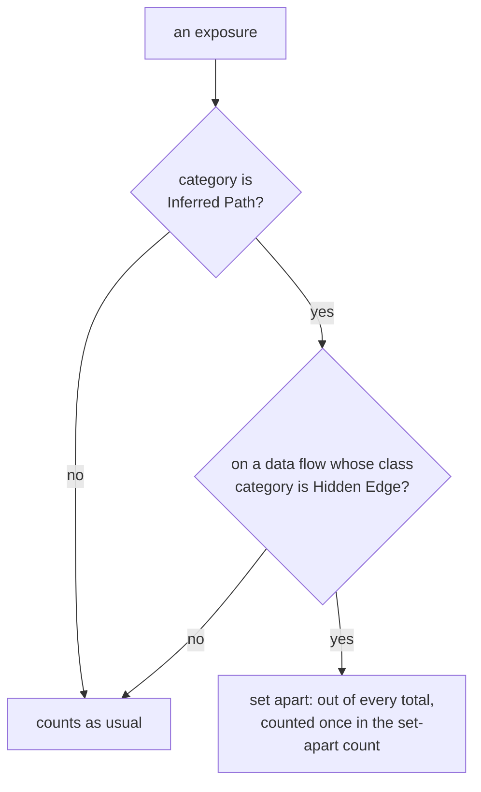

# Hidden Edges — Analysis Contract

Once an operator accepts a hidden-edge candidate, the reviewing client records it in the model as an ordinary data flow. From then on every analysis that follows flows or counts exposures meets it. This document is the contract those analyses code against: how to recognise a hidden edge, which of its fields to rely on, what its own findings are, the one rule that keeps them out of totals, and how each consumer in the platform includes, labels or excludes it.

**What this document covers:** what a hidden edge is in the graph; its fields and their orders; its `Inferred Path` findings; the set-apart rule; the two kinds of consumer and what each owes; class matching; and how the platform's own consumers apply the contract. For the candidates before acceptance, see [query-contract.md](./query-contract.md).

---

## What a hidden edge is in the graph

A hidden edge is **a data flow whose class is a data flow class in the category `Hidden Edge`**:

```
(:Component)-[:FLOWS]->(:DataFlow)-[:FLOWS]->(:Component)
                           │
                           └─[:IS_INSTANCE_OF { required_capability, …, tier, … }]->(:DataFlowClass { category: "Hidden Edge" })
```

- It is identified by its **class category alone**, the exact string `Hidden Edge`, read from the model's data; each consumer holds the string as a constant in its own source. The ids of the four classes the hidden-edges module ships live only in the module's class files, and a consumer tests the category, not the id.
- It is an **operator-reviewed, inferred path, not a declared flow.** It says an attacker who holds the source may reach the target; it does not say data moves between them.
- It runs in one direction, from the foothold (source) to the reached end (target), always between two components.
- Its fields live where every class attribute lives: on the `IS_INSTANCE_OF` relation from the flow to its class.

The platform cannot tell an edge an operator accepted from a flow someone set to a `Hidden Edge` class by hand: the category is the whole test. Every rule below therefore applies to any flow of a `Hidden Edge` class. A reviewing client that holds its own decision records may apply a stricter test locally.

---

## The fields a consumer relies on

A consumer relies on the **base fields** and the **fields the reviewing client writes**, the same in every hidden-edge class. It never relies on a kind-specific field (`credential_basis`, `transport_state`, `capture_side`, `escape_vector`): those describe one kind and may change with the table.

| Field | Values | Meaning |
|---|---|---|
| `required_capability` | `opportunistic` < `targeted` < `advanced` | The attacker capability the path needs |
| `required_privilege` | `none` < `user` < `admin` < `system` | The privilege an attacker must hold at the source |
| `granted_privilege` | `none` < `user` < `admin` < `system` | The privilege an attacker holds at the target once the path is taken. For `credential-capture` it is the captured sender's identity at the receiver, not a host privilege |
| `hidden_edge_kind` | `remote-service`, `credential-reuse`, `credential-capture`, `host-escape` | The kind; fixed per class |
| `technique_ids` | ATT&CK ids, at most 10 | The path techniques; each becomes one of the edge's own exposures |
| `source_exposure_ids` | Exposure ids, at most 50 | The exposures the path was inferred from: the link back to the findings that justify it |
| `proposed_by` | `rule`, `operator` | `rule` when accepted as proposed; `operator` when the operator edited it first |
| `tier` | `high`, `medium`, `low` | How firmly the model's facts supported the path when it was proposed: confidence, not impact |

`rationale` (the operator's own words, optional) is for display only. The capability and privilege fields are on fixed, ordered scales, so an analysis can chain on them: an actor follows an edge only when it holds what the previous edge granted. The hidden-edges module itself does not chain.

---

## The edge's own findings: `Inferred Path`

Every hidden-edge class carries the same generic policy. For each well-formed entry of the flow's `technique_ids` (the first ten are read), it emits **one exposure on the flow**:

| Exposure field | Value |
|---|---|
| `category` | `Inferred Path` |
| `name` | `Inferred <kind> path: <technique>`, for example `Inferred credential reuse path: T1078` |
| `description` | States that the flow is marked as an inferred attack path, the technique, the tier as confidence and the privilege granted at the target. Nothing from the flow's free-text fields is copied in |
| `criticality` and `score` | From `granted_privilege` only: `none` low 3.0, `user` medium 5.0, `admin` high 7.5, `system` critical 9.0, unstated medium 5.0. The tier never moves the score |
| `attack_vector` | `LOCAL` for `host-escape`, `ADJACENT` for `credential-capture`, `NETWORK` otherwise |
| `EXPLOITED_BY` | The technique, linked as any exposure's technique is |

These findings describe a **route**, not a weakness of the model as drawn: they restate, as a path, what the exposures in `source_exposure_ids` already found. Counting them beside those exposures would count the same risk twice.

The hidden-edges module never anchors a new candidate on a hidden-edge flow, never treats one as a declared flow when it excludes pairs, and never reads a credential item from one.

---

## The set-apart rule

> An exposure is **set apart** from totals only when its category is **`Inferred Path`** AND it sits on a data flow whose class category is **`Hidden Edge`**. An `Inferred Path` exposure anywhere else counts as usual.

Both halves must hold. An ordinary exposure on a hidden-edge flow counts; an exposure filed under `Inferred Path` on a component or an ordinary flow counts.

**The threat report and coverage-tools** keep the set-apart findings out of their severity and count totals, and each reports **one count** of what it set apart beside those totals, so nothing disappears silently. The platform's control-gaps query (`controlGaps`) counts these findings like any other.



---

## Two kinds of consumer

| A consumer that reports… | Does with a hidden-edge flow | Says so by |
|---|---|---|
| **Reachability or attack paths** (flow routes, choke points, blast radius, crown-jewel reachability) | **Includes it** as a route, since it is one | Labelling every route, node or jewel that uses one: "via inferred edge", with the edge's tier and the privilege it grants |
| **Flow hygiene, zoning, boundary crossings, control coverage or compliance-style facts** | **Excludes it** by class category, since these judge the model as drawn | Reporting one count of the hidden-edge flows it left out, and naming them where it lists flows |

In both kinds, the edge's own `Inferred Path` findings follow the set-apart rule.

---

## Class matching

A hidden-edge class is never the class of an ordinary element. The platform's `matchClasses` query treats it as any other class, so a client that proposes classes for ordinary elements leaves the hidden-edges module's classes out itself: [Dethereal](../dethereal/MCP_ARCHITECTURE.md#match_classes)'s `match_classes` drops every candidate of that module.

---

## How the platform's consumers apply the contract

| Consumer | Hidden-edge flows | `Inferred Path` findings on them | Documented in |
|---|---|---|---|
| **Threat Report** Reachability (crown-jewel, pick-two, choke points, blast radius) | Included and labelled "via inferred edge (\<tier\>, grants \<privilege\>)"; a declared choke point an inferred edge goes around is named as bypassed | Never raise on-route posture | [frontend.md](../dethernety-threat-report/frontend.md#hidden-edges-in-the-report) |
| **Threat Report** Boundary Crossings, the declared-zone policy, the zoning block, defense-in-depth, and the control grading in Coverage & Gaps | Excluded; Boundary Crossings counts and names them | — | [frontend.md](../dethernety-threat-report/frontend.md#hidden-edges-in-the-report), [backend.md](../dethernety-threat-report/backend.md#hidden-edge-flows-in-the-zoning-input) |
| **Threat Report** Component Profile | A neighbour reached through one is marked inferred | Out of the element's totals | [frontend.md](../dethernety-threat-report/frontend.md#hidden-edges-in-the-report) |
| **Threat Report** Residual Risk, Posture Summary, Coverage & Gaps, exports | — | Set apart from every total, with one count | [frontend.md](../dethernety-threat-report/frontend.md#hidden-edges-in-the-report), [data-model.md](../dethernety-threat-report/data-model.md#hidden-edge-flows-and-set-apart-findings) |
| **Coverage Tools** `gradedCoverage` | — | Set apart from `exposures`, `techniques` and every `meta` count; counted in `meta.inferredPathSetApart` | [coverage-facts.md](../dethernety-coverage-tools/coverage-facts.md#inferred-path-exposures-set-apart) |

---

## Related documentation

| Topic | Document |
|-------|----------|
| The candidates before acceptance | [query-contract.md](./query-contract.md) |
| How candidates are produced | [architecture.md](./architecture.md) |
| Module index | [README.md](./README.md) |
