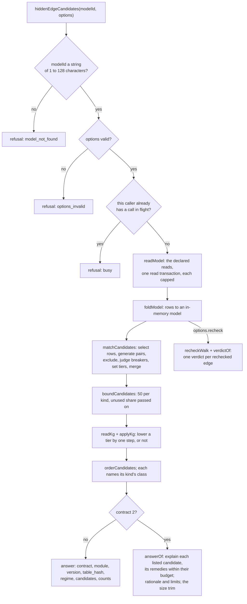
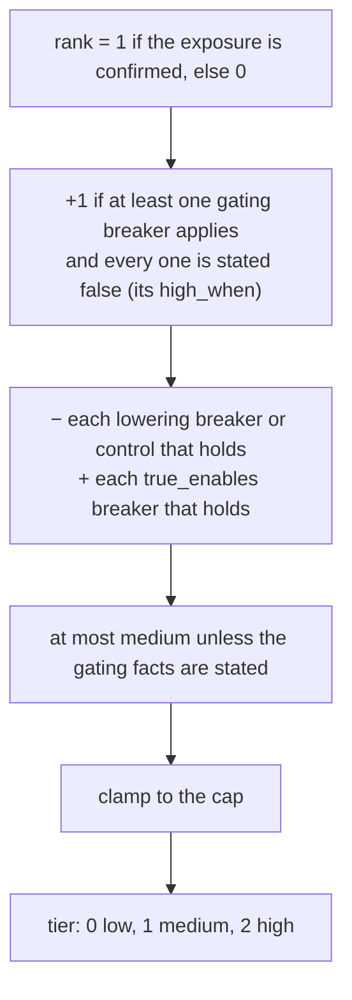

# Hidden Edges — Architecture

Dethernety Hidden Edges turns a model's exposures into proposed attack paths. Its design has three parts: a fixed set of read-only Cypher reads that return flat rows, a pure fold that builds an in-memory model from them, and a pure matching core that applies the **edge-kind table** to that model. An optional knowledge-graph step can then lower a candidate's tier. This document explains how a candidate comes to exist, what decides its tier, what bounds the work, and why each step is shaped the way it is.

**What this document covers:** the module's shape; one call end to end; the reads and the fold; the edge-kind table, with the footholds each row acts from; which exposures feed the matching; anchors, roles and peer relations; the exclusions; breakers; tiers; the merge; the budgets and the order; the knowledge-graph regime; the bounds; determinism and read-only discipline; and contract 2's explanations, remedies and recheck. For the answer's field-level shape, see [query-contract.md](./query-contract.md); for what analyses see once an edge is accepted, see [analysis-contract.md](./analysis-contract.md).

---

## 1. Module shape

The module extends `DtFileOpaModule`, the platform's file-policy base class (see [Base classes](../modules/BASE_CLASSES.md)), because it ships classes: the four hidden-edge data flow classes under `data/dethernety-hidden-edges/dataFlow/`, served and evaluated as any class module's are. On top of that base it adds:

- **`getSchemaExtension()`**: one query field, `hiddenEdgeCandidates(modelId: ID!, options: String): String`.
- **`getResolvers(context)`**: the field's resolver. It captures the session-scoped database name and creates the knowledge-graph client from the resolver context.

At load the module validates its edge-kind table (`validateTable`) and hashes it (`table_hash`). A table that fails validation fails the module's load, never one call: a half-read row would propose edges nobody wrote. It also reads its four class files, `dataFlow/<kind>/class.json`, once (`readKindClasses` in `src/classes.ts`): the class ids live only there. A missing or malformed file, one outside the `Hidden Edge` category, or a repeated id fails the load. Each candidate in the answer names its kind's class (`class: { id, name }`), the class an accepted edge of that kind is written with.

---

## 2. One call, end to end

A contract-2 call takes the same path to the listed candidates, so its candidates are contract 1's, each with an explanation (see [Explanations](#14-explanations-contract-2)). A call with `recheck` leaves the path after the fold (see [The recheck](#16-the-recheck-contract-2)).

A read over its cap answers `model_too_large`; a deadline passed between reads or while matching answers `deadline`. Any other failure is a fault: it is logged without the query, its parameters or its message, and thrown with a generic message, which the platform reports as a module error.

**The candidates are chosen before the knowledge graph runs.** The per-kind budgets are applied first, so the knowledge graph can lower a tier but never push a candidate out of the answer.

---

## 3. The reads and the fold

### The reads

`src/reads.ts` declares every query the module runs; the runner inside the read transaction refuses any other text. The reads are flat, one per fact type, so an `OPTIONAL MATCH` never multiplies another fact's rows, and each has a cap of its own:

| Read | Cap (rows) |
|---|---|
| Boundaries, walked from the model's root boundaries one hop at a time, with a visited set | 2,000 boundaries; 4,000 boundary edges |
| Components under the boundaries reached | 5,000 components; 10,000 component edges |
| Flows between those components, and the data items each flow carries | 10,000 flows; 20,000 flow–data rows |
| The model's data items | 5,000 |
| Class instances (`IS_INSTANCE_OF`) of every element, with the relation's whole property map | 25,000 |
| Exposures on every element, with their disposition facts | 20,000 |
| The exposures' ATT&CK techniques, from `EXPLOITED_BY` | 40,000 |
| Controls supporting the elements (`SUPPORTS`), and the controls' classes | 20,000 supports; 5,000 controls; 10,000 control classes |

Each read asks for at most its cap plus one row, and one row over the cap refuses the call as `model_too_large`, naming the read. The caps are module constants, written into the Cypher as integer literals. The attribute data one call may hold is capped as well: 32 MiB of class-relation property maps, which any user who can edit a model can grow.

The boundary walk visits each boundary once and stops at 50 levels of nesting (`boundaryDepthCut` in the counts says whether it stopped with boundaries left). `parentBoundary` is a list, so the forest may be a DAG or even hold a cycle; a variable-length match would enumerate paths, while this walk does not.

### The fold

`foldModel` turns the rows into the in-memory model the matching works on. It is pure, and it treats the rows as untrusted in shape:

- A value of the wrong type is treated as absent.
- A reference it cannot resolve (an end of a flow outside the model, an exposure on an element it left out) is left out and counted in `danglingReferences`; a push may be under way while the reads run.
- An element with no class or several is left out and counted (`elementsWithoutClass`, `elementsWithSeveralClasses`), except a boundary, which stays in the forest unclassified so its children keep their place.
- Attribute values are rebuilt from the platform's flat keys; "absent" and "explicitly `false`" stay apart, because the tier rules read them differently.
- Each exposure's **lifecycle** comes from `lifecycleOf` in `src/fold.ts`: `AFFIRMED` by someone is **confirmed**, `AFFIRMED` by no one is **pending**, `RISK_ACCEPTED` is **confirmed** and `COMPENSATING_CONTROL` is **pending**, any other disposition kind is **disposed**, and an exposure with no disposition is confirmed when a user authored it and pending otherwise.

---

## 4. The edge-kind table

The table (`src/edge-kinds.json`, compiled into the build) says which exposure techniques, on which elements, suggest which hidden edge; how the other end is found; and which attributes or controls break or weaken the path. It holds **27 rows** over the four kinds. Rows are keyed on technique ids, element kinds and class names as the platform stores them, never on class ids.

### A row

| Part | Meaning |
|---|---|
| `id`, `edge_kind` | The row id (`<kind>/<name>`) and the kind it proposes |
| `techniques` | The ATT&CK techniques that select it |
| `anchors` | The element kinds it anchors on (`component`, `securityBoundary`, `dataFlow`, `data`), optionally limited to named classes; a flow anchor of a target or source row names the anchored end (`initiator` or `responder`) |
| `exposed_role`, `peer_relation` | How the anchor becomes pairs (below) |
| `reached_types` | For target and source rows: the component types a reached end may have (`PROCESS`, `STORE`, `EXTERNAL_ENTITY`) |
| `foothold_types`, `managed_foothold` | The component types a foothold may have, and whether a foothold under a Managed Runtime holds the pair at low (see [Footholds](#footholds-the-types-a-row-acts-from-and-managed-footholds)) |
| `credential_flows` | For credential rows: how a component anchor uses the credential items on its flows (`outbound`, `both`, `received`) |
| `path` | The technique the accepted flow will carry: the cited technique when it is in `from_cited`'s families, else the technique named for the credential item's class, else `default` |
| `attribute_breakers`, `control_breakers` | What breaks or weakens the path (see [Breakers](#7-breakers)) |
| `defaults` | The base-field defaults: `required_capability`, `required_privilege`, `granted_privilege` |
| `tier_cap` | The highest tier the row may give |
| `provenance` | Why the row exists, 1 to 500 printable ASCII characters: the ATT&CK technique and the mitigations it rests on. A contract-2 answer passes it on as the row's `rationale` |
| `emitters` | The policy locators of the open-source classes that emit the row's techniques; the table lint checks each against the repository |

### Selection

For each technique an exposure cites, a row is chosen by the technique, the element kind it sits on and that element's class name: a row naming the class wins over a row for any class of the kind; failing both, the parent technique is tried the same way. A bare parent technique cited beside one of its own sub-techniques that selects a row is the sub-technique's context and selects nothing (a host's instance-metadata finding cites T1552.005 and T1552). One exposure can select several rows; each selection carries the cited techniques that chose it, and breaker filters and `path.from_cited` compare against those and their parents. The validator refuses a table in which one technique on one element kind and class selects two rows.

### The rows by kind

| Kind | Rows | Techniques | Anchored on |
|---|---|---|---|
| `remote-service` | 9 | T1021 (and .001, .004), T1210 | Network segments and management planes, hosts, application layers, the office environment; secure remote access and internal service flows; listed service components; VPN gateways and administrators |
| `credential-reuse` | 13 | T1078, T1550, T1552, T1555, T1003, T1558 and listed sub-techniques of each | Components, data items, boundaries, flows; SNMP monitoring flows; hosts and application services (instance metadata); Kerberos authentication flows |
| `credential-capture` | 4 | T1040, T1557 | Flows, components, boundaries, data items |
| `host-escape` | 1 | T1611 | Containers |

`edge-kinds.json` (table format version 3) is the source of truth for the exact rows; the table lint test pins each against the open-source catalogue, and a committed snapshot records the row every catalogue finding selects.

### Roles and peer relations

A row's **role** says which end the anchor is, and its **peer relation** how the other end is found. The validator refuses any other pairing.

| Role | Edges run | Relations it may use |
|---|---|---|
| `target` | foothold → the anchored end (the anchor is reached) | `in-zone`, `same-segment`, `segment-outside-anchor`, `kerberos-realm` |
| `source` | the anchor → a reached peer (the anchor is the foothold) | `landing-segment`, `zone-egress`, `instance-role-reach`, `kerberos-realm`, `same-host-outside-container` |
| `capture` | a foothold beside a credential-bearing flow → the flow's responder | `capture-footholds` |
| `credential` | the holder of a credential item → an acceptor of the same item | `shared-credential` |

| Relation | How the pairs are found |
|---|---|
| `same-segment` | Footholds: the reached end's peers under the same **segment**, the nearest separating network boundary (a Network Segment or the Endpoint / Office Environment) or, with none, a Network Perimeter, which caps the pair at low |
| `in-zone` | Reached: the components within the anchoring boundary, down to the next separating boundary below it. Footholds: the other components within it and the reached end's same-segment peers |
| `segment-outside-anchor` | Reached: the components under the anchoring boundary (a host). Footholds: their same-segment peers outside it |
| `landing-segment` | Reached: the components in the segments the anchor's own declared flows land in, other than the flows' own targets |
| `zone-egress` | Footholds: the processes under the anchoring zone. Reached: components under separating boundaries outside it, crown jewels first, at most 20 |
| `instance-role-reach` | Reached: the cloud services (External Cloud Service or Object Storage components, or the targets of Secret Retrieval flows) that any workload on the foothold's host reaches and the foothold does not already reach; a Managed Runtime instead of a host caps the pair at low |
| `kerberos-realm` | The realm: the initiators of Kerberos Authentication flows to the anchored flow's responder |
| `same-host-outside-container` | Footholds: the components in the anchoring container. Reached: the components on the same host outside it |
| `capture-footholds` | Footholds: the same-segment peers of either end of a credential-bearing flow, apart from both ends. Reached: the flow's responder |
| `shared-credential` | Holder → acceptor pairs of the same credential item, from the declared flows that carry it |

### Footholds: the types a row acts from, and managed footholds

The **foothold** is the pair's source, the component an attacker starts from. Sniffing a flow, escaping a container, fetching an instance-role credential or dumping credentials needs code running there, so a row names the component types its foothold may have (`foothold_types`); a row whose foothold is the anchor itself, or the holder of a credential item, names none. A pair whose foothold is of another type is skipped before it spends the anchor's pair budget, and counted in `excluded_foothold_type`.

| Rows | `foothold_types` | `managed_foothold` |
|---|---|---|
| The `remote-service` target rows (`rs-1`, `rs-1f`, `rs-2`, `rs-3`, `rs-3f`, `rs-3b`); `credential-reuse/cr-2`, `cr-2f`, `cr-4` | `PROCESS`, `EXTERNAL_ENTITY`: an outside device stays a foothold | `keep` |
| `credential-reuse/cr-3`, `cr-3f` (instance-role reach) | `PROCESS` | `keep` (the relation holds a managed host at low itself) |
| `credential-reuse/cr-1d`, `cr-1db` (credential dumping) | `PROCESS` | `low` |
| Every `credential-capture` row; `host-escape/he-1` | `PROCESS` | `low` |
| `remote-service/rs-4v`, `rs-4a`, `rs-5`; `credential-reuse/cr-1`, `cr-1b`, `cr-1s`, `cr-1f`, `cr-4b`, `cr-4c` | none (`rs-5`'s `zone-egress` relation offers processes only) | `keep` |

**Managed footholds.** Where a foothold sits under a **Managed Runtime** boundary, host-level access is the platform vendor's, not the workload's: code there cannot sniff the network, dump the host's credentials or escape to a host. A row with `managed_foothold: low` holds such a pair at low, with the low reason `managed_runtime`; a row with `keep` judges it as any other.

The validator refuses a `zone-egress` row that names a foothold type other than `PROCESS`, and a row whose relation offers only reached ends of named types without naming its `reached_types`.

A **credential item** is a data item whose `isCredential` answer is true; when the author has not answered, its class decides (User Credentials, Authentication Tokens). A **credential-bearing flow** carries a credential item, or its class is in the category Identity & Access. For a flow whose credential travels in the response (Secret Retrieval, Certificate Enrollment, Authentication Exchange), a capture also reaches the item's other acceptors. A credential item carried by more than five flows is generic and caps its pairs at low.

---

## 5. Which exposures feed the matching

An exposure feeds the matching when:

- its lifecycle is **confirmed**, or **pending** and the call's `include_pending` is not `false` (the default is `true`); a **disposed** exposure never feeds. A risk-accepted exposure is confirmed because the weakness is still there: accepting a risk says it is real and tolerated. A compensated exposure is pending: a control reduces the weakness, but neither disposition says it blocks an attacker's path;
- it is not on a **hidden-edge flow**, a flow whose class is in the category `Hidden Edge`. Such a flow's exposures are the inferred path itself; they never anchor (`hidden_edge_anchors_skipped`);
- its techniques select at least one row (otherwise `exposures_without_row`).

A component anchor of a target row must itself be a type the row reaches: an administrator is the source of movement, not a reached service.

---

## 6. Pairs and exclusions

For each (exposure, row), the relation generates **pairs** (foothold → reached end), round-robin over the reached ends, so a budget is shared fairly. A pair whose foothold is not a component of the folded model is dropped at once, with no count; one whose foothold is of a type the row cannot act from is skipped (`excluded_foothold_type`, see [Footholds](#footholds-the-types-a-row-acts-from-and-managed-footholds)). Neither spends the budget. One rule (`footholdOk` in `src/generate.ts`) decides which types a row acts from, the processes-only rule of `zone-egress` included, for the matching and the recheck alike. Work is bounded: at most **1,000 pairs** are considered per (exposure, row), and at most **10,000 distinct pairs** drawn, skipped ones included, so a walk where most of what a relation offers is skipped still ends (either is counted in `pairs_over_anchor_budget`); and at most **200,000** are judged per call, over which the call is refused as `model_too_large`, never answered in part. The matching yields to the event loop every 2,000 pairs and checks the deadline.

Each pair is then dropped, and counted, by the first exclusion that applies, in this order. Exclusions 1 to 4, and the tier of a pair that passes them, are one step, `judgePair`, which the [recheck](#16-the-recheck-contract-2) shares, so the two cannot drift apart:

| Order | Exclusion | Count |
|---|---|---|
| 1 | Both ends are external entities | `excluded_external_pair` |
| 2 | The reached end's type is not in the row's `reached_types` | `excluded_reached_type` |
| 3 | A **declared** flow already runs from the foothold to the reached end, in that direction (a hidden-edge flow is not a declared flow) | `excluded_declared_flow` |
| 4 | A breaker removes the pair | `excluded_by_breaker` |
| 5 | The pair's candidate id is in the call's `excluded` option | `excluded_by_decision` |

A pair whose end is not a component of the folded model, or whose two ends are the same component, is dropped first without a count. `excluded` is directional: excluding A → B does not hide B → A.

---

## 7. Breakers

A **breaker** is a fact that breaks or weakens the path. It applies to all of a row's techniques or only to those it names.

The breakers' facts drive contract 2's explanation as well: each gating breaker is one of the conditions high needs, and its attributes are reported as meeting it, leaving it unanswered or contradicting it (see [Explanations](#14-explanations-contract-2)).

**Attribute breakers** read one attribute, or a group, on a named element of the pair: the shared boundary, the nearest common ancestor of named classes, the reached end or its ancestor, the foothold or its ancestor, the anchor or its ancestor, the flow, the flow's responder, or the credential item. An attribute breaker reads only on the classes it lists, so "absent" never means "this class has no such attribute". Each has a polarity:

- **`true_breaks`**, with a strength: **`removes`** (all its attributes `true` drops the pair) or **`lowers`** (lowers the tier by one). It also says how it gates the high tier, through `high_when`: `all_false` (every attribute explicitly `false`), `any_false` (a group any member of which is enough on its own, so one explicit `false` counts) or `ignored` (it only lowers).
- **`true_enables`**: all its attributes `true` raises the tier by one, up to the cap; `false` or absent never counts toward high.

A breaker lists as `own_condition` the findings that fire on its own attribute being absent or false. When the cited exposure is one of them and the attribute is read on the element it sits on, the attribute cannot be true there, so the breaker gates the tier but never removes. Of those, it lists as `clears` the findings that fire **only** on its attributes (every rule body of the finding tests one of them as false or absent): stating the attributes true clears such a finding, which a [remedy](#15-remedies-contract-2) reports. The validator refuses a `clears` entry its `own_condition` does not name.

**Control breakers** count a control of named control classes that `SUPPORTS` the reached end (or an ancestor), the flow or the anchor, optionally only when one of named attributes is `true` on the control, and optionally only for named credential item classes (MFA protects a person's password, not a machine credential). They remove or lower. One control class set counts once, and one control counts once.

The locators of the facts a breaker read go into the candidate's `facts`: `attributes:<element id>#<attribute>` and `control:<control id>`.

---

## 8. Tiers

A tier says how firmly the model's facts support a pair: **high**, **medium** or **low**. It is confidence, not impact; what the path grants is `granted_privilege`.

The **cap** is the lowest of:

- the row's `tier_cap`;
- the cap the row's breakers support for the cited techniques that selected it (the highest among them): high needs a breaker that gates high, medium any breaker that breaks the path, and a technique with neither is held at low;
- **medium** when the exposure is pending;
- **low** when the relation alone is weak: a segment that is only a network perimeter, a managed runtime instead of a host, a foothold under a managed runtime for a row with `managed_foothold: low`, a generic credential item;
- **medium** for a zone anchor (a target row in `in-zone` anchored on a boundary) unless the reached component has its own confirmed exposure of the technique's family, which is then cited with the candidate as an `exposure:<id>` fact.

So a confirmed exposure with an applicable breaker attribute left unstated is medium; with every gating attribute explicitly `false`, high; a pending exposure is never above medium; and a gating breaker that is `true` has already failed the gate and lowers no further. An explicit `false` is a recorded answer: nothing in the platform writes a schema default into a model's attributes.

---

## 9. The merge

After the per-(exposure, row) peer cap (at most **20 pairs**, chosen by tier, then foothold relevance, then generation order; `peers_capped`), the pairs of one (kind, source, target) merge into one candidate. **The candidate rests on the parts that give it its tier:** only the parts at the highest tier among them contribute, so a lower part's technique, exposure or defaults never rides on a higher one (a technique capped at low would otherwise become a high finding of the accepted flow).

| Candidate part | From the winning-tier parts |
|---|---|
| `technique_ids` | Their path techniques |
| `cited_techniques`, `exposure_ids`, `rows`, `facts` | The union of theirs |
| `defaults` | The one row's defaults that is easiest for the attacker: the lowest capability and required privilege together, then the highest granted privilege; never a mix of rows |
| `fields` | Per kind-specific field, the most telling value set: `cleartext` over `tls_unverified` over `unstated`; `both` over `initiator_segment` over `responder_segment`; `configuration` over `kernel_or_runtime` over `unstated`; `default_account` over `shared_item` over `instance_role` over `kerberos_realm` |

The candidate id is `he:` and the first 16 hex characters of SHA-256 over the kind, source and target joined by NUL, so the same pair always has the same id. The lists `exposure_ids`, `facts` and `cited_techniques` keep at most 50 entries; `totals` gives their full lengths.

---

## 10. Budgets and order

The answer holds at most **200 candidates**: a budget of **50 per kind**, taken in the order remote-service, credential-reuse, credential-capture, host-escape; a kind that uses less passes its unused share to the next. Within a kind, and in the answer, candidates are ordered by tier, then whether the target is a crown jewel, then id. `kind_budget_dropped` counts what the budgets left out.

The peer cap of [the merge](#9-the-merge) uses a different relevance: for a target row, footholds with an inbound flow from an external entity or a confirmed exposure first; for a source row, crown jewels first.

---

## 11. The knowledge-graph regime

The module applies the knowledge graph through the deployment's knowledge-graph client (`createKgClient` from `@dethernety/dt-module`), with the caller's own token, since entitlement is a statement about the caller. The answer's `regime` says which applied:

| `regime` | When |
|---|---|
| `{ "kg": "kg_present" }` | The capability probe answered available and entitled, and every read succeeded |
| `{ "kg": "kg_absent", "reason": "no_data" }` | The client reports no knowledge-graph data |
| `{ "kg": "kg_absent", "reason": "not_entitled" }` | The caller is not entitled |
| `{ "kg": "kg_absent", "reason": "no_session" }` | The client has no session for the caller |
| `{ "kg": "kg_absent", "reason": "unavailable" }` | The client is unavailable or misconfigured |
| `{ "kg": "kg_absent", "reason": "failed" }` | A read failed or passed the timeout |

**One timeout bounds every knowledge-graph read: 15 seconds,** never past the call's own deadline. Any read that fails or times out makes the whole call `kg_absent` with reason `failed`; the candidates keep the tiers the facts gave them.

**What leaves the platform.** After the capability probe, two batched reads: the exposure rules of the model's **class inventory** (the class ids of its elements held by an allowed module, sorted, at most 250; the rest is counted in `kg_classes_capped`), then the threats of those rules (at most 2,000 rule references the knowledge graph itself returned). The inventory depends on what the model contains, never on its exposures or the candidates. No element id, model id, name, attribute value or finding is sent. The allowed module is `dethernety-general` by default. A deployment that sets `MODULE_KG_CLASS_MODULES` (comma-separated module names) replaces that list, so it must name `dethernety-general` too to keep its classes.

**What it can change.** The knowledge graph can **lower a tier by one step, never raise it and never drop a candidate.** A candidate is lowered, and marked `kg: "lowered"`, when:

- **anchor side:** every anchoring part at the candidate's tier fails its check. A part is checked only when the platform's evaluation created the finding (a user's own assertion is not checked), against the rules of the finding's own class with the same name and, when both are known, the same policy hash. It fails when such a rule has threats but its condition groups do not hold on the element's attributes, or its threats cite none of the row's technique families. A part with no checkable rule is unknown, which is not a failure.
- **peer side,** only when every anchoring part is a `source` row: the reached component's class is covered by the knowledge graph, its rules have threats, and none cites the kind's technique families.

A low candidate stays low. The rules that failed are added to `facts` as `kg:<rule id>`, and a failed peer class as `kg-class:<class id>`.

This is a **consistency check, not a second source**: the class policies and the knowledge-graph rules come from the same class research, so the knowledge graph agreeing adds no independent confirmation; disagreeing is a reason to trust a candidate less.

---

## 12. The bounds

The platform's resolver timeout (30 s) cancels nothing, and Memgraph ignores the driver's transaction timeout, so the work is bounded by what it may read and do:

| Bound | Value | Over it |
|---|---|---|
| Rows per read | See [the reads](#the-reads) | `model_too_large`, naming the read |
| Class-relation attribute data | 32 MiB | `model_too_large` (`attributeBytes`) |
| Boundary nesting followed | 50 levels | Deeper boundaries left out; `boundaryDepthCut: true` |
| Pairs considered per (exposure, row) | 1,000 | The rest not considered; `pairs_over_anchor_budget` |
| Distinct pairs drawn per (exposure, row), skipped footholds included | 10,000 | The rest not drawn; `pairs_over_anchor_budget` |
| Pairs judged per call | 200,000 | `model_too_large` (`matching`) |
| Pairs kept per (exposure, row) | 20 | `peers_capped` |
| Candidates per answer | 50 per kind, 200 in all | `kind_budget_dropped` |
| List entries per candidate | 50 | `totals` gives the full count |
| The module's deadline | 25 s, checked between reads and as matching yields | `deadline` |
| Knowledge-graph reads | 15 s in all | `kg_absent`, `failed` |
| Calls in flight | One per caller (the verified user's subject; one shared key when authentication is off), per process | `busy` |
| `options` | 128 KiB; `excluded` at most 2,000 ids; `recheck` at most 200 edges of at most 50 findings each | `options_invalid` |
| Parts explained per candidate (contract 2) | 3, each with at most 12 facts | `parts_total`, `facts_total` give the full counts |
| Remedies (contract 2) | 100,000 pairs judged again per call; none once less than 5 s of the deadline is left; 5 kept per candidate | `remedies: null`; `limits.remedies_skipped`; `remedies_total` |
| A contract-2 answer's size | 900 KiB (UTF-16 units) | Explanations cut to the primary part, then left out; `limits.explain_trimmed` |
| Ways in and facts per rechecked edge | 10 ways in, 12 removing facts | The rest not listed |

---

## 13. Determinism and read-only discipline

- **Deterministic.** The same platform state, table, options and knowledge-graph regime give the same answer on every call. Elements and exposures are processed in id order, every list in the answer is sorted, and ties break by id.
- **Read-only.** The module opens its session with `defaultAccessMode: READ` and reads through `executeRead`. Memgraph does not enforce the access mode, so the module adds its own guarantees: the runner refuses any Cypher but the declared reads, and a unit test refuses write clauses and procedure calls in them.
- **Portable.** No read aggregates a map, no list comprehension builds a map literal, attribute values are never `collect()`ed (it drops nulls), and every `LIMIT` is an integer literal (a Bolt parameter arrives as a float, which Memgraph refuses in `LIMIT`).
- **No error echoes.** Errors never carry Cypher, parameters or attribute values.
- **No authorization of its own.** The platform has no per-model authorization: any verified user can read any model through the platform's own queries, and can learn here whether a model id exists and its counts.

---

## 14. Explanations (contract 2)

A contract-2 answer (`answerOf` in `src/answer.ts`, asynchronous) explains each listed candidate after the matching and the knowledge graph have run, so contract 1 does no more work than it did. It gives the event loop a turn between candidates, so a long explanation never holds the process. With `explain` set, `matchCandidates` keeps each candidate's parts and the topology; `explainPart` in `src/generate.ts` judges a part again, recording each fact it weighs and the reasons beside its tier (`basis`), and gives the same tier the matching gave.

- **Which parts.** The parts at the candidate's tier before the knowledge graph (the parts the merge kept), confirmed findings first, then by exposure, row and credential item; at most 3. The first is the **primary part**.
- **What a part says.** Its row, role and relation, the exposure and element it anchors on, the techniques that selected the row, the path technique, the boundary the relation was computed under, the flow and the credential item, its low reason, its tier, its `basis` (confirmed or pending; how many conditions high needs and how many are stated; what raised or lowered it; what caps it, and whether high is reachable at all) and its facts, each with the stated value and its effect.
- **The knowledge graph's step** is the candidate's: its evidence is said once, on the primary part, after the model's facts, at most two of them.
- **The rationale** of each row a listed candidate uses is the row's `provenance`.
- **The limits** say where the caps left the answer short: per kind, the candidates listed and not listed for the budget, the pairs past the peer cap and the selections past their pair budget.

**The size trim.** A contract-2 answer is held under 900 KiB (UTF-16 units). Each explanation is measured once in each form it can take; over the limit, every candidate keeps only its primary part, and then explanations are replaced by `{ "omitted": "size" }` from the lowest-ordered candidate up. The answer is never refused for its size.

The field-by-field shape is in [query-contract.md](./query-contract.md#explain-contract-2).

---

## 15. Remedies (contract 2)

A remedy answers: what one statement in the model would remove or lower this edge (`src/remedies.ts`)? A candidate is the merge of several parts, and a breaker on one part says nothing about the edge, so a remedy is judged over the whole edge:

1. **The changes.** Each `true_breaks` attribute breaker of a part, on an element the pair has, whose attributes are not all stated `true` yet, suggests stating them `true` there; each control breaker the part's own judging finds unmet suggests a control of its class on the element it reads its controls on. The same change suggested by several parts is judged once.
2. **The judging.** Each change is applied to a copy of the topology that states that one thing more (and, for an attribute change, drops the findings the breaker `clears`, which then anchor nothing). Every part of the edge is judged again on it, the parts the peer cap set aside included.
3. **The outcome.** `removes` when no part survives; `lowers_to:low` or `lowers_to:medium` when the best surviving part is lower than the candidate's tier as its kept parts give it (before the knowledge graph); `this_path_only` when some parts close but the tier stays. A change that does neither is not a remedy.
4. **One flow is not every flow.** A part names one flow carrying the credential. When another credential-bearing flow carries the same credential to the reached end (for a capture, one beside the foothold's segment that the model does not state encrypted), a change on the named flow closes that way in only.

At most 5 remedies are kept per candidate, the strongest first; `remedies_total` counts all. The work has its own budget: 100,000 pairs judged again per call, and it stops when less than 5 seconds of the call's deadline is left. Reading a candidate's ways in for their changes is part of that work: it, too, stops when the deadline leaves no room. Past either, the candidates left get `remedies: null`, counted in `limits.remedies_skipped`, and the answer still arrives. The remedies give the event loop a turn every 2,000 steps (a way in read for its changes, or a pair judged again).

---

## 16. The recheck (contract 2)

A recheck (`options.recheck`, contract 2 only) judges edges a person already decided, accepted, rejected or took back, instead of proposing candidates. A missing candidate does not tell whether an edge still holds: an accepted edge's own flow is never a declared flow, so the edge is still generated, but a budget, a cap or an exclusion may each leave it out of an answer. So `recheckWalk` in `src/generate.ts` walks again:

- only the rows of the rechecked edges' kinds, over every exposure that is not disposed, pending included, with no peer cap, no kind budget, no exclusions and no knowledge graph;
- only the pairs of the rechecked edges: each relation is offered the rechecked footholds and reached ends, and a pair of another edge is passed over;
- each pair with why it was or was not kept, judged by the same per-pair step as the matching (`judgePair`, with `footholdOk` for the foothold): `kept` (with its tier from the model's facts, and whether its finding is pending), `removed` (with the facts that removed it), `end_type` (the reached end, the foothold, or a target row's anchor of a type the row does not take; unlike the matching, the recheck draws footholds of every type, so it can name one the row cannot act from) or `declared_flow`.

Every pair drawn counts against the call's 200,000-pair budget and yields to the deadline, as the matching does. `verdictOf` in `src/recheck.ts` then gives each edge the first verdict that matches: `end_gone`, `declared_flow`, `holds`, `removed`, `end_type`, `mixed`, `grounds_disposed` or `not_derived`. A verdict that is not `holds` carries a positive reason, so a client can tell an edge whose grounds a person disposed (`grounds_disposed`) from one whose findings stopped firing (`not_derived`). The answer's shape and each verdict's condition are in [query-contract.md](./query-contract.md#the-recheck-contract-2).

---

## Related documentation

| Topic | Document |
|-------|----------|
| The answer, field by field | [query-contract.md](./query-contract.md) |
| What analyses see of an accepted edge | [analysis-contract.md](./analysis-contract.md) |
| Module index, build and test | [README.md](./README.md) |
| `DTModule` interface | [../modules/DT_MODULE_INTERFACE.md](../modules/DT_MODULE_INTERFACE.md) |
| Base classes (`DtFileOpaModule`) | [../modules/BASE_CLASSES.md](../modules/BASE_CLASSES.md) |
| Platform overview | [../README.md](../README.md) |
