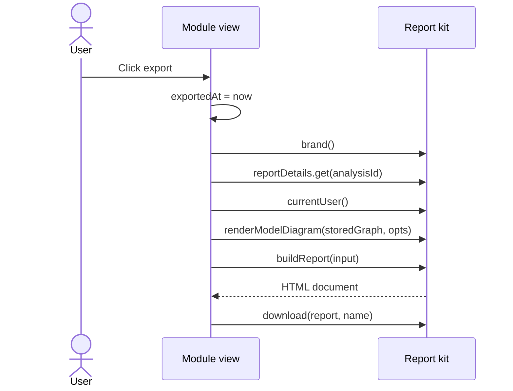

# Dynamic Module System

## Table of Contents
- [Overview](#overview)
- [Module Loading Flow](#module-loading-flow)
- [Failure Handling](#failure-handling)
- [Host Dependency Injection](#host-dependency-injection)
- [Component Registry](#component-registry)
- [Host Context Composable](#host-context-composable)
- [Report Kit](#report-kit)
- [Application Initialization](#application-initialization)
- [Module Development Guide](#module-development-guide)
- [Security Considerations](#security-considerations)
- [API Surface](#api-surface)
- [Debugging](#debugging)

## Overview

The dynamic module system lets a module ship Vue components that dt-ui loads at runtime, without rebuilding the frontend application. A module frontend is two files, `frontend/bundle.js` and `frontend/frontend-manifest.json`; the manifest names the component keys the bundle registers (see [DTModule Interface → Module frontend](../../modules/DT_MODULE_INTERFACE.md#module-frontend)).

dt-ui loads **no module frontend before it mounts**. A module's bundle is fetched the first time one of its component keys is needed, once per module.

**Primary Source Files:**
- `apps/dt-ui/src/services/ModuleLoader.ts`
- `apps/dt-ui/src/services/ComponentRegistry.ts`
- `apps/dt-ui/src/composables/useHostContext.ts`
- `apps/dt-ui/src/pages/analysisresults.vue` (the page that renders module components)
- `apps/dt-ws/src/gql/module-management-services/module-frontend.ts` (dt-ws: reading and serving bundles)
- `apps/dt-ws/src/modules/module-bundle.controller.ts` (dt-ws: the bundle route)

```
┌─────────────────────────────────────────────────────────────────────────┐
│                      Module Loading Architecture                        │
├─────────────────────────────────────────────────────────────────────────┤
│                                                                         │
│  1. Application Startup (no module is fetched)                          │
│     └─→ ModuleLoader.exposeHostDependencies()                           │
│         └─→ window.__HOST_DEPENDENCIES__                                │
│     └─→ app.mount('#app')                                               │
│                                                                         │
│  2. First Use: moduleLoader.ensure(key)                                 │
│     └─→ Key already registered? Return the component                    │
│     └─→ Otherwise read the manifest (getFrontendModuleManifest, once)   │
│         └─→ key → owning module                                         │
│                                                                         │
│  3. Bundle Fetch (once per module)                                      │
│     └─→ GET /module-bundles/<name>/<sha256>/bundle.js                   │
│         └─→ Bearer token; same origin as the API; no redirects          │
│     └─→ Check the bytes against the manifest hash                       │
│                                                                         │
│  4. Dynamic Import                                                      │
│     └─→ Blob → object URL → import(blobUrl) → revoke the URL            │
│                                                                         │
│  5. Module Installation                                                 │
│     └─→ module.install(hostDependencies)                                │
│         └─→ componentRegistry scoped to the module's own keys           │
│                                                                         │
│  6. Render                                                              │
│     └─→ The registry is reactive: the waiting view renders the          │
│         component once it is registered                                 │
│                                                                         │
└─────────────────────────────────────────────────────────────────────────┘
```

---

## Module Loading Flow

### What dt-ws holds

When the module registry loads or reloads a module, it reads `frontend/bundle.js` and `frontend/frontend-manifest.json` once and holds, on the module's registry entry, the bundle bytes, their sha256, gzip and brotli copies, and the validated manifest. A request never reads the disk. A reload replaces the whole held copy at once, so a URL carrying an old hash is never answered with new bytes.

A frontend that cannot be used is refused and logged by module name (`Module frontend not loaded`, with the reason); the module itself stays loaded. Refusals:

- one of the two files without the other;
- a file that is not a regular file (a symlink, a FIFO), or `frontend/` that is not a directory;
- a manifest over 64 KiB or a bundle over 32 MiB;
- a manifest that does not validate (`parseFrontendManifest` from `@dethernety/dt-module`).

**Source:** `module-frontend.ts` (`loadModuleFrontend`), `module-registry.service.ts` (`attachFrontend`)

### The manifest query

`getFrontendModuleManifest` returns one entry per module that is on the module allow-list (`ALLOWED_MODULES`) and has a frontend, sorted by name. It carries no bundle text.

| Field | Meaning |
|-------|---------|
| `name`, `version` | The module |
| `available` | `false` while the module is unhealthy; its bundle route then answers `503` |
| `hash` | sha256 of the bundle, lowercase hex |
| `size` | Bundle size in bytes, uncompressed |
| `url` | `/module-bundles/<name>/<hash>/bundle.js` |
| `components` | The component keys the bundle registers |
| `hostApi` | `{ min, max }`, the host dependency versions the bundle works with |

dt-ui reads it through `DtModule.getFrontendModuleManifest()` (dt-core, `network-only`) via `modulesStore.getFrontendModuleManifest()`.

### The bundle route

`GET /module-bundles/:name/:hash/bundle.js`, behind `JwtAuthGuard`, as the SSE route is.

| Condition | Response |
|-----------|----------|
| No registered module of that name, no frontend, or not on the module allow-list | `404` |
| The module is unhealthy | `503` |
| `:hash` is not the current bundle's sha256 | `404` |
| Otherwise | `200`, the held bytes |
| `If-None-Match` matches the ETag | `304` |

A `200` or `304` carries `Content-Type: application/javascript; charset=utf-8`, `Cache-Control: private, max-age=31536000, immutable`, `Vary: Accept-Encoding` and an ETag per encoding (`"<hash>"`, `"<hash>-gz"`, `"<hash>-br"`). The encoding follows `Accept-Encoding`: brotli, then gzip, then none.

The hash makes the URL content-addressed: a bundle never changes under its URL, so the browser keeps it for a year, and a new bundle gets a new URL.

A module frontend installed in a tab is not fetched again; the tab keeps that version until the page is reloaded. The tab also keeps its manifest unless a failure in [Failure Handling](#failure-handling) clears it, so after a server-side update, a module the tab has not loaded yet is requested at the old URL. The fetch uses the default cache mode, so if the HTTP cache holds that URL (from an earlier page load or another tab), the old bundle is served without asking the server (it is `immutable`) and the tab renders it. Only an uncached old URL reaches the `404` recovery, which rereads the manifest and fetches the new URL. A reload gets the new version, since the new manifest names it.

**Source:** `module-bundle.controller.ts`, `module-frontend.ts` (`lookupBundle`, `bundleResponse`). The SPA fallback skips `/module-bundles`, and the dt-ui dev server proxies it to dt-ws.

### `ensure(key)`

**Source:** `ModuleLoader.ts`

```typescript
async ensure(key: string): Promise<Component>
```

1. If the registry already has `key`, return it.
2. Read the manifest on first use, and index it: component key → owning module.
3. No module owns `key`: forget the manifest (a module may have been installed since) and fail.
4. Load the owner, once per module: fetch the bundle from the manifest's `url`, check its hash, import it, call `install()`.
5. Return the registered component. If `install()` did not register the key it declared, forget the load and fail.

Every failure is a `ModuleFrontendError` with a `kind`: `unloadable`, `unavailable` or `host-api`.

### `prefetch(moduleName)`

Starts loading a module's frontend ahead of need, when the caller knows the owning module before it knows the key. A module that cannot be used now is left for `ensure()` to report; `prefetch()` never throws.

### Bundle fetch

**Source:** `ModuleLoader.ts` (`fetchBundle`)

- The `url` from the manifest is resolved against the API server's URL (the configured GraphQL URL). The result must have the API server's origin and a path under `/module-bundles/`; anything else is refused before a request is made.
- The request carries `Authorization: Bearer <token>` unless auth is disabled, and uses `redirect: 'error'`, so a redirect fails the fetch. The token never leaves the API origin.
- Where `crypto.subtle` exists, the bytes' sha256 must equal the manifest's `hash`. `crypto.subtle` exists only in a secure context, so over plain HTTP on a host other than `localhost` or a loopback address the check is skipped.

### Dynamic import and install

The bundle text is wrapped in a `Blob` (`application/javascript`), imported from an object URL with `/* @vite-ignore */`, and the URL is revoked in a `finally` block. The default export (or the module namespace) must have an `install` function.

`install()` receives the host dependencies (`window.__HOST_DEPENDENCIES__`) with one change: `services.componentRegistry` is a registry **scoped to the keys this module owns** (see [Scoped registry](#scoped-registry)).

### The analysis results page

`pages/analysisresults.vue` renders an analysis document's first non-`metadata.*` key as a module component.

1. When the analysis is fetched, the page calls `moduleLoader.prefetch()` with the analysis class's module name, so the bundle loads alongside the index document instead of after it.
2. When the index document arrives and its key is not registered, the page calls `ensure(key)` and shows **Loading analysis view…**.
3. The component renders once it is registered.
4. On failure the page shows an error with **Retry**, which calls `ensure(key)` again.

| Error kind | Message |
|------------|---------|
| `unloadable` | This analysis view couldn't be loaded. |
| `unavailable` | This analysis view is unavailable right now. Try again shortly. |
| `host-api` | This analysis view needs a different version of the app. Reload the page; if that doesn't help, ask an administrator to update the module. |

### User Timing marks

Read them with `performance.getEntriesByType('measure')`. Each measure carries `detail.ok`.

| Measure | From → to | `detail.ok` |
|---------|-----------|-------------|
| `dt:mount` | `dt:boot` → `dt:mounted` | `false` if initialization threw |
| `dt:module:<name>` | Start → end of one module frontend load | `false` for a failed load |
| `dt:view:<key>` | The analysis fetch → its module component rendering it | Always `true`; a failed view is not measured |

**Source:** `utils/userTiming.ts`. A timing call never throws.

---

## Failure Handling

| Situation | What the loader does | Error kind |
|-----------|----------------------|------------|
| Manifest query fails | Forgets the manifest; the next `ensure()` asks again | `unloadable` |
| No module declares the key | Forgets the manifest | `unloadable` |
| A key is declared by two or more modules | Gives it to neither; logs both names | `unloadable` |
| `available: false` | No fetch; forgets the manifest, to notice recovery | `unavailable` |
| `HOST_API_VERSION` outside the module's `hostApi` range | No fetch | `host-api` |
| Bundle URL off the API origin or outside `/module-bundles/` | No fetch | `unloadable` |
| `401` | Refreshes the token and retries once (not when auth is disabled) | `unloadable` if it still fails |
| `404` (a stale hash: the module changed since the manifest was read) | Rereads the manifest once and fetches the new URL | `unloadable` if it still fails |
| `503` | — | `unavailable` |
| Other non-2xx, a redirect, a network error | — | `unloadable` |
| Hash mismatch | Does not import | `unloadable` |
| No `install` function, or `install()` throws | — | `unloadable` |
| `install()` does not register a key it declared | Forgets the load | `unloadable` |

A failed load is forgotten, so the next `ensure()`, the page's **Retry**, starts again. Failures are logged to the console (`Failed to load module <name>:`) and are never silenced.

---

## Host Dependency Injection

### Global Exposure

**Source:** `ModuleLoader.ts` (`exposeHostDependencies`)

```typescript
static exposeHostDependencies(VueRuntime?: any, appContext?: any): void {
  window.__HOST_DEPENDENCIES__ = {
    useHostContext,
    services: {
      componentRegistry,
    },
    __VUE__: VueRuntime,
    __JSONFORMS__: { core: JsonFormsCore, vue: JsonFormsVue },
    __APP_CONTEXT__: appContext,
    reporting: getReportingKit(),
  }
}
```

### HostDependencies Interface

**Source:** `ModuleLoader.ts`

```typescript
export interface HostDependencies {
  useHostContext: typeof useHostContext
  services: {
    componentRegistry: typeof componentRegistry
  }
  __VUE__?: any
  // The host's JSONForms engine: @jsonforms/core and @jsonforms/vue only.
  // Modules supply their own renderer set.
  __JSONFORMS__?: {
    core: typeof JsonFormsCore
    vue: typeof JsonFormsVue
  }
  __APP_CONTEXT__?: any
  // The report kit. A module feature-detects it and keeps its own export when it is missing.
  reporting?: ReportingKit
}

export const HOST_API_VERSION = 1
```

`HOST_API_VERSION` is the version of this shape. A module frontend's manifest names the range it works with (`hostApi`); the host raises the version when the shape changes incompatibly, and refuses a module whose range excludes it.

`reporting` is optional and only adds to the shape, so `HOST_API_VERSION` stays **1**. The kit carries its own `version`; see [Report Kit](#report-kit).

### Why Window Global?

Dynamic imports cannot access the host application's module scope. The window global provides a bridge:

```
┌─────────────────────────────────────────────────────────────────────────┐
│                         Host Application                                │
│                                                                         │
│  ┌─────────────────┐    ┌─────────────────┐    ┌─────────────────┐      │
│  │  Vue Runtime    │    │  Pinia Stores   │    │  Component      │      │
│  │                 │    │                 │    │  Registry       │      │
│  └────────┬────────┘    └────────┬────────┘    └────────┬────────┘      │
│           │                      │                      │               │
│           └──────────────────────┼──────────────────────┘               │
│                                  │                                      │
│                   ┌──────────────┴────────────────┐                     │
│                   │  window.__HOST_DEPENDENCIES__ │                     │
│                   └──────────────┬────────────────┘                     │
│                                  │                                      │
└──────────────────────────────────┼──────────────────────────────────────┘
                                   │
┌──────────────────────────────────┼──────────────────────────────────────┐
│                   Dynamically Loaded Module                             │
│                                  │                                      │
│                 ┌────────────────┴────────────────┐                     │
│                 │  const { useHostContext,        │                     │
│                 │    services } =                 │                     │
│                 │    window.__HOST_DEPENDENCIES__ │                     │
│                 └─────────────────────────────────┘                     │
│                                                                         │
└─────────────────────────────────────────────────────────────────────────┘
```

---

## Component Registry

**Source:** `ComponentRegistry.ts`

The registry maps a component key to `{ component, moduleId, globalName }` and tracks which keys each `moduleId` registered.

| Method | Purpose |
|--------|---------|
| `register(key, component, moduleId?)` | Store the component (`markRaw` unless it is a loader function) and a global name: `my_component` → `DynamicMyComponent` |
| `unregister(key)` / `unregisterModule(moduleId)` | Remove one key, or every key a module registered |
| `get(key)` | The component, or `undefined` |
| `getComponent(key)` | As `get`, with a console warning when the key is missing |
| `getComponentName(key)` | The global name |
| `hasComponent(key)`, `getAvailableComponents()`, `getModuleComponents(moduleId)`, `getAllModules()`, `getComponentInfo(key)` | Lookups |
| `scoped(owns, onRefused)` | The per-module view `install()` receives |

**markRaw:** keeps Vue from making a component reactive, which saves memory and render work.

### Reactive lookups

The maps are plain, so Vue would not see a change. Every change increments a `shallowRef` revision and every lookup reads it, so a `computed` over `get(key)` re-runs when a module frontend that loads later registers its components. This is how the analysis results page renders a component that was not registered when the page opened.

### Scoped registry

`scoped(owns, onRefused)` returns a `ModuleComponentRegistry`: the registry's public methods and none of its state.

- `register` and `unregister` act only on keys `owns(key)` accepts; any other key is refused, logged (`Module <name> touched the component "<key>", which it does not own: ignored`) and not registered.
- `unregisterModule` removes only the owned keys.
- Lookups read the whole registry.

The loader's `owns` accepts the keys the manifest index gives the module. A key two modules declare belongs to neither, so neither can register it, and a view that needs it fails visibly instead of rendering whichever module loaded last.

This prevents accidental collisions between modules. It is **not isolation**: a module frontend runs with full page privilege and can reach the unscoped registry through `window.__HOST_DEPENDENCIES__`.

---

## Host Context Composable

### Context Structure

**Source:** `useHostContext.ts` (`useHostContext`). The block below is abridged.

```typescript
export function useHostContext() {
  // Vue Router
  const router = useRouter()
  const route = useRoute()

  // Pinia Stores (selective exposure)
  const analysisStore = useAnalysisStore()
  const issueStore = useIssueStore()

  // Safe component resolution with error handling
  const safeResolveComponent = (name: string) => {
    try {
      return resolveComponent(name)
    } catch (error) {
      console.warn(`Failed to resolve component: ${name}`, error)
      return null
    }
  }

  return {
    // Navigation
    router,
    route,

    // The same report kit as window.__HOST_DEPENDENCIES__.reporting (see "Report Kit")
    reporting: getReportingKit(),

    // Pinia stores: analysisStore + issueStore only. This is an API-surface / coupling
    // choice (modules shouldn't reach into flowStore internals), NOT a data boundary —
    // modules already hold full token-scoped GraphQL via `utils` below. See "Module
    // trust model" for the honest surface.
    stores: {
      analysisStore,
      issueStore
    },

    // Services (see "Exposed Services" below)
    services: {
      componentRegistry,
      openDispositionDialog,
      affirmFinding,
      clearFindingDisposition,
      supersedeFinding,
      deleteFinding,
      openFindingIssueSelector
    },

    // Vue Composition API primitives
    vue: {
      ref,
      reactive,
      computed,
      watch,
      getCurrentInstance,
      provide,
      inject,
      nextTick,
      onMounted,
      onUnmounted,
      resolveComponent: safeResolveComponent
    },

    // Utilities — INCLUDING full token-scoped GraphQL. The dt-core accessors below are
    // constructed on the host's shared *authenticated* Apollo client, so a module can
    // read AND write (create/update/delete); authorization is enforced only server-side,
    // exactly as for the host UI. This is the real module trust surface — see below.
    utils: {
      resolveComponent: safeResolveComponent,
      getPageDisplayName,
      dtUtils: new DtUtils(apolloClient),
      dtModel: new DtModel(apolloClient),
      dtClass: new DtClass(apolloClient),
      dtMitreAttack: new DtMitreAttack(apolloClient)
    }
  }
}
```

### Exposed Services

The `services` object gives a module bundle controlled access to host capabilities it cannot construct on its own:

| Service | Signature | Purpose |
|---------|-----------|---------|
| `componentRegistry` | `register(key, component, moduleId)` / `getComponent(key)` | Register a module's Vue components by key so the host can resolve and render them (e.g. an analysis-results page resolving a module's document component). |
| `openDispositionDialog` | `(args: OpenDispositionArgs) => Promise<DispositionMutationResult \| null>` | Open the platform's shared finding-disposition dialog from anywhere — including module bundles and host pages that have no access to `flowStore` or dt-ui components. Now supports an **affirm mode** (the dialog with its kind locked to `AFFIRMED`, only the reason editable). |
| `affirmFinding` | `({ finding }) => Promise<DispositionMutationResult>` | One-click affirm — dispose the finding with kind `AFFIRMED` (reviewed and confirmed a real, live risk). |
| `clearFindingDisposition` | `({ finding }) => Promise<DispositionMutationResult>` | Lift any disposition (including Undo of an affirm). Idempotent. |
| `supersedeFinding` | `({ finding, elementId }) => Promise<…>` | Clone a SYSTEM finding into a USER-editable copy and dispose the original as `SUPERSEDED`. |
| `deleteFinding` | `({ finding }) => Promise<boolean>` | Delete a USER-authored finding. |
| `openFindingIssueSelector` | `({ finding, elementId, modelId, elementLabel? }) => Promise<FindingIssueResult \| null>` | Open the platform's finding → issue workflow (the same picker as the exposures tab: "Add to Issue board", or create a real issue of a chosen class attached to the element). |

**Finding-action services — narrow action functions, never the store.** The five
services above (`affirmFinding`, `clearFindingDisposition`, `supersedeFinding`,
`deleteFinding`, `openFindingIssueSelector`) each map a finding reference onto a
single canonical `flowStore` → `dt-core` mutation — the *same* write path the
dt-ui exposures tab calls — so a module-loaded surface (e.g. the Threat Report's
Residual Risk ledger) gets behaviour that cannot drift from the platform's. This
preserves the trust model: the Pinia `flowStore` itself is **never** handed to a
module; only these bounded, session-scoped action functions are, each returning a
result envelope. The caller owns feedback (snackbar/Undo) and refresh. The
disposition lifecycle (`AFFIRMED` as the one live-keeping kind, Supersede,
re-derivation survival) is specified in
[ADR-010](../../decisions/010-finding-affirmation-lifecycle.md), which extends
[ADR-007](../../decisions/007-finding-disposition-lifecycle.md).

**`openDispositionDialog` — finding triage from a module.** A single `<DispositionDialog>` is mounted once in `layouts/default.vue` and bound to a small `dispositionDialogStore`. A caller invokes `openDispositionDialog(args)` and awaits the returned promise, which resolves with the mutation result on **save/clear** or `null` on **cancel/close**. A new call supersedes any pending one (resolving the prior as cancelled).

```typescript
interface OpenDispositionArgs {
  finding: DispositionableFinding
  findingType?: FindingType // defaults to 'EXPOSURE'
}
```

The dialog itself owns the write path (`flowStore.disposeExposure` / `controlsStore.disposeCountermeasure`); this service only marshals open/close state and the pending promise. It **does not widen scope** — disposal remains bounded by the platform's session-scoped, authenticated mutation. This lets a module (such as the Threat Report's Residual Risk ledger) route a finding's disposition action through the platform's real triage flow rather than reimplementing it.

**`openFindingIssueSelector` — the finding → issue workflow.** The same
singleton-dialog pattern backs the issue workflow. A `stores/issueDialogStore.ts`
drives a single global `<FindingIssueDialog>` mounted once in
`layouts/default.vue` (alongside the global `<DispositionDialog>`). A caller
invokes `openFindingIssueSelector(args)` and awaits the picker outcome — "Add to
Issue board" (copy + redirect) or a real issue created of a chosen class and
attached to the element. The host owns all issue logic; the module only triggers
it, so there is no drift and no second issue implementation in module code.
The issue's description is `finding.description` as the caller gives it; a finding
passed without one is described as `Exposure: <name>`. The finding's id, the element
and the model are linked to the issue, each only when it names a node, and an id the
caller leaves out is never sent.

> Note: the window-level `HostDependencies.services` (exposed via `ModuleLoader.exposeHostDependencies`) carries only `componentRegistry`; the finding-action services (`openDispositionDialog`, `affirmFinding`, `clearFindingDisposition`, `supersedeFinding`, `deleteFinding`, `openFindingIssueSelector`) are provided through the `useHostContext()` composable, which is the surface modules call.

### Exposed Vue Primitives

| Category | Functions |
|----------|-----------|
| **Reactivity** | `ref`, `reactive`, `computed`, `watch` |
| **Lifecycle** | `onMounted`, `onUnmounted` |
| **Dependency Injection** | `provide`, `inject` |
| **Component** | `resolveComponent`, `getCurrentInstance` |
| **Async** | `nextTick` |

### Module trust model — full-trust, governed server-side

Runtime-loaded modules are **first-party, trusted code**. Beyond the two Pinia stores,
`useHostContext().utils` hands each module `DtUtils` / `DtModel` / `DtClass` /
`DtMitreAttack` constructed on the host's shared **authenticated** Apollo client — i.e.
full, token-scoped GraphQL **including create / update / delete**. There is **no
client-side capability boundary**; authorization is enforced only server-side (per-request
JWT), exactly as for the host UI itself.

Two things are commonly mistaken for a security boundary but are not:

- **Limiting the exposed Pinia *store* set to `analysisStore` + `issueStore`** is an
  API-surface / coupling choice (modules shouldn't reach into `flowStore` internals). It is
  **not** a data-access or exfiltration control — a module already has the full GraphQL
  surface via `utils.dtUtils` and can read or mutate anything the session is authorized for.
- **`authStore` not being handed out** means a module can't read the raw refresh token, but
  a module *can* still make authenticated requests through the bridged client.

The real control is the same as the backend's: **only load modules you trust** (backend
allowlist + source validation in production; see
[SECURITY_MODEL.md](../../../SECURITY_MODEL.md)). Treat a loaded module as part of the
application's trust base.

---

## Report Kit

**Source:** `apps/dt-ui/src/reporting/` (`index.ts` holds the `ReportingKit` interface)

The report kit gives a module what it needs to export a report: the installation's brand, a print-ready frame around the module's own sections, the model diagram, the analysis's report details, and the download. Each module that uses it gets the same cover, page furniture and file handling, so no module builds its own.

The kit is one frozen object per page. It is reachable two ways, and both are the same object:

- `window.__HOST_DEPENDENCIES__.reporting`
- `useHostContext().reporting`

### Feature detection

A module checks for the kit and its version before using it, and keeps its own export when the kit is missing or older:

```javascript
const kit = window.__HOST_DEPENDENCIES__?.reporting
if (kit && kit.version >= 1) {
  // build the export with the kit
} else {
  // your own export
}
```

- Never throw when the kit is missing. An older host has no `reporting`.
- `version` is raised only when a member is added. A member is never changed or removed, so `version >= n` is the whole check.
- `HOST_API_VERSION` stays **1**: the kit is an optional addition to the host dependencies.

### Members (version 1)

| Member | What it does |
|--------|--------------|
| `version` | `1` |
| `escapeHtml(text)` | Escapes text for HTML content or a quoted attribute. `null` and `undefined` give an empty string |
| `currentUser()` | `{ displayName }` for the signed-in user, or `null` |
| `brand()` | The installation's brand, `Promise<Brand \| null>`. Read once per page load; `null` when unbranded or when anything fails |
| `reportDetails.get(analysisId)` | The analysis's report details, `Promise<{ client?, author?, project?, customFields?, updated? } \| null>` |
| `renderModelDiagram(graph, opts?)` | The model diagram as SVG: `{ svg, figure, width, height }`, or `null` |
| `buildReport(input)` | A complete, self-contained HTML document: cover, the module's sections, and an "about this report" footer |
| `download(report, name)` | Saves the report as `<kind>[-<variant>]-<stamp>.html` |

### An export, step by step



```javascript
const kit = window.__HOST_DEPENDENCIES__?.reporting
if (kit && kit.version >= 1) {
  const exportedAt = new Date().toISOString()          // taken at the click
  const [brand, details] = await Promise.all([kit.brand(), kit.reportDetails.get(analysisId)])
  const diagram = kit.renderModelDiagram(snapshot.graph, { caption: strings.diagramCaption })

  const report = kit.buildReport({
    kind: 'example-report',
    title: 'Example Report',
    brand,
    meta: {
      modelName: snapshot.modelName,
      modelId: snapshot.modelId,
      clientName: details?.client,                     // the client on a kit that does not read reportDetails
      module: { name: 'example-module', version: '1.0.0' },
      generatedAt: snapshot.generatedAt,
      fingerprint: snapshot.fingerprint,
      exportedAt,
      exportedBy: kit.currentUser()?.displayName,
      reportDetails: details,                          // as reportDetails.get returned it
    },
    sections: [
      { id: 'summary', title: 'Summary', html: `<p>${kit.escapeHtml(snapshot.summary)}</p>` },
      ...(diagram ? [{ id: 'model', title: 'Model', html: diagram.figure, pageBreakBefore: true }] : []),
    ],
    css: '.example-report .summary { font-size: 11pt; }',
  })
  kit.download(report, { kind: 'example-report', stamp: exportedAt.slice(0, 10) })
}
```

### Rules for a module's report

- **Section HTML and module CSS are the module's, and trusted.** `buildReport` escapes every field it prints itself, but it inserts `sections[].html` and `css` as given. The module escapes everything it puts into them; use `kit.escapeHtml`.
- **Scope the module's CSS under `.<kind>-report`.** The sections sit inside `<main class="<kind>-report">`. `kind` must match `[a-z0-9-]+`; anything else falls back to `report`.
- **Every word the frame prints comes from `strings`.** A report in another language passes all of them, and sets `locale` (for example `hu-HU`). The keys of `FrameStrings`, with their English defaults:

  | Key | Default |
  |-----|---------|
  | `preparedFor` | Prepared for |
  | `model` | Model |
  | `modelId` | Model ID |
  | `client` | Client |
  | `author` | Author |
  | `project` | Project |
  | `reportDetails` | Report details |
  | `generated` | Generated |
  | `module` | Module |
  | `fingerprint` | Fingerprint |
  | `exported` | Exported |
  | `exportedBy` | Exported by |
  | `stale` | The model has changed since this report was generated. |
  | `brandAppliedAtExport` | The brand on this report was applied when it was exported; it is not part of its content. |
  | `aboutThisReport` | About this report |
  | `page` | Page |
  | `of` | of |

- **`exportedAt` is taken by the module at the click,** not when the report was generated.
- **`exportedBy` comes from `kit.currentUser()`.** It is the identity provider's name for the user; when the provider gives no name, the username or email is used. It is `null` when only an opaque id is known (a UUID or a long token with digits), so a subject id is never printed as a person's name. Leave `exportedBy` out when it is `null`. When the report details name an author, the frame prints the author and leaves **Exported by** out, so the exporting account, which can be an email address, does not appear.
- **Pass the report details as `meta.reportDetails`,** exactly as `reportDetails.get` returned them (`meta.reportDetails = details`). The frame prints from them:
  - **On the cover,** the facts in this order: Model, Prepared for (the client), Project, Author, Generated, Module. The custom fields follow in a block of their own titled "Report details" (`strings.reportDetails`), at most 10, in the order given, escaped like every other value.
  - **In the closing block** ("About this report"), Project after Client, and Author after Exported.
  - **The client** is `meta.clientName` when it is given, and the details' `client` otherwise, on the cover and in the closing block.

  The kit's `version` stays 1, and a host whose kit predates `meta.reportDetails` ignores it; pass `clientName` too, and the client still prints there.
- **The brand is applied at export.** It is not part of the report's content, so it does not go into the report's fingerprint. A branded report says so in its footer (`brandAppliedAtExport`). Pass the result of `await kit.brand()` as `brand`, which keeps `buildReport` synchronous.
- **No `<details>` in a report.** Disclosure prints unpredictably, so the frame turns every `<details>` and `<summary>` into a plain block that is always open.
- **`pageMark` prints on every page,** the cover included, through one fixed-position element. Use it for a mark such as a draft notice.
- **`download` is the only place that knows the output format.** Today it saves an `.html` file that the reader prints to PDF from the browser. A later format changes `download`, not the modules that call it.

The document carries a Content-Security-Policy that allows inline styles and `data:` images only. No script runs in it and it loads nothing, so a report cannot reference external images, fonts or stylesheets.

### Printing

**Source:** `reporting/frame.ts`, `reporting/frame.css.ts`

The frame's print rules apply to every report the kit builds:

- **Running header and footer.** The brand name and the title print at the top of each page; the brand footer line, the model and the generation time at the bottom, with "Page n of m". The cover has none. They use CSS page margin boxes, so they print only where the browser supports them (see [Browser print results](#browser-print-results)).
- **The brand footer line is cut in the running footer.** It is cut to 90 characters with an ellipsis, about two lines. The closing block prints it in full.
- **Timestamps print in UTC.** The cover, the closing block and the running footer print `generatedAt` and `exportedAt` as "15 Nov 2026, 10:00 UTC" in English (day before month, for `en-US` too), and in the report's `locale` otherwise. A value that is not an ISO date-time with a zone (`Z` or an offset), or that names a date that does not exist, prints as given.
- **Tables keep their right edge.** A collapsed outer border lies half outside its table, and print clips what lies outside the page area. The kit insets its sections by 1 px in print, so a full-width table's right edge stays on the page.
- **Headings stay with what follows them.** Section titles, and `h2`–`h4` inside sections, avoid a page break after them. Firefox and Safari ignore that rule, so each heading's unbreakable box also reaches 28 mm further down, through a block that takes no space in the layout. A heading with less than that left below it (about a table header and two rows) moves to the next page with what follows. A section that opens with a figure (a diagram) carries its title inside that figure, which never splits, so the title cannot stay behind on the page before the drawing.
- **Table rows stay whole.** A row stays on one page; the rule is set on the cells too, for engines that ignore it on rows (WebKit). Safari still splits a row (see [Browser print results](#browser-print-results)). A table's header row (`thead`) repeats on each page.
- **Figures are never split.** A diagram figure prints no taller than 205 mm, so it fits a Letter page with the section title above it and the caption below. A taller drawing is cut into several figures; see [The model diagram](#the-model-diagram).

### Browser print results

The Threat Report's export through the kit was printed on macOS 27.0.1:

| Browser | Result |
|---------|--------|
| Chrome 157.0.8103.52 | The running header and footer and "Page n of m" print (margin boxes). Checked on A4 and Letter |
| Firefox 160.0 | No margin boxes. The cover at the start and the closing block at the end print instead. Checked on Letter |
| Safari 27.0.1 | No margin boxes. The cover at the start and the closing block at the end print instead |
| Edge | Not tested |

In all three, the content of a closed `<details>` element does not print. Reports carry none: the frame opens any a section brings (see [Rules for a module's report](#rules-for-a-modules-report)).

The table-edge, heading, row and diagram rules above were added after this check, and checked again in Chrome. A re-print in Firefox and Safari showed that both ignore the rule that keeps a heading with what follows it. The heading's 28 mm reach and the title inside a section's opening figure (see [Printing](#printing)) came from that re-print. A second re-print showed Firefox keeping every heading with what follows it; for Safari, see below.

Safari printing is best effort. Safari (WebKit) still splits a table row across two pages: it ignores `break-inside` on rows and cells. It can also leave a section title alone at the foot of a page, with the diagram figure that carries it starting on the next page. Every break rule also carries its legacy `page-break-*` alias, which WebKit honours more consistently, but neither case is fixed. Chrome keeps rows whole and keeps the title with the diagram; Firefox keeps the title with what follows it.

### The model diagram

**Source:** `reporting/diagram.ts`

```typescript
renderModelDiagram(graph: ModelGraph, opts?: DiagramOptions): DiagramResult | null
```

It draws the **model graph a report stored when it was generated**, never the live model: it fetches nothing, so the diagram matches the report's content. The graph holds `boundaries` (position, size, parent), `components` (position, size, type, boundary) and `flows` (source and target ids). Processes, stores and external entities each get their own shape.

| Option | Effect |
|--------|--------|
| `caption` | The figure caption, from the caller's own strings. The renderer prints no text of its own |
| `highlightIds` | Components outlined in the accent colour |
| `highlightBoundaryIds` | Boundaries outlined in the accent colour |
| `crownJewelIds` | Components marked with a star |
| `entryPointIds` | Components marked with an arrow |

The result is `{ svg, figure, width, height }`: a standalone `<svg>` of the whole drawing with a `viewBox` and `width="100%"`, the print-ready markup in `figure`, and the drawing's size. When the drawing fits on a printed page, `figure` is that SVG in one `<figure>`, with the caption when one is given. It returns `null` when there is no graph, nothing to draw, or a position or size that is present but not a finite number. The palette is neutral and print-safe: outlines and light fills, with no meaning carried by colour alone.

**A drawing taller than a printed page** is cut into several figures, one below the other, so `figure` may hold several `<figure>` elements. Put `figure` into a section as it is; `svg` is still the whole drawing.

- **Where it cuts.** At the lowest gap that no boundary or node spans. Failing that, between the nodes inside a boundary that holds them, so only that boundary's side lines are cut. Only where neither fits does it cut at the height of a page. A stretch of nothing taller than a page is left out; a flow line crossing it is cut there too.
- **How each figure is sized.** All of them print at one scale, so a boundary cut across two pages lines up. Each prints whole on one page. It is never enlarged, and never shrunk below three quarters of its print size, so its labels stay readable.
- **The caption** goes under the last figure.
- **More than 20 figures**, and the drawing prints as one figure shrunk to the page instead.

### Report details

**Source:** `reporting/reportDetails.ts`

`kit.reportDetails.get(analysisId)` reads an analysis's report details: `{ client?, author?, project?, customFields?, updated? }`, with a key present only when it holds a value, or `null` when the analysis has none. `customFields` is a list of `{ label, value }`, at most 10, in the order the user gave them. It reads them live on every call, so read them at the click, and pass the result to `buildReport` as `meta.reportDetails` (see [Rules for a module's report](#rules-for-a-modules-report)).

- **Read-only for modules.** The user sets them in the host's **Report details** dialog on the analysis results page. A module does not build its own editor.
- **Never put report details (the client, the author, the project or a custom field), or anything that identifies a client, in a `getDocument` payload.** Agents read that payload. Report details reach a report only through the kit, at export.

---

## Application Initialization

### Startup Sequence

**Source:** `main.ts` (`initializeApp`)

```typescript
const initializeApp = async () => {
  timingMark('dt:boot')
  try {
    // 1. Apollo client (async: fetches the runtime config)
    await initializeApolloClient()

    // 2. Auth mode, including no-auth, before anything authenticated runs
    await useAuthStore().initializeAuthMode()

    // 3. Host dependencies, for module frontends loaded later
    ModuleLoader.exposeHostDependencies(VueRuntime, app._context)

    // 4. Mount. No module frontend has been fetched.
    app.mount('#app')
    markMounted(true)   // dt:mounted, measure dt:mount
  } catch (error) {
    app.mount('#app')
    markMounted(false)
  }
}
```

Plugins (Pinia, router, Vuetify) are registered by `registerPlugins(app)` before `initializeApp()` runs.

**Order:**
1. Auth mode is resolved before mount, so the first authenticated request after mount, GraphQL or a module bundle, knows whether to send a token.
2. Host dependencies are exposed before mount, so any later `install()` finds them.
3. Module frontends load on first use, after mount (`moduleLoader.ensure`).

---

## Module Development Guide

**Reference implementation:** `modules/dethernety-threat-report/frontend/`

### Module Directory Structure

```
modules/my-module/frontend/
├── index.js                 # Module entry point with install/uninstall
├── frontend-manifest.json   # The component keys install() registers, and the hostApi range
├── vite.config.mjs          # Build configuration
├── externals/
│   └── vue-shim.js          # Vue runtime redirect to host
├── components/
│   ├── MyComponent.vue      # SFC components
│   └── AnotherComponent.vue
├── __tests__/
│   └── frontendManifest.test.js  # Contract test: install() registers exactly the manifest's keys
├── dist/
│   └── bundle.js            # Build output
└── bundle.js                # Copied from dist/; the packager takes this file and the manifest
```

### Frontend Manifest

```json
{
  "manifestVersion": 1,
  "components": ["my_component", "another_component"],
  "hostApi": { "min": 1, "max": 1 }
}
```

`components` must list exactly the keys `install()` registers. A bundle without a valid manifest is not loaded. The format, the validator and the contract test are in [DTModule Interface → Module frontend](../../modules/DT_MODULE_INTERFACE.md#module-frontend).

### Module Entry Point

A module exports `id`, `install`, and optionally `uninstall`:

**Example:** `modules/my-module/frontend/index.js`

```javascript
import MyComponent from './components/MyComponent.vue'
import AnotherComponent from './components/AnotherComponent.vue'

export default {
  id: "my-module-id",

  async install(hostDependencies) {
    if (!hostDependencies) {
      console.error('Host dependencies not provided to module')
      return
    }

    // Scoped to the keys this module's manifest declares
    const { componentRegistry } = hostDependencies.services || {}

    if (!componentRegistry) {
      console.error('Component registry not available')
      return
    }

    // Keys match the document keys the module's getDocument() returns,
    // and frontend-manifest.json's "components"
    const componentsToRegister = [
      { key: "my_component", component: MyComponent },
      { key: "another_component", component: AnotherComponent },
    ]

    componentsToRegister.forEach(({ key, component }) => {
      try {
        componentRegistry.register(key, component, "my-module-id")
      } catch (error) {
        console.error(`Failed to register component ${key}:`, error)
      }
    })
  },

  uninstall() {
    const deps = window.__HOST_DEPENDENCIES__
    if (deps?.services?.componentRegistry) {
      deps.services.componentRegistry.unregisterModule('my-module-id')
    }
  }
}
```

### Vue Shim Pattern (Critical for SFCs)

Modules using Single File Components (`.vue` files) must redirect Vue imports to the host runtime. This is achieved via a shim file and Vite alias.

**Example:** `modules/my-module/frontend/externals/vue-shim.js`

```javascript
// vue-shim.js - Redirects Vue imports to host runtime
const runtime = window.__HOST_DEPENDENCIES__?.__VUE__
if (!runtime) {
  throw new Error('[module] Host Vue runtime not found on window.__HOST_DEPENDENCIES__.__VUE__')
}

export default runtime

// Re-export all Vue APIs used by SFC compiler
export const {
  // Reactivity
  ref, shallowRef, reactive, readonly, computed, watch, watchEffect,
  toRef, toRefs, unref, isRef, isReactive, isReadonly, toRaw, markRaw,

  // Lifecycle
  onMounted, onUnmounted, onBeforeMount, onBeforeUnmount,
  onUpdated, onBeforeUpdate, onErrorCaptured,

  // App/Context
  provide, inject, getCurrentInstance, nextTick,

  // Component helpers
  defineComponent, defineAsyncComponent, h,

  // SFC compiler helpers (used in compiled templates)
  openBlock, createBlock, createVNode, createElementVNode, createElementBlock,
  createTextVNode, createCommentVNode, withCtx, withDirectives, withModifiers,
  renderList, renderSlot, createSlots, normalizeClass, normalizeStyle,
  resolveComponent, resolveDirective, Fragment, Teleport, Suspense,
  Transition, TransitionGroup,

  // v-model helpers
  vModelText, vModelCheckbox, vModelSelect, vModelDynamic,

  // Composition helpers
  useAttrs, useSlots,
} = runtime
```

### Vite Build Configuration

**Example:** `modules/my-module/frontend/vite.config.mjs`

```javascript
import { defineConfig } from 'vite'
import vue from '@vitejs/plugin-vue'
import cssInjectedByJsPlugin from 'vite-plugin-css-injected-by-js'
import path from 'path'

export default defineConfig({
  plugins: [
    vue(),
    cssInjectedByJsPlugin()  // Injects CSS into JS bundle
  ],
  resolve: {
    alias: {
      // CRITICAL: Redirect 'vue' imports to shim
      vue: path.resolve(__dirname, 'externals/vue-shim.js'),
    },
  },
  build: {
    target: 'esnext',
    lib: {
      entry: './index.js',
      name: 'MyModule',
      fileName: () => 'bundle.js',
      formats: ['es']
    },
    rollupOptions: {
      output: {
        format: 'es',
        inlineDynamicImports: true,
        manualChunks: undefined
      }
    },
    cssCodeSplit: false,  // CSS goes into JS for injection
    outDir: './dist',
    emptyOutDir: true
  }
})
```

**Key Configuration Points:**

| Setting | Purpose |
|---------|---------|
| `alias: { vue: 'vue-shim.js' }` | Redirects all Vue imports to host runtime |
| `cssInjectedByJsPlugin()` | Embeds CSS in JS bundle (no external CSS files) |
| `formats: ['es']` | ES module format for dynamic import |
| `inlineDynamicImports: true` | Single bundle file |

### SFC Component Pattern

Components access host context directly via `window.__HOST_DEPENDENCIES__`:

**Example:** `modules/my-module/frontend/components/MyComponent.vue`

```vue
<script setup lang="ts">
// Access host dependencies at component level
const { useHostContext } = window.__HOST_DEPENDENCIES__
const { router, stores, services, vue, utils } = useHostContext()

// Destructure Vue primitives from host context
const { ref, reactive, computed, watch, onMounted, onUnmounted, nextTick } = vue

// Access stores
const analysisStore = stores.analysisStore
const issueStore = stores.issueStore

// Access utilities — incl. full token-scoped GraphQL (governed server-side)
const getPageDisplayName = utils.getPageDisplayName
const dtUtils = utils.dtUtils // read/write GraphQL: dtUtils.performQuery / performMutation

// Define component props and emits
interface Props {
  content: any
  analysisId: string
  scopeId: string
}
const props = defineProps<Props>()

const emit = defineEmits<{
  (e: 'update:content'): void
  (e: 'redirect:issue'): void
}>()

// Use reactive state with host Vue primitives
const selectedItems = ref<string[]>([])
const isLoading = ref(false)

// Lifecycle hooks from host context
onMounted(() => {
  // Initialization logic
})

onUnmounted(() => {
  // Cleanup logic
})

// Computed properties
const filteredItems = computed(() => {
  // Computation logic
})

// Watch for changes
watch(() => props.content, (newContent) => {
  // Handle content changes
}, { deep: true, immediate: true })
</script>

<template>
  <!-- Use Vuetify components from host -->
  <v-container>
    <v-card>
      <v-card-title>{{ props.content?.title }}</v-card-title>
      <v-card-text>
        <!-- Component template -->
      </v-card-text>
    </v-card>
  </v-container>
</template>

<style scoped>
/* Scoped styles are injected via cssInjectedByJsPlugin */
</style>
```

### Import Pattern Summary

| What | How | Example |
|------|-----|---------|
| Vue primitives | From `useHostContext().vue` | `const { ref, computed } = vue` |
| Stores (Pinia) | From `useHostContext().stores` | `const { analysisStore } = stores` (only these two; not a security boundary) |
| GraphQL (full CRUD) | From `useHostContext().utils` | `utils.dtUtils.performMutation(...)` — authenticated, governed server-side |
| Router | From `useHostContext().router` | `router.push('/path')` |
| Utilities | From `useHostContext().utils` | `utils.getPageDisplayName()` |
| Report kit | From `useHostContext().reporting` or `window.__HOST_DEPENDENCIES__.reporting` (same object) | `if (kit && kit.version >= 1) kit.buildReport(...)`; see [Report Kit](#report-kit) |
| Other module components | Direct import | `import MyDialog from './MyDialog.vue'` |
| Host components (Vuetify) | Use in template directly | `<v-card>`, `<v-btn>` |

### Building and Packaging

```bash
# From the module's frontend directory
cd modules/my-module/frontend

# Build the bundle and place it beside the manifest
vite build && cp dist/bundle.js bundle.js
```

The module's packager (`scripts/package-module.js`) takes `frontend/bundle.js` and `frontend/frontend-manifest.json` into the package, and refuses a `frontend/` that lacks either; see [Module Package Design → Module frontend](../../modules/MODULE_PACKAGE_DESIGN.md#module-frontend). dt-ws reads both when it loads the module.

---

## Security Considerations

### Trust Model

```
┌─────────────────────────────────────────────────────────────────────────┐
│                        Module Trust Boundary                            │
├─────────────────────────────────────────────────────────────────────────┤
│                                                                         │
│  A loaded module runs as FIRST-PARTY TRUSTED code inside the host       │
│  application. It receives full token-scoped GraphQL (create/update/     │
│  delete) via useHostContext().utils.dtUtils — there is NO client-side   │
│  capability sandbox. The trust boundary is at LOAD TIME, not runtime.   │
│                                                                         │
│  Security relies on:                                                    │
│  1. Backend validates module sources                                    │
│  2. Module allowlist in production (only load modules you trust)        │
│  3. Server-side authorization on every GraphQL request (per-request JWT)│
│                                                                         │
│  NOT security controls (common misconceptions):                        │
│  - "Limited store exposure" — an API-surface choice, not a data boundary│
│  - "authStore not exposed" — hides the raw token, but the module still  │
│    makes authenticated requests through the bridged client              │
│  - "Scoped component registry" — prevents accidental key collisions;    │
│    a module can still reach the unscoped registry                       │
│                                                                         │
└─────────────────────────────────────────────────────────────────────────┘
```

### Mitigations

Because a loaded module is trusted first-party code with full token-scoped GraphQL, the
mitigations are all at **load time** and **server-side** — there is no client-side
capability sandbox to rely on.

| Risk | Mitigation |
|------|------------|
| Malicious / untrusted module code | Backend module allowlist + source validation in production ("only load modules you trust") |
| Unauthorized data access or mutation | Server-side authorization on every GraphQL request (per-request JWT) — the same control that governs the host UI |
| Raw refresh-token theft | `authStore` not exposed (module can still make authenticated requests, but cannot read the raw token) |
| XSS via module | Module allowlist, module content review. **Not** the CSP — it deliberately permits `blob:` so module bundles can execute (see [SECURITY_MODEL.md](../../../SECURITY_MODEL.md#module-frontends)) |
| Bearer token sent off the API origin | The loader fetches only same-origin `/module-bundles/` URLs and refuses redirects |
| Bundle replaced in transit or by a stale cache | sha256 check against the manifest hash where `crypto.subtle` exists; hash-addressed URLs |
| Two modules claiming the same component key | The key belongs to neither; the view fails visibly |
| Memory leaks | Blob URL revoked in a `finally` block |

The bundle route's authentication, caching and their limits are in [SECURITY_MODEL.md → Module frontends](../../../SECURITY_MODEL.md#module-frontends).

---

## API Surface

### GraphQL

**Source:** `dt-core/src/dt-module/dt-module-gql.ts` (`GET_FRONTEND_MODULE_MANIFEST`)

```graphql
query GetFrontendModuleManifest {
  getFrontendModuleManifest {
    name
    version
    available
    hash
    size
    url
    components
    hostApi {
      min
      max
    }
  }
}
```

### REST

```
GET /module-bundles/:name/:hash/bundle.js
```

The bundle bytes. See [The bundle route](#the-bundle-route).

---

## Debugging

### Console Logs

dt-ui logs:

```
Component registered: my_component (module: my-module-id) as DynamicMyComponent
Failed to load module my-module: ModuleFrontendError: Module my-module bundle: HTTP 500
Failed to load the module frontend manifest: <error>
The component "my_component" is declared by more than one module (module-a, module-b): not loaded
Module my-module touched the component "other_key", which it does not own: ignored
```

dt-ws logs `Module frontend loaded` (with `moduleName`, `hash`, `size`, and `components`, the number of keys) or `Module frontend not loaded` (with `moduleName` and the `reason`, or `error` when reading the files threw) at module load and reload.

### Troubleshooting

| Issue | Cause | Solution |
|-------|-------|----------|
| dt-ws logs `Module frontend not loaded … frontend/bundle.js without frontend/frontend-manifest.json` | The module ships no manifest | Add `frontend/frontend-manifest.json` and repackage |
| dt-ws logs `invalid frontend-manifest.json: …` | The manifest fails validation | Fix the problems it names; run the contract test |
| "No module frontend owns the component" | No allowed module with a frontend declares the key, or two modules do | Check `getFrontendModuleManifest` and `ALLOWED_MODULES` |
| "did not register the component … it declares" | `install()` and the manifest disagree | Run `assertFrontendManifest` in the module's tests |
| "needs host API …" | The module's `hostApi` range excludes this host's `HOST_API_VERSION` | Update the module, or the app |
| "bundle does not match its hash" | The bytes received are not the ones the manifest names | Check any proxy in front of dt-ws |
| "Refusing a module bundle URL off the API server" | The manifest `url` resolves to another origin or path | Check the configured API URL |
| "Module <name> has no install function" | Module doesn't export `install` | Check module's default export |
