# Building Your First Model

This tutorial walks you through your first threat model from an empty platform to a finished report. You draw an online store as a data flow diagram, place its parts in trust zones, let the platform derive the exposures, run a **Threat Report**, and turn one finding into a tracked issue. Plan on about 30 minutes.

Every step names exactly what to click and what to type, so you can follow along with the platform open in another tab. Your model will look like the screenshots.

---

## What you will build

You model **E-commerce Platform**: a small online store. Customers browse and buy through a public web server. Behind it, an API server runs the business logic, a payment service authorises cards with an outside payment processor, and two data stores hold customer records and login sessions. Because the store takes card payments, it falls under **PCI-DSS**.

![The finished E-commerce Platform model in the data flow editor. A Customer on the left sends "Shopping" to a Web Server inside a DMZ boundary. "API requests" flow on to an API Server inside an Internal Network boundary, which sends "Payments" to a Payment Service, which sends "Card authorisation" to an external Payment Gateway. Inside Internal Network, a nested Database Zone holds a Customer Database, outlined in gold, and a Session Cache. Each boundary shows its trust zone chip: DMZ, Internal, and Restricted.](images/first-model/model-complete.webp)

The model has three kinds of building blocks:

| Building block | What it represents | In this model |
|---|---|---|
| **Boundary** | A trust boundary: a network segment, a tier, or a data layer that groups elements | DMZ, Internal Network, Database Zone |
| **Component** | Something in the system: a **process**, a data **store**, or an **external entity** outside your control | Web Server, API Server, Payment Service, Customer Database, Session Cache, Customer, Payment Gateway |
| **Data flow** | Data moving from one component to another | Six flows, from "Shopping" to "Sessions" |

Here is the plan you build from. Each boundary shows the trust zone you give it.

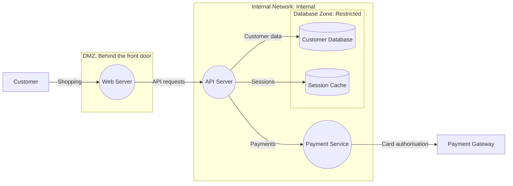

---

## Before you start

| You need | Why |
|---|---|
| **A running Dethernety deployment** | The tutorial runs on a stock install. To set one up, see [Installing the BYODt Deployment](byodt/INSTALLATION.md). |
| **A modern web browser** | Chrome, Edge, Firefox, or Safari, with the platform open (signed in, if your deployment uses sign-in). |
| **About 30 minutes** | You can stop at any point. Everything saves as you go. |

> **Tip:** When you model your own system later, start the same way: a rough sketch. List the trust boundaries (what is reachable from the internet, what is internal, where the sensitive data lives), the components inside each one, and the data that moves between them. You don't need every detail. Classes and exposures fill in the security picture once the shape is right.

---

## The editor at a glance

You'll do most of your work in the **data flow editor**. Here are its parts, so the steps below make sense. You open it for the first time in [Create your model](#create-your-model).


1. **Model name**: the model you're editing.
2. **Model settings**: opens the model dialog, where you edit the name, description, and compliance drivers, or export the model.
3. **Edit lock**: switches between edit mode (open padlock, tooltip *Edit mode (click to lock)*) and view mode (closed padlock, tooltip *View mode (click to edit)*).
4. **Zoning overview**: lists every boundary and its trust zone.
5. **Analyses** (sparkle icon): creates and runs analyses on the model.
6. **Palette**: the four element types, **Process**, **Store**, **External Entity**, and **Boundary**. Click its header to collapse or expand it.
7. **Properties panel**: shows the settings of whatever you select. It reads *Select an item* until you select something. Use the chevron at its right end to expand or collapse it.
8. **Canvas controls**: zoom in, zoom out, fit view, and the interactivity lock.

The canvas is a boundary too. It is the model's **Default Boundary**, the outermost container that holds everything else. Click an empty spot on the canvas and the panel reads *Boundary: Default Boundary*. It has no **Zoning** tab, so you give trust zones to the boundaries you draw inside it.

> **Important:** When you reopen a model later, it opens in **view mode**: the padlock (3) is closed and the palette (6) is collapsed. Nothing you drag or click changes the model. Click the padlock to start editing, then click the palette header to expand it. A brand-new model opens ready to edit.

---

## Create your model

1. In the left rail, click **Browser**. The **Home** folder opens. On a new install, the models row shows a **No models yet — create one** card.
2. Optional: open the folder you want the model in. A new model is created in the folder you have open.
3. Click the round **+** button (tooltip **Create or import**). A speed dial opens with three options. Click **New model**, the diagram icon. Clicking the **No models yet — create one** card does the same thing.

   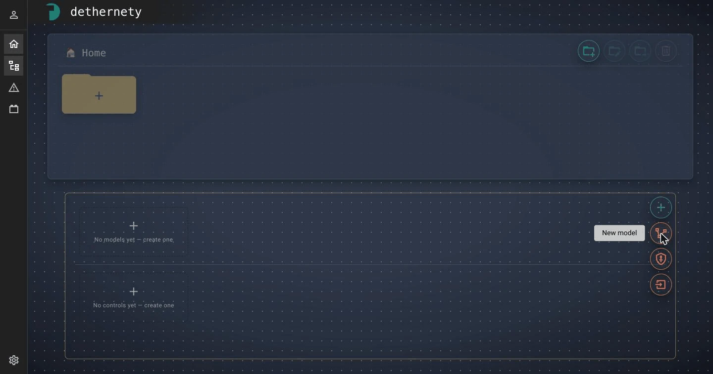

   A model named *New Model* is created straight away, and its dialog opens on the **General** tab.

4. Fill in the fields:

   | Field | Enter |
   |---|---|
   | **Name** | `E-commerce Platform` |
   | **Description** | `Online store: storefront, API, payment processing and data stores.` |
   | **Compliance drivers** | Pick **PCI-DSS** from the list. It is added as a chip. |

   In **Compliance drivers** you can pick a recommended framework or type your own and press Enter. Each recommendation carries a label for how much the platform does with that driver, such as *Full enrichment*, *Data classification*, or *Declared only*.

5. Click the **Open data flow editor** button (6 in the figure below). It saves your changes and opens the empty model in the editor.

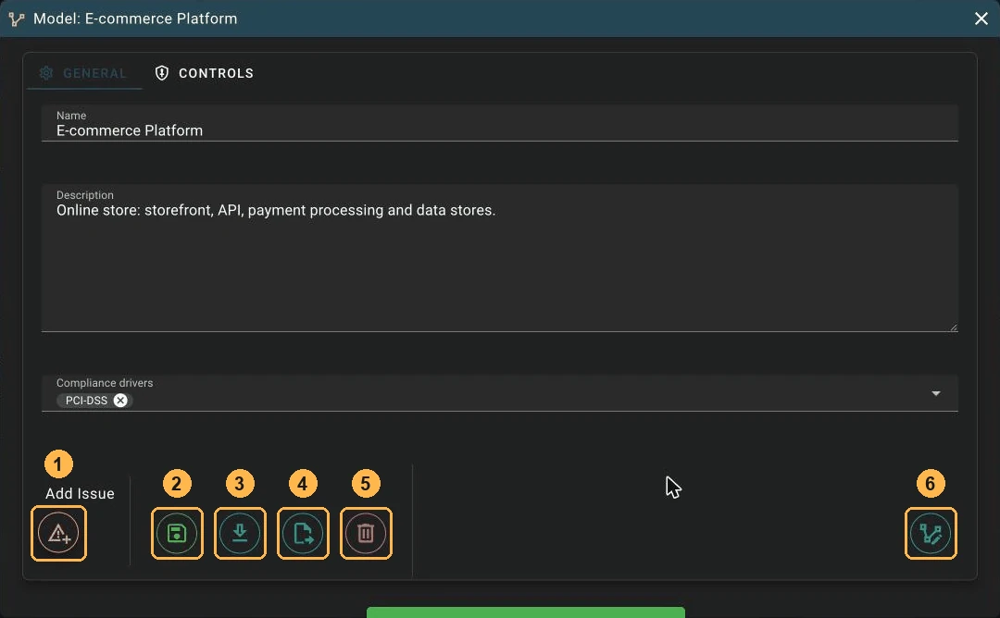

The buttons along the bottom of the dialog have icons but no tooltips:

| # | Button | What it does |
|---|---|---|
| 1 | **Add Issue** | Raises an issue against the whole model. |
| 2 | **Save** (green) | Saves the dialog and keeps it open. |
| 3 | **Export** (download icon) | Saves, then exports the model as a ZIP archive. See [Export and import your model](#export-and-import-your-model). |
| 4 | **Move to folder** | Moves the model to another folder. |
| 5 | **Delete** | Deletes the model, after you confirm by typing its name. |
| 6 | **Open data flow editor** | Saves, then opens the model on the canvas. |

To come back to this dialog later, click **Model settings** (2) in the editor, or click the settings icon on the model's tile in the Browser. Right-clicking the tile also works.

> **Note:** The model has no module step. The classes you pick for boundaries, components, and data flows come from the modules installed on your deployment, and every model gets the same set. See [Where the classes you can pick come from](UNDERSTANDING_MODULES.md#where-the-classes-you-can-pick-come-from).

---

## Set up security boundaries

Start with the boundaries, because components belong to the boundary you drop them into. For each boundary, you pick a **class** (what kind of boundary it is), give it a name and description, and set its **trust zone**.

| Name | Class | Place it | Trust zone | Description |
|---|---|---|---|---|
| **DMZ** | Network Segment | On the canvas, left of center | Behind the front door (DMZ) | `Public-facing services, reachable from the internet` |
| **Internal Network** | Network Segment | On the canvas, right of the DMZ. Make it large. | Internal | `Private network for application services` |
| **Database Zone** | Data Layer | **Inside** Internal Network | Restricted | `Databases holding customer and payment data` |

### Add the DMZ

1. Drag **Boundary** from the palette onto the canvas. The new boundary is selected, and the properties panel opens on its **General** tab.
2. In the **Boundary Class** field, type `Network Segment` and pick **Network Segment** from the list. The class applies straight away. A message confirms the change and reports how many exposures it generated, and a class card appears showing the class's category, module, and description.
3. Replace the placeholder **Name** with `DMZ` and the **Description** with the text from the table, then click **Save** on the right side of the panel.

   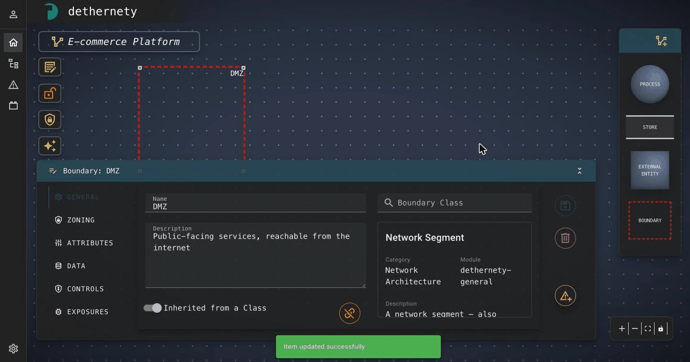

4. Open the **Zoning** tab. In the **Trust zone** list, choose **Behind the front door (DMZ)**, then click **Save**. The message *Zoning saved successfully* appears, and the boundary gets a coloured stripe down its left edge and a zone chip.

   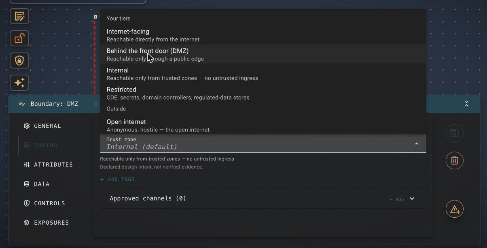

5. Drag a corner handle of the selected boundary to make it big enough for one component.

> **Tip:** **Pick the class first**, then edit the name and description and save. If you change the name or description and then pick a class before saving, the class pick can be lost. Following the class-first order avoids this. Name and description also save on their own when you click out of the field (*Item updated successfully*).

The trust zones you can choose from:

| Trust zone | Meaning |
|---|---|
| **Internet-facing** | Reachable directly from the internet |
| **Behind the front door (DMZ)** | Reachable only through a public edge |
| **Internal** | Reachable only from trusted zones, with no untrusted ingress |
| **Restricted** | Cardholder data environments, secrets, domain controllers, regulated-data stores |
| **Open internet** | Outside your estate entirely |

A boundary with no zone of its own inherits its parent's zone. At the top of the chain it falls back to **Internal (default)** and counts as unclassified. A zone is declared design intent, not verified evidence. Everything else on the Zoning tab, such as tags and **Approved channels**, is optional, and you can skip it for this tutorial. [Boundary Trust Zones](BOUNDARY_TRUST_ZONES.md) covers all of it.

### Add Internal Network and Database Zone

1. Add **Internal Network** the same way: drag **Boundary** onto the canvas to the right of the DMZ, pick **Network Segment**, enter the name and description, save, and set the trust zone to **Internal** on the **Zoning** tab. Resize it so that it fills most of the right side of the canvas, leaving room for a nested boundary.
2. Drag another **Boundary** and drop it **inside** Internal Network. Dropping it there makes it a child of Internal Network.
3. Pick the **Data Layer** class, name it `Database Zone`, add the description, and save.
4. On the **Zoning** tab, the trust zone reads *Internal (inherited from Internal Network)*. Choose **Restricted** and save.
5. Resize Database Zone so that it can hold two stores.

The animation below shows steps 2 to 5.


Your boundary structure is now:

```text
Default Boundary (the canvas)
├── DMZ                    Behind the front door (DMZ)
└── Internal Network       Internal
    └── Database Zone      Restricted
```

> **Tip:** To move an element or a boundary into a different boundary later, drag it there. Drag it out onto the open canvas to take it out of every boundary you drew.

---

## Add the components

Each component works like a boundary: drop it where it belongs, pick its class, then name, describe, and save it.

| Name | Palette type | Class | Drop it in | Description |
|---|---|---|---|---|
| **Customer** | External Entity | End User | The canvas, outside every boundary | `Anonymous or signed-in shopper on the internet` |
| **Payment Gateway** | External Entity | Payment Service Provider | The canvas, outside every boundary | `Third-party card processor (for example Stripe)` |
| **Web Server** | Process | Web Server | DMZ | `Serves the storefront to customers over HTTPS` |
| **API Server** | Process | Application Service | Internal Network | `Business logic: catalogue, accounts, orders` |
| **Payment Service** | Process | Application Service | Internal Network | `Authorises and records card payments` |
| **Customer Database** | Store | Relational Database | Database Zone | `PostgreSQL: customer accounts, orders and payment records` |
| **Session Cache** | Store | Cache / In-Memory Store | Database Zone | `Redis: login sessions and carts` |

For each row:

1. Drag the palette type onto the canvas, or into the boundary named in the table. The component is selected, and its properties panel opens with a placeholder name such as *New Process*.
2. In the **Component Class** field, type the class name and pick it. The list shows exact name matches first, followed by related classes labelled **Suggested**. If you're unsure what a class is called, click **Browse all classes →**.

   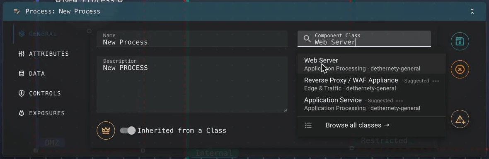

3. Enter the **Name** and **Description**, then click **Save**.

> **Note:** On a freshly installed deployment, the class search may show *Semantic search is unavailable on this deployment — showing name-based matches.* That happens while the deployment is still setting up its search model. Typing the class name still finds it. The **Suggested** matches appear once setup finishes.

> **Tip:** An element with no class shows an orange **?** badge. Hover over it for the reason: *No class assigned. Open Settings to assign one.* Select the element and pick a class to clear the badge.

### Mark the crown jewel

A **crown jewel** is an asset an attacker would most want to reach. The Threat Report checks which of your crown jewels can be reached, and how. In this store, that's the customer database.

1. Select **Customer Database**.
2. In the **General** tab, click the crown button to the left of the **Inherited from a Class** switch.

The crown fills in and the node gets a gold outline. Click the crown again to unmark it. See [Marking crown jewels](COMPONENT_CONFIGURATION_GUIDE.md#marking-crown-jewels) for more.

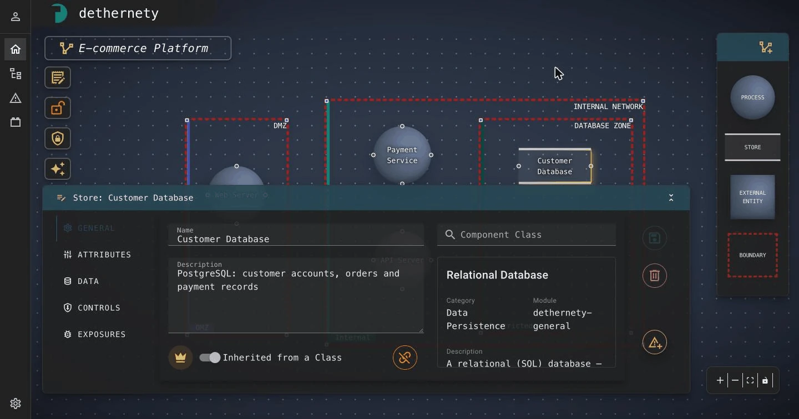

> **Note:** The **Inherited from a Class** switch also has a second setting, **Represents a Model**. With it, a component stands for another model on the platform instead of a class, which is useful for drawing a large system as linked sub-models. You don't need it for this tutorial. See the [Component Configuration Guide](COMPONENT_CONFIGURATION_GUIDE.md).

---

## Connect the data flows

A data flow is an arrow from one component to another. Its direction is the direction the data travels in.

| From | To | Name | Class | Description |
|---|---|---|---|---|
| Customer | Web Server | `Shopping` | HTTP/S Request | `Browsing, cart and checkout over HTTPS` |
| Web Server | API Server | `API requests` | API Call | `REST calls carrying the customer's session token` |
| API Server | Payment Service | `Payments` | Internal Service Communication | `Order total and card token for authorisation` |
| Payment Service | Payment Gateway | `Card authorisation` | API Call | `HTTPS to the processor's API, authenticated with an API key` |
| API Server | Customer Database | `Customer data` | Database Query | `SQL over TLS with a pooled service account` |
| API Server | Session Cache | `Sessions` | Database Query | `Session and cart reads and writes` |

For each row:

1. Point at the source component. Small round connection handles appear on its edges.
2. Drag from a handle on the source to a handle on the target, and release. The flow is created, and its properties panel opens.
3. In the **Data Flow Class** field, pick the class from the table.
4. Enter the **Name** and **Description**, then click **Save**.

The animation below shows the first flow, from Customer to Web Server.

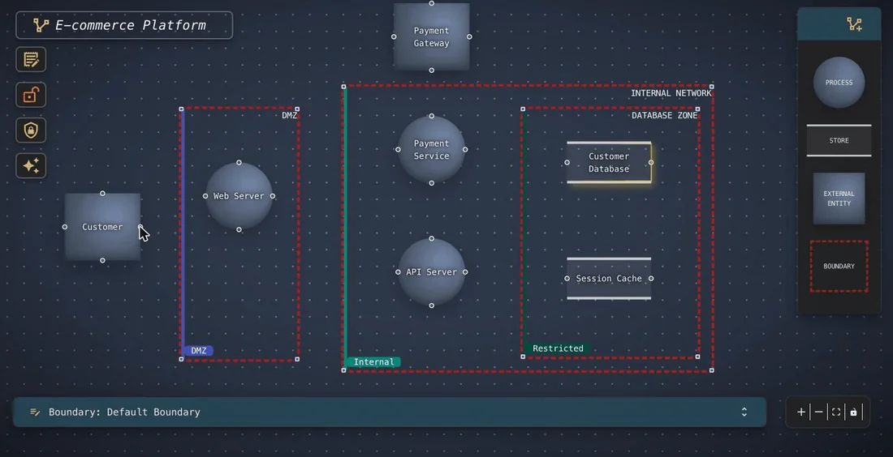

> **Tip:** The editor draws each flow's name as a label on the canvas. Short names keep the diagram readable, so put the detail in the description.

### See what the platform found

Each class you picked comes with policies that derive **exposures**: weaknesses that could be exploited on that element, each linked to the MITRE ATT&CK techniques that exploit it. You've been generating them all along. That's what the message after each class pick counted.

1. Select **Customer Database** and open its **Exposures** tab. The tab shows a count, such as **EXPOSURES (9)**, and a table with each exposure's name, description, and the techniques that exploit it.
2. Click the tab's expand button. The **Exposures of Customer Database** dialog opens.
3. Click an exposure to see its score, attack vector, and the techniques that exploit it, such as *Network Sniffing (T1040)* or *Adversary-in-the-Middle (T1557)*.


New exposures are **pending**: nobody has reviewed them yet. **Affirm** confirms one as a real risk, **Dispose** mutes one that doesn't apply (with a reason), and **Customize** makes an editable copy. You can leave them all pending for now. You review them in bulk in the Threat Report. [Managing Findings](MANAGING_FINDINGS.md) explains each decision.

---

## Check your work

Before you run the report, make sure the model is complete.

1. **Every element has a class.** No orange **?** badges are left on the canvas.
2. **Every boundary has a trust zone.** Click **Zoning overview** (4). The dialog lists each boundary with its trust zone, role, and channels. The chip at the top reads **0 unclassified**. If it doesn't, turn on **Show only unclassified** to find the boundary you missed.

   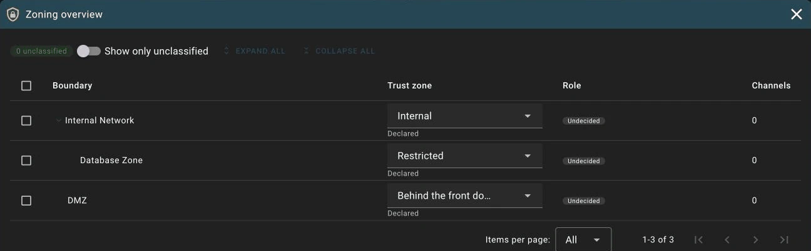

3. **The diagram matches the plan.** Compare your canvas with the figure in [What you will build](#what-you-will-build): seven components, three boundaries with their zone chips, six flows, and a gold outline on Customer Database.

---

## Run the Threat Report

Analyses come from modules, not from the core platform, so the analysis types you can run depend on the modules your deployment has installed. **A stock install has one analysis type, Threat Report.** It reads your model as it stands and summarises its residual risk: which exposures are open, which crown jewels can be reached, and where flows cross boundaries. It runs in seconds, asks you no questions, and never changes the model. Additional modules can add other analysis types.

1. Click **Analyses** (5), the sparkle icon. A dialog titled *Analysis: E-commerce Platform* opens.
2. Click **+ New Analysis**. A menu lists one entry for each available analysis type. Click **Threat Report**.
3. A row appears, named *Threat Report*, with the status **Ready**. Click **Run**.
4. Within a few seconds, the status changes to **Done** and the button changes to **View results**. Click it.

The animation below shows these steps.

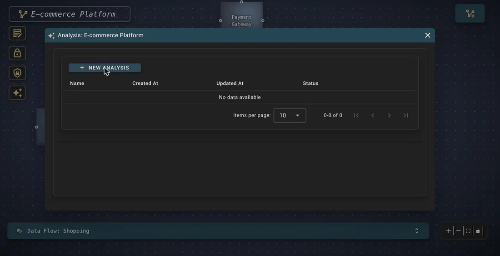

> **Tip:** A new analysis takes the analysis type's name. To tell runs apart later, rename the row: click its **Name** cell and type over it, or use **Rename** in the row's **⋮** menu. **Re-run**, also in the **⋮** menu, replaces that row's result. To keep a result for comparison, create a new analysis instead.

### Read the report

The report opens on its **Posture** tab. The header reads *Analysis Results: Threat Report - E-commerce Platform*, with the time of the snapshot and a green **Fresh** marker.


For this model, expect about seven components and four boundaries (the count includes the Default Boundary), a hundred or more open exposures spread across the Critical, High, and Medium bands, and five boundary crossings. Your numbers may differ, depending on the module versions on your deployment.

| Tab | What it shows |
|---|---|
| **Posture** | A roll-up of the model's residual risk. Click a number to jump to a filtered view. |
| **Coverage & Gaps** | Your MITRE ATT&CK coverage and where the gaps are. |
| **Reachability** | Which crown jewels can be reached over your flows, and what lies on the way. |
| **Boundary Crossings** | Where flows cross boundaries, and how each crossing compares with your trust zones. |
| **Residual Risk** | Every finding, grouped by element, which you can filter and act on. |

Open **Residual Risk**. Each row shows a finding's band, score, the MITRE techniques that exploit it, its attack vector, and its source, plus four actions: **Affirm**, **Dispose**, **Customize**, and **Issue**.


The report is a snapshot. If you change the model afterwards, the marker changes from **Fresh** to **Stale**. Click **Recreate** to bring the report up to date. **Export JSON** and **Export HTML** save the report to share. [Getting Started with the Threat Report](threat-report/GETTING_STARTED.md) covers all of this in depth, and the [Threat Report guide](threat-report/README.md) covers every tab.

---

## Raise an issue from a finding

An **issue** is a unit of tracked work: it gives a finding a place on a board, a severity, and a status that outlive the next report.

1. On the **Residual Risk** tab, find a finding you want to act on. Click its **Issue** action (the flag icon). A dialog titled **Raise an issue from this finding** opens, with the finding's name under the title.
2. Under *Or create an issue:*, click **Vulnerability**.

   

3. The issue is created straight away and its card opens. It is named after the finding and the element, in the form *`<finding>` Issue on `<element>`*, and its description is copied from the finding. Rename it to something you'll recognise later.

   

4. Open the **Attributes** tab and fill in the fields the issue's class defines. Each class defines its own fields, and every class that ships with the platform has a **severity** and a **status**.
5. In the left rail, click **Issues**. Your new issue is listed under the default **Open** filter.

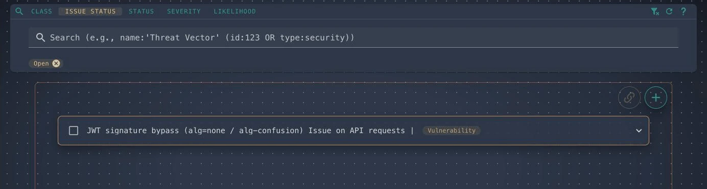

The six issue classes come from the platform's general module. A deployment with more modules installed may offer more. See [Where issue classes come from](ISSUE_MANAGEMENT_GUIDE.md#where-issue-classes-come-from).

> **Note:** The issue links to the finding, the element it was raised on, and the model, but **not** to the analysis that showed the finding. To record which report it came from, add the analysis yourself on the issue's **Associated Elements** tab. See [What actually gets associated](ISSUE_MANAGEMENT_GUIDE.md#what-actually-gets-associated).

> **Important:** Two different things are called "status". The **Close Issue** / **Open Issue** button sets the platform's open or closed flag. The **status** attribute on the **Attributes** tab moves through the values the class defines, such as `confirmed`, `mitigating`, and `verified`. Changing one doesn't change the other. See [Status: two different things](ISSUE_MANAGEMENT_GUIDE.md#status-two-different-things).

### Add another finding to the same issue

Related findings often belong on one issue. To add a finding to an issue that already exists:

1. In the **Raise an issue from this finding** dialog, click **Add to Issue board**. The finding is copied to the platform's clipboard, and the **Issues** page opens.
2. Click the target issue's row to expand its card.
3. Click **Add from clipboard**. The finding is linked to the issue, and a comment records what was added.
4. Click **Return to `<page>`** to go back to where you were.

> **Warning:** The clipboard holds **one** item, and it expires after 30 minutes. Copying a second finding replaces the first. To collect several findings on one issue, repeat the whole loop for each one: copy, add, return. See [Adding elements to an existing issue](ISSUE_MANAGEMENT_GUIDE.md#adding-elements-to-an-existing-issue).

Issues live on the platform. Dethernety ships with no tracker integration, so nothing you do here reaches Jira, GitHub, or any other tracker. See [External system integration](ISSUE_MANAGEMENT_GUIDE.md#external-system-integration).

---

## Export and import your model

You can save a model as a portable ZIP archive, for a backup, to share with a colleague, or to keep under version control beside your code.

### Export a model

1. Open the model dialog: click **Model settings** (2) in the editor, or click the settings icon on the model's tile in the Browser.
2. Click **Export** (3, the download icon). The dialog saves the model and opens **Export Model**.
3. Click the download button. Your browser saves `<model name>-export.zip`.

The archive holds the model as a set of JSON files:

```text
<model name>-export.zip
├── manifest.json        Model metadata and module references
├── structure.json       Boundary and component hierarchy
├── dataflows.json       Data flow connections
├── data-items.json      Data classification items
└── attributes/          Per-element configuration
    ├── boundaries/
    │   └── <id>.json
    ├── components/
    │   └── <id>.json
    ├── dataFlows/
    │   └── <id>.json
    └── dataItems/
        └── <id>.json
```

This is the same split-file format the [Dethereal Claude Code plugin](dethereal/README.md) uses, so you can export a model, enrich it with the plugin (see [Discovery and enrichment](dethereal/DISCOVERY_AND_ENRICHMENT.md)), and import it again.

### Import a model

1. In the Browser, open the folder to import into. Click the **+** button (**Create or import**) and choose **Import model**.
2. Click **Select File** and choose a `.zip` archive.
3. Check the **Model name** field. It is filled in with the model's name from the archive. If the folder already holds a model with that name, the field suggests the next free one, such as *`<name> (2)`* or *`<name> (3)`*, and a hint under the field says why. Only models in the same folder count. If the folder's models can't be listed, the field keeps the archive's name, and the hint says the name couldn't be checked. You can type a different name, but the field can't be empty.
4. Click the **Import** button at the bottom of the dialog. A progress bar steps through the eight stages of the import.
5. When it finishes, a success message appears, the model shows up in the folder, and the button changes to **Close**.

The archive itself is never changed. If the import hits problems it can work around, warnings appear beside the success message. If it hits a critical error, the error is shown in red and nothing is imported.

---

## What you learned

You built a complete threat model and worked it through to a tracked issue. Along the way, you:

- created a model and recorded its compliance driver
- drew **boundaries**, nested one inside another, and placed each one in a **trust zone**
- added **components**, gave every element a **class**, and marked a **crown jewel**
- connected components with **data flows**, and saw the **exposures** the classes derived
- checked the model with the **Zoning overview**
- ran a **Threat Report** and read its posture and residual risk
- raised an **issue** from a finding
- learned how to **export and import** a model as a ZIP archive

## Next steps

- **[Boundary Trust Zones](BOUNDARY_TRUST_ZONES.md)**: declare which boundaries may talk to each other with approved channels, then see the result on the report's **Boundary Crossings** tab.
- **[Managing Findings](MANAGING_FINDINGS.md)**: affirm the risks that are real and dispose of the ones that aren't.
- **[Working with Findings](threat-report/WORKING_WITH_FINDINGS.md)**: triage the **Residual Risk** ledger in the Threat Report.
- **[Working with Security Controls](WORKING_WITH_SECURITY_CONTROLS.md)**: add the controls that counter your exposures.
- **[Component Configuration Guide](COMPONENT_CONFIGURATION_GUIDE.md)**: fill in class attributes and classify the data your components handle.
- **[Security Analysis Workflow](SECURITY_ANALYSIS_WORKFLOW.md)**: how analyses run, and what other analysis types can offer.
- **[Issue Management Guide](ISSUE_MANAGEMENT_GUIDE.md)**: filter, merge, and track issues with your team.
- **[Dethereal plugin](dethereal/README.md)**: build and enrich models in conversation with Claude Code.
