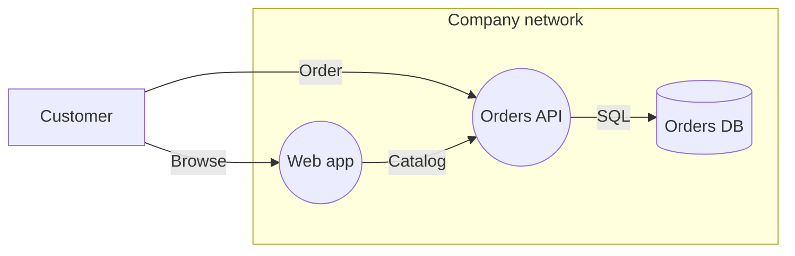

# Quick Start

This guide takes you from nothing to your first threat finding. You install the platform on your own machine, open it, draw a small online store, run the **Threat Report**, and read its first finding.

---

## What you will do

1. Install the platform with one command.
2. Open it in your browser.
3. Draw a store: four elements in one boundary.
4. Run the **Threat Report**.
5. Read the first finding, then see what removes it.

**Time to allow.** The first install downloads a few GB: the container images, then an embedding model of about 1.26 GB in the background. Allow 30 minutes to an hour for a first install, most of it unattended download time. Drawing the model and reading its first finding then takes about 10 minutes.

---

## Before you start

| You need | Details |
|---|---|
| **A container engine** | **Docker** with the Compose plugin, or **Podman 4.1+** with a Compose provider. On macOS, the Podman machine must be running. |
| **Linux or macOS** | On Windows, run everything inside WSL. |
| **Node.js 18 or later** | Only to run the installer with npx. The deployment itself never needs it. Without Node.js, use [`get-byodt.sh`](#without-nodejs) instead. |
| **Memory** | The database runs with a 4 GB memory limit, and the embedding model adds about 0.9 GB. On Docker Desktop or a Podman machine, the virtual machine's memory is what counts. If it is capped at 4 GB or less, raise it first. |
| **Disk** | Several GB free in the folder you install into. |
| **Internet access** | On the first start, to download the images, modules and model. See [Network access for the first start](byodt/INSTALLATION.md#network-access-for-the-first-start). |

---

## Install the platform

Open a terminal in the folder where the deployment should live, such as your home folder. Run:

```sh
npx @dether.net/byodt@0.14.0
```

The installer asks a few questions. Answer them like this:

1. npx may ask `Ok to proceed?`. Answer `y`.
2. The installer shows a third-party notice and asks `Continue? [y/N]`. Answer `y`. Nothing is downloaded before you do.
3. It downloads the release, checks it, and unpacks it into a new folder, `./byodt`. You see these lines among others:

   ```
   ==> SHA-256 matches the release (…).
   ==> Unpacked release 0.14.0 into ./byodt.
   ```

   If [cosign](https://github.com/sigstore/cosign) is installed, it also verifies the signature and prints `==> Signature verified: the release workflow of dether-net/dethernety-oss at v0.14.0 signed it.` Without cosign, it warns that *the bundle's integrity was checked, its authenticity was not* and goes on; install cosign to check who published it too.

4. Setup asks for your settings. Press Enter to keep each default, **except the last one**:

   | Question | Answer |
   |---|---|
   | `Graph database, memgraph or neo4j [memgraph]:` | Enter |
   | `Keep the database in the engine's named volume? [Y/n]` (Docker Desktop or a Podman machine only) | Enter |
   | `Reach the console and the platform from other machines too (binds 0.0.0.0)? [y/N]` | Enter |
   | `Port [3000]:` | Enter |
   | `Does this machine reach the internet only through an HTTPS proxy? [y/N]` | Enter. If you are behind a proxy, see [Behind an outbound proxy](byodt/INSTALLATION.md#behind-an-outbound-proxy). |
   | `Start the stack now? [y/N]` | **`y`** |

   > **Important:** The default for **Start the stack now?** is No. If you pressed Enter, setup ends with `==> Ready. Start with: ./byodt/byodt up`. Run `./byodt/byodt up` to start it.

5. When the stack has started, the installer prints:

   ```
   ==> Up. Console: http://127.0.0.1:3000/console/
   ```

   That address is the deployment's operator console. The platform itself is at `http://127.0.0.1:3000`.

### Without Node.js

Run the same install with `get-byodt.sh` from the release:

```sh
VERSION=0.14.0
curl --proto '=https' --tlsv1.2 -fsSL "https://github.com/dether-net/dethernety-oss/releases/download/v${VERSION}/get-byodt.sh" | sh
```

It asks the same questions. To check the installer's signature before you run it, and for every other option, see [With `get-byodt.sh` from the release](byodt/INSTALLATION.md#with-get-byodtsh-from-the-release).

These commands use the current release; newer releases are listed on the [releases page](https://github.com/dether-net/dethernety-oss/releases).

---

## Open the platform

The installer returns before the platform is ready. On the first start, the deployment installs its modules and loads the MITRE reference data first, and only then starts the platform.

1. Browse to <http://127.0.0.1:3000>. For the first few minutes, the browser may refuse to connect. Wait and reload. To check progress, see [Verify the deployment is healthy](byodt/INSTALLATION.md#verify-the-deployment-is-healthy).
2. The home page loads, with cards for **Data Flow Models**, **Control Catalog**, **Issues** and **Modules**.

There is no sign-in. A fresh install runs in standalone mode: it is reachable only from this machine, and anyone using this machine has full access to it.

> **Note:** The embedding model keeps downloading in the background. Until it is ready, the class picker shows *Semantic search is unavailable on this deployment — showing name-based matches.* Typing the class name still finds it. The suggestions get better once the model has downloaded.

---

## Draw the model

You draw **Storefront**: a small online store. A customer browses a web app and places orders through an API. The API stores orders in a database. The web app, the API and the database sit inside one company network.



### Create the model

1. In the left rail, click **Browser**.
2. Click the round **+** button (tooltip **Create or import**). In the speed dial, click **New model**. The model dialog opens on the **General** tab.
3. In **Name**, type `Storefront`.
4. Click **Open data flow editor**, the unlabelled diagram icon at the far right of the buttons along the bottom of the dialog. It saves the model and opens the empty canvas. The palette on the right lists **Process**, **Store**, **External Entity** and **Boundary**.

### Add the boundary

1. Drag **Boundary** from the palette onto the canvas. Its properties panel opens on the **General** tab.
2. In the **Boundary Class** field, type `Network Segment` and pick **Network Segment**.
3. Replace the **Name** with `Company network`, then click **Save**.
4. Drag a corner handle of the boundary to make it big enough for three components.

> **Tip:** **Pick the class first**, then edit the name, then save. If you change the name and then pick a class before saving, the class pick can be lost.

> **Note:** Skip the boundary's **Zoning** tab for this quick start. The report then shows two collapsed zoning advisories for **Company network**: it has no trust zone, and it holds a high-value asset (the crown jewel) whose isolation the model can't show. That's fine. [Boundary Trust Zones](BOUNDARY_TRUST_ZONES.md) explains zones.

### Add the components

| Name | Palette type | Class | Drop it |
|---|---|---|---|
| **Customer** | External Entity | End User | On the canvas, outside **Company network** |
| **Web app** | Process | Web Server | Inside **Company network** |
| **Orders API** | Process | Application Service | Inside **Company network** |
| **Orders DB** | Store | Relational Database | Inside **Company network** |

For each row:

1. Drag the palette type to where the table says. The properties panel opens.
2. In the **Component Class** field, type the class name and pick it.
3. Enter the **Name**, then click **Save**.

### Mark the crown jewel

A **crown jewel** is an asset an attacker would most want to reach. Here, that's the database.

1. Select **Orders DB**.
2. On the **General** tab, click the crown button to the left of the **Inherited from a Class** switch.

The node gets a gold outline.

### Connect the data flows

A data flow's direction is the direction the data travels in.

| From | To | Name | Class |
|---|---|---|---|
| Customer | Web app | `Browse` | HTTP/S Request |
| Customer | Orders API | `Order` | API Call |
| Web app | Orders API | `Catalog` | API Call |
| Orders API | Orders DB | `SQL` | Database Query |

For each row:

1. Point at the source component. Small round connection handles appear on its edges.
2. Drag from a handle on the source to a handle on the target, and release. The flow's properties panel opens.
3. In the **Data Flow Class** field, pick the class from the table.
4. Enter the **Name**, then click **Save**.

> **Tip:** Name every flow. A new flow gets a placeholder name such as *New Data Flow*, and the report lists flows by name.

Your model is finished:


---

## Why the model already has findings

You haven't answered any of the classes' questions. That is enough for findings. An unanswered question counts as the protection being absent, so the class's rules fire. This is by design: nothing is assumed safe until you say so.

Have a look:

1. Select **Orders API** and open its **Attributes** tab. The questions are grouped under headings such as **Authentication & Access** and **Application Security**. Most are yes-or-no questions that offer **Yes**, **No** and **Not answered**.
2. Expand **Application Security**. **Parameterized Queries Used** is **Not answered**.

   The questions are marked as required, and an unanswered one shows *is a required property* in red. That is expected: you can save with questions left unanswered. To see the questions in a larger dialog, *Attributes of Orders API*, with a guide to each one beside it, click the right-hand of the two buttons at the top right of the tab.
3. Open the **Exposures** tab. It shows how many exposures the class derived.

Don't answer anything yet. You come back to this in [Try it: answer the questions](#try-it-answer-the-questions).

---

## Run the Threat Report

1. In the editor, click **Analyses** (the sparkle icon). A dialog titled *Analysis: Storefront* opens.
2. Click **New Analysis**, then **Threat Report**.
3. A row appears with the status **Ready**. Click **Run**.
4. The status changes to **Done**. Click **View results**.

The report opens on its **Posture** tab. The header reads *4 components · 2 boundaries*. The boundary count includes the **Default Boundary**, which is the canvas itself.

Expect **73 open findings** for this model: **14 Critical**, **48 High** and **11 Medium**. Your numbers may differ with the module versions on your deployment.

Each finding's band comes from its score; [Severity bands](threat-report/READING_THE_REPORT.md#severity-bands) gives the ranges.

---

## Read the first finding

On the **Posture** tab, **Top residual risks** lists the open findings, ranked by band, then score, then name. The first row shows:

| Part | Meaning |
|---|---|
| **Critical** | The band. |
| **Injection (SQLi / NoSQLi / OS command / LDAP)** | The finding. |
| **network** | The attack vector: the attacker comes over the network. |
| **on Orders API** | The element it was found on. |
| **⛉ uncovered** | No security control on the element supports it. |


Click the row. The **Orders API**'s Component Profile opens, with its findings.

On the **Residual Risk** tab, the **Orders API** group's row for this finding shows its score, **9.8**, and two MITRE ATT&CK technique chips: **T1059** and **T1190**. Hover over a chip for the technique's name: *Command and Scripting Interpreter* and *Exploit Public-Facing Application*.

### What it means

The application builds queries or shell commands from input it hasn't validated. An attacker can then read or change the stored data, or run commands on the host. Parameterized statements, running commands with an argument array, and server-side allow-list validation defeat it.

### Why it fired

The **Application Service** class raises this finding when any of these is true:

- **Parameterized Queries Used** is not Yes.
- **OS Commands Avoided Or Arg-Array Used** is not Yes.
- **Server-Side Allowlist Validation Applied** is not Yes.
- **Dynamic Query-String Concatenation Used**, **User Input In Shell Command String**, **Validation Is Client-Side Only** or **Denylist Filtering Used** is Yes.

The first three are **Not answered**, so it fires.

### How it reaches your data

Open the **Reachability** tab. It reads *1 of 1 crown jewels reachable from external entry*. Entry points are the model's external entities: here, **Customer**.

For **Orders DB**, it shows *reachable · shortest route 2 hops · 1 crossing*, and *worst on any route: Critical*.

Click **view strip** beside it to see the routes:

- The shortest route is **Customer → Orders API → Orders DB**.
- A second route goes through **Web app**.
- Every route passes through **Orders API**, the element with the injection finding.


The tab says it plainly: *Flow routes and the threats on them — not attack paths.* [Reachability and Flow Routes](threat-report/REACHABILITY.md) explains how to read it.

---

## Try it: answer the questions

Tell the platform that the Orders API is protected against injection.

1. Go back to the editor: click the diagram icon at the top right of the report. A model you reopen opens in view mode, so click the padlock on the left to edit.
2. Select **Orders API**, open its **Attributes** tab and expand **Application Security**. Set exactly these three questions to **Yes**:
   - **Parameterized Queries Used**
   - **OS Commands Avoided Or Arg-Array Used**
   - **Server-Side Allowlist Validation Applied**
3. Leave every other question as it is, and click **Save**.

> **Important:** Some questions in **Application Security** describe a weakness, such as **Denylist Filtering Used**. For those, **Yes** makes the finding fire. Answer only the three above.

The platform evaluates the class again and removes the **Injection** finding.

> **Important:** Here you only claim the protections, to see how answers drive findings. On a real model, answer **Yes** only for a protection you have checked is in place. A **Yes** that isn't true removes the finding from the report, not the risk. For a finding that doesn't apply, record why instead: see [Managing Findings](MANAGING_FINDINGS.md).

The report is a snapshot, so it doesn't change by itself. Open it again (**Analyses**, then **View results**): its marker has turned from **Fresh** to **Stale**. Click **Recreate**. The report now counts 72 open findings, and the top row of **Top residual risks** is *Query/command injection enabling bulk exfiltration* on the **SQL** flow, also scored 9.8.

---

## Stop and start the deployment

From the folder you ran the installer in:

```sh
./byodt/byodt down    # stop; everything on disk is kept
./byodt/byodt up      # start again
```

Later starts take well under a minute.

---

## Next steps

- **[Building Your First Model](BUILDING_YOUR_FIRST_MODEL.md)**: a fuller model, with trust zones and issues.
- **[Threat Report guide](threat-report/README.md)** and **[Reading the Report](threat-report/READING_THE_REPORT.md)**: every tab of the report.
- **[Reachability and Flow Routes](threat-report/REACHABILITY.md)**: routes to your crown jewels.
- **[Managing Findings](MANAGING_FINDINGS.md)**: affirm the findings that are real and dispose of the ones that aren't.
- **[Component Configuration Guide](COMPONENT_CONFIGURATION_GUIDE.md)**: answer attributes and classify the data your components handle.
- **[Installing the BYODt Deployment](byodt/INSTALLATION.md)**: every install option.
- **[Dethereal plugin](dethereal/README.md)**: build models in conversation with Claude Code.
