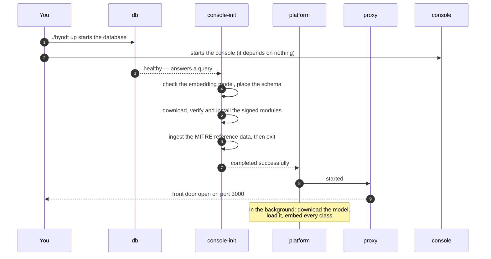

# Installing the BYODt Deployment

This guide takes you from an empty machine to a running Dethernety deployment that you control. When you finish, you have:

- **The platform** at `http://127.0.0.1:3000`, where you build and analyse threat models.
- **The operator console** at `http://127.0.0.1:3000/console/`, which reports the deployment's health.
- **A graph database** (Memgraph by default, or Neo4j) holding your models, with the MITRE ATT&CK, ATLAS and D3FEND reference data already loaded.

**Time to allow:** 30 minutes to an hour for the first install, most of it unattended download time. The first start pulls four container images, installs the signed modules, loads the reference data, and downloads the embedding model's weights (about 1.26 GB). Every later start takes well under a minute.

---

## At a glance

If your machine already meets the [requirements](#requirements), these commands are the whole installation. Replace `X.Y.Z` with the version from the [latest release](https://github.com/dether-net/dethernety-oss/releases/latest).

```sh
VERSION=X.Y.Z
BASE="https://github.com/dether-net/dethernety-oss/releases/download/v${VERSION}"

# 1. Download the bundle and its signature
curl -fsSLO "${BASE}/byodt-${VERSION}.tar.gz"
curl -fsSLO "${BASE}/byodt-${VERSION}.tar.gz.bundle"

# 2. Verify the signature (needs cosign)
cosign verify-blob "byodt-${VERSION}.tar.gz" \
  --bundle "byodt-${VERSION}.tar.gz.bundle" \
  --certificate-identity "https://github.com/dether-net/dethernety-oss/.github/workflows/release.yml@refs/tags/v${VERSION}" \
  --certificate-oidc-issuer https://token.actions.githubusercontent.com

# 3. Extract it somewhere durable, and enter the directory
tar xzf "byodt-${VERSION}.tar.gz"
cd "byodt-${VERSION}"

# 4. Start it (first-run setup included)
./byodt up

# 5. Open the console and check for a Healthy verdict
./byodt console
```

> **Important:** Two choices cannot easily be changed after the first start: the **database engine** (Memgraph or Neo4j) and, on Docker Desktop or a Podman machine, **where the database stores its data**. If either applies to you, read [Optional: choose your settings first](#optional-choose-your-settings-first) before step 4.

The rest of this guide walks through each step, explains what the first start does, and shows what a healthy deployment looks like.

---

## Before you start

### Requirements

| Requirement | What you need |
|---|---|
| **Container engine** | **Docker** with the Compose plugin, **or** **Podman 4.1+** with a Compose provider. Podman brokers to Docker Compose v2 when it is present, otherwise to `podman-compose`. |
| **Disk** | Several gigabytes free in the directory you extract the bundle into: four container images, the embedding model's weights (about 1.26 GB in `data/models`), the database's data, and the reference data. |
| **Memory** | Enough for the database plus the platform. Memgraph runs with a **4096 MiB** memory limit — the measured floor for the reference-data ingest. Neo4j runs with a **2 GB** heap and a **1 GB** page cache, plus what the JVM needs beyond those. The platform holds the embedding model in memory, which adds roughly 0.8–0.9 GiB. |
| **CPU** | No fixed minimum. The timings in this guide are for a 4-vCPU host, which matches the embedder's default of 4 inference threads (`EMBEDDING_THREADS`; see [Configuration → Embedding](./CONFIGURATION.md#embedding)). |
| **Network (first start only)** | Access to the container registries, GitHub release assets, and Hugging Face. See [Network access for the first start](#network-access-for-the-first-start). |
| **Optional tools** | [cosign](https://github.com/sigstore/cosign) to verify the bundle's signature. `curl` for the health checks. |

> **Warning:** On a VM-backed runtime — **Docker Desktop**, or a **Podman machine** on macOS or Windows — the memory that counts is the memory the *virtual machine* is allowed, not the host's. If the VM is capped at 4 GB or less, raise it in the runtime's settings before you start. The reference-data ingest is deliberately not retried when the database runs out of memory.

### Check your container engine

The control script runs `<engine> compose`, so that exact command must work. Check whichever engine you have:

```sh
docker compose version
```

```sh
podman compose version
```

Use whichever prints a version. If neither does, install the missing piece: a bare engine without a Compose provider is not enough.

On the first start, the script detects the engine (Docker first, then Podman) and records the choice in `.env` as `CONTAINER_ENGINE`, so every later command uses the same one. To force a specific engine, see [Configuration → Container engine](./CONFIGURATION.md#container-engine).

### Podman specifics

Podman works fully. Three things to know:

1. **On macOS, start the machine first.** Podman runs containers inside a virtual machine that is not started for you:

   ```sh
   podman machine start
   ```

   Without it, every `byodt` command stops with an error saying that the engine's compose is not usable. See [Troubleshooting](./TROUBLESHOOTING.md#no-usable-container-engine).

2. **Use the named volume for database storage on a VM-backed runtime.** This applies to a Podman machine and to Docker Desktop alike; see the warning in [Optional: choose your settings first](#optional-choose-your-settings-first).

3. **Rootless is expected.** The containers write into the bundle's runtime directories under an unprivileged user id that does not match yours, so the control script creates those directories world-writable on every start. You do not need to do anything. Do not tighten them by hand: the next start widens them again.

### Network access for the first start

The first start needs to reach:

| Destination | What for |
|---|---|
| **`ghcr.io`** | The platform and console images. |
| **The publishers' registries** (`docker.io` by default) | The database and proxy images. |
| **`github.com`** and its release-asset host | The signed module payloads for the release you are installing. |
| **`huggingface.co`** and the host it redirects downloads to | The embedding model's weights. The platform verifies each file's sha256 before it uses it. |

Module signatures are verified offline: the trusted root is embedded in the console image, so no signing service is contacted.

Later starts need none of this. If the machine sits behind an allowlist, open these destinations before the first start rather than debugging a half-finished one.

> **Warning:** The model download does **not** use an HTTPS proxy: the platform ignores `HTTPS_PROXY` and connects to Hugging Face directly. If the machine reaches the internet only through a proxy, or not at all, place the weights by hand; see [Hosts without internet access](#hosts-without-internet-access).

---

## Get the bundle

The deployment ships as a signed release asset: a tarball holding the control script, the compose files, and a configuration template.

1. **Find the version.** Open the releases page and note the version you want:

   <https://github.com/dether-net/dethernety-oss/releases/latest>

2. **Download the bundle.** Replace `X.Y.Z` with that version:

   ```sh
   VERSION=X.Y.Z
   curl -fsSLO "https://github.com/dether-net/dethernety-oss/releases/download/v${VERSION}/byodt-${VERSION}.tar.gz"
   ```

3. **Verify the signature (recommended).** Every release asset is signed. With [cosign](https://github.com/sigstore/cosign) installed, download the signature bundle and check it:

   ```sh
   curl -fsSLO "https://github.com/dether-net/dethernety-oss/releases/download/v${VERSION}/byodt-${VERSION}.tar.gz.bundle"

   cosign verify-blob "byodt-${VERSION}.tar.gz" \
     --bundle "byodt-${VERSION}.tar.gz.bundle" \
     --certificate-identity "https://github.com/dether-net/dethernety-oss/.github/workflows/release.yml@refs/tags/v${VERSION}" \
     --certificate-oidc-issuer https://token.actions.githubusercontent.com
   ```

   **Result:** cosign prints `Verified OK`. The bundle is the published one, unmodified. The identity is pinned to this exact release tag, so an asset from a different release does not pass.

4. **Extract it and enter the directory:**

   ```sh
   tar xzf "byodt-${VERSION}.tar.gz"
   cd "byodt-${VERSION}"
   ```

   **Result:** the directory holds these files (`ls -A` shows the hidden ones):

   | Path | What it is |
   |---|---|
   | `byodt` | The control script — your interface to the deployment. |
   | `compose.yaml` | The service definitions, except the database. |
   | `compose.memgraph.yaml`, `compose.neo4j.yaml` | The database service, one file per engine. |
   | `.env.example` | The configuration template, and the manifest of the tested image set. |
   | `proxy/` | The front-door configuration and its TLS entrypoint. |
   | `README.md` | A quick-start reference for the bundle. |
   | `LICENSE`, `NOTICE` | The licence and the third-party notices. |
   | `.gitignore` | Keeps the files the first start creates out of version control, if you track the directory with git. |

> **Warning:** Where you extract the bundle matters. This directory **becomes the deployment**: your configuration, the database password, and — with the default storage setting — the graph itself all live inside it. Put it somewhere durable and backed up, never in a temporary directory.

---

## Optional: choose your settings first

You can skip this section. The first start creates `.env` from `.env.example` and starts straight away with defaults that suit a single operator on a trusted machine:

| Setting | Default |
|---|---|
| Front door | Plain HTTP on `127.0.0.1:3000` (loopback only) |
| Database engine | Memgraph |
| Database storage | A host bind mount at `data/memgraph` |

To change any of these, create `.env` **before** the first start — and before `./byodt models pull`, which performs the same first-run setup:

```sh
cp .env.example .env
# then edit .env
```

The control script never overwrites an existing `.env`. Every setting is documented in [Configuration](./CONFIGURATION.md).

**To run Neo4j instead of Memgraph**, add `DB_ENGINE=neo4j` to `.env`, or start the first time with:

```sh
DB_ENGINE=neo4j ./byodt up
```

The first start records the engine in `.env` as `DB_ENGINE` (and on Neo4j, the image as `NEO4J_IMAGE`), so later commands need no export. See [Configuration → The database engine](./CONFIGURATION.md#the-database-engine).

> **Warning:** Choose the database engine before the first start. Each engine keeps its own data and nothing converts one into the other: switching later starts an empty graph, and a backup taken on one engine cannot be restored on the other.

> **Warning:** On a VM-backed runtime — **Docker Desktop**, or a **Podman machine** on macOS or Windows — store the database in the named volume, not a host bind mount. A bind mount that crosses the VM's file-sharing layer can corrupt a running database. Set this in `.env` before the first start:
>
> ```
> DB_DATA=memgraph-data
> ```
>
> On Neo4j, set `NEO4J_DATA=neo4j-data` instead. On native Linux the default bind mount (`./data/memgraph`, or `./data/neo4j`) is fine, and easier to inspect and copy. Switching later means a fresh, empty database. See [Configuration → Where the database keeps its data](./CONFIGURATION.md#where-the-database-keeps-its-data).

---

## Optional: download the embedding model ahead

The platform embeds in process with its built-in model, **EmbeddingGemma 300m** (`embeddinggemma-300m-retrieval-v1`, by Google). The weights are not in any image: on the first start, the platform downloads them once from Hugging Face into `data/models` and verifies them. You can do that step ahead of time — for example while you still have a fast connection:

```sh
./byodt models pull
```

It runs the platform's own download code in a one-off container and needs no database. Before it starts, it prints the model's size and its licence:

```
Embedding model embeddinggemma-300m-retrieval-v1: 1.26 GB into /models, downloaded only where missing or wrong.
The model is licensed under the Gemma Terms of Use: https://ai.google.dev/gemma/terms.
…
Ready: the platform loads the model from there without downloading it.
```

- It is safe to run again: it downloads only what is missing or wrong.
- `Ctrl-C` stops it and keeps nothing partial.
- When it prints `Ready`, the first start loads the model from disk instead of downloading it.

> **Note:** `models pull` performs first-run setup, so it creates `.env` with the defaults if it does not exist yet. Make your [settings choices](#optional-choose-your-settings-first) first.

> **Note:** The model is licensed under the [Gemma Terms of Use](https://ai.google.dev/gemma/terms). The platform logs the licence before it downloads, and `./byodt models pull` prints it.

### Hosts without internet access

For a host that cannot reach Hugging Face directly — no internet, or internet only through a proxy:

1. **On a connected machine**, extract the same release and run `./byodt models pull`.
2. **Copy its `data/models` directory** into the offline host's bundle directory, keeping the `<repo>/<revision>/<file>` layout intact.
3. **Copy as the account that runs `./byodt`** on the offline host, not as root. Files owned by root pass only under rootful Docker; rootless Podman refuses them.
4. **Keep the files writable only by their owner.**

The platform verifies every file's sha256 at start and downloads only what is missing or wrong. It refuses a weight file when any file or directory on its path is owned by another account, or is writable by accounts other than its owner, and names that entry in its error. See [Troubleshooting](./TROUBLESHOOTING.md#in-the-models-directory-is-owned-by-uid-or-is-writable-by-accounts-other-than-its-owner).

---

## Start it

From the bundle directory:

```sh
./byodt up
```

That is the whole installation: the command performs first-run setup, then starts the stack. Expect output like this:

```
==> Created .env from .env.example — review it before starting.
==> Container engine: docker (recorded CONTAINER_ENGINE in .env).
==> Database engine: memgraph (recorded DB_ENGINE in .env).
==> Seeded mode/mode.env with the pure open-source defaults.
==> Wrote a new database password to .env.secrets (mode 0600).
==> Starting the stack…
    …your container engine's pull and start output…
==> Up. Console: http://127.0.0.1:3000/console/
==> First start downloads the embedding model once (about 1.26 GB; 'byodt models pull' does it ahead) and ingests reference data — 'byodt logs platform' and 'byodt logs console-init' to follow.
```

The first line asks you to review `.env`, but the start does not wait: it goes ahead with the defaults. If you meant to change a setting first, see [Optional: choose your settings first](#optional-choose-your-settings-first).

> **Important:** `./byodt up` returning does **not** mean the deployment is ready. It means the containers have started. The platform may still be downloading the embedding model and embedding classes in the background. Use the checks in [Verify the deployment is healthy](#verify-the-deployment-is-healthy) to know when it is done.

---

## What happens on the first start

You do not need to follow this to install, but it explains what you see in the logs and why the first start is slower than later ones.

### Setup, before anything starts

| Step | What it creates |
|---|---|
| **Configuration** | `.env`, copied from `.env.example`. The detected container engine is appended as `CONTAINER_ENGINE` and the database engine as `DB_ENGINE`, unless `.env` already sets them. On Neo4j, the image is also recorded as `NEO4J_IMAGE`. |
| **Runtime directories** | `modules/`, `schema/`, `data/`, `data/models/`, `data/content-cache/`, `mode/` and `tls/`, plus the database's own: `data/memgraph-log/` and `data/memgraph/` on Memgraph, `data/neo4j-logs/` and `data/neo4j/` on Neo4j. The data directory is created only for a host bind mount. |
| **Database password** | A freshly generated password in `.env.secrets`, mode `0600`. It is created once and never regenerated. See [Configuration → The generated secret file](./CONFIGURATION.md#the-generated-secret-file). |
| **Mode layer** | `mode/mode.env`, seeded with the standalone defaults. |

All of this is idempotent. Every later `./byodt up` repeats the checks silently, so a deployment that lost a runtime directory repairs itself instead of failing.

### The start sequence



1. **`db` starts.** It counts as healthy only once it answers a query, not merely once its process is up.
2. **`console-init` runs** once the database is healthy. It checks that the platform's embedding model is the one this release's MITRE data was embedded with, and stops the start if it is not. It then places the schema, downloads the module payloads for this release, verifies every signature against the pinned release identity, checks each download's digest, installs the modules, and ingests the MITRE ATT&CK, ATLAS and D3FEND reference data. Then it exits.
3. **`platform` starts** only after the database is healthy *and* `console-init` has completed successfully. That dependency is declared, so the platform cannot start against an unseeded graph or a stale schema. In the background it then downloads the embedding model's weights (unless `./byodt models pull` placed them), loads the model, and embeds every class once — about 0.2 s per class on a 4-vCPU host: 15–20 seconds for the roughly 80 bundled classes, a few minutes with cloud content packages (about 1,200 classes). Matching uses names meanwhile.
4. **`proxy` starts** and publishes the front door.
5. **`console`** has no dependency on any other service, so it starts straight away and can report on the deployment even while the rest is down.

### How long it takes

There is no fixed figure: it depends on your connection and disk. As a reference point, on one fresh install the stack was serving within minutes, and the embedding model became ready in under half an hour. The health checks are deliberately patient, so a slow start is waited out rather than aborted. The model download does not hold the start: the platform serves throughout, matching by name until the model is ready.

Later starts skip nearly all of it. The images are cached, the weights are on disk, the classes are already embedded, module payloads whose digest already matches are skipped, and the ingest is skipped when the reference data has not changed. A normal start takes well under a minute.

### Follow the progress

```sh
./byodt logs console-init     # schema, module install, and data ingest
./byodt logs platform         # model download, load, and class embedding
./byodt logs                  # everything, interleaved
```

`Ctrl-C` stops following the log. It never stops the deployment.

### If part of it fails

The two halves of `console-init` fail differently, on purpose:

| Problem | What happens |
|---|---|
| **A version, schema, or embedding-model problem** | The start is aborted and the platform is not started. A schema that disagrees with the code serving it must not serve, and a model that did not make the reference vectors would not match them. `./byodt up` fails with an error ending `'byodt logs console-init' says why.` |
| **A module or data problem** | The fault is recorded and the stack still comes up. You get a running deployment with a specific diagnosis in the console, instead of a silent empty one. |

Either way, go to [Troubleshooting](./TROUBLESHOOTING.md): every state the one-shot can report is listed there with its fix. For a first start that seems stuck, see [It is taking a very long time](./TROUBLESHOOTING.md#it-is-taking-a-very-long-time).

---

## Verify the deployment is healthy

Run all four checks. Each one tests something different.

### 1. Every service is running

```sh
./byodt status
```

**Expected:** `db`, `platform`, `proxy` and `console` are `Up`, and `db`, `platform` and `proxy` report `(healthy)`. Columns trimmed:

```
NAME                    SERVICE    STATUS                    PORTS
dethernety-console-1    console    Up 27 minutes
dethernety-db-1         db         Up 27 minutes (healthy)   7687/tcp
dethernety-platform-1   platform   Up 27 minutes (healthy)   3003/tcp
dethernety-proxy-1      proxy      Up 27 minutes (healthy)   127.0.0.1:3000->80/tcp
```

The `console` has no health status: its image has no shell to run a health check in. The `db` and `platform` ports are internal to the stack; only the proxy publishes one.

`console-init` is missing from this list, and that is correct. It is a one-shot that has already exited, and `status` lists running containers only. To see it, include stopped containers:

```sh
./byodt status -a
```

```
NAME                        SERVICE        STATUS
dethernety-console-init-1   console-init   Exited (0) 27 minutes ago
```

`Exited (0)` is success. Any other exit code means it stopped the start; see [Troubleshooting](./TROUBLESHOOTING.md#the-platform-never-starts-and-console-init-exited-non-zero).

### 2. The front door answers

```sh
curl -fsS http://127.0.0.1:3000/healthz
```

**Expected:** `ok`

This is the proxy answering for itself, so it succeeds even when the platform behind it is down. That is what makes it useful: it tells a front-door problem apart from a platform problem.

### 3. The platform and the console are healthy

```sh
curl -fsS http://127.0.0.1:3000/health
```

**Expected:** a JSON document whose `status` is `healthy`, with a `services` section covering the database, GraphQL, the loaded modules, and the embedder. Formatted and trimmed:

```json
{
  "status": "healthy",
  "version": "0.13.0",
  "services": {
    "database": { "status": "up", "responseTime": 1 },
    "graphql":  { "status": "up" },
    "modules":  { "status": "up", "loaded": 3, "healthy": 3 },
    "embedder": { "state": "ready", "runtime": "onnx", "profile": "embeddinggemma-300m-retrieval-v1" }
  }
}
```

How to read the result:

| You see | Meaning |
|---|---|
| `"status": "healthy"` | Everything is up and the embedder is `ready`. |
| `"status": "degraded"` with `"embedder": { "state": "downloading" }` or `"loading"` | Normal right after a first start. The platform serves meanwhile, and class search shows *Semantic search is unavailable on this deployment — showing name-based matches.* Wait, and follow `./byodt logs platform`. |
| `curl` fails with an HTTP error | The platform is unhealthy (it answers `503`), or not reachable through the front door. See [Troubleshooting](./TROUBLESHOOTING.md#first-gather-the-facts). |

`healthy` means the model is ready, but the classes may still be embedding for a short while. Class matching uses names until `./byodt logs platform` shows `Embeddings resolved`. See [Matching uses names after a start](./TROUBLESHOOTING.md#matching-uses-names-after-a-start).

> **Tip:** With `jq` installed, `curl -fsS http://127.0.0.1:3000/health | jq '.status, .services.embedder.state'` prints just the two values you are waiting for.

The console has its own probe on the same address:

```sh
curl -fsS http://127.0.0.1:3000/console/healthz
```

**Expected:** `ok`

> **Note:** Once you install a TLS certificate, these addresses become `https://`, and a self-signed certificate also needs `curl -k`. See [TLS at the front door](./OPERATIONS.md#tls-at-the-front-door). After you connect the deployment to the cloud, `/health` reports only `status` and a timestamp, without the `services` section.

### 4. The console reports a healthy deployment

Open the console:

```sh
./byodt console
```

This prints the console address and, on macOS, opens it in your browser. You can also browse to <http://127.0.0.1:3000/console/> directly. In the standalone configuration there is no sign-in: the page loads straight to the **Deployment** dashboard.


Check each numbered item:

| # | What you should see | What it means |
|---|---|---|
| **1** | A green **Healthy** verdict at the top. | No failures are being reported. |
| **2** | Under **Modules**, every module reads `placed`. | The signed module payloads installed. On later starts they read `skipped`, which is equally good: the copy on disk already matches. |
| **3** | Under **Data ingest**, `Status: ok`, with a statement count in the tens of thousands beneath it. | The reference data loaded into the graph. On later starts it reads `skipped-unchanged`, which is equally good. |
| **4** | A **Pre-cloud** badge in the header, top right. | The deployment is running standalone. |
| — | No banners above the tabs. | Nothing needs your attention. The **Connect to cloud** card is an invitation, not a warning; see [Cloud](./CLOUD.md) if you want it. |

A **Degraded** or **Fault** verdict, or any banner, is explained in [Troubleshooting](./TROUBLESHOOTING.md#verdict-shows-degraded-or-fault).

---

## Open the platform

Browse to <http://127.0.0.1:3000>, or select **Open platform →** in the console header.

**Result:** the Dethernety home page loads, with cards for **Data Flow Models**, **Control Catalog**, **Issues** and **Modules**.


The deployment is installed. Continue with [Building Your First Model](../BUILDING_YOUR_FIRST_MODEL.md) to create your first threat model.

---

## Commands you will use

Run these from the bundle directory. `./byodt help` lists every command; the full reference is in [Operations → Command reference](./OPERATIONS.md#command-reference).

| Command | What it does |
|---|---|
| `./byodt up` | Start the deployment, and apply changes to `.env`. Safe to run at any time. |
| `./byodt down` | Stop the deployment. Data is kept. |
| `./byodt status` | Show the running services and their health. Add `-a` to include stopped ones. |
| `./byodt logs [service]` | Follow the logs of every service, or one: `db`, `console-init`, `platform`, `proxy`, `console`. |
| `./byodt console` | Print the console address, and open it on macOS. |
| `./byodt backup` | Back up the graph to `backups/`. |
| `./byodt version` | Show the control script's version and the pinned release set. |

---

## Next steps

- **Build your first model.** Follow [Building Your First Model](../BUILDING_YOUR_FIRST_MODEL.md).
- **Secure the front door.** The default is plain HTTP bound to loopback, which suits a single operator on a trusted machine. Anything else — a shared host, access from another machine — should terminate TLS first. See [TLS at the front door](./OPERATIONS.md#tls-at-the-front-door).
- **Set up backups.** `./byodt backup` copies the graph out to `backups/` — with no downtime on Memgraph; on Neo4j the database stops while it is dumped. Copy the result off the machine, and keep `.env.secrets` safe too. See [Backing up and restoring the graph](./OPERATIONS.md#backing-up-and-restoring-the-graph).
- **Learn the settings.** [Configuration](./CONFIGURATION.md) documents every value in `.env`, and which command applies which kind of change.
- **Connect the deployment** to cloud sign-in and content packages, if you want them. See [Cloud](./CLOUD.md).
- **If something went wrong**, start at [Troubleshooting](./TROUBLESHOOTING.md).
