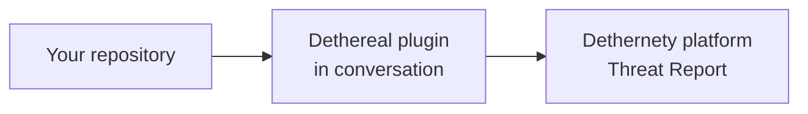

# Quick Start

This guide takes you from nothing to your first threat model on the platform. You install the plugin in your harness, sign in, point the assistant at a repository, answer a few checkpoint questions, and publish the model to the platform — where you run the **Threat Report**. It assumes a Dethernety platform is already running.



---

## What you will do

1. Install the plugin for your harness.
2. Sign in to the platform.
3. Threat-model a repository in conversation.
4. Publish the model to the platform.
5. Open it on the platform and run the **Threat Report**.

**Time to allow.** About 15 minutes, assuming the platform is already running. Most of that is the assistant's discovery-and-enrichment pass over your repository.

---

## Before you start

| You need | Details |
|---|---|
| **A running Dethernety platform** | On this machine (`http://127.0.0.1:3000`) or on another host reachable over HTTPS. Don't have one? See the platform [Quick Start](../QUICK_START.md). |
| **Node.js 20.11.1 or later** | The plugin's server needs it; the plugin will not install or start on an older Node. |
| **One harness, at its minimum version** | Install the plugin into one of the harnesses below. |

| Harness | Status | Minimum version |
|---|---|---|
| Claude Code | Stable | 2.1.295 |
| Codex | Experimental | 0.157.0 |
| OpenCode | Preview | 1.18.32 |

The commands below use the Claude Code form `/dethereal:<command>`; on **Codex** type `$dethereal:<command>`, and on **OpenCode** `/dethereal-<command>`. Before you use OpenCode, read its [known issues](README.md#known-issues-on-opencode).

---

## Install

Install the plugin for one harness with the installer:

```bash
npx @dether.net/dethereal install --harness claude --scope user
```

For another harness, change the `--harness` value:

| Harness | `--harness` | Notes |
|---|---|---|
| Claude Code | `claude` | — |
| Codex | `codex` | Codex asks you to trust the plugin's hooks before they run |
| OpenCode | `opencode` | Read the [known issues](README.md#known-issues-on-opencode) first |

`--scope user` installs the plugin for all your projects; start a new session in the harness after installing. For all install options, see [install options](GETTING_STARTED.md#codex-and-opencode).

---

## Sign in

Run `/dethereal:login`. It opens a sign-in in your browser:

```
> /dethereal:login

Signed in (signed in).
Platform:     https://dethernety.example.com
Account:      user@example.com
Valid for:    60 minutes
```

If the sign-in window hadn't finished when the command returned, it prints a URL to open; open it, sign in, then run `/dethereal:login` again. (If the platform runs with auth disabled, no sign-in is needed.)

---

## Threat-model a repository

From inside a checked-out repository, run:

```
> /dethereal:threat-model
```

You can add a one-line system description after the command, but you don't need a model first — `threat-model` creates one, and its discovery pass scans the whole codebase. A newly created model is a **quick model** by default: a shorter first pass you can deepen later with `--full`.

The assistant then walks you through a few checkpoints. You answer or correct each one:

- A **scope** question (free text): the system's crown jewels, what you trust, which adversaries to consider, anything out of scope, and compliance.
- The assistant scans the repository and shows the **discovered structure** — components, boundaries, data flows — for you to **confirm or adjust**.
- A few **class and boundary** questions to confirm.

When the model is ready to publish, the plugin asks for your consent:

```
Model passed Gate 2 and is ready to publish to <platformUrl>. Push to platform now? (push / skip)
```

Answer `push`. The plugin publishes the model and confirms:

```
Pushed "<model-name>" to platform.
  <N> boundaries, <M> components, <K> flows, <J> data items.
  Platform model ID: <id>

Server IDs written to local files.
Commit these changes to preserve sync state.
```

**Which repository?** There's no bundled sample, so use a repository of your own. A good first choice is a small service whose repo includes its infrastructure (Terraform, Kubernetes manifests, or a Dockerfile and compose file), so the discovery scan has something concrete to find.

---

## See it on the platform

Open the platform in your browser (`http://127.0.0.1:3000`, or your platform URL) and find the model — it's there now. Open it, then run the **Threat Report**: click **Analyses** (the sparkle icon), **New Analysis**, **Threat Report**, **Run**, then **View results**.

For the details, see the platform [Quick Start — Run the Threat Report](../QUICK_START.md#run-the-threat-report) and [Reading the Report](../threat-report/READING_THE_REPORT.md).

---

## Next steps

- **Deepen the model:** run `/dethereal:threat-model --full` to re-enrich and run the full review (Gate 3). See [The 11-Step Guided Workflow](GUIDED_WORKFLOW.md).
- **See the attack surface:** run `/dethereal:surface` for components, trust-boundary crossings, exposures and control coverage (read-only).
- **[Getting Started](GETTING_STARTED.md)** — the complete install, authentication, and first-model reference.
- **[The 11-Step Guided Workflow](GUIDED_WORKFLOW.md)** — the full process from scope to sync.
